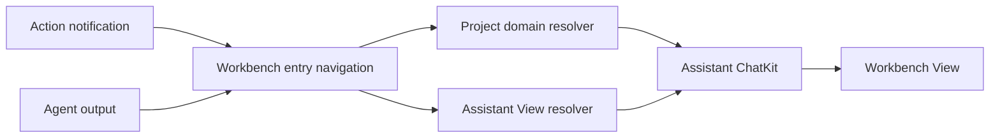

# Workbench entry navigation in Bosi and Cloud

Notifications carry a shared `WorkbenchEntryTarget`. Human action notifications and agent output items both delegate to the host's Workbench entry navigation. Delivery/read state, business action policy, destination resolution and View rendering remain separate.

## Extension contract

- `workbench.view` identifies an Assistant, explicit organization or tenant scope, optional Project (`null` means no Project), exact public `viewKey`, optional `selectionId` and bounded scalar/array `parameters`. Any declared Workbench View can use this target; adding another plugin View does not change notification UI, IPC dispatch or ChatKit mounting.
- `project.pipelines` is a domain intent that resolves its Assistant and View through the Project query. It retains the exact instance/round/node reference. This adapter is separate from the general Assistant View resolver.
- `WorkbenchEntry` is the credential-free resolution result: canonical Assistant, scope and View location. It grants no business/resource access.
- A new domain intent requires an explicit shared discriminator/schema and host adapter. Do not infer target kinds from labels, View key names or incidental fields, add an open-ended URL/command payload, or place business rules in the notification component.
- View parameters are navigation state, not credentials or confidential content. Cloud persists them in its established Workbench URL state. Limits are 50 keys, 100 array elements, 4,000 characters per scalar string and 12,000 serialized parameter characters.



Desktop uses `resolveWorkbenchEntry` with adapters in `electron/workbench-entry.cjs`. Cloud uses `WorkbenchEntryNavigation` in core services, independent of notification components. New Views reuse the `workbench.view` adapter and existing View registry; no new SDK capability or dynamic service locator is introduced.

The Assistant resolver lives under `xpert/workbench-navigation/queries`. It checks published runtime access (or exact Project binding), canonical identity and the currently enabled `agent.workbench` manifest. Feature activation and per-action authorization remain in their existing owners. Non-Project Views and tenant-scoped Views use the same scoped ChatKit session path. Every credential renewal re-resolves the current destination; an unavailable or revoked View fails instead of selecting a different Bot.

## Protocol compatibility

`xpert-notifications-v3` opts into generic Workbench targets. v2 receives Project pipeline actions only; legacy output clients receive their existing notification kinds. List, pending counts and read responses respect the negotiated target support. Updated clients try v3, then v2, then the output profile, retaining the negotiated profile for pagination and reads. This prevents unsupported targets from breaking an older client's entire snapshot.

Business sources remain responsible for resolving current presentation and resource access before a notification is listed or clicked. Marking a notification read does not approve or complete the action.

## Ownership and routing

| Entry                                                     | Desktop behavior                                                                                                  |
| --------------------------------------------------------- | ----------------------------------------------------------------------------------------------------------------- |
| Notification `workbench.view`                             | Resolves the enabled Assistant View and opens scoped ChatKit with selection and parameters.                       |
| Notification `project.pipelines`                          | Resolves the authorized Assistant, opens its Project-scoped ChatKit and focuses the project tasks Workbench View. |
| ChatKit `workbench.navigation.open` → `project.pipelines` | Uses the same host resolver, retaining the active Workbench organization or tenant scope.                         |
| `assistant.conversation` / `assistant.project`            | Existing authenticated ChatKit navigation, with the originating Project scope retained for delegated entries.     |
| `workbench.view`, file previews and execution inspection  | ChatKit Workbench handles the declared View commands.                                                             |
| `project.application`                                     | Existing configured platform route; distinct from pipeline management.                                            |
| Other platform management routes                          | Existing allowlisted external navigation.                                                                         |

The former independent ProjectPanel and Project remote-frame request bridge have been removed. Assistant profile Views and the personal Event Inbox retain their existing host.

## Resolution and access

- For Project intents, `ProjectPipelineWorkbenchQuery` belongs to the Project query layer. It authorizes the Project before reading a focused instance, its selected round/run and the exact node. It resolves explicit Assistant participants in that run's saved bindings to their current published identity. An unfocused entry uses the Project's assigned Assistants.
- Resolution requires one unique canonical Assistant. Missing, unbound, unpublished, ambiguous or provider-managed focused destinations report unavailable. There is no role-name heuristic, first-Bot fallback or automatic permission change. Multiple distinct Assistants require an explicit entry policy before this route can choose between them.
- Project-based Assistant authorization is independent of ordinary Bot catalog visibility. A Project entry can therefore open an authorized Assistant absent from the sidebar without adding it to the catalog or changing the saved ordinary conversation.
- An explicit organization must be known to the authenticated profile. Explicit `organizationId: null` selects tenant scope; only an omitted scope inherits the profile. Resolution, credential renewal and delegated conversation navigation retain that scope without replacing the sidebar organization.
- Short-lived ChatKit credentials are issued by the existing session endpoint, which rechecks Project membership and the exact Assistant binding. Renewals re-resolve the destination and reject a changed source Assistant. Account credentials never enter the Remote View.
- Workbench focus carries `initialTab`, `pipelineInstanceId`, `pipelineRoundId` and `pipelineNodeId`. Repeated clicks in the same Assistant/Project/organization update the navigation request without resetting the conversation. Account changes and newer user choices invalidate pending navigation.
- Opening a notification does not send a chat message, start a model run or approve, reject, install, publish or complete the source action. Each business action retains its server authorization.

## Validation

```sh
node --experimental-strip-types --test apps/desktop/tests/workbench-entry.test.cjs apps/desktop/tests/project-workbench.test.cjs apps/desktop/tests/workbench.test.cjs apps/desktop/tests/workbench-handler.test.cjs apps/desktop/tests/last-session-ui.test.cjs apps/desktop/tests/chat-presentation.test.cjs apps/desktop/tests/assistant-profile.test.cjs apps/desktop/tests/user-notifications.test.cjs apps/desktop/tests/i18n.test.cjs
corepack pnpm --dir apps/desktop exec tsc --noEmit
corepack pnpm exec jest --config packages/server-ai/jest.config.ts --runInBand --runTestsByPath packages/server-ai/src/xpert-project/pipeline/queries/pipeline-workbench-navigation.query.spec.ts packages/server-ai/src/xpert-project/pipeline/queries/pipeline.controller.spec.ts
```

The regression covers exact target validation, ambiguous/removed bindings, current published aliases, Project permission revocation, Assistants outside the Bot catalog, tenant and cross-organization scopes, credential renewal, delegated execution conversations, repeat clicks and stale navigation. Native acceptance evidence is recorded separately from automated tests.

Generic View regression additionally covers independent business View keys, null Project scope, tenant scope, disabled/revoked Views, canonical aliases, contract/IPC parser parity, repeated focus with current-source renewal and v3/v2/output protocol negotiation. These cases are automated; the prior native pipeline-navigation evidence does not claim native coverage of every future View.
