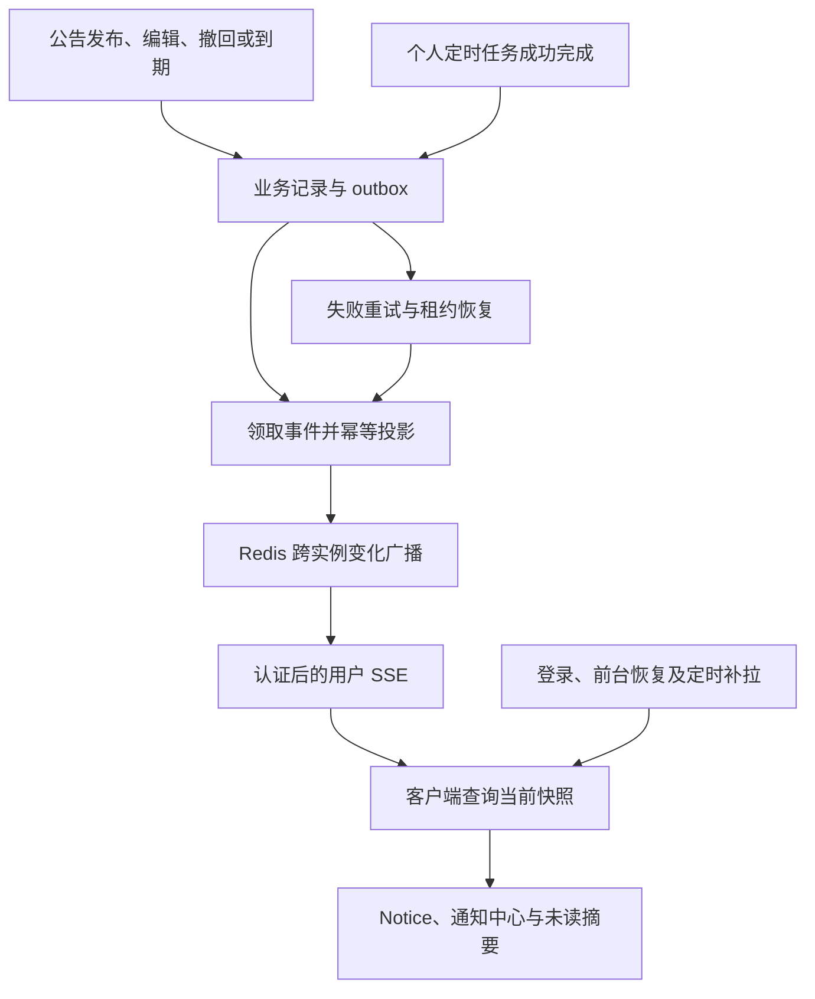

# 公告与用户实时通知

用户于 2026-10-31 完成本地验收。本文描述已实现的公告、Web/Bosi 通知、个人定时任务结果通知及公共日期时间组件；生产部署和客户端发布按发布流程单独进行。

需求来源：[xpert #1265](https://github.com/xpert-ai/xpert/issues/1265)。通知功能默认开启，无需增加环境配置。

## 使用公告管理

具有 `ANNOUNCEMENT_MANAGE` 权限的用户可以从 Web 设置进入“公告”，页面路径为 `/settings/announcements`。该权限默认授予 `SUPER_ADMIN`；管理接口仍在服务端校验权限和当前租户。

1. 点击“新建公告”，在 Dialog 中填写标题、正文、类别、重要程度、适用客户端及生效时间。
2. 使用预览检查内容，保存为草稿。保存本身不会发布。
3. 在列表中发布草稿。开始时间已到则立即生效，否则到时间后生效；设置失效时间后，到点自动退出待展示列表。
4. 可以编辑已发布公告的内容、时间和动作链接。已发布公告不能改变适用客户端；需要更改受众或重新触达时，复制为新公告后发布。
5. 撤回后，普通用户不再看到该内容。管理员仍可查看审计记录。

| 字段       | 约束与行为                                                       |
| ---------- | ---------------------------------------------------------------- |
| 标题       | 必填，最多 160 字符                                              |
| 正文       | 必填，最多 20,000 字符；支持行文本、一级到三级标题及简单列表标记 |
| 类别       | 一般公告、维护通知、模型下线，使用 Radio Group 单选              |
| 重要程度   | 普通、重要，使用 Radio Group 单选；影响展示顺序与标记            |
| 适用客户端 | Web、Desktop，至少一个；发布后固定                               |
| 生效时间   | 必填；表单按当前设备时区选择，提交为带时区的 ISO 时间            |
| 失效时间   | 可选，必须晚于生效时间；可清除                                   |
| 动作链接   | 可选；名称最多 80 字符，URL 最多 2,048 字符且必须为 HTTPS        |

正文通过文本插值渲染，不执行 HTML，不加载正文中的外部图片；不是完整 Markdown 渲染器。需要可点击的外部入口时使用独立动作链接。

保存期间禁用重复提交和关闭 Dialog；保存失败保留填写内容并显示错误。并发编辑由 `revision` 控制，过期修订返回 409，重新加载后再编辑。

数据库状态为 `draft`、`published`、`withdrawn`。列表中的“待生效”“生效中”“已过期”由已发布状态与起止时间推导。编辑、发布和撤回生成新的修订与审计记录，审计保存操作者和当时的内容。

## 用户如何收到通知

### 公告 Notice 与历史

- Web 与 Bosi 在界面右上角显示 Notice 卡片。自动展示无遮罩、不模糊背景、不抢输入焦点，也不按短计时自动消失。
- 卡片默认显示标题和三行正文摘要；“查看详情”在卡片内展开，长内容可滚动。用户主动打开的通知中心及历史详情使用 Dialog。
- 同时自动展示一张公告。已有 Dialog 或客户端关键流程占用界面时延后展示；关闭后不会立即连续替换为当前快照中的其他公告，剩余内容可从通知入口查看。
- 关闭针对公告稳定 ID，不针对修订号。编辑同一公告不会让已关闭用户再次收到自动展示；新公告拥有新 ID，可以重新触达。
- 关闭记录按租户、用户、公告唯一，服务端同步后两端都不再自动展示。离线和并发场景允许短暂不同步。
- 关闭时立即隐藏本地卡片，失败请求进入当前账号的本地重试队列。Web 使用浏览器存储，Desktop 使用主进程持久化存储；恢复后补交服务端。
- 历史保留当前租户、适用客户端、已生效且未撤回的公告，包括已关闭和已过期内容。尚未生效及撤回内容不向普通用户展示。

公告面向当前租户全员，仅区分适用客户端。没有跨租户平台广播，也没有按组织、模型或任意用户名单定向发布的管理能力。

### 定时任务结果

当前唯一的 Agent 生产入口是**个人定时任务成功完成**。执行存储将状态从 `RUNNING` 转为 `SUCCEEDED` 时，在同一事务内检查接收者并写通知 outbox：

- 任务有 `runAsUserId` 和 Assistant，且不是 Project 任务。
- 接收者属于同一租户，是普通用户身份；存在组织时仍为有效成员。
- 结果会话属于该用户、同一租户和 Assistant，且会话已经 `idle`。
- 幂等键为 `scheduled:<executionId>:completed`，重复完成处理不会增加重复通知。

通知类型为 `agent.completed`，来源保存 task、execution、Assistant 和 conversation 标识。客户端通过 `open_conversation` 语义动作打开结果，不把具体 Web URL 存入事件。

新产生的任务结果可以显示轻提示；用户正在查看对应会话时抑制额外提示。登录或断线后的补拉更新列表和数字，不逐条补弹历史任务结果。读取结果通知使用独立 `readAt`，不会推进聊天消息的阅读游标，也不会重新执行任务。

当前通知入口数字来自摘要中的未关闭公告及未读任务结果，摘要每类最多 30 条。它不是全量聊天未读计数，也不是完整历史总数；历史列表支持继续加载。

## 实时机制与恢复

数据库中的公告、关闭记录和任务通知是权威状态。Redis Pub/Sub 与 SSE 只发送变化提示，提示不包含通知正文、聊天内容或长期凭据。事件丢失或重复由快照查询修复，不使用游标增量协议。

| 环节         | 当前实现                                                                                 |
| ------------ | ---------------------------------------------------------------------------------------- |
| outbox 领取  | 每秒检查一次，每批最多 20 条；`SKIP LOCKED` 加 30 秒租约，支持多 API 实例竞争            |
| 投影与广播   | 先幂等生成用户通知，再广播变化；广播失败可以重试，不重跑业务任务                         |
| 重试         | 指数退避，最长 5 分钟；累计 20 次失败进入 `blocked`，管理员可以重新排队                  |
| 定时公告     | 发布或修改时间时写入持久化起止事件；触发前重查状态、修订和时效，跳过旧版本调度           |
| SSE 变化合并 | 服务端每 250ms 合并当前用户可见的变化，连接建立后先发一次同步提示                        |
| 心跳与认证   | 每 25 秒心跳并检查用户存在性/类型；连接最长 60 秒，或随 JWT 更早到期而结束，重连重新认证 |
| 连接上限     | 每个 API 实例中，同一租户/用户最多 8 条连接，超过返回 429                                |
| 客户端恢复   | 登录、重连提示、恢复前台及作用域变化触发补拉；90 秒定时校准；重连指数退避加抖动          |
| 数据保留     | 每小时清理已发送超过 7 天的 outbox、超过 90 天的任务通知；任务查询也限制最近 90 天       |

90 秒是兜底校准间隔，并非请求频率上限；变化和重新认证后的首次提示也会触发查询。公告关闭记录及审计不随短期传输数据清理。

Desktop 在 Electron 主进程持有认证信息、维护连接和关闭重试，渲染进程只通过受控 IPC 接收结构化数据。原有 15 秒 Assistant 活动刷新保留，因为通知事件尚未覆盖所有聊天变化。

账号、租户、组织或服务地址变化会取消旧连接，清空当前视图并丢弃晚到响应。通知接口返回 404 时，客户端兼容旧服务端，停止本功能重试并隐藏入口；服务端升级后，重载、重新登录或切换作用域可重新探测。没有通知启用环境开关。

App 完全退出、操作系统休眠或没有网络时，SSE 不提供即时触达保证。重新打开后查询持久化结果。本期没有系统通知、Web Push 或移动 Push。

## 身份、权限和数据边界

- 用户与租户来自受信任的 `RequestContext`，请求不能指定其他用户或租户作为作用域。
- 通知 API 拒绝通信技术账号和 client-secret principal。管理操作额外检查 `ANNOUNCEMENT_MANAGE`。
- 用户通知的查询和阅读重新通过 `AssertChatConversationAccessQuery` 检查来源会话，并检查当前组织成员关系。失去访问权的内容不继续出现在列表中；无权阅读的 ID 返回不可用。
- 公告操作与修订审计、相关 outbox 写入在事务内完成；任务成功状态与完成事件也在同一事务内提交。事务失败不产生成功通知。
- 公告关闭、通知阅读、渠道投递成功和业务操作完成具有不同语义，不能互相替代。
- SSE 只提示客户端重新查询；接收提示不授予内容访问权，打开实际资源仍执行该资源的授权。

新权限写入数据库后，已有登录会话可能仍使用旧权限。遇到“没有执行通知的权限”，先核对当前租户角色的 `ANNOUNCEMENT_MANAGE`，再重新登录更新会话。不能仅凭账号邮箱判断有管理权限。

## 数据与 API

### 持久化表

| 表                       | 用途与关键唯一约束                                          |
| ------------------------ | ----------------------------------------------------------- |
| `announcement`           | 公告正文、受众、状态、修订和起止时间                        |
| `announcement_dismissal` | 关闭记录；唯一 `(tenantId, userId, announcementId)`         |
| `announcement_audit`     | 操作人与内容快照；唯一 `(announcementId, revision)`         |
| `user_notification`      | 用户结果通知与阅读时间；唯一 `(tenantId, userId, eventKey)` |
| `notification_outbox`    | 可靠事件、领取租约、重试状态；唯一 `(tenantId, eventKey)`   |

### 接口

以下路径均在 `/api` 下。分页默认 `offset=0&limit=30`，`limit` 为 1–100；未知 query/body 字段由严格 Zod schema 拒绝。`client` 仅允许 `web`、`desktop`。

| 方法与路径                                    | 用途                                       |
| --------------------------------------------- | ------------------------------------------ |
| `GET /announcement-admin`                     | 分页管理列表                               |
| `POST /announcement-admin`                    | 创建草稿                                   |
| `PATCH /announcement-admin/:id`               | 完整内容及 `revision` 更新                 |
| `POST /announcement-admin/:id/publish`        | 发布；body 为 `{ revision }`               |
| `POST /announcement-admin/:id/withdraw`       | 撤回；body 为 `{ revision }`               |
| `GET /announcement-admin/:id/audit`           | 审计历史                                   |
| `GET /announcements/pending?client=web`       | 当前待展示公告，最多 30 条                 |
| `GET /announcements/history?client=web`       | 分页公告历史                               |
| `GET /announcements/:id?client=web`           | 当前有权查看的公告详情                     |
| `PUT /announcements/:id/dismissal`            | 幂等关闭                                   |
| `GET /user-notifications`                     | 分页任务结果，含 `hasMore` 和 `nextOffset` |
| `GET /user-notifications/sync?client=web`     | 公告与任务通知摘要                         |
| `GET /user-notifications/stream`              | 认证后的 SSE 连接                          |
| `PUT /user-notifications/:id/read`            | 标记任务结果已读                           |
| `GET /notification-delivery-admin`            | 当前租户投递状态与本实例连接数             |
| `POST /notification-delivery-admin/:id/retry` | 将当前租户 blocked 事件重新排队            |

快照含 `supported: true`、内容哈希 `version`、`announcements`、`notifications`、`hasMoreAnnouncements` 和 `hasMoreNotifications`。`version` 用于内容比较，不是可供增量回放的数据库游标。

SSE 的 `change` 数据为 `{ schemaVersion: 1, type: 'sync.required', eventId }`；`heartbeat` 不触发内容查询。常见错误为 400 `NOTIFICATION_INVALID`、403 `NOTIFICATION_DENIED`、404 `NOTIFICATION_UNAVAILABLE`、409 `NOTIFICATION_CONFLICT`、429 `NOTIFICATION_BUSY`。

## 公共日期时间组件

公告编辑使用 `@xpert-ai/headless-ui` 的 `ZardDateTimePickerComponent`（`z-date-time-picker`），源码位于 [packages/ui 日期时间组件](../packages/ui/src/lib/components/date-time-picker/)。它组合 Zard Calendar、Popover、Button、Input 与独立的 `ZardTimeDialComponent`，可供其他业务复用。

- 同一面板选择日期及 24 小时时间；时钟为内外双圈，选完小时自动进入分钟。
- 支持点击、拖动、精确到一分钟、方向键微调及手动 `HH:mm` 输入。
- 弹层中的更改是草稿，确认后回填；Escape 丢弃草稿并恢复焦点。窄屏自动上下布局，操作栏保持可达。
- Calendar 日期格高 44px、日期与星期字号 14px，网格填满左侧；内容区与底部操作栏分别处理间距。
- 支持 Reactive Forms、`ngModel` 或 `[(value)]`，同一个实例选择一种绑定方式。值为本地时间 `YYYY-MM-DDTHH:mm`；空值为 `''`，兼容表单 reset 写入 `null`。
- 禁用状态合并表单与组件输入，并关闭已打开弹层。UTC 转换、开始/失效关系等业务校验仍由消费页面负责。
- 通用文案来自 UI 包的 `xp-ui:dateTimePicker.*` 中英繁体资源；Cloud 直接加载 UI 包资源，不再维护覆盖它的重复副本。字段名与业务清除文案由调用者传入。

完整 API 和接入示例见 [UI 包 README](../packages/ui/README.md#date-and-time-picker)。公告管理页采用 Zard UI；“新建公告”按钮为 `lg`，新建和编辑共用 Dialog，类别与重要程度采用 Radio Group。

## 迁移与运维

迁移组件为 `ai.user-notifications`，编号 `20261031010000`，见 [迁移 SQL](../packages/server-ai/src/user-notification/migrations/20261031010000-user-notifications.sql) 和 [只读 checks](../packages/server-ai/src/user-notification/migrations/checks/20261031010000-user-notifications.sql)。五张表已登记到 [数据库迁移清单](../.deploy/api/database-migrations.json) 的 managedTables；迁移幂等补充已有 `SUPER_ADMIN` 的管理权限。

按[统一数据库迁移流程](./development/database-migrations.md)先应用并验证结构，再运行对应 API/Web/Desktop 构建。功能默认启用，复用现有 PostgreSQL、Redis 和认证配置。

代理需要允许 SSE 持续连接并禁用响应缓冲；接口设置 `Cache-Control: no-store` 和 `X-Accel-Buffering: no`。发布后检查代理链路中的实际连接、重连和跨实例通知，不能只检查 API 健康状态。

投递管理接口提供 pending 数、已到期数、最早到期时间、最多 50 条 blocked 记录，以及当前实例的租户连接数。服务内部另有连接、变化、Redis 失败、发送和重试计数；当前没有完整 Prometheus 面板或生产延迟/容量基准。

遇到未送达时，检查公告是否已发布、起止时间、当前租户、适用客户端和关闭记录；任务通知还需核对是否满足个人定时成功条件及来源授权。Redis 提示失败时保留持久化事件并重试；被阻塞的事件可通过管理接口重排，不删除业务记录或重跑任务来修复通知。

## 后续接入边界

当前只实现 Web/Desktop 应用内通知及个人定时任务成功入口。后台 Agent 任意 message、失败、等待输入、Project 任务、桌面系统通知、移动 App、飞书、企业微信、微信、邮件和复杂偏好尚未接入。

未来扩展遵循以下分层，避免把客户端类型与发送渠道混为一谈：

| 概念           | 已有与后续职责                                                                                     |
| -------------- | -------------------------------------------------------------------------------------------------- |
| 应用客户端     | 当前 `web`、`desktop`；未来移动端扩展显式客户端契约。飞书、微信不能直接加入 `announcement.clients` |
| 逻辑通知       | 稳定事件、来源、接收者与语义动作；一个事件不会因为多个渠道而复制为多条业务事实                     |
| 投递渠道       | 应用内、系统 Push、具体第三方消息产品分别处理在线生命周期、格式与回执                              |
| 接收目标       | 设备或绑定的外部账号/会话，必须明确租户、用户、integration/应用、状态及绑定版本                    |
| 阅读与业务状态 | 与投递接受、送达、失败、取消及未知结果分别记录                                                     |

共享契约已有 `NotificationDestination` 和 `NotificationDeliveryState` 类型；外部 Destination、逐目标 Delivery、订阅偏好和设备注册尚未落表，没有空的渠道适配器或公开 SDK 通知能力。

首个外部需求落地时再增加逐目标投递账本、最小启用/撤销偏好和实际适配器。优先评估现有 `IChatChannel` / `ChatChannelRegistry`、Integration 与外部身份绑定能力，发送前重查当前接收者、绑定版本和内容权限。不能根据昵称推断身份，不能因绑定过账号就自动转发所有通知，不能把个人通知默认发送到群。

第三方超时可能对应“已接收但结果未知”，仅在支持稳定幂等键或查询结果时自动恢复；外部失败不应阻塞应用内收件箱。解绑、重绑、集成停用和设备失效须使旧目标失效。回调需要供应商认证与防重放，第三方已读不代表业务审批完成。

移动 App 前台可复用查询和同步；后台/退出后的触达需要独立 Push 及设备注册。微信接入前明确具体产品（桥接、公众号、小程序、企业微信等），分别核对授权、主动发送与回执能力。实施时再核对供应商当前规范。

关联需求继续独立推进：[#1266 模型批量替换](https://github.com/xpert-ai/xpert/issues/1266)、[#1250 Web 版本感知](https://github.com/xpert-ai/xpert/issues/1250)、[#1207 滚动重启](https://github.com/xpert-ai/xpert/issues/1207)、[#416 指标通知与审批](https://github.com/xpert-ai/xpert/issues/416)、[#1176 模型异常反馈](https://github.com/xpert-ai/xpert/issues/1176)、[#1247 模型类型区分](https://github.com/xpert-ai/xpert/issues/1247)。这些是原需求调查中的关联项，不表示本功能已实现或关闭它们。

## 验证与验收记录

2026-10-31，用户在本地 Web/Bosi 测试并逐项调整 Notice、公告 Dialog、Radio Group、日期时间钟盘及公共 UI 归属后，明确回复“我验收通过”。计划据此转为本文，并与实现一起提交。测试与验收不表示已经生产发布。

| 已完成验证                | 结果与范围                                                                                                                     |
| ------------------------- | ------------------------------------------------------------------------------------------------------------------------------ |
| PostgreSQL/Redis 与调度器 | 14/14；隔离 PG 15、Redis、两个 Nest HTTP 实例，覆盖迁移、权限、过滤、关闭、修订、时效、事务、租约、失败重试、SSE 及默认启用    |
| Web 状态与界面            | 公告表单、Notice、通知服务三个套件 13/13；涵盖作用域切换、晚响应、关闭重试、旧服务端与通知提示                                 |
| 公共 UI                   | 日期时间、钟盘及 Dialog 弹层三个套件 10/10；包括表单绑定、草稿确认、指针与键盘、禁用及嵌套焦点                                 |
| Desktop                   | 全量 462/462；后续通知、服务、启动与会话 UI 定向回归 41/41                                                                     |
| 构建与类型                | contracts 构建；common/config/server-ai 类型检查；Cloud/UI Angular 类型与模板检查；UI 包及三语资源构建；Desktop 类型与前端构建 |
| 浏览器与原生 App          | 本地公告发布和 Bosi 接收；Notice 长文、暗色、展开与关闭；Dialog、Radio Group、Calendar/Clock、中文资源及焦点恢复               |

集成测试通过已认证身份夹具及可拒绝访问的来源授权夹具验证模块边界。真实 LLM 定时任务的全程执行、生产代理滚动重启、生产连接容量/P95 延迟、移动 Push 和外部账号发送不在已完成验证范围。

## 代码入口

| 入口                             | 位置                                                                                                  |
| -------------------------------- | ----------------------------------------------------------------------------------------------------- |
| 共享 schema 与扩展类型           | [user-notification.schema.ts](../packages/contracts/src/user-notification.schema.ts)                  |
| 公告服务与接口                   | [announcement/](../packages/server-ai/src/announcement/)                                              |
| 通知、outbox、worker、SSE 和迁移 | [user-notification/](../packages/server-ai/src/user-notification/)                                    |
| 个人定时任务事件生产             | [scheduled-task-notification.ts](../packages/server-ai/src/xpert-task/scheduled-task-notification.ts) |
| Web 状态同步                     | [user-notifications.service.ts](../apps/cloud/src/app/@core/services/user-notifications.service.ts)   |
| Web 公告管理                     | [announcements/](../apps/cloud/src/app/features/setting/announcements/)                               |
| Web Notice 与中心                | [notifications/](../apps/cloud/src/app/@shared/notifications/)                                        |
| Desktop 主进程                   | [user-notifications.cjs](../apps/desktop/electron/user-notifications.cjs)                             |
| Desktop 展示                     | [notifications/](../apps/desktop/src/notifications/)                                                  |
| 公共日期时间组件                 | [date-time-picker/](../packages/ui/src/lib/components/date-time-picker/)                              |
