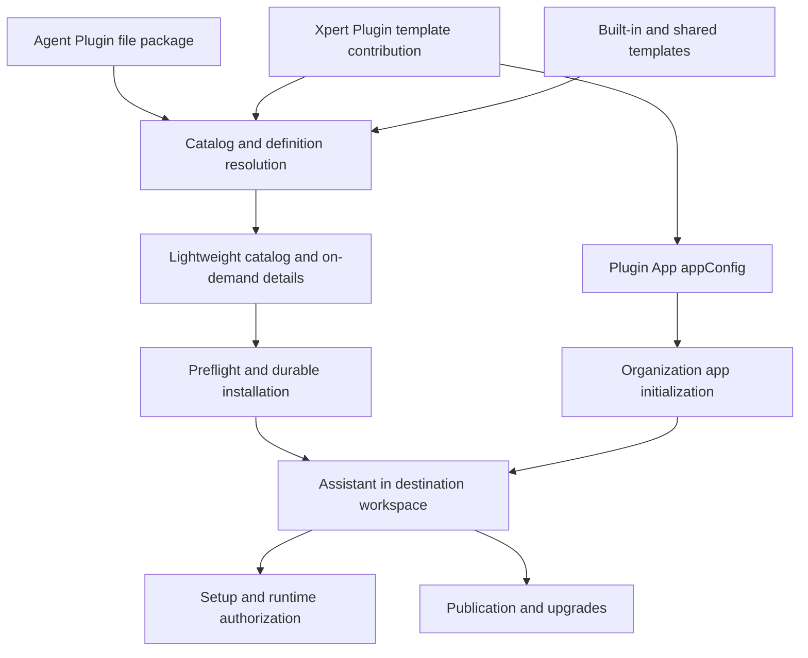

Web and Desktop share server definitions, preflight checks, installation records, and lifecycle services. Clients present information and collect configuration; the server determines access, resolved sources, installation progress, and execution readiness. See the [feature guide](/en/guides/assistant-templates) and [authoring guide](/en/guides/assistant-template-authoring).

## Sources and layers

An Agent Plugin is a file resource package that does not load NestJS modules. A native Xpert Plugin can implement server functionality. A Plugin App is a native plugin's application initialization declaration referencing templates and business resources. An Assistant Template is a portable definition distributable through either package; an Assistant is its workspace instance.

`AssistantTemplateDefinition` extends `TXpertTeamDraft` with top-level `memories` and `template` metadata. `template.dependencies` holds source selectors; manifest v2 holds initialization and additional execution requirements. Parsing normalizes compatible legacy definitions and checks contradictions. Details, preflight, and installation consume the same normalized definition.

## Catalog flow and performance

Agent Plugin import generates and persists `templateCatalog` summaries. The first read validates and backfills legacy packages. Summaries project display fields only, excluding DSL, initial file content, full dependencies, manifests, and appConfig. Native-template presentation projections are cached by content digest and language, up to 512 entries; authorization decisions are not cached there.

Sorting occurs before slicing: `agent-plugin → plugin → builtin → shared → other`, preserving relative order within each source. The server currently aggregates a lightweight catalog before filtering and slicing; this is not database pagination. `hasApplication` helps clients exclude app-associated content. Source and category counts reflect the visible Assistant catalog.

The default page size is 48. Desktop emits the first batch before fetching subsequent pages; Web initially presents 24 cards and supports showing more. Later failures preserve received content. Organization or language changes invalidate stale responses.

The authenticated `catalog-avatar/:id` endpoint returns JSON `{ url }`, which may contain an image data URL. Clients fetch through authenticated HTTP as cards approach the viewport. References incorporate version digests to avoid reusing stale images. This is not a public static-file endpoint. A single-avatar lookup must not persist an incomplete multi-template catalog map.

### Local performance baseline

Measurements on 2026-10-14 used the same authorized test environment: 210 raw Chinese catalog entries, 199 Assistant entries, including 90 Agent Plugin templates.

| Metric                                    | Before                  | After                     |
| ----------------------------------------- | ----------------------- | ------------------------- |
| Desktop full-catalog fetch median, 3 runs | 9.056 s                 | 1.147 s, down 87.3%       |
| First available data                      | Wait for full catalog   | 48 entries in 225–230 ms  |
| Full-catalog JSON                         | 19,744,736 bytes        | 116,466 bytes, down 99.4% |
| First-page JSON                           | Not measured separately | 30,193 bytes              |
| First summary request after API restart   | Not measured separately | 481 ms                    |
| First legacy-summary backfill             | Not measured separately | 3.49 s, one-time cost     |

These measure fetching, response reading, and projection, not first paint, DOM rendering, WAN latency, or a production SLA. Baseline and optimized evidence are retained separately. Catalog counts are not fixed product metrics.

## Durable installation state machine

`publish` controls whether publication occurs. Status is separate from stage: `running`, `interrupted`, `failed`, or `succeeded`. Input includes `idempotencyKey`, `templateId`, and `workspaceId`, with optional basic configuration, locale, and capability selections.

Reuse a key only for the same installation intent. Retry reads persisted server input and reuses the Assistant, dependencies, and initialization progress; it does not accept replacement configuration in its request body. New intent requires a new key. Restart recovery recognizes interrupted work. A changed source returns `SOURCE_CHANGED` rather than continuing against new content blindly.

Public receipts include `assistantId`, `stage`, `attempt`, `retryable`, dependency locks, and resource-installation records. They exclude stored input, source files, credentials, and raw execution exceptions. `pendingAuthInstallationIds` is an installation-time snapshot; live setup and runtime checks determine current connection readiness.

## Dependencies, setup, and access boundaries

Native resource locks record plugin versions, component digests, and providers. Agent Plugin locks additionally record package name, digest, binding ID, and binding version. Sources are pinned before Assistant creation; details, installation, and execution recheck visibility and enabled state.

Authentication, tenant, organization, destination edit access, and published-Assistant use access are separate checks. Missing organization context must not be misdiagnosed as an account permission failure. A business workspace's organization does not change a native plugin's system/tenant installation requirements.

Onboarding revisions are stored per user and Assistant. Connectors reference authorized connections without writing credentials into prompts, preferences, or manifests. Volume enforces user/shared file scope, containment, and `create-only` behavior.

Tool-level operation policies decide allow, approval, or denial before handler invocation. Background work uses the same rules. Explicit first configuration creates a personal routine; enabling it is separate. Server tasks cannot execute local-only capabilities. Activities and per-user unread state are durable. Event triggers remain unsupported.

## API entry points

Paths below include `/api`. All require appropriate identity and scope checks. Encode IDs used as path segments.

| Method and path                                                                                                    | Purpose                                                                                   |
| ------------------------------------------------------------------------------------------------------------------ | ----------------------------------------------------------------------------------------- |
| `GET /api/xpert-template/catalog`                                                                                  | Summary list with `offset`, `limit`, `search`, `category`, `pluginName`, `assistantsOnly` |
| `GET /api/xpert-template/catalog-avatar/:id`                                                                       | Authorized avatar projection                                                              |
| `GET /api/xpert-template/:id`                                                                                      | Full template details                                                                     |
| `GET /api/xpert-template/:id/overview`                                                                             | Four capability sections                                                                  |
| `GET /api/xpert-template/:id/setup`                                                                                | Workspace-aware model, capability, and dependency preflight                               |
| `POST /api/xpert-template-installations`                                                                           | Create or reuse an installation, HTTP 202                                                 |
| `GET /api/xpert-template-installations`                                                                            | Accessible installation records                                                           |
| `GET /api/xpert-template-installations/:id`                                                                        | Installation receipt                                                                      |
| `POST /api/xpert-template-installations/:id/retry`                                                                 | Retry persisted intent, HTTP 202                                                          |
| `GET /api/xpert/:id/template-setup`, `PUT /api/xpert/:id/template-setup`                                           | Read and save instance setup                                                              |
| `PUT /api/xpert/:id/template-setup/routines/:key`                                                                  | Configure a personal routine                                                              |
| `GET /api/xpert/:id/template-lifecycle/publication`                                                                | Publication preview                                                                       |
| `POST /api/xpert/:id/template-lifecycle/publication`, `DELETE /api/xpert/:id/template-lifecycle/publication`       | Publish or revoke sharing                                                                 |
| `GET /api/xpert/:id/template-lifecycle/upgrade/sources`                                                            | Available upgrade/migration sources                                                       |
| `GET /api/xpert/:id/template-lifecycle/upgrade`, `POST /api/xpert/:id/template-lifecycle/upgrade`                  | Preview and apply an upgrade                                                              |
| `POST /api/xpert/:id/template-lifecycle/upgrade/resume`, `POST /api/xpert/:id/template-lifecycle/upgrade/rollback` | Resume an operation or restore prior configuration                                        |

ChatKit uses corresponding routes such as `/api/ai/assistants/:assistantId/template-setup`, governed by published-Assistant access. The compatibility endpoint `POST /api/xpert-template/:id/install` remains available. Clients needing shared, recoverable progress should use installation operations.

## Publication and three-way upgrades

Publication extracts supported portable graph content and removes instance state. Unsupported nodes or middleware configuration cannot be silently dropped. Publications currently store the latest content rather than an arbitrary version history. Revocation affects future discovery and imports.

Upgrades compare source baseline, local definition, and new definition across presentation, instructions, runtime configuration, and template requirements. Conflicts require explicit choices. An expected-revision mismatch returns 409. A draft is persisted before publication, with operation snapshots for recovery.

Migration between native and Agent Plugin sources requires explicit target selection. Skill reconciliation replaces only source-managed references and preserves user-added skills. A new source creates new dependency locks instead of reusing the old package's bindings.

Assistant identity, conversations, and business state are separate from template versions. Incompatible file scope, existing routine definitions, or skill dependencies block unsafe merges. New routines remain paused. Recovery after a persisted draft is covered; this is not a guarantee of crash atomicity at every database-write boundary. Configuration rollback does not undo external effects.

## Code and deployment entry points

Paths are relative to the `xpert` repository:

| Path                                                                     | Responsibility                                                  |
| ------------------------------------------------------------------------ | --------------------------------------------------------------- |
| `packages/contracts/src/ai/assistant-template*.ts`                       | Definition, dependency, manifest, setup, and overview contracts |
| `packages/contracts/src/ai/template-installation.model.ts`               | Installation input, state, and dependency locks                 |
| `packages/contracts/src/agent-plugin.ts`                                 | Agent Plugin Xpert extension and runtime bindings               |
| `packages/server-ai/src/xpert-template/`                                 | Catalog, details, capability preflight, and definition parsing  |
| `packages/server-ai/src/plugin-resource/template-installation/`          | Installation orchestration, source locks, and dependencies      |
| `packages/server-ai/src/xpert/template-setup/`                           | Onboarding, connections, and routines                           |
| `packages/server-ai/src/xpert/template-lifecycle/`                       | Portable publication, upgrade, migration, and recovery          |
| `packages/server-ai/src/xpert/template-workspace-initializer.service.ts` | Initial files and ledgers                                       |
| `apps/desktop/electron/catalog.cjs`                                      | Desktop catalog and installation integration                    |

Additive installation SQL lives in `plugin-resource/template-installation/migrations/`; lifecycle SQL lives in `xpert/template-lifecycle/migrations/`, relative to `packages/server-ai/src/`. Apply through the deployment workflow against the destination database's actual version. External migration mode must not rely on automatic schema synchronization. Backend, Web, and Desktop must use compatible contracts.

Validation should distinguish identity/scope, resource registration, actual loading, Assistant publication, business execution, and recovery. Real-provider operations, desktop packages on other operating systems, and production load need their own evidence. Local feature acceptance and performance measurements do not replace those checks.
