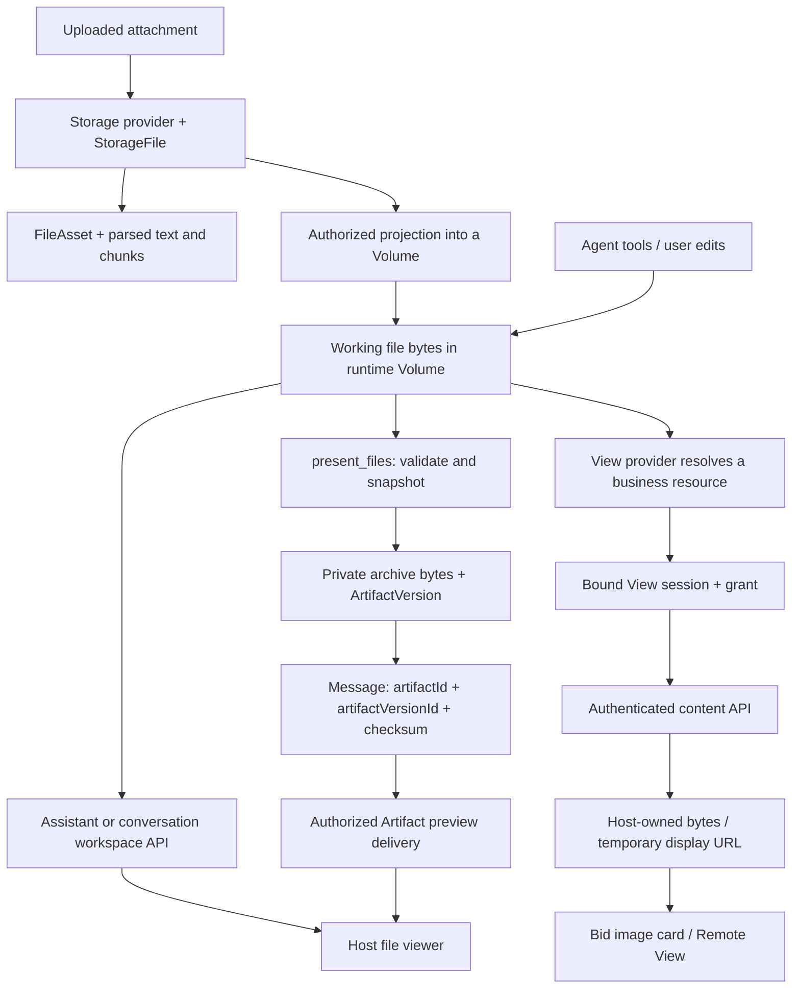
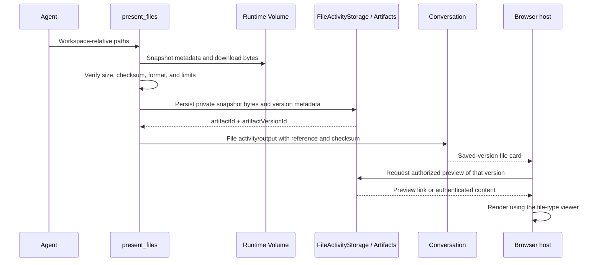
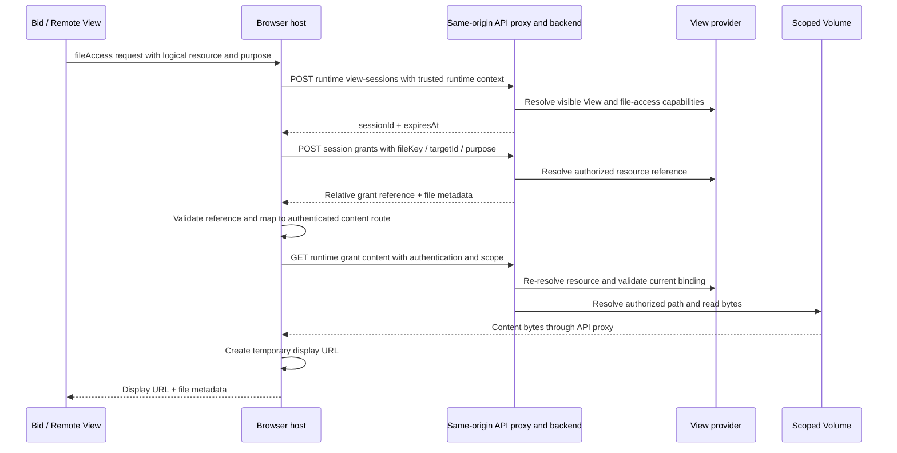
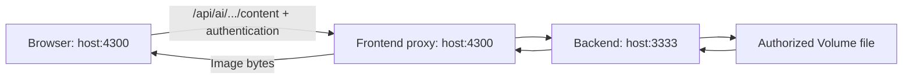

Xpert exposes files through several interfaces that share storage primitives but have different authorization and version semantics. A workspace file browser reads the current file; a `present_files` card opens a saved Artifact version; a Bid image resource card asks a View provider to resolve a business resource before reading its bytes.

This document describes those runtime paths, including authenticated View content reads through the frontend's same-origin API proxy. For uploading attachments, parsing, and model tool inputs, see [ChatKit attachment file lifecycle and data flow](./file-lifecycle-data-flow.md).

## 1. Data models and boundaries

| Concept                        | What it stores or represents                                                                            | Lifetime and access boundary                                                           |
| ------------------------------ | ------------------------------------------------------------------------------------------------------- | -------------------------------------------------------------------------------------- |
| `StorageFile` / `FileAsset`    | Original upload metadata and a file-understanding asset; original bytes reside in a storage provider    | Upload and conversation attachment authorization                                       |
| `file_artifact` / `file_chunk` | Parsed text, derived structures, and searchable chunks                                                  | File-understanding pipeline; **not** the saved deliverable versions below              |
| Workspace file / Volume        | File bytes in an authorized runtime filesystem scope                                                    | Mutable working content; scope can belong to an Assistant, user, or project            |
| `PortableWorkspaceFileRef`     | A portable reference to a scoped workspace file                                                         | Identifies storage; possession of the reference does not grant access                  |
| `Artifact` / `ArtifactVersion` | A deliverable and version metadata, including a workspace file reference, MIME type, size, and checksum | `present_files` saves a private snapshot and returns a version-pinned reference        |
| View file session / grant      | Cached authorization context and a resolved resource reference                                          | Current implementation: session lifetime of one hour; grants expire with their session |
| Artifact preview link          | An `ArtifactLink` with access policy, expiration, and version selection                                 | Signed previews use an expiring token; they are not permanent public publication       |
| Browser object URL             | A `blob:` URL for bytes already fetched by the host                                                     | Ephemeral browser resource; revoke when replaced or the view is destroyed              |

File metadata and references can be persisted in the database and messages without embedding image bytes. A filesystem path, a grant reference, a signed preview link, and a browser object URL are different objects; they must not be used interchangeably.

## 2. Overall data flow



The two output branches can refer to images derived from the same working file, but they do not share the same preview URL contract. Storage stays behind the server: browser requests go through authorization and content delivery, rather than exposing an absolute server filesystem path.

## 3. Direct workspace browsing and editing

The workspace file UI uses the Assistant or conversation workspace API to list files, read content, download bytes, and perform permitted writes. File capabilities help the UI decide which actions to display; the server authorizes every operation independently.

- Assistant runtime requests resolve the **published Assistant's runtime file access**. Access to its authoring `XpertWorkspace` is a separate permission model.
- Conversation requests validate conversation access and the corresponding Assistant/project context.
- A project Volume requires project access and the correct binding. A shared Assistant Volume and a per-user Volume must remain distinct.
- The Volume layer resolves scoped relative paths and enforces filesystem containment, including traversal and symlink protections.

Text can be loaded into a document model. Binary previews use authenticated downloads and renderer-specific handling, such as a temporary object URL for an image. `FileDocumentStore` shares document state between tabs for the same workspace/path; drafts and preview URLs are not durable file storage. Saving invokes an authorized write API.

The conversation attachment list `/api/ai/conversations/:conversationId/files` represents uploaded/parsed attachments. It is distinct from the runtime directory tree under `.../workspace/files`.

## 4. `present_files`: save a version, then preview it

`present_files` publishes a reference into the conversation to a **private saved version**. The tool itself does not create a public sharing link and does not rewrite the working file.



The current tool accepts up to 20 files, 25 MiB per file, and 64 MiB total. It verifies downloaded bytes against the snapshot's size and SHA-256 before persistence. The storage service archives bytes in a private user-scoped Volume and stores `ArtifactVersion` metadata separately. Repeated presentation of unchanged content can reuse a version. Later changes to the working file do not change the saved snapshot.

There are two delivery integrations:

| Integration                      | Flow                                                                                                                             | Authorization and version semantics                                                                                                                                                 |
| -------------------------------- | -------------------------------------------------------------------------------------------------------------------------------- | ----------------------------------------------------------------------------------------------------------------------------------------------------------------------------------- |
| Cloud-hosted tool output preview | Host calls `POST /api/artifacts/:artifactId/links/signed-preview`; browser opens `/artifacts/share/:slug` with its preview token | Link creation is authenticated. The host requests the exact `artifactVersionId` and checks the returned version/checksum. The content endpoint enforces link policy and expiration. |
| Conversation runtime content     | Client reads `GET /api/ai/conversations/:conversationId/artifacts/:artifactId/versions/:artifactVersionId/content`               | Validates conversation access, Assistant binding, and an allowed version reference in stored conversation messages; also checks Artifact scope/status and content checksum.         |

The Cloud preview helper requests a five-minute signed link by default; the backend default is fifteen minutes when no TTL is supplied. The `/artifacts/share` route is proxied by the frontend, and its public base URL normally prefers the frontend URL. This explains why a `present_files` image could already display through port 4300 while a View resource card followed a different path.

Saved-version access does not fall back to whatever happens to exist at the original working path. Expired links are renewed through an authenticated request; the saved Artifact reference remains the durable identity.

## 5. Bid and Remote View resource access

A View resource card describes a logical resource using `viewKey`, `fileKey`, `targetId`, and `purpose` (`preview` or `download`). The provider resolves that resource to a `PortableWorkspaceFileRef` after applying its business rules. The host handles authentication and content transport; the remote component receives display data rather than platform credentials.



### Grant reference versus content request

The runtime grant response contains a relative reference:

```text
/api/workspace-files/content/<sessionId>/<grantId>/<fileName>
```

The host validates its structure and session, then reads bytes through:

```text
GET /api/ai/workspace-files/view-sessions/<sessionId>/grants/<grantId>/content/<fileName>
```

These are **different routes**. Setting an image's `src` directly to the first path still invokes the cookie-bound content endpoint; it does not activate authenticated runtime delivery. The Cloud host uses its authenticated HTTP client to fetch a Blob from the second path and creates the display URL only after that request succeeds. ChatKit's file-access transport also resolves the grant reference through its configured runtime API.

`viewFileContentRoute` accepts only the expected reference on the configured API origin, with the matching session and exactly the required path segments. It rejects foreign origins, URL credentials, query strings, fragments, and invalid decoded path segments. Credentials are never attached to an arbitrary host supplied by a grant URL.

The grant service still builds its canonical URL from the backend public base URL. The **runtime controller returns only the pathname** so that the client can use its configured authenticated transport. Management API grant responses retain their canonical URL.

### Authorization is preserved

An authenticated content read checks:

1. The authenticated principal and supported credential binding, including runtime Assistant restrictions for client secrets.
2. Session ownership and tenant/organization scope; session and grant expiration.
3. Grant/session binding, filename, resource key, target, and purpose.
4. Current View visibility and provider resolution in the stored runtime context. Assistant runtime access is revalidated; project resources retain their project membership and binding checks.
5. The resolved reference's tenant, file path, and Volume scope still match the granted resource.
6. Scoped filesystem resolution before streaming bytes.

A grant therefore cannot be reused to follow a resource key that now points at a different file or Volume. However, a generic View grant is **not an immutable byte snapshot**: a mutable file can change at the same authorized path. Providers that need version semantics must resolve a version-specific resource; `present_files` provides a separate saved-snapshot model.

### Browser lifecycle

The Cloud Remote View host tracks in-flight reads and object URLs by context revision. Switching Assistant/project/conversation context or destroying the renderer invalidates pending results, revokes old object URLs, and cleans up the file-access session. A response from the previous context must not populate the new view. Persist logical resource references, not `blob:` URLs or preview tokens.

## 6. API and transport boundaries

All API paths below include the normal `/api` prefix. `:sid`, `:gid`, and `:name` stand for session ID, grant ID, and encoded filename.

| Purpose                      | Endpoint                                                                                              | Access model                                                                                            |
| ---------------------------- | ----------------------------------------------------------------------------------------------------- | ------------------------------------------------------------------------------------------------------- |
| Assistant workspace files    | `/api/ai/assistants/:assistantId/workspace/{capabilities,files,file,file/download}`                   | Explicit runtime guards plus Assistant file authorization; mutation endpoints enforce write permissions |
| Conversation workspace files | `/api/ai/conversations/:conversationId/workspace/{files,file,file/download}`                          | Workbench authentication plus conversation and file-scope authorization                                 |
| Runtime View session         | `POST /api/ai/workspace-files/view-sessions`                                                          | Explicit runtime guards; binds the resolved host, View, principal, and runtime scope                    |
| Runtime grant                | `POST /api/ai/workspace-files/view-sessions/:sid/grants`                                              | Session owner plus View/provider checks; returns a relative reference                                   |
| Runtime content              | `GET / HEAD /api/ai/workspace-files/view-sessions/:sid/grants/:gid/content/:name`                     | Authenticated read with resource revalidation                                                           |
| Session cleanup              | `DELETE /api/ai/workspace-files/view-sessions/:sid`                                                   | Owner-authorized session revocation; clears session cookie                                              |
| Management session and grant | `/api/workspace-files/view-sessions` and `/:sid/grants`                                               | Management authentication; distinct from the runtime client-secret surface                              |
| Management download          | `GET /api/workspace-files/view-sessions/:sid/grants/:gid/content/:name`                               | Authenticated download; requires a `download` grant                                                     |
| Cookie-bound content         | `GET / HEAD /api/workspace-files/content/:sid/:gid/:name`                                             | Signed HttpOnly session cookie, cached grant binding, expiry, and origin/request-metadata policy        |
| Saved-version content        | `GET /api/ai/conversations/:conversationId/artifacts/:artifactId/versions/:artifactVersionId/content` | Conversation runtime authorization and referenced Artifact version                                      |
| Signed preview creation      | `POST /api/artifacts/:artifactId/links/signed-preview`                                                | Authenticated Artifact access                                                                           |
| Artifact link delivery       | `/artifacts/share/:slug`                                                                              | Link policy; signed previews additionally require a valid preview token                                 |

Runtime controllers marked `@Public()` are not anonymous file endpoints: the annotation bypasses the default management guard, while explicit runtime guards and domain authorization still execute.

Runtime View content and cookie-bound View content share the streaming response helper: MIME type, UTF-8 filename, `private, no-store`, `nosniff`, `HEAD`, and byte ranges (`206`/`416`). `preview` uses inline disposition; `download` uses attachment disposition. The Blob preview client currently fetches the body before displaying it; server range support does not imply progressive rendering by that client. Conversation Artifact content has its own response implementation and should not be assumed to have identical range behavior.

The direct cookie route remains available. Its read-time policy uses the signed session cookie, cached grant, and request-origin checks; it does not run the full provider re-resolution of the authenticated route. The same-origin fix adds authenticated delivery without relaxing that direct route's protections.

## 7. Deployment and public URL configuration

Browser origin includes scheme, hostname, and port. `http://192.0.2.10:4300` and `http://192.0.2.10:3333` are different origins. The following address is a documentation placeholder; substitute the actual reachable host.

API process:

```dotenv
API_BASE_URL=http://192.0.2.10:3333
CLIENT_BASE_URL=http://192.0.2.10:4300
```

Frontend development process:

```dotenv
VITE_API_BASE_URL=same-origin
API_BASE_URL=http://127.0.0.1:3333
```

The frontend process's `API_BASE_URL` is the proxy upstream in this example; it need not equal the API process's public URL. `apps/cloud/proxy.conf.cjs` proxies both `/api` and `/artifacts/share`. Production ingress must provide equivalent routing when the frontend uses same-origin access.



The browser communicates with port 4300; the proxy forwards to 3333. This does not require setting the backend's public `API_BASE_URL` to the frontend port.

Artifact links choose a public base URL in this order: `PUBLIC_BASE_URL`, `ARTIFACTS_PUBLIC_BASE_URL`, `CLIENT_BASE_URL` through configuration, then the API base URL. Their `/artifacts/share` path consequently can use the frontend origin independently of canonical workspace-file URLs.

## 8. Diagnosis and acceptance checks

| Observation                                                             | What to inspect                                                                                                                                                                   |
| ----------------------------------------------------------------------- | --------------------------------------------------------------------------------------------------------------------------------------------------------------------------------- |
| Grant response contains `localhost` when accessed from another computer | The backend public URL or an older runtime/controller build. `localhost` refers to the browser's computer. Check the actual content request as well as grant metadata.            |
| A direct image request returns `401`                                    | Cookie-bound route: session cookie absent, invalid, or expired. Runtime route: authentication absent or invalid. Identify the route before changing configuration.                |
| A direct image request returns `403` after fixing the hostname          | Cookie route origin/Referer/Fetch Metadata policy can still reject it, especially for embedded or Blob-backed views. Correcting the hostname alone does not change the transport. |
| Authenticated workspace/View request returns `403`                      | Verify tenant, selected organization, Assistant runtime scope, and project/conversation binding before concluding the account lacks access.                                       |
| Content request returns `404`                                           | Missing/expired session or grant, filename mismatch, hidden View/resource, or mismatched owner/scope can intentionally appear as not found.                                       |
| Grant succeeds but preview fails                                        | Follow the subsequent content request: URL, authentication, scope, status, MIME type, and bytes. A successful grant does not prove content delivery or rendering.                 |
| `present_files` works but Bid image cards fail                          | Compare Artifact delivery with View grant delivery; they have separate routes and authorization contracts.                                                                        |
| Many repeated sessions/grants                                           | Inspect context churn, retries, cleanup, and stale responses. Request counts or the Network panel's total elapsed time do not identify a single slow request.                     |

For a local authenticated investigation, use `tools/scripts/local-plugin-cli.mjs` with `requireAuthentication` and `createRequestHeaders`. For a known organization, use `createRequestHeaders({ scope: 'organization', orgId }, token, tenantId)` to preserve `organization-id`, `tenant-id`, and `x-scope-level`. If scope is unknown, discover it through authorized organization/workspace reads. Do not read browser credentials or bypass access control to reproduce a preview.

A complete acceptance check should confirm:

1. On a second computer, the Bid card obtains a grant and reads bytes through the frontend's authenticated runtime content endpoint, with no direct image request to `localhost` or port 3333.
2. The image actually renders; binary content has the expected MIME type and nonzero dimensions in the viewer.
3. Context changes do not display old results, and replacing/destroying a view cleans up temporary resources.
4. Anonymous reads, another principal's session, a mismatched scope, a revoked session, and a changed resource binding remain rejected.
5. Saved `present_files` versions still preview correctly and are not replaced by current working-file content.

## 9. Implementation map and related documentation

| Area                                 | Source                                                                                                                                                                                                                                                                                                                                                                                                                                                     |
| ------------------------------------ | ---------------------------------------------------------------------------------------------------------------------------------------------------------------------------------------------------------------------------------------------------------------------------------------------------------------------------------------------------------------------------------------------------------------------------------------------------------- |
| Workspace file runtime authorization | [Assistant file guard](https://github.com/xpert-ai/xpert/blob/main/packages/server-ai/src/ai/assistant-file-access.guard.ts), [Assistant workspace controller](https://github.com/xpert-ai/xpert/blob/main/packages/server-ai/src/ai/assistant-workspace-files.controller.ts), [conversation workspace controller](https://github.com/xpert-ai/xpert/blob/main/packages/server-ai/src/ai/workbench-files.controller.ts)                                    |
| View resolution and authorization    | [View extension service](https://github.com/xpert-ai/xpert/blob/main/packages/server/src/view-extension/view-extension.service.ts), [file access service](https://github.com/xpert-ai/xpert/blob/main/packages/server-ai/src/workspace-file-access/workspace-file-access.service.ts)                                                                                                                                                                       |
| View content delivery                | [runtime controller](https://github.com/xpert-ai/xpert/blob/main/packages/server-ai/src/ai/workspace-file-access-runtime.controller.ts), [cookie content controller](https://github.com/xpert-ai/xpert/blob/main/packages/server-ai/src/workspace-file-access/workspace-file-content.controller.ts), [stream response helper](https://github.com/xpert-ai/xpert/blob/main/packages/server-ai/src/workspace-file-access/workspace-file-content.response.ts) |
| Cloud resource preview               | [route validation](https://github.com/xpert-ai/xpert/blob/main/apps/cloud/src/app/@core/services/view-file-content-route.ts), [View API client](https://github.com/xpert-ai/xpert/blob/main/apps/cloud/src/app/@core/services/view-extension-api.service.ts), [Remote View renderer](https://github.com/xpert-ai/xpert/blob/main/apps/cloud/src/app/@shared/view-extension/renderers/remote-component-renderer.component.ts)                               |
| Saved deliverables                   | [present_files implementation](https://github.com/xpert-ai/xpert/blob/main/packages/server-ai/src/sandbox/middlewares/present-files.ts), [snapshot storage](https://github.com/xpert-ai/xpert/blob/main/packages/server-ai/src/sandbox/middlewares/file-activity-storage.service.ts), [Artifacts service](https://github.com/xpert-ai/xpert/blob/main/packages/server-ai/src/artifacts/artifacts.service.ts)                                               |
| Saved-version preview integrations   | [Cloud Assistant host](https://github.com/xpert-ai/xpert/blob/main/apps/cloud/src/app/features/assistant/assistant-chatkit.runtime.ts), [conversation Artifact read handler](https://github.com/xpert-ai/xpert/blob/main/packages/server-ai/src/chat-conversation/commands/handlers/read-conversation-artifact.handler.ts)                                                                                                                                 |
| Proxy configuration                  | [Cloud development proxy](https://github.com/xpert-ai/xpert/blob/main/apps/cloud/proxy.conf.cjs)                                                                                                                                                                                                                                                                                                                                                           |

Related documentation: [attachment lifecycle](./file-lifecycle-data-flow.md), [file upload architecture](../guides/file-upload-architecture.mdx), [Volume workspace architecture](../guides/volume-workspace-architecture.mdx), [workbench file tabs](../../workbench-artifact-tabs.md), and [tool image storage and model inputs](../../tool-images.md).
