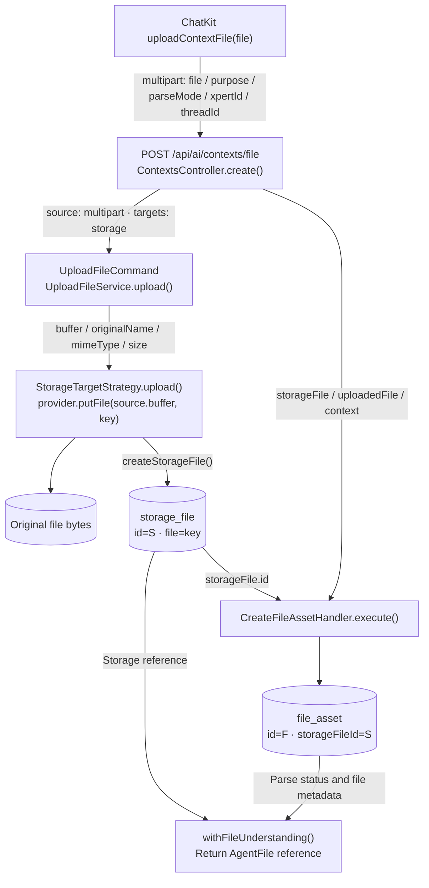
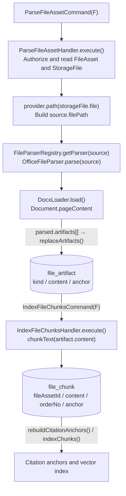
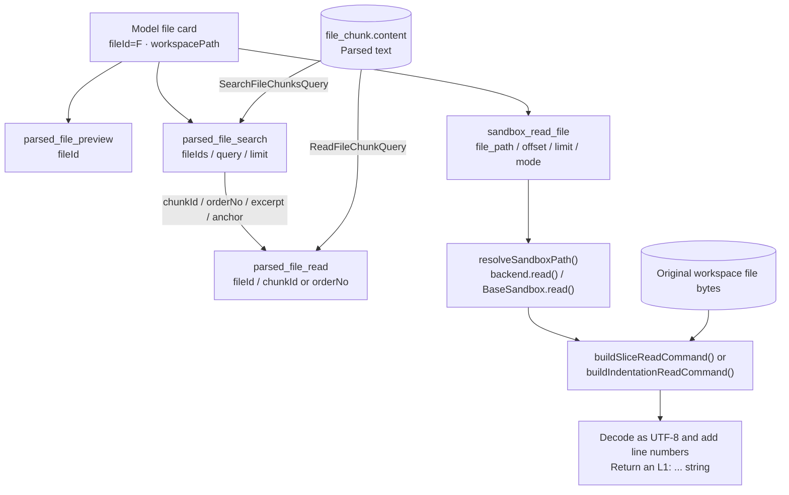
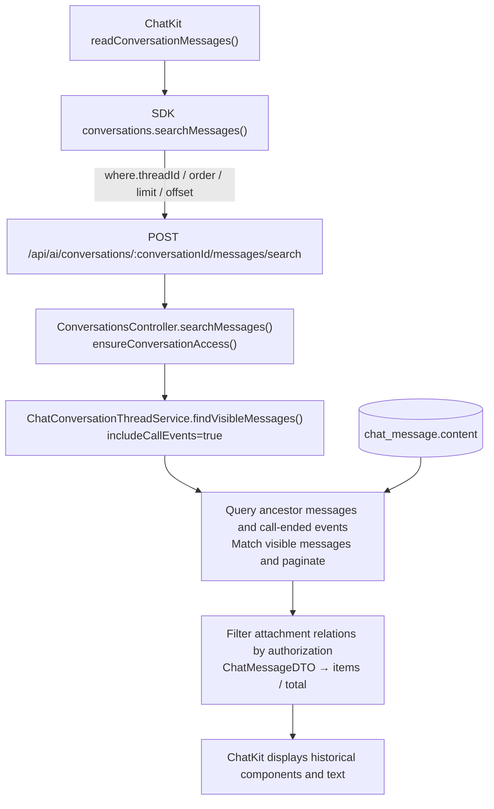

# ChatKit attachment file lifecycle and data flow

[简体中文](../../zh-Hans/architecture/file-lifecycle-data-flow.md)

Document type: architecture and implementation reference. Scope: the main path from ChatKit attachment upload and parsing through Agent tool reads, message persistence, and history loading. Implementation baseline: 2026-10-11.

An attachment has three forms of content in the system: original file bytes, parsed text, and the output returned by a particular tool call. Storage providers and runtime Volumes hold the original bytes; the file-understanding layer holds parsed text; tool outputs enter conversation messages. When investigating a file-related failure, first identify which form of content and which transformation failed.

This document uses a DOCX attachment as an example. `S` denotes `storage_file.id`, `F` denotes `file_asset.id`, `C` denotes the conversation ID, and `T` denotes the thread ID. All identities and paths in examples are placeholders.

## Storage locations and fields

| Data                                | Storage location                                 | Key fields                                                                                   | Consumers                                                 |
| ----------------------------------- | ------------------------------------------------ | -------------------------------------------------------------------------------------------- | --------------------------------------------------------- |
| Original file bytes                 | File storage provider; `LOCAL` in the case study | Storage key `storage_file.file`, resolved to the actual file by the provider                 | Parsers, download endpoints, workspace projection         |
| Original file metadata              | `storage_file`                                   | `id=S`, `file`, `storageProvider`, `originalName`, `mimetype`, `size`                        | Upload and file-understanding layers                      |
| File-understanding asset            | `file_asset`                                     | `id=F`, `storageFileId=S`, `status`, `parseMode`, `capabilities`, `summary`, `workspacePath` | ChatKit, Agents, file tools                               |
| Parsed artifacts                    | `file_artifact`                                  | `fileAssetId=F`, `kind`, `content`, `anchor`, `metadata`                                     | Chunking, preview, derived-artifact reads                 |
| Searchable text chunks              | `file_chunk`                                     | `fileAssetId=F`, `artifactId`, `orderNo`, `content`, `tokenCount`, `anchor`                  | `parsed_file_search`, `parsed_file_read`                  |
| Conversation–file association       | `conversation_file_link`                         | `conversationId=C`, `threadId=T`, `fileAssetId=F`, `storageFileId=S`                         | Conversation file visibility and authorization            |
| Message–attachment association      | `chat_message_file_asset`                        | Message entity's many-to-many `fileAssets` relation                                          | History attachment display, rebuilding inputs for retries |
| Workspace copy of the original file | Runtime Volume                                   | `workspacePath`, `metadata.workspace.relativePath`, and Volume scope                         | Sandbox file tools, shell tools                           |
| Output of an executed tool          | `chat_message.content`, a database `json` column | `content[i].data.tool/input/output/status`                                                   | Conversation history display                              |

The file-understanding `FileAsset` entity and the upload orchestration's `IFileAsset` aggregate are different data models. The latter contains `destinations`; the upload controller extracts a `StorageFile` from it and then creates the former.

## Uploading the original file and creating a file asset



| Step | Tool or method                                               | Inputs and outputs                                                                                                                                                                                                                                 |
| ---- | ------------------------------------------------------------ | -------------------------------------------------------------------------------------------------------------------------------------------------------------------------------------------------------------------------------------------------- |
| 1    | `useChatFiles.uploadContextFile(file)`                       | Builds `FormData` containing `file`, `purpose='chat_attachment'`, and `parseMode='auto'`, plus `xpertId` and `threadId` when available. Uploads through the SDK's `contexts.fetch('/contexts/file', ...)`.                                         |
| 2    | `ContextsController.create()`                                | Receives an `Express.Multer.File` through `@UploadedFile()`. Resolves conversation and upload scope, then executes `UploadFileCommand({ source: { kind: 'multipart', file }, targets: [target] })`.                                                |
| 3    | `UploadFileHandler.execute()` → `UploadFileService.upload()` | `resolveSource()` normalizes `file.buffer/originalname/mimetype/size` to `source.buffer/originalName/mimeType/size`; `normalizeFileMimeType()` identifies the type from the bytes.                                                                 |
| 4    | `StorageTargetStrategy.upload()`                             | Generates a `key`, calls `provider.putFile(source.buffer, key)`, then saves metadata through `StorageFileService.createStorageFile()`.                                                                                                             |
| 5    | `CreateFileAssetHandler.execute()`                           | Receives `storageFile`, `uploadedFile`, `purpose`, `parseMode`, and context; saves `storageFileId=S` and generates `F`. Looks up existing assets by `storageFileId + tenantId`; creates a `conversation_file_link` when the conversation is known. |
| 6    | `ContextsController.withFileUnderstanding()`                 | Combines the storage record and file asset into an `AgentFile`. The frontend receives a file reference, status, and capabilities.                                                                                                                  |

The default context upload target is `storage`, with the directory `contexts` and filename prefix `files`. A typical storage key is:

```text
contexts/<tenantId>/files-<timestamp>-<random>.docx
```

For the `LOCAL` provider, `LocalProvider.putFile()` writes bytes to `config.rootPath + key`, and `LocalProvider.path(storageFile.file)` resolves the storage key to a server-side path. Other providers determine the physical location through their own implementations.

The upload controller does not accept a client-supplied path as a trusted workspace path. The server generates `workspacePath` after authorization and actual file projection. Tenant, organization, and user identities come from the authenticated request context.

Sources: [upload controller](https://github.com/xpert-ai/xpert/blob/main/packages/server-ai/src/ai/context.controller.ts), [upload orchestration](https://github.com/xpert-ai/xpert/blob/main/packages/server/src/file/file-upload/upload-file.service.ts), [storage target](https://github.com/xpert-ai/xpert/blob/main/packages/server/src/file/file-upload/strategies/storage-target.strategy.ts), [LOCAL provider](https://github.com/xpert-ai/xpert/blob/main/packages/server/src/file/file-storage/providers/local.provider.ts), [file asset creation](https://github.com/xpert-ai/xpert/blob/main/packages/server-ai/src/file-understanding/commands/handlers/create-file-asset.handler.ts).

## Parsing and building the text index

After creating the asset, the controller calls `EnqueueFileParseCommand(F, { runInline })`. `parseMode='none'` skips parsing; `fast` parses inline; `deep` parses in the background; `auto` parses inline when the file is no larger than 2,000,000 bytes. The current background branch uses `setImmediate()` in `EnqueueFileParseHandler` to invoke the parsing command; it is not a durable task queue.



For a standard DOCX file, `OfficeFileParser.parse()` uses `DocxLoader` to extract `pageContent` and produce `summary` and `text` artifacts. A DOCX with a legacy compound-document signature follows `parseLegacyDoc()` instead; the extension alone does not determine the decoding path.

`IndexFileChunksHandler` splits chunkable artifact text, saves `file_chunk.content`, and builds citation anchors and a vector index. When parsing completes, it updates `file_asset.status`, `summary`, `capabilities`, `metadata.parser`, `metadata.chunkCount`, and `parsedAt`. The `ready` status means this parsing pipeline completed; it does not change the original DOCX bytes.

Sources: [parse handler](https://github.com/xpert-ai/xpert/blob/main/packages/server-ai/src/file-understanding/commands/handlers/parse-file-asset.handler.ts), [parse scheduling](https://github.com/xpert-ai/xpert/blob/main/packages/server-ai/src/file-understanding/commands/handlers/enqueue-file-parse.handler.ts), [Office parser](https://github.com/xpert-ai/xpert/blob/main/packages/server-ai/src/file-understanding/parsers/office.parser.ts), [text chunking](https://github.com/xpert-ai/xpert/blob/main/packages/server-ai/src/file-understanding/commands/handlers/index-file-chunks.handler.ts).

## Workspace copies and path propagation

`FileWorkspaceProjectionService.projectFileAsset()` copies the original file into a Volume accessible to the Agent. Projection can run after parsing or when attaching the file to a conversation; it reuses an existing copy in the same scope when available.

```text
projectFileAsset({ fileAssetId: F, storageFileId: S, conversationId: C, ... })
  → FileAssetAccessService.resolve() authorizes access
  → XpertWorkAreaResolver.resolve() selects the Volume and session directory
  → readStorageFile(storageFile)
  → provider.getFile(storageFile.file) returns a Buffer
  → writeProjectedVolumeFile(volume, relativePath, buffer)
  → VolumeHandle.writeFile(...) writes the original bytes
  → Save file_asset.workspacePath and metadata.workspace
```

Example session paths:

```text
metadata.workspace.relativePath = sessions/<C>/files/<F>/example-tender.docx
workspacePath = /workspace/sessions/<C>/files/<F>/example-tender.docx
```

`workspacePath` belongs to the runtime path namespace visible to the Agent; it is not a host filesystem path. The actual directory depends on the Volume's `catalog`, `scopeId`, provider, and workspace resolver. Project and Assistant files can have different scopes.

Projection copies the original file `Buffer`, not `file_chunk.content`. The `workspace` capability means the file is accessible by path; it does not mean the file can be read as UTF-8 text.

Sources: [workspace projection](https://github.com/xpert-ai/xpert/blob/main/packages/server-ai/src/file-understanding/file-workspace-projection.service.ts), [workspace path resolution](https://github.com/xpert-ai/xpert/blob/main/packages/server-ai/src/file-understanding/domain/workspace-file.ts).

## Attachment references in conversations and model inputs

The main upload response fields are shown below. This example represents completed parsing and projection; the status may still be `parsing` immediately after background parsing starts.

```json
{
  "id": "<F>",
  "fileId": "<F>",
  "storageFileId": "<S>",
  "objectKey": "contexts/<tenantId>/files-<timestamp>-<random>.docx",
  "originalName": "example-tender.docx",
  "mimeType": "application/vnd.openxmlformats-officedocument.wordprocessingml.document",
  "status": "ready",
  "parseStatus": "ready",
  "purpose": "chat_attachment",
  "parseMode": "auto",
  "capabilities": ["preview", "read", "search", "workspace"],
  "workspacePath": "/workspace/sessions/<C>/files/<F>/example-tender.docx"
}
```

On the frontend, `attachments.toSubmittedFiles()` preserves these reference fields. When submitting a message, `useChatSubmission()` places them in `inputPayload.files[]`; the locally displayed message uses `newMessage.fileAssets`.

```text
inputPayload.files[]
  → normalizeChatHumanInputFiles()
  → normalizeChatRequestFiles() / normalizeChatRequestFile()
  → toChatFileAssetReferences() returns [{ id: F }]
  → humanMessage.fileAssets
  → ChatMessageUpsertCommand
  → chat_message_file_asset association table

attachChatFileAssetsToConversation()
  → AttachFileToConversationCommand({ fileAssetId: F, storageFileId: S,
                                     conversationId: C, threadId: T, ... })
  → conversation_file_link
  → projectFileAsset()
```

For model input, `createHumanMessage()` → `resolveAttachmentFile()` resolves and authorizes the file reference again. For an ordinary document with parsed results, `GetFilePreviewQuery(F)` → `buildFileUnderstandingPrompt()` builds a compact file card containing `fileId`, `storageFileId`, `status`, `capabilities`, `workspacePath`, `summary`, and `availableAnchors`. Full text remains in the file-understanding layer for tools to read on demand. Compatibility paths such as `LoadFileCommand` still exist when this branch does not apply, so the file card is not the only path for every format and state.

The meaning of `id` changes with the object type: the uploaded `AgentFile.id` is `F`; when `resolveAttachmentFile()` takes the `StorageFile` branch, the internal object's `id` can become `S`, while retaining `fileId=F` and `fileAssetId=F`. To trace a file across layers, use the explicit `fileAssetId/fileId` and `storageFileId` fields.

Sources: [chat file reference normalization](https://github.com/xpert-ai/xpert/blob/main/packages/server-ai/src/xpert/commands/handlers/chat-file-assets.ts), [conversation attachment](https://github.com/xpert-ai/xpert/blob/main/packages/server-ai/src/file-understanding/commands/handlers/attach-file-to-conversation.handler.ts), [model attachment input](https://github.com/xpert-ai/xpert/blob/main/packages/server-ai/src/shared/agent/message.ts), [message attachment relation](https://github.com/xpert-ai/xpert/blob/main/packages/server-ai/src/chat-message/chat-message.entity.ts).

## Two paths for Agent file reads



| Tool                  | Model-call parameters                                   | Server function or query                                                                                           | Return value                                                                                                                 |
| --------------------- | ------------------------------------------------------- | ------------------------------------------------------------------------------------------------------------------ | ---------------------------------------------------------------------------------------------------------------------------- |
| `parsed_file_preview` | `{ fileId: F }`                                         | `requireConversationFile()` → `GetFilePreviewQuery` / `GetFilePreviewHandler.execute()`                            | JSON string containing `file`, `artifactCount`, and `availableReads`. The tool wrapper does not directly return body chunks. |
| `parsed_file_search`  | `{ fileIds: [F], query, limit }`; `fileIds` is optional | `searchConversationFiles()` → `resolveFileIds()` → `SearchFileChunksQuery({ fileId, query, limit })` for each file | JSON array containing `fileId`, `name`, `workspacePath`, `chunkId`, `orderNo`, `anchor`, and `excerpt`.                      |
| `parsed_file_read`    | `{ fileId: F, chunkId }` or `{ fileId: F, orderNo }`    | `requireConversationFile()` → `ReadFileChunkQuery` / `ReadFileChunkHandler.execute()`                              | JSON object containing `fileId`, `chunkId`, `orderNo`, `anchor`, and `content`.                                              |
| `sandbox_read_file`   | `{ file_path, offset?, limit?, mode?, indentation? }`   | `SandboxFileMiddleware` → `resolveSandboxPath()` → `backend.read()`                                                | Plain string with `L1: ...` line numbers, read from the original file.                                                       |

The public parameter of `parsed_file_search` is the plural `fileIds`; the internal per-file query uses the singular `fileId`. `parsed_file_read` requires exactly one of `chunkId` or `orderNo`. Before execution, the tools resolve visibility using the current conversation, project, and file associations. A file ID alone is not an authorization credential.

`SearchFileChunksHandler` merges and ranks vector-search and database text-match results. `ReadFileChunkHandler` reads a chunk by `fileAssetId + chunkId` or `fileAssetId + orderNo`. The tools then use `compactText()` to limit the length of returned `excerpt/content` values.

The sandbox path contract asks the model for a path relative to the working directory, such as `sessions/<C>/files/<F>/example-tender.docx`. Currently, `resolveSandboxPath()` calls `resolve(workingDirectory, file_path)` for relative paths and passes absolute paths through unchanged. The sandbox and Volume implementations remain responsible for enforcing access boundaries.

At the implementation baseline, both slice and indentation modes in `BaseSandbox.read()` execute `fs.readFileSync(filePath, 'utf-8')`. They do not reuse the binary-file checks in the file-understanding layer's `decodeTextFileContent()`. Reading original files such as DOCX through this path can therefore produce garbled text and NUL characters even when parsing status is `ready`.

Sources: [parsed file tools](https://github.com/xpert-ai/xpert/blob/main/packages/server-ai/src/file-understanding/tools/file-understanding.tools.ts), [search handler](https://github.com/xpert-ai/xpert/blob/main/packages/server-ai/src/file-understanding/queries/handlers/search-file-chunks.handler.ts), [read handler](https://github.com/xpert-ai/xpert/blob/main/packages/server-ai/src/file-understanding/queries/handlers/read-file-chunk.handler.ts), [sandbox file tools](https://github.com/xpert-ai/xpert/blob/main/packages/server-ai/src/sandbox/middlewares/sandbox-file.middleware.ts), [BaseSandbox](https://github.com/xpert-ai/xpert/blob/main/packages/plugin-sdk/src/lib/sandbox/sandbox.ts), [text decoding checks](https://github.com/xpert-ai/xpert/blob/main/packages/server-ai/src/file-understanding/parsers/text-file.ts).

## Tool outputs in conversation messages

A tool's return value can feed subsequent model execution and can also become a replayable message component through tool events. This section describes the display and persistence path of the `sandbox_read_file` call in the case study; event wrappers can differ between tools.

```text
BaseSandbox.read() returns a result string
  → withToolMessage(): output = result
  → dispatchCustomEvent(ON_TOOL_MESSAGE, {
      id, category: 'Tool', tool, input, status: 'success', output, ...
    })
  → xpert-agent/agent.ts converts the event into a type='component' MESSAGE
  → component.data retains tool / input / output / status
  → sanitizeMessageContentForPersistence()
  → appendMessageContent(aiMessage, component)
  → ChatMessageUpsertHandler.execute()
  → ChatMessageService.save(entity)
  → chat_message.content[i].data.output
```

Example persisted structure:

```json
[
  {
    "type": "component",
    "data": {
      "tool": "sandbox_read_file",
      "input": {
        "file_path": "sessions/<C>/files/<F>/example-tender.docx",
        "limit": 200
      },
      "status": "success",
      "output": "L1: PK\u0003\u0004..."
    }
  }
]
```

Here, `output` is a snapshot of one invocation's result, independent of `file_chunk.content` and the original file bytes. Currently, `sanitizeMessageContentForPersistence()` removes temporary fields such as `appInstanceToken` from display data; it does not remove NUL characters from tool outputs.

There is also an `ON_TOOL_MESSAGE` branch that writes to `aiMessage.events`. In this case, the `category='Tool'` event was first converted into a component message. The problematic bytes were in `content[2].data.output`, and the record's `events` field was empty.

Sources: [tool event wrapper](https://github.com/xpert-ai/xpert/blob/main/packages/server-ai/src/sandbox/middlewares/tool-message.utils.ts), [Agent event conversion](https://github.com/xpert-ai/xpert/blob/main/packages/server-ai/src/xpert-agent/agent.ts), [chat stream handling](https://github.com/xpert-ai/xpert/blob/main/packages/server-ai/src/xpert/commands/handlers/chat.handler.ts), [message preprocessing for persistence](https://github.com/xpert-ai/xpert/blob/main/packages/server-ai/src/chat-message/message-step-persistence.ts), [message persistence handler](https://github.com/xpert-ai/xpert/blob/main/packages/server-ai/src/chat-message/commands/handlers/upsert.handler.ts).

## Reading conversation history

When opening a conversation, ChatKit reads persisted messages. It does not execute tools again or reread the DOCX to replay a tool card.



The controller first checks conversation access and verifies that the requested thread belongs to that conversation. It filters attachments through `filterAuthorizedFileRelations()` before producing DTOs.

At the implementation baseline, merging call-ended events uses the following SQL condition:

```sql
message.content::jsonb -> 0 ->> 'type' = 'call_ended'
```

The `content` column itself has type `json`. To inspect the first block's `type`, this condition converts the entire content value to `jsonb`. Consequently, a problematic character inside a nested tool output can fail the whole history query. Filtering happens before pagination, so changing the frontend page size cannot reliably bypass the affected record.

Sources: [history controller](https://github.com/xpert-ai/xpert/blob/main/packages/server-ai/src/ai/conversation.controller.ts), [thread message query](https://github.com/xpert-ai/xpert/blob/main/packages/server-ai/src/chat-conversation/conversation-thread.service.ts).

## Field mapping reference

| Field                                 | Owning object and meaning                                                                  | Distinction to preserve                                         |
| ------------------------------------- | ------------------------------------------------------------------------------------------ | --------------------------------------------------------------- |
| `id`                                  | Depends on the object: `AgentFile.id=F`, `StorageFile.id=S`                                | Not every object's `id` is a file asset ID                      |
| `fileId` / `fileAssetId`              | File-understanding identity `F`; both explicitly identify the asset in new file references | Distinct from `storageFileId`                                   |
| `fileIds`                             | Array of asset IDs accepted by `parsed_file_search`                                        | Internal `SearchFileChunksQuery.input.fileId` is a single value |
| `storageFileId`                       | Original file storage record `S`                                                           | Distinct from `F`                                               |
| `objectKey` / `storage_file.file`     | Storage provider key                                                                       | Not `workspacePath` or a host absolute path                     |
| `file_asset.fileName`                 | Can hold the `storageFile.file` storage key in uploaded assets                             | Not the original display name `originalName`                    |
| `workspacePath`                       | Location of the file copy in the Agent's path namespace                                    | Not parsed text or a host path                                  |
| `file_path`                           | Path parameter of `sandbox_read_file`                                                      | Not `parsed_file_read.fileId`                                   |
| `source.filePath`                     | Server-side path used by the parser                                                        | Not a public path directly usable by tools                      |
| `chunkId` / `orderNo`                 | Locates a text chunk within a file                                                         | Not an original-byte offset or sandbox line number              |
| `file_chunk.content`                  | Parsed text chunk                                                                          | Distinct from `chat_message.content`                            |
| `chat_message.content[i].data.output` | Historical output of a particular tool call                                                | Not the sole source of the original file or parsed text         |

## Case study: DOCX binary output breaks history loading

An investigation on 2026-10-11 confirmed that a DOCX was stored through `LOCAL`, had file-understanding status `ready`, used the `office` parser, and had `summary` and `text` artifacts plus searchable chunks. Parsing had completed, but reading the original file produced a problematic message output.

The observed call sequence was:

1. `parsed_file_preview({ fileId: F })` succeeded and returned the file's status and capabilities.
2. A `parsed_file_search` call incorrectly supplied singular `fileId` and was rejected by the strict schema; the tool accepts a `fileIds` array.
3. A subsequent search with the correct parameters succeeded, while `sandbox_read_file({ file_path, limit: 200 })` was also called.
4. The sandbox read the DOCX's compressed bytes as UTF-8. The output began with `L1: PK` and contained 1,054 NUL characters.
5. The output was persisted with JSON escapes in an AI message's `content[2].data.output`.
6. On reopening the conversation, the call-event query executed `content::jsonb`, triggering PostgreSQL `22P05`: `\u0000 cannot be converted to text.` The message endpoint returned HTTP 500.

The file card's instruction that `sandbox_read_file` could read the original file when `workspacePath` was available lacked a format restriction and was a contributing prompt-level factor. It does not, by itself, prove the model's internal reasoning when selecting tools. The direct cause of the history-query failure was the combination of NUL characters in persisted output and SQL JSON conversion.

Recovery first backed up the entire affected message, then verified the account, conversation, organization scope, and original content inside a transaction before replacing only the unreadable tool output. All other message blocks, tool parameters, and message columns remained unchanged. The conversation retained its eight messages, the original SQL ran successfully, three API instances recorded five successful message queries in total, and the UI reloaded normally. The original file, workspace copy, and parsed text were unchanged.

This was data recovery, not a code fix. Further changes need to address the sandbox's text-reading boundary, character handling for persisted outputs, and an event-query design that avoids converting arbitrary message content as a whole. Regression validation needs a real binary file and PostgreSQL; mocked QueryBuilder results cannot establish whether this database error is fixed. Simply removing `::jsonb` and using JSON field extraction still fails on the affected data.

The case study omits production accounts, IP addresses, tenant and organization IDs, conversation IDs, original message bodies, and backup locations. Those details belong in protected operational receipts.

## Cross-repository source entry points and related documents

The platform baseline is `xpert` revision `d3352d47b`; the corresponding ChatKit and SDK source baselines are `ae06dbe` and `71ffc19`. This document records behavior at that date. Update the field tables and data flows when tool contracts or storage models change.

| Repository     | Source path                                                                    | Entry point                                |
| -------------- | ------------------------------------------------------------------------------ | ------------------------------------------ |
| `chatkit-js`   | `packages/chatkit-ui/src/components/chat/files/useChatFiles.ts`                | `uploadContextFile()`                      |
| `chatkit-js`   | `packages/chatkit-ui/src/components/chat/attachments.tsx`                      | `toSubmittedFiles()`, parse-status polling |
| `chatkit-js`   | `packages/chatkit-ui/src/components/chat/composer/useChatSubmission.ts`        | `inputPayload.files`                       |
| `chatkit-js`   | `packages/chatkit-ui/src/providers/stream/history/useStreamHistoryMessages.ts` | `readConversationMessages()`               |
| `xpert-sdk-js` | `packages/core/src/client.ts`                                                  | `ConversationsClient.searchMessages()`     |

Related architecture documents:

- [Unified file upload architecture](../guides/file-upload-architecture.mdx)
- [File-understanding architecture](../guides/file-understanding-architecture.mdx)
- [Volume and workspace architecture](../guides/volume-workspace-architecture.mdx)
- [AI Agent architecture and source map](/en/architecture/ai-agent-architecture)
