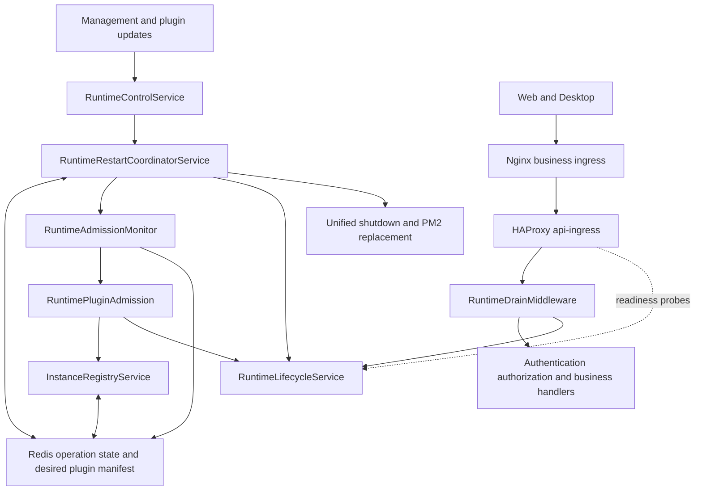
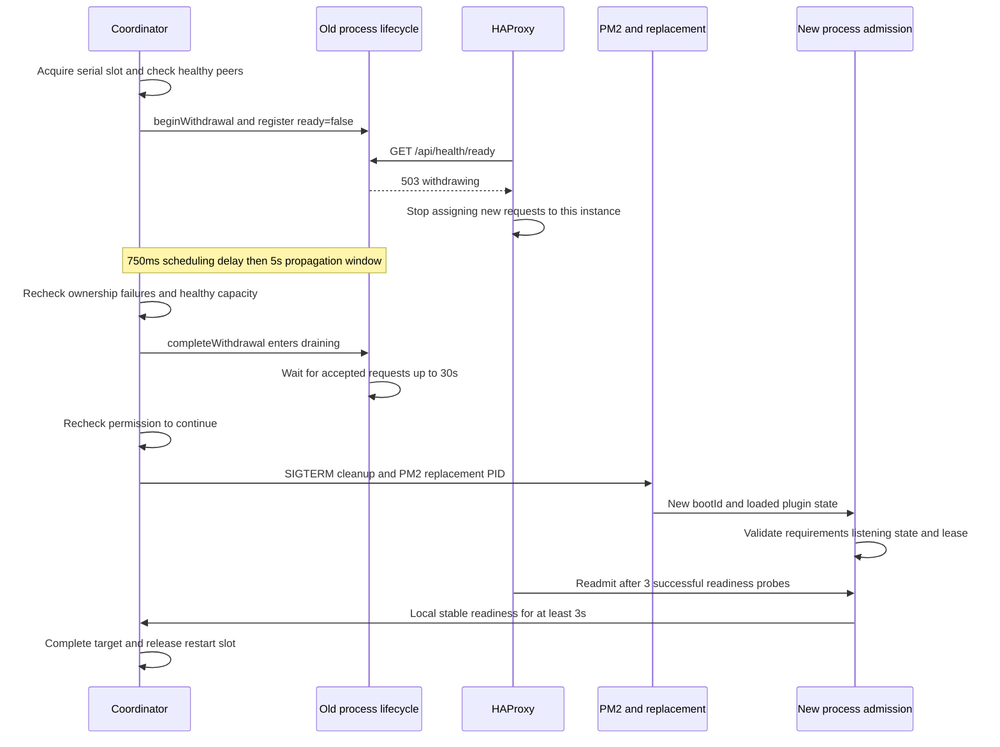

Runtime Control connects plugin convergence, API replica restarts, business admission, ingress withdrawal and client recovery. It preserves serving capacity during updates while fencing instances whose plugin requirements, validation deadline or registry lease no longer permit new business requests.

This page describes the source and Compose design including the #1207 fix, and separates it from the proposed ingress acknowledgement capability. Every business ingress must use the readiness-aware proxy before relying on its withdrawal propagation contract. An API image update alone does not complete that migration. For cleanup after a process receives a signal, see [Graceful API shutdown](/en/guides/graceful-api-shutdown).

## Architecture



Redis stores desired state, instance leases and restart operations. Local admission and lifecycle determine whether an API accepts a request; HAProxy readiness probes determine whether ingress selects that API. Writing `ready=false` to Redis does not directly change proxy routing.

| Component                              | Responsibility                                                                                      | Boundary                                                                                                                     |
| -------------------------------------- | --------------------------------------------------------------------------------------------------- | ---------------------------------------------------------------------------------------------------------------------------- |
| `RuntimeControlService` / Controller   | Capability checks, authorization, restart confirmation, status and instance registration management | Interactive restart requires a Default tenant SuperAdmin session and `confirmation: "RESTART"`; API keys cannot authorize it |
| `PluginRuntimeGenerationStore`         | Atomic generation publication, cumulative desired manifest and convergence state                    | Active operations retain a fixed snapshot; later changes become follow-up work                                               |
| `RuntimeRestartCoordinatorService`     | Target collection, serial restarts, capacity checks, failure handling and generation handoff        | Owns rollout progress, not the admission timer                                                                               |
| `InstanceRegistryService`              | Replica identity, per-start `bootId`, heartbeat lease, plugin state and ready validity              | A registration does not imply current serving eligibility                                                                    |
| `RuntimeAdmissionMonitor`              | Independent scheduling, one shared in-flight check and timing diagnostics                           | Determines when to check, not whether plugins qualify                                                                        |
| `RuntimePluginAdmission`               | Startup, plugin requirements, continuous admission and lease validation                             | Revalidates after expiry instead of unconditionally restoring old versions                                                   |
| `RuntimeLifecycleService` / Middleware | Withdrawal, drain, request tracking, readiness and structured rejection                             | Withdrawal retains the safety guard; drain rejects new business and recovery requests                                        |
| `api-ingress`                          | Per-instance probes, withdrawal, readmission and limited recovery routing                           | Does not replay requests or terminate established connections to withdraw traffic                                            |
| Desktop                                | Structured errors, bounded recovery for safe requests and session banner cleanup                    | Does not automatically replay chat or tool writes                                                                            |

## Independent state models

### Desired plugin state

Plugin installation or runtime requirement changes publish a generation. Redis atomically records the change, cumulative requirements and state. The desired manifest persists independently of expiring history, so history expiry cannot admit a process that violates current requirements.

Convergence states are `in_progress`, `awaiting_restart`, `completed` and `failed`. Insufficient healthy capacity without explicit downtime approval leaves work waiting for reassessment when capacity returns. Failed generations require an explicitly published new generation instead of unlimited automatic retries. Queued changes do not inherit a previous batch's downtime approval.

Installation, actual plugin loading, requirement satisfaction, ingress readmission and business acceptance remain distinct release outcomes.

### Restart operations and boot identity

An operation moves from `collecting` to `rolling`. Targets move through `pending`, `restarting` and `completed`, or enter `failed`. There is currently one concurrent restart slot. Redis locks, conditional target updates and atomic operation handoff prevent coordinators from advancing the same target twice.

A target binds the registered replica identity to its old `expectedBootId`. A replacement confirms its return using a new `bootId`. A replica already satisfying all operation requirements may acknowledge without restarting. The HTTP readiness `instanceId` is a lifecycle process identifier; correlate it with registry replica and boot identities rather than treating every instance identifier as interchangeable.

### HTTP lifecycle

| State         | `/api/health/ready` | New ordinary requests                 | Meaning                                                        |
| ------------- | ------------------- | ------------------------------------- | -------------------------------------------------------------- |
| `ready`       | 200                 | Accepted                              | Admitted and not withdrawing                                   |
| `withdrawing` | 503                 | Accepted while the safety guard holds | Serves requests still arriving during ingress propagation      |
| `draining`    | 503                 | Rejected                              | Stops accepting work while existing responses finish           |
| `unready`     | 503                 | Rejected                              | Startup, plugin admission, validation or lease conditions fail |

State precedence is `draining`, then unsafe admission as `unready`, then `withdrawing`, then `ready`. Losing a lease during withdrawal therefore fences ordinary traffic immediately. `status=withdrawing` can coexist with `admission.reason=ready`: the process is safe but leaving ingress.

## Admission and RuntimeAdmissionMonitor

Admission refresh previously ran inside the coordinator's serial processing loop. Slow asynchronous coordination could postpone refresh beyond the five-second deadline even when the process and plugins were healthy. The independent monitor removes that scheduling dependency.

An independent Nest provider owns the monitor lifecycle, starting it at application bootstrap and scheduling a check every second. The coordinator receives Monitor and Admission through constructor injection and does not create or stop them. Admission refresh must remain active when restart execution is disabled. The monitor reads shared rollout metadata without calling back into the coordinator. The coordinator also calls `monitor.refresh()` when it needs a current result. Concurrent callers share one pending Promise, avoiding overlapping checks and an unbounded backlog. Each check includes the active rollout snapshot, desired requirements, admission evaluation and the registry readiness write. Stopping the monitor prevents new scheduled checks; it does not forcibly cancel one already in flight.

The monitor runs in the same Node.js process as the API. It cannot isolate event-loop stalls or Redis failures, and slow checks do not extend admission validity.

| Setting                       | Current value   | Purpose                                                      |
| ----------------------------- | --------------- | ------------------------------------------------------------ |
| Monitor interval              | 1 second        | Refresh independently of the coordinator's `processing` gate |
| Validation lifetime           | 5 seconds       | Fence ordinary requests when validation expires              |
| Registry heartbeat / lease    | 15 / 45 seconds | Establish whether this process retains its instance lease    |
| Local stable readiness window | 3 seconds       | Confirm replacements and commit admitted startup state       |
| Per-replica restart deadline  | 300 seconds     | Bound withdrawal, drain, exit and replacement startup        |

`RuntimePluginAdmission` preserves these rules:

- Matching the latest desired manifest permits admission only with listening startup state and a valid lease.
- During a rollout, only a recognized replacement may join against a verified manifest. Shared configuration may already contain queued updates, so the replacement may also match an atomically published cumulative manifest, including an intermediate generation. It cannot combine individual plugin versions, rewrite the operation snapshot or inherit new downtime approval. Arbitrary new or returning boots cannot use this exception.
- An unfinished or failed rollout may retain continuously admitted old processes. Validation or lease expiry breaks continuity; resuming the monitor alone cannot readmit an old manifest.
- Failed-candidate recovery follows explicit startup restoration rules. A check exception does not mark the process healthy; previous validation may remain usable until its deadline, after which admission closes.
- Registry readiness includes lifecycle state, preventing refresh from advertising withdrawing or draining processes as ready.

## Withdrawal and recovery sequence



The existing 750ms scheduling delay, five-second propagation wait and 30-second pre-signal HTTP drain are separate budgets. Signal handling then has its own unified process exit deadline. See the shutdown guide for queue cleanup and exit budgets; these phases must not all be reported as startup latency.

Drain timeout may still lead to signalling after the final checks pass. Long connections do not receive an unlimited wait. Request accounting releases once on response `finish` or `close`. An established SSE response cannot resume by switching proxy upstreams; interruption and recovery follow the business protocol.

Lost operation ownership, a failed target or insufficient healthy peers stops further restart progress. Cancellation clears only lifecycle state matching the `restartId`; readmission still requires a valid safety guard and ingress probes. External shutdown can enter drain directly and supersede withdrawal. A stale propagation timer cannot reopen that process.

**Completion boundary:** the coordinator completes a replacement based on local stable readiness and plugin requirements. HAProxy independently readmits it after three successful probes. `IRuntimeRestartStatus.status=completed` and plugin convergence completion express runtime outcomes only; counts include already-current targets that need no restart. Replica-ready and operation-completed audit events carry `completionScope: "runtime"`, and withdrawal events record the effective `withdrawalMs`. No HAProxy acknowledgement is written back to the coordinator. The three-second stability window is not proof that every ingress has resumed routing; deployments requiring that guarantee need the proposed acknowledgement adapter below.

## Ingress contract and recovery routes

The standard path is `client → Nginx → api-ingress:3000 → API replicas`. Both repository Compose files set the webapp's `API_HOST` to `api-ingress`. External Nginx, separate API domains, shared links, ChatKit and WebSocket routes must also use it. Direct routing to `api:3000` bypasses withdrawal.

HAProxy resolves up to 32 API addresses through Docker DNS and checks each address at `/api/health/ready`. The configured image is `haproxy:3.2.26-alpine`; `XPERT_INGRESS_IMAGE` can select a compatible mirror. Checks use a one-second interval and timeout, `fall=1`, `rise=3`, and initial fully-down state. Proxy request retries are disabled, including for writes.

`RUNTIME_TRAFFIC_WITHDRAWAL_MS` configures API propagation waiting, defaulting to `5000`. Only integer millisecond values from `5000` through `60000` are accepted; empty, fractional or out-of-range values fail application initialization. Compose passes this setting through; recreate API containers after changing it. It does not alter HAProxy probes or extend the 300-second per-replica deadline, so longer waits consume that deadline. Choose a budget covering actual ingress propagation; the current minimum preserves the shipped ingress protection.

The default five-second withdrawal window is a bounded propagation assumption tied to these settings, **not an ingress removal ACK**. Probe queuing, proxy stalls, additional ingress paths or changed settings can invalidate it. All ingress paths must respect the contract; deployments requiring positive confirmation need a dedicated acknowledgement protocol.

With no ready backend, ordinary requests receive structured `503 RUNTIME_NOT_READY`, `Retry-After: 5` and `Cache-Control: no-store`. Only the following recovery routes may fall back to a TCP-reachable process. API authentication and tenant / organization authorization still run, and draining processes still reject requests.

| Method | Recovery paths                                                                                                                                          |
| ------ | ------------------------------------------------------------------------------------------------------------------------------------------------------- |
| GET    | `/api/plugin`, `/api/system/runtime/restart-capability`, `/api/system/runtime/restart/:restartId`, `/api/system/runtime/plugin-convergence/:generation` |
| POST   | `/api/auth/login`, `/api/plugin`, `/api/plugin/by-names`, `/api/plugin/configuration`, `/api/plugin/refresh`, `/api/system/runtime/restart`             |
| PUT    | `/api/plugin/configuration`                                                                                                                             |

Maintain ingress ACLs alongside `RuntimeDrainMiddleware.isRecoveryRequest()`. This is not a general admission bypass for every plugin management endpoint. Recovery routing cannot work if no process is listening.

## Diagnostics and Desktop recovery

Authenticated readiness probes also skip tenant settings lookup, keeping diagnostics independent of Redis. Other requests wait at most 250 ms per tenant-settings cache read or write and fall back to database settings for the same tenant; a failed cache write does not discard those settings. No further cache work is queued while timed-out operations remain pending, concurrent cache operations are capped at 32, and explicit failures back off for 5 seconds. This fallback preserves authentication and organization authorization; it does not make Redis-dependent restart writes available during a Redis outage.

`/api/health/ready` reports lifecycle state, active requests and `admission`. This lightweight snapshot serves a different purpose from the database, cache and other checks at `/api/health`. When all backends are unavailable, ingress returns a synthetic 503; inspect individual readiness snapshots through controlled internal access.

| Admission field                               | Meaning                                                                                                       |
| --------------------------------------------- | ------------------------------------------------------------------------------------------------------------- |
| `reason`                                      | Primary cause, in order: startup not listening, expired lease, expired validation, plugin not admitted, ready |
| `validationAgeMs` / `validationRemainingMs`   | Time since validation and remaining validity; age is null before the first validation                         |
| `leaseRemainingMs`                            | Remaining local registry lease                                                                                |
| `checkDurationMs` / `checkInFlight`           | Last completed duration or current elapsed time; duration is null before a check                              |
| `lastCheckFailed`                             | Whether the latest check threw; not a replacement for all admission conditions                                |
| `eventLoopDelayMaxMs` / `eventLoopDelayP99Ms` | Event-loop delay over the latest monitor sampling interval                                                    |

Machine reasons are `startup-not-listening`, `lease-expired`, `validation-expired`, `plugin-not-admitted` and `ready`. First distinguish deliberate withdrawal from admission failure. Correlate `runtime.readiness.changed`, `runtime.admission.check-slow`, `runtime.admission.check-failed`, `runtime.restart.replica-withdrawing` and `runtime.restart.replica-signaling` with Redis latency, CPU throttling and GC evidence. A long business request alone does not establish event-loop blocking.

API middleware rejections include `RUNTIME_DRAINING` or `RUNTIME_NOT_READY`, a reason, retry timing and `Connection: close`. The synthetic ingress error describes the absence of ready backends without a specific process's admission diagnostics. Desktop preserves `errorCode` and `retryAfterMs` through `HTTP → ClientError → IPC HostResult → HostError → ChatPanel`.

- Automatic recovery applies only to explicit runtime 503s on GET, HEAD and the exact `POST /api/ai/v1/chatkit/sessions` endpoint. Session creation is retried because runtime rejection occurred before business execution.
- At most two additional attempts fit within a 15-second retry-scheduling budget, retaining the existing per-attempt timeout. This is not a total request-duration limit. `Retry-After` accepts seconds or an HTTP date; missing or invalid values default to five seconds.
- Unknown 503s, network failures, chat writes and tool writes are not replayed. Authentication refresh shares the recovery budget. Account or configuration changes invalidate old requests, and wake-up after budget expiry does not send another retry.
- Successful session acquisition clears its own prior error banner without requiring a new iframe-ready event. Old-session results cannot clear current-session state; unrelated tool errors remain visible.

## Delivery stages and remaining work

The current `rolling-self-signal` mode relies on PM2 or a development watcher to replace the process. `RuntimeProcessSignaler` represents local signalling, not deployment orchestration. A future Kubernetes integration should reuse admission, lifecycle and diagnostics while adapting rollout execution and Pod identity, with a single rollout executor. No Kubernetes client, deployment-mode switch or placeholder ingress ACK is introduced now.

| Stage                                 | Status                                        | Acceptance boundary                                                                                                  |
| ------------------------------------- | --------------------------------------------- | -------------------------------------------------------------------------------------------------------------------- |
| Control plane and admission isolation | Implemented in source                         | Generation snapshots, serial targets, independent monitor, lease and validation fencing                              |
| Withdrawal and readmission            | Implemented in source and standard Compose    | Withdrawal before drain, readiness routing, cancellation, replacement recovery and limited recovery routes           |
| Diagnostics and Desktop               | Implemented in source                         | Structured causes and timings, bounded safe recovery and correct session banner cleanup                              |
| Deployment migration                  | Required per environment                      | Synchronize installer configuration, inspect all effective ingress paths and validate actual API, PM2 and plugins    |
| Explicit ingress acknowledgement      | Proposed, not implemented                     | Withdrawal ACK before drain; readmission ACK before releasing the next replica; capacity based on actual routability |
| Operational observability             | Logs and snapshots exist; aggregation remains | Correlate phase durations, rejection causes, probe results and capacity with alerts and release records              |

The acknowledgement design should bind `restartId`, registry replica identity, `bootId` and ingress configuration version, and support multiple ingress participants, idempotent requests, timeout cancellation and rollback. Failure to confirm removal must prevent signalling; failure to confirm readmission must prevent counting that instance as ingress serving capacity. The adapter and protocol remain future work; health-check timing is not an implementation of this guarantee.

## Validation and source map

Run from the repository root:

```sh
corepack pnpm exec jest --config packages/server/jest.config.ts --runInBand packages/server/src/runtime-control packages/server/src/managed-connection/instance-registry.service.spec.ts packages/server/src/tenant/tenant-setting/tenant-settings
node --experimental-strip-types --test apps/desktop/tests/*.test.cjs apps/desktop/tests/audio-capture/*.test.cjs
corepack pnpm exec tsc --noEmit -p apps/desktop/tsconfig.json
node --test docker/runtime-ingress/rollout.test.cjs
```

Server tests cover validation deadlines, leases, convergence, admission refresh during stalled coordination, cancellation and external shutdown precedence. Desktop tests cover budgets, error transport, context invalidation and banner recovery. Docker tests use real Nginx, HAProxy and three Node fixtures running production lifecycle, middleware and withdrawal logic. They exercise two replacement passes, GET / POST requests, no duplicate writes, established SSE, cancellation and all-unready recovery.

Fixtures replace Node processes inside their containers; they are not a complete Xpert and PM2 deployment. Production acceptance still needs effective proxy configuration, actual plugin versions, process-manager behavior, HTTP/2 / keep-alive / WebSocket paths and long business operations. Record loading, admission, ingress readmission and business results separately.

| Source                                                                      | Content                                                                              |
| --------------------------------------------------------------------------- | ------------------------------------------------------------------------------------ |
| `packages/contracts/src/runtime-control.ts`                                 | Status and diagnostic contracts                                                      |
| `packages/server/src/runtime-control/`                                      | Generations, coordination, monitor, admission, lifecycle, drain and unified shutdown |
| `packages/server/src/managed-connection/instance-registry.service.ts`       | Instance registration and lease                                                      |
| `packages/server/src/health/health.controller.ts`                           | Readiness snapshot                                                                   |
| `docker/runtime-ingress/`                                                   | HAProxy configuration, deployment instructions and Docker regression                 |
| `apps/desktop/electron/runtime-recovery.cjs`, `service.cjs`, `dispatch.cjs` | HTTP recovery and IPC errors                                                         |
| `apps/desktop/src/host.ts`, `ChatPanel.tsx`                                 | HostError and session recovery state                                                 |

The historical investigation and proposed Nginx configuration reload approach remain in `docs/operations/runtime-draining-ingress-withdrawal-follow-up-2026-10-17.md`. The implemented approach uses readiness-aware HAProxy routing; the historical proposal's ingress ACK requirement remains in the plan above.
