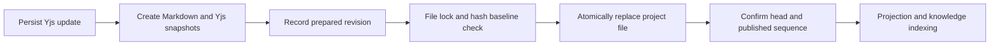

Spaces reuses project collaboration and file infrastructure. The platform supplies generic content capabilities, plugins implement the Space view and format-specific models and editors, and ChatKit Workbench owns navigation, save protection, and Assistant review.

This page describes current code contracts and operating boundaries. User-facing guides cover [Spaces](/en/guides/spaces), [Markdown collaboration](/en/guides/spaces-markdown), and [document source imports](/en/guides/spaces-document-sources).

## Responsibilities

| Layer                     | Responsibility                                                                                                                                         |
| ------------------------- | ------------------------------------------------------------------------------------------------------------------------------------------------------ |
| Project                   | Type, members and roles, Assistant connections, archive state, and file workspace                                                                      |
| Platform content services | Resource authorization, editor registration and resolution, collaboration persistence, file publication, versions, proposals, comments, and references |
| HTTP SDK                  | Typed `Client.content` requests with shared identity, organization context, and cancellation                                                           |
| ChatKit Workbench         | Editor instances, internal navigation, unsaved-state coordination, links, Assistant review, and context handoff                                        |
| ClawXpert Detail          | Hosts ChatKit and calls generic `prepareLeave()` before leaving a route                                                                                |
| Spaces plugin             | Space metadata, lists and folders, project content entry points, subpage relationships, and import orchestration                                       |
| Markdown plugin           | Tiptap/Yjs model, Markdown parsing and serialization, editing UI, location handling, and save handshake                                                |
| Connector plugin          | External authorization, fixed API requests, source search, reading, and conversion warnings                                                            |

ClawXpert Detail does not register a second set of content commands, maintain document dirty state, or open separate Angular document review screens. Spaces does not own general AI conversation or review. Other formats extend the shared contracts rather than adding format semantics to the Space list or generic platform storage.

## Project and resource identities

The built-in project type is `applicationKey: 'platform'`, `projectTypeKey: 'space'`. `plugin_spaces_space` is unique by tenant, organization, and project and holds extension metadata. Content records reference it through `spaceId`, but that ID is not a file catalog, volume root, or authorization scope.

File references use `catalog: 'projects'`, `projectId`, and `scopeId: projectId`, mapping to the logical root `/project/<projectId>`. A Space has no separate Volume and does not choose file ownership from the Assistant creator. Pages, binary files, and collected artifacts share the project workspace.

`parentId` identifies a physical folder; `parentPageId` identifies a logical parent page. Page and resource identities survive renaming and moving. Ordinary file versions use Space history storage. Managed Markdown body versions are authoritative in the platform content service; plugins must not maintain a second body head.

## Authorization boundaries

Entry points construct tenant, organization, actor, Assistant, and project scope from trusted requests. Browser-provided identities or file-root overrides are not accepted.

- Within a project, check membership and the Assistant's project connection without adding Studio container visibility or global Assistant directory visibility as another requirement.
- Before project selection, capability entry checks access to the published Assistant directory entry.
- Spaces views, actions, and tools also validate the installed and published `spaces` capability through the platform's Assistant middleware resolver.
- Subsequent document operations authorize the resource and action. Removing an Assistant capability does not delete project files or transfer their ownership.
- Collaboration broadcasts reauthorize every recipient. An old connection cannot bypass membership revocation, archive state, or an unavailable resource.

Owners and managers can manage, editors can write, and members can read. Archived projects are read-only. Server plugins run as trusted code; Remote View iframe isolation is not a server-plugin security sandbox.

## Unified editor and resource contracts

`ContentEditorRegistry` registers both text models and file editors. `IContentEditorProvider` explicitly distinguishes `ContentDocumentModel` from `ContentFileEditor`; capabilities are not inferred from filenames, display titles, or incidental fields.

| Contract                  | Purpose                                                                                                                                                 |
| ------------------------- | ------------------------------------------------------------------------------------------------------------------------------------------------------- |
| `ContentEditorsApi`       | List, prepare, and resolve editors, plus file-editor reads and writes with revision baselines                                                           |
| `ContentDocumentModel`    | Plugin-defined text model initialization, validation, reading, patching, and upgrades                                                                   |
| Content resource provider | Resource description, authorization, and editor entry, with optional file, reference, page hierarchy, location, and publication projection capabilities |
| `ContentDocumentsApi`     | Managed documents, revisions, proposals, comments, and optional page hierarchy operations                                                               |
| `ContentReferencesApi`    | Authorized image, file, and page references with preview/download resolution                                                                            |

File editors submit opaque file content and an `expectedRevision`; the platform handles access and conflicts. Spreadsheet cells, slide structures, and Office semantics belong to their editor plugins rather than the common document model.

Common runtime capabilities include `platform.project.access`, `platform.project.files`, `platform.content.resources`, `platform.content.editors`, `platform.content.documents`, `platform.content.references`, `platform.project.knowledge`, `platform.connector.documents`, and `platform.assistant.middleware-access`. Plugins use public contracts rather than retrieving internal services through generic service getters.

## Workbench navigation protocol

Opening content separates preparation, resolution, and navigation:

1. A business plugin may call its `document.open` action to prepare an authorized resource. That action does not navigate.
2. Call `workbench.content.resolve` to resolve the registered editor. The current Workbench supplies Assistant, project, and organization context.
3. Validate success and pass the returned `navigation` to `workbench.navigation.open` through the same bridge, opening a tab in the current ChatKit Workbench.

```ts
// bridgeRequest represents the plugin's correlated-request helper.
const result = await bridgeRequest('invokeClientCommand', {
  commandKey: 'workbench.content.resolve',
  payload: { resourceId, providerKey }
})
// Shape of navigation in a successful response:
// { target: 'workbench.view', viewKey: 'markdown.views__markdown.editor',
//   selectionId: resourceId, parameters: { contentProvider: providerKey } }
if (result.success && result.navigation) {
  await bridgeRequest('invokeClientCommand', {
    commandKey: 'workbench.navigation.open',
    payload: result.navigation
  })
}
```

The request envelope contains `channel: 'xpertai.remote_component'`, `protocolVersion: 1`, `instanceId`, `scopeRevision`, `requestId`, `type: 'invokeClientCommand'`, `commandKey`, and `payload`. The `clientCommandResult` response uses the same correlation fields and places its output in `result`. The host validates origin, instance, current scope, and manifest declarations.

Spaces requires `workbench.content.resolve`; Markdown/Office editors require `workbench.content.status`. Hosts that cannot satisfy required commands do not show those entries. `required` declares compatibility, not authorization. Failures preserve the current document without falling back to the outer ClawXpert Workbench. The old `workbench.content.open` entry is not retained.

## Save and leave lifecycle

Each Workbench has its own editor lifecycle coordinator, shared by native editors and Remote Views.

1. A plugin reports resource state through `workbench.content.status`. Only events matching the instance, scope, and selected resource are accepted.
2. Before closing or replacing a dirty resource, ChatKit sends `editorEvent/prepareClose`.
3. The plugin finishes saving and returns `closePrepared` with the original `requestId` and `scopeRevision`.
4. Leaving requires `ready: true` and clean state. Errors, timeouts, unmounts, or stale responses are not successful saves.

The public API is `prepareLeave(): Promise<boolean>`, not a public dirty property or event. ClawXpert routes consume only that boolean and block departure after 15 seconds without a response. `beforeunload` provides a browser-close warning; it does not guarantee durable offline recovery or indicate AI task completion.

`assistant.content.review` opens proposals, comments, versions, and external conflicts in ChatKit. `workbench.content.link/copyLink` builds authorized entries from the configured public `workbench.linkBaseUrl`. Missing configuration returns `link_unavailable` rather than copying the current private conversation URL.

## Collaboration, publication, and recovery

The current Markdown model is `markdown.tiptap`, schema `4`, using the Yjs fragment `body`. Frontend and backend share model constraints. The platform rejects unsupported schemas and stale epochs. The model supports upgrades from schemas 1, 2, and 3 in the same family; this is not a migration of old standalone Space data.

Collaboration updates persist before broadcasting to authorized sessions. File publication has a separate acknowledgment path:



The platform stores `content_document`, `content_revision`, `content_proposal`, `content_comment`, `content_location_change`, and collaboration data. Revision files live at `.apps/content/versions/<resourceId>/<revisionId>.md` with a matching `.yjs`; external conflict copies live at `.apps/content/external/<resourceId>/<hash>.md`.

Recovery examines unfinished publication. It continues when the disk still matches the baseline, only acknowledges when it already matches the candidate, and enters conflict state for unrelated content. An accepted Yjs sequence is not a published-file sequence. Location changes persist prepared, committed, and projected stages, retiring the old collaboration epoch before filesystem movement and projection.

Restoration, model upgrades, and external conflict resolution validate baselines and change the epoch. Old clients cannot keep writing. Ordinary file APIs block bypassing managed-document publication, but direct sandbox writes can still create external conflicts.

Knowledge indexing follows file publication, can retry independently, and does not roll back content on failure. The default project binding uses keyword search; results reauthorize access and check the indexed hash against the current file.

## Document source integration

Connectors supply `ConnectorStrategyRuntime.documents?: ConnectorDocumentSource`. The platform coordinates sources, search, and read through `platform.connector.documents`. Scope comes from trusted runtime context, and credentials use existing connection grants and refresh flows without passing through the Remote View.

The Feishu adapter calls fixed OpenAPI origins, never fetches a pasted URL directly, and does not follow redirects. It checks account authorization, docx/wiki targets, revisions before and after reading, and text size. Spaces persists import intent, rereads the source against the preview baseline at confirmation, and then creates the file and resource. Completed requests can be retried safely.

`SpaceItem.importOrigin` stores provenance, including revision, hash, original URL, and conversion warnings. Shared connections expose documents available to their authorized account; copied files are shared under destination-project permissions. The contract does not provide two-way synchronization or remote writeback.

## Remote View theming and internationalization

Plugin views reuse shared shadcn/ui controls, including Dialog, Select, Dropdown, Button, and Input. Preserve component defaults and use host theme variables for visual configuration. `--xui-font-size` and `--xui-density-root-font-size` derive typography and density. Business layouts should not introduce another component typography, radius, or shadow system.

Central plugin dictionaries use the shared Remote View i18n layer for language selection, interpolation, and fallback. English and `zh-Hans` keys remain aligned; components reference keys, while server errors use platform i18next namespaces. Filenames, document bodies, and external source titles retain their original text.

## Release and deployment

These docs are based on source inspection. Previous local checks linked adjacent SDK builds and do not replace browser acceptance using released dependencies. ChatKit currently declares SDK `0.14.0`, which lacks `Client.content`; shipping only the platform's Angular removal changes cannot deliver the feature.

Release in this order:

1. Publish contracts/plugin-sdk with content contracts and the HTTP SDK with `Client.content`.
2. Upgrade ChatKit to the released SDK, then build and publish ChatKit without manual `node_modules` edits.
3. Upgrade the platform's ChatKit dependency, build matching plugins and Remote View assets, and update and publish Assistant configuration.
4. Back up the database and project Volumes, then apply migrations appropriate to the installed versions before reopening writes.
5. Validate Space opening, document switching, collaboration, blocked departure after save failure, restoration, links, revocation, and Feishu import using the released package combination.

Relevant migration entry points:

| Repository    | Path                                                                                          |
| ------------- | --------------------------------------------------------------------------------------------- |
| xpert         | `packages/server-ai/src/xpert-project/migrations/20260920-project-types.sql`                  |
| xpert         | `packages/server-ai/src/artifacts/migrations/20261015-content-resource-policy.sql`            |
| xpert         | `packages/server-ai/src/knowledgebase/runtime/migrations/20261020-resource-policy.sql`        |
| xpert         | `packages/server-ai/src/content-resource/documents/migrations/20261021_content_documents.sql` |
| xpert-plugins | `xpertai/apps/spaces/migrations/20261023-subpages.sql`                                        |
| xpert-plugins | `xpertai/apps/spaces/migrations/20261023-document-import-origin.sql`                          |

These are upgrade entry points, not a universal automatic migration for arbitrary historical databases. Fresh installation also requires normal plugin entity initialization. Current code does not provide a general conversion from old Assistant-owned standalone Spaces to Project Spaces.

## Verification entry points and remaining boundaries

Use these source locations to find implementations and adjacent tests:

| Repository    | Entry points                                                                                                             |
| ------------- | ------------------------------------------------------------------------------------------------------------------------ |
| xpert         | `packages/server-ai/src/content-resource/`, `packages/server-ai/src/connector/`, `packages/server-ai/src/xpert-project/` |
| xpert-sdk     | `packages/core/src/tests/content.test.ts` and the `Client.content` implementation                                        |
| chatkit-js    | `WorkbenchShell.content.test.tsx`, `editor-lifecycle.test.ts`, `RemoteViewFrame.test.tsx`, `ParentMessenger.test.tsx`    |
| xpert-plugins | `xpertai/apps/spaces/`, `xpertai/apps/markdown-editor/`, `packages/shadcn-ui/`                                           |

Recorded protocol, component, and historical browser checks apply to the versions tested at that time. The latest ChatKit responsibility changes still require acceptance with released packages. Office also needs compatible platform dependencies and its own validation; Markdown acceptance does not establish Office readiness.

Production deployments still need validation or further work for cross-node shared storage and lock failures, joint database/Volume backup and recovery, the full IME and dual-window browser interaction matrix, and durable offline editing. Publication projection currently retains the revision author's identity; revoked author access can block projection. A maintenance identity and recovery policy remain necessary, and are not described here as solved.
