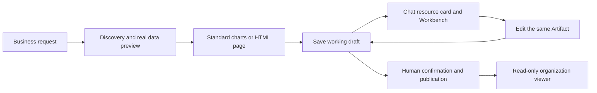

Artifacts Dashboard is a persistent, editable data dashboard provided by the Live Dashboard plugin. A user describes a business question in chat. The Agent queries authorized data, creates standard charts or an HTML/JavaScript page, and saves a working draft under a stable Artifact identity. A human publishes a formal version before sharing a read-only dashboard with organization members.

These pages describe the current implementation, independently of development plans and dated acceptance reports. They do not establish production release readiness or compatibility with publicly published packages.

## Workflow

Saved content contains the page, controls, Bindings and dependency snapshots, not query rows. Formal versions freeze the definition. Opening, filtering and refreshing still query data currently accessible to the viewer. A fixed dashboard version is therefore not a historical data snapshot.

## Ownership and modules

| Layer              | Responsibility                                                                          | Source entry                                                        |
| ------------------ | --------------------------------------------------------------------------------------- | ------------------------------------------------------------------- |
| contracts          | Binding, Dataset, fields, parameters, completeness, freshness and provenance            | `packages/contracts/src/analytics-query.model.ts`                   |
| Platform Analytics | Current-actor source authorization, provider dispatch, validation, deadlines and limits | `packages/server/src/data-source/analytics/`                        |
| plugin-sdk         | Provider registration, normalization and isolated HTML document host                    | `packages/plugin-sdk/src/lib/data/analytics/`, `artifact-document/` |
| Platform Artifacts | Stable identity, drafts, immutable versions, links and presentation authorization       | `packages/server-ai/src/artifacts/`                                 |
| Cloud / ChatKit    | Resource cards, Workbench navigation, standalone viewer and controlled client commands  | `apps/cloud/src/app/artifacts/presentation/`                        |
| Source plugins     | Native query syntax, discovery, parameter mapping and Dataset projection                | `xpert-plugins/community/tools/analytics-*`                         |
| Dashboard plugin   | Definitions, Agent tools, preflight, controls, sharing UI and renderer integration      | `xpert-plugins/community/apps/live-dashboard`                       |

Providers do not implement page editing or charts. The platform does not interpret SQL, ontology Actions or script business logic. The dashboard consumes the same Dataset across providers.

## Available capabilities

- PostgreSQL, MySQL, Doris, data-xpert ontology and Workspace Python/JavaScript sources.
- Standard Data Analytics rendering and Agent-authored HTML/CSS/JavaScript pages.
- Plugin-packaged ECharts and Three.js core, with exact dependency versions and bytes saved alongside content.
- Real previews, filter probes, initial HTML rendering checks and successful save receipts.
- Editing across turns, saved drafts, human publication, formal history and concurrency protection.
- Chat resource cards that open, switch and restore dashboards in ChatKit's own Workbench.
- Read-only organization sharing, a floating standalone toolbar, filters and refresh.

Read [Data and rendering](./data-and-rendering), [Lifecycle and sharing](./lifecycle-and-sharing), and [Configuration and limits](./configuration-and-limits).

## Documentation ownership

These pages maintain current behavior, module ownership and interface semantics. SDK documentation remains the API reference. Packaged plugin skills guide Agent operations, while dated acceptance reports preserve their actual verification scope. Implemented items from development plans are described here as features; unimplemented proposals are not product commitments.
