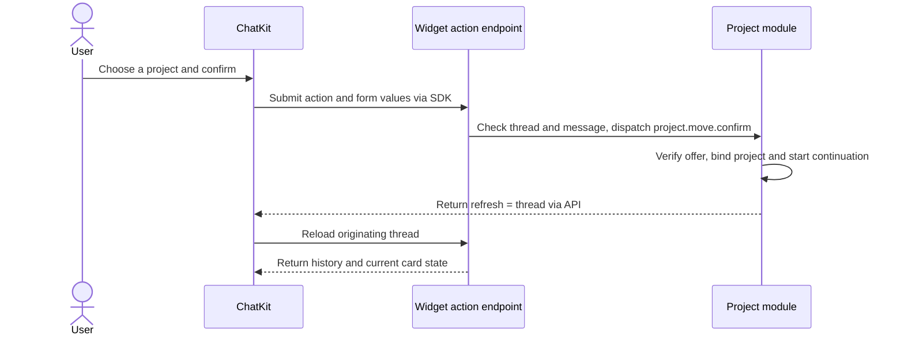

A user can choose a project in an assistant reply, click **Move and continue**, and watch the dashboard take shape in the same conversation. After a page refresh, that reply can show either the pending form or the project it was moved to. Two backend components make this possible. A **message widget provider** (`@MessageWidgetProvider`) decides what the current viewer can see on a message. An **action provider** (`@WidgetActionProvider`) groups the operations for a Widget type and decides what each click can change.

## How a card reaches its message

A card uses the existing assistant message content type `TMessageContentWidget`. The outer part has `type: 'component'` and its payload has `data.type: 'Widget'`. Each A2UI surface in `data.widgets[]` describes a piece of the interface. A `surfaceUpdate` supplies components and bindings, and `beginRendering` identifies the root component. ChatKit renders the result inline in the message list without a host-managed mount point.

| Identifier                  | Purpose                                                                                                             |
| --------------------------- | ------------------------------------------------------------------------------------------------------------------- |
| `threadId`, `messageId`     | Identify the originating thread and assistant reply.                                                                |
| `widgetId`                  | Identifies a card instance on that reply and matches the content part's `id`. A stable domain record ID works well. |
| `provider`                  | Selects the provider that can reconstruct this kind of card, such as `project.move`.                                |
| `action.name`               | Selects the handler for an operation, such as `project.move.confirm`.                                               |
| `surfaceId`, component `id` | Let A2UI connect components, layout and data bindings within the rendered interface.                                |

1. **Publish.** Before the assistant reply completes, resolve `ConversationRuntimeCapability` from the current execution registry and call `publishWidget(this, { provider, widgetId })`. The platform binds the current assistant reply of this execution. Supply `messageId` to address a known reply in the same thread. The host binds the thread and actor.
2. **Persist.** The platform verifies the provider's identity and the caller's permission to contribute to the conversation, then records the binding in `chat_message_widget_reference`. A provider can safely issue the same binding again. For dynamic cards this table holds a reference. The provider derives form fields, available projects and offered actions from current business state.
3. **Render inline and restore in place.** Publishing during the active reply inserts a Widget block at that point in the stream and persists its position among the text blocks. Subsequent text starts a separate block, so a reply can contain text → card → text. Live publication, message completion, history reads and reconnect snapshots call `resolve(references)` in batches grouped by provider. Each returned `messageId` and `widget.id` must match a registered pair. Reissuing a card updates that block without moving it; references without a saved position appear at the end. Refreshing reads the current business state without running the model again. Identical card replay preserves in-memory form edits; retaining those edits across a page refresh requires separate draft persistence.

Restricted sessions apply message visibility rules first. A provider must opt in with `visibleInRestrictedSessions = true` and limit the returned fields and choices to what the current viewer may see. It can omit any reference the viewer cannot access. If unloading a provider leaves no eligible implementation in the current scope, its cards disappear. Reinstalling the provider can restore eligible business records from their original references.

## What happens when the user clicks Move and continue

The project picker sets its confirm button's `action.name` to `project.move.confirm` and lists the same name in **the containing surface's `serverActions`**. The button's `action.context` declares the values to submit. For an existing project, `mode` is the literal `existing` and `target` reads the selected value from `/existing`. For a new project, `mode` is `create` and `target` reads the name from `/create`.



For actions listed in `serverActions`, ChatKit calls `client.threads.submitWidgetAction` directly. The SDK encodes each URL identifier separately and submits the request with the session's credentials. The request body contains the resolved form values themselves. The IDs in this path are placeholders.

```http
POST /api/ai/threads/{threadId}/messages/{messageId}/widgets/{widgetId}/actions/project.move.confirm
Content-Type: application/json

{"mode":"existing","target":"selected-project-id"}
```

The shared endpoint checks the caller's permission to contribute, any restricted-session access rules, and whether the assistant message belongs to the originating thread. For `project.move.confirm`, it finds the `project.move` action provider in the current scope, resolves the declared `confirm` entry in its `actions` map, and passes its handler `{ threadId, messageId, widgetId, fields }`. Two policies establish that the action was offered.

| Handler declaration                   | How the offer is verified                                                                                                                                                                       |
| ------------------------------------- | ----------------------------------------------------------------------------------------------------------------------------------------------------------------------------------------------- |
| Default or `widgetSource = 'message'` | The platform checks an issued reference and the card currently restored by its provider, including its ID and `serverActions`. Client-editable message content does not grant action authority. |
| `widgetSource = 'receipt'`            | The handler checks the originating thread, message, card instance and allowed operation against an authoritative domain record (the receipt). Project moves use this policy.                    |

Under either policy, the handler validates form values, permissions on the target resource and current business state, and handles retries. ChatKit blocks concurrent clicks on the same card. A surface can also set `requiresIdleThread: true` to wait for the active run to finish. These controls govern the interface. The backend must still enforce its own state checks.

A handler can return `{ refresh: 'thread' }` to reload the originating thread if the user is still viewing the same card. Returning `{}` leaves the view in place. Actions outside `serverActions` follow the existing A2UI `onAction` callback path for host-side interactions.

### Business behavior stays with the provider

For the project picker, the project module owns the selection request, move eligibility, target permissions, confirmation receipt, and continuation. It publishes and restores the card through its message provider and handles confirmation and cancellation through its action provider. The generic `request_user_input` tool remains a clarification mechanism. See [Move a conversation into a project](/en/guides/conversation-project-move) for capability setup, the user flow, and current limits.

The same message and action infrastructure supports other plugin-owned cards. The shared endpoint does not decide project policy or start project work on its own. Each provider validates its own business state and returns a generic refresh result when appropriate.

## Registration and module boundaries

Both Widget registries extend the SDK's generic `NamedProviderRegistry`. It validates the implementation, enforces name ownership and rejects a different live provider with the same name in the same scope. `BaseStrategyRegistry` owns discovery, lifecycle subscriptions, scoped lookup and cleanup. Other provider categories can opt into the same strict layer; existing registries retain their naming and replacement behavior.

The platform's `AIWidgetsModule` contains the shared action endpoint and message resolution infrastructure. SDK decorators declare each registration's kind and name for the loader's generic preflight checks. A plugin registers its own providers in its Nest module without changing `AiModule` for each new card or action. Plugin code publishes through the host-bound `ConversationRuntimeCapability`; platform-internal project services use constructor injection and internal typed CQRS contracts.

## Register a card in a plugin

This example adds a dashboard publication review card to the `@example/dashboard` plugin. `DashboardService` represents the plugin's own business service. Its `reviewWidgetsForCurrentViewer` method checks visibility for each reference and returns `{ messageId, widget }` pairs. When building the publish button, use the same `publishAction` for its `action.name` and its surface's `serverActions`. The service's `publishFromWidget` and `cancelReviewFromWidget` methods validate the form, check business permissions and make their state changes idempotent.

```ts
import { Module } from '@nestjs/common'
import {
  ConversationRuntimeCapability,
  MessageWidgetProvider,
  WidgetActionProvider,
  type RuntimeCapabilityRegistry,
  type IMessageWidgetProvider,
  type IWidgetActionProvider,
  type MessageWidgetReference,
  type WidgetActionContext
} from '@xpert-ai/plugin-sdk'
import { DashboardService } from './dashboard.service'

const reviewProvider = '@example/dashboard:review'
const publishAction = reviewProvider + '.publish'

@MessageWidgetProvider(reviewProvider)
class DashboardReviewCards implements IMessageWidgetProvider {
  constructor(private dashboards: DashboardService) {}

  issue(capabilities: RuntimeCapabilityRegistry, widgetId: string) {
    return capabilities.require(ConversationRuntimeCapability).publishWidget(this, {
      provider: reviewProvider,
      widgetId
    })
  }

  resolve(refs: readonly MessageWidgetReference[]) {
    return this.dashboards.reviewWidgetsForCurrentViewer(refs)
  }
}

@WidgetActionProvider(reviewProvider)
class DashboardReviewActions implements IWidgetActionProvider {
  constructor(private dashboards: DashboardService) {}

  readonly actions = {
    publish: {
      execute: async (context: WidgetActionContext) => {
        await this.dashboards.publishFromWidget(context)
        return { refresh: 'thread' as const }
      }
    },
    cancel: {
      execute: async (context: WidgetActionContext) => {
        await this.dashboards.cancelReviewFromWidget(context)
        return { refresh: 'thread' as const }
      }
    }
  }
}

@Module({ providers: [DashboardService, DashboardReviewCards, DashboardReviewActions] })
export class DashboardPluginModule {}
```

This is the minimal Widget returned for one review record. `review-42` is the record’s stable identifier. The Publish button and `serverActions` both reference the plugin action.

```json
{
  "id": "review-42",
  "type": "component",
  "data": {
    "type": "Widget",
    "category": "Dashboard",
    "widgets": [
      {
        "name": "review",
        "serverActions": ["@example/dashboard:review.publish"],
        "messages": [
          {
            "surfaceUpdate": {
              "surfaceId": "review",
              "components": [
                { "id": "caption", "component": { "Text": { "text": { "literalString": "Publish" } } } },
                {
                  "id": "publish-button",
                  "component": {
                    "Button": {
                      "child": "caption",
                      "action": { "name": "@example/dashboard:review.publish", "context": [] }
                    }
                  }
                }
              ]
            }
          },
          { "beginRendering": { "surfaceId": "review", "root": "publish-button" } }
        ]
      }
    ]
  }
}
```

Register the message provider and action provider in the plugin's own Nest module to use the shared endpoint. Plugin registrations use the full package name as their prefix. Built-ins can use names such as `project.move`. Two different implementations of the same registration kind cannot claim the same name in one scope. Lookup proceeds through the organization, tenant-wide, system-wide and built-in scopes. The registry only dispatches explicitly declared own actions; it never calls arbitrary provider methods or inherited object properties. Local action names contain only letters, digits, underscores or hyphens. Loading, refreshing or unloading a provider affects its entire action set. The sample card offers only `publish`; registering `cancel` does not authorize it on that card until its current `serverActions` includes it.

For a form that pauses a running model until the user supplies missing fields and returns those answers to the same run, see [Runtime user input](/en/guides/runtime-user-input).
