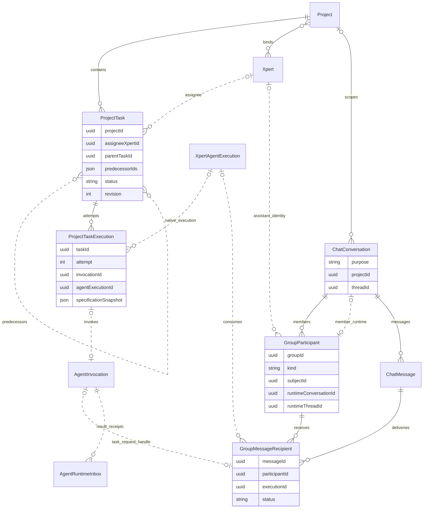

Desktop and Cloud share ChatKit's project management entry for group chats. Connect a project to a group so a coordinating Assistant can create tasks, assign Assistant owners, record dependencies, and dispatch work to members in batches. The task view retains execution and acceptance records, while the group conversation retains the collaboration history.

The coordinating Assistant plans and reviews the work; the platform executes requests and delivers results reliably. Creating tasks, setting dependencies, or changing planned dates does not start execution automatically.

## Getting started

1. When creating the coordinating Assistant, enable **Project management** and choose a model that supports tool calling. In Desktop, select the capability in the Assistant creation screen. In Cloud, select it in the creation wizard's basic information step. The capability can also be adjusted in supported Assistant settings.
2. Create a group and invite the Assistants that will do the work. Each member needs the model and tools required for its role. Enable project management for execution members too if they need to read or modify project tasks.
3. As the group owner, open **Select project** below the composer. Select an existing project, or choose **New project** and enter a name. Then confirm the participating Assistants; the primary Assistant must remain selected. Creation or association happens only after confirmation. Canceling this step does not create a project.
4. Describe the goal, deliverables, owners and ordering in the group. The coordinator uses project task tools to save the plan, dispatch work and review results.
5. Open **Project tasks** in Workbench to inspect the task list, assignees, dependencies, timeline and execution records.

ChatKit uses the Xpert SDK and a shared backend for project creation and association. Desktop and Cloud do not need their own project creation event handlers.

Once connected, the same project menu shows the project name and an action to **manage participating Assistants**. Existing participants stay connected; select additional members and save to include them. Save is disabled when nothing has changed. Non-owners can view participants but cannot edit them. There is no separate project button in the group header.

### Project selection and permissions

- Group membership, human project permissions, and Assistant-to-project connections are separate relationships. Joining a group does not grant project editing rights.
- The group owner selects the project. Connecting an existing project also requires its management permission. Task operations always check the current business user's project permissions.
- Group members share an Assistant runtime conversation, but each actual execution remains attributed to the human who initiated it. Task entry points recheck current membership and project association through the group domain instead of treating the runtime conversation's first creator as its permanent owner. Personal conversations still require a matching creator.
- Only active Assistant members explicitly included in the project can receive this group's project tasks. The task assignee must match the selected execution member.
- After the group project is set, this entry cannot switch it to another project. Eligible Assistants can still be added. Member conversations with existing executions cannot silently switch projects, so configure the project before starting the conversation.
- The capability switch configures task tools and instructions. It does not grant permissions, create a project, or configure external execution environments.

## How Assistants communicate in the group

The platform injects shared response guidance into every receiving Assistant's group context. It covers coordinators and execution members, ordinary requests, task dispatches, and result continuations. Desktop and Cloud use the same guidance without editing each Assistant's role prompt or changing one-to-one conversations.

- Use the user's language and default to 1–3 short sentences or bullets. Lead with the result, blocker or next step; avoid repeating the plan or narrating each operation.
- Apply the same guidance to visible replies, progress updates and messages sent to other members.
- Refer to members and tasks by name. Do not expose internal tool names or arguments, internal IDs, routing metadata, API paths, runtime or queue mechanics, raw errors or stack traces. Explain a failure's impact and next steps in plain language.
- Requested deliverables and necessary evidence may exceed the default length. Brevity must not omit requirements, conceal blockers or uncertainty, or claim success before execution or acceptance is confirmed.

For example, the coordinator can say:

> The analyst will research competitors, and the data specialist will verify prices. Once both results are accepted, the writer will prepare the report.

An execution member can say:

> Prices for three products are recorded in the price table. One quote still needs a date check and should not be used in the final report yet.

This is model guidance, not character truncation or a technical-information filter. The backend independently enforces authorization, tool-output isolation, credential redaction and access to execution records.

## A two-batch example

Ask the coordinator in the group:

> Have the analyst research competitors and the data specialist verify prices. Once both tasks are accepted, have the writer prepare a report. Save assignees, dependencies and execution records. Request rework if a result does not meet the requirements.

The coordinator saves these tasks:

| Task                     | Assignee        | Predecessors | Batch  |
| ------------------------ | --------------- | ------------ | ------ |
| T1: Research competitors | Analyst         | None         | First  |
| T2: Verify prices        | Data specialist | None         | First  |
| T3: Prepare the report   | Writer          | T1, T2       | Second |

The following steps require explicit tool calls; creating the tasks does not start an automatic scheduler:

1. The coordinator calls `project_dispatch_task` for T1 and T2.
2. The platform delivers requests to the selected members. Different members can execute in parallel. Formal tasks for the same member wait for separate runs instead of becoming additional input to another task.
3. After execution, the platform records results and resumes the coordinator through the group. Successful execution moves a task to `review`; failure moves it to `blocked`. Stale results cannot overwrite edited tasks or newer acceptance decisions.
4. The coordinator reads the actual result and evidence using `project_get_task`, then accepts it or requests rework with `project_decide_task`. A task becomes `done` only after acceptance.
5. Once T1 and T2 are done, the coordinator explicitly dispatches T3. Dependency checks reject an earlier dispatch.
6. After T3 is executed and accepted, the coordinator summarizes the deliverables for the user.

There is no separate Batch entity. Batches are expressed through task `predecessorIds` and explicit dispatch by the coordinator. `parentTaskId` represents work decomposition and does not replace dependencies.

A retry keeps the same task and adds an execution attempt:

```text
T1: Research competitors
├─ E1 → I1 → Analyst's first execution: failed
└─ E2 → I2 → Analyst's second execution: succeeded, awaiting acceptance
```

Replaying the same tool call reuses its dispatch and execution records. Only an explicit new attempt creates another execution record.

## Domain model and relationships

| Model                   | Meaning                                                                                                                               |
| ----------------------- | ------------------------------------------------------------------------------------------------------------------------------------- |
| `Project`               | Project container, human membership permissions and Assistant connections                                                             |
| `ProjectTask`           | Business work, including its assignee, requirements, dependencies and status                                                          |
| `ProjectTaskExecution`  | One execution attempt and a snapshot of its task requirements                                                                         |
| `AgentInvocation`       | A unified invocation containing the target, runtime status, result and continuation information; it need not belong to a project task |
| `XpertAgentExecution`   | The Assistant's actual execution record                                                                                               |
| `ChatConversation`      | A public group or a member's own runtime conversation, distinguished by `purpose`                                                     |
| `GroupParticipant`      | A user or Assistant's membership in a group                                                                                           |
| `GroupMessageRecipient` | Delivery and consumption of one group message by one member                                                                           |
| `AgentRuntimeInbox`     | The shared runtime-result inbox that arbitrates result consumption between waiting and automatic continuation                         |

In this domain ER diagram, dotted lines are logical references stored as IDs or JSON and do not guarantee database foreign keys. Only Assistant members are shown; human members, task steps, artifacts and other fields are omitted.



An `AgentInvocation` does not automatically create a `ProjectTask`. This workflow creates business tasks first, then saves execution attempts and invocations when dispatching. An ordinary group message does not create a project task merely because it wakes an Assistant.

## Execution architecture

Group members use the existing native Assistant runtime type, `xpert-task`. The group supplies a delivery channel and conversation context. There is no separate `xpert-group` runtime or `GroupTaskRuntimeStrategy`.

```mermaid
sequenceDiagram
    participant C as Coordinating Assistant
    participant P as ProjectTaskDispatchService
    participant I as AgentInvocationRuntime
    participant N as AssistantTaskRuntimeStrategy
    participant G as Group delivery and runtime
    participant W as Execution Assistant
    participant R as Result inbox and continuation

    C->>P: project_dispatch_task(taskId, target)
    P->>P: Check assignee, revision and dependencies; save attempt
    P->>I: start(native Assistant target)
    I->>N: start()
    N->>G: ExecuteGroupTaskCommand
    G->>W: Run through the existing Handoff queue
    W-->>G: Output and group reply
    I->>N: inspect() (background monitor or explicit query)
    N->>G: Read the matching delivery and actual execution
    G-->>I: Actual status and result
    I-->>R: Persist terminal event
    R->>R: Claim exclusive consumption
    R->>G: Resume delivery of the original group reply
    G->>C: Continue acceptance
    C->>P: project_get_task / project_decide_task
```

### Dispatch and monitoring

`project_dispatch_task` calls `ProjectTaskDispatchService` through CQRS. It saves the execution attempt and immutable dispatch intent before calling the Invocation API. A group-member target explicitly declares `configuration.executionContext.type = "group_member"`, including group, member and project references. The backend resolves these references from authorized relationships, not from message text.

`AgentInvocationRuntime` selects `AssistantTaskRuntimeStrategy` for `provider = "xpert-task"`. Through the scoped `AssistantTaskExecution` capability, the strategy invokes the group domain's `ExecuteGroupTaskCommand`. The group domain publishes requests, resolves actual executions and cancels the exact run. The existing Handoff queue continues to schedule execution.

Background monitoring and explicit result queries use the same `inspect()` method. Only the actual execution linked to the matching delivery can supply a result. A message saying “done” does not complete a task.

### Result delivery and acceptance

All formal runtime results pass through the existing Runtime Outbox / Inbox. Waiting and automatic continuation compete for the same durable consumption record; duplicate consumption is not avoided by prohibiting waits for group tasks.

- A successful member reply is usually already visible in the public group. For formal tasks, it remains visible while delivery back to the coordinator waits for actual execution completion, result persistence and the consumption claim.
- The same reply receives a backend-verified runtime-result reference. The full successful result is not published again.
- Failures and results without reply text produce a retryable, deduplicated status notification.
- Result continuation uses the execution ID reserved by the shared inbox and enters the member conversation through the existing group queue. The inbox does not independently occupy the member thread to start the model.
- If the current coordinator turn already consumed the result by waiting, the background process does not wake another turn for that result.
- Human pause or stop actions, member removal and permission revocation still prevent unauthorized continuation. An unknown execution outcome is not grounds to restart a model or repeat tool side effects.

Acceptance uses current task requirements, the execution attempt and the result revision. Runtime success only makes a task ready for review. Automated independent review remains subject to existing executor capabilities; group-member dispatch does not provide it automatically.

### Conversation failure feedback

Model billing problems, rate limits and other execution errors mark the corresponding group-message delivery as `failed`. Desktop and Cloud show the reason below the message and provide access to the Assistant's execution record. Its `error` belongs to the selected execution and is not overwritten by a later successful retry. Error text is credential-redacted, stripped of stack traces and length-limited before reaching the frontend.

Legacy deliveries marked `blocked / execution_not_completed` also display the failure reason on read when their associated execution has definitively failed; no database rewrite is needed. Deliveries genuinely waiting for human action or an uncertain execution outcome remain `blocked`. After resolving billing, send a new request; failed messages are not automatically rerun.

## Tools and SDK APIs

The coordinator's main tools are:

| Tool                         | Purpose                                                                                                            |
| ---------------------------- | ------------------------------------------------------------------------------------------------------------------ |
| `project_list_task_runtimes` | List available background executors and group-member targets for the current project                               |
| `project_update_task_plan`   | Save parent relationships, dependencies and planned dates; validate revisions, cross-project references and cycles |
| `project_dispatch_task`      | Explicitly dispatch an existing task; use `target: { type: "group_member", participantId }` for a group member     |
| `project_get_task`           | Read the task, attempt history and authorized results without creating an execution                                |
| `project_decide_task`        | Accept the result or request rework based on actual evidence                                                       |

External runtimes still use `bindingId`, which is mutually exclusive with a group-member `target`. Omit `bindingId` and `delivery` for group-member dispatch. It currently uses ordinary Assistant output and does not support requesting CLI file-delivery mode through this entry. `delivery` is not a channel-name string.

ChatKit configures group projects through the Xpert SDK:

| SDK method                                 | HTTP route                            | Purpose                                                                  |
| ------------------------------------------ | ------------------------------------- | ------------------------------------------------------------------------ |
| `client.groups.project(groupId)`           | `GET /api/ai/groups/:groupId/project` | Read the group project and its participating members                     |
| `client.groups.setProject(groupId, input)` | `PUT /api/ai/groups/:groupId/project` | Create or associate a project and connect explicitly selected Assistants |

Creation requests use a stable client-generated project UUID. If the network outcome is uncertain, the UI retries with the same UUID. An existing project uses `mode: "existing"` and its project ID. The backend locks the group record and rechecks authorization to prevent concurrent windows from selecting different projects.

`participantIds` contains the explicitly selected Assistant members and must include the primary Assistant. Updates only add connections: omitting an existing participant does not remove it. Responses return all active members already connected to that project, matching subsequent reads. Creation and Assistant connections reuse idempotent project-domain operations. If configuration fails partway through, retry with the same project ID to complete it instead of creating another project with a new ID.

Project listing and existing-project name lookup use `client.forGroupComposer(groupId, primaryParticipantId).projects`; reading and saving the group association use the original `client.groups`. Both retain the host's identity and organization context while using their respective authorized routes. Group credentials cannot directly access generic project management APIs. For a 403, inspect the request boundary rather than changing membership permissions to bypass the refusal.

### Module responsibilities and dependency boundaries

| Module                                              | Owns                                                                                              | Does not own                                            |
| --------------------------------------------------- | ------------------------------------------------------------------------------------------------- | ------------------------------------------------------- |
| ChatKit `ProjectSelector` / `ProjectManagementMenu` | Shared project menu, search and menu actions                                                      | Group APIs or task dispatch                             |
| ChatKit `useGroupProject`                           | Connects group project state to the existing menu; manages confirmation dialogs and focus         | Project authorization or local task creation            |
| ChatKit `useGroupProjectForm` / `GroupProjectForm`  | The hook reads and saves members; the form renders them; late responses are ignored after closing | Desktop or Cloud host changes                           |
| SDK `GroupsClient`                                  | Typed requests, routes, abort signals and existing host authentication                            | Authorization rules, menu state or execution scheduling |
| `GroupProjectService`                               | Group-owner checks, project association and member runtime-conversation connections               | Task state or acceptance                                |
| `GroupTaskTargetService`                            | Resolves targets from persisted caller conversations and rechecks membership and project access   | Accepting model-supplied group or user identity         |
| `ProjectTaskDispatchService`                        | Task requirements, assignees, dependencies and idempotent attempts                                | Group message publication                               |
| `AssistantTaskExecution`                            | Native Assistant transport capability contract                                                    | Another group runtime or scheduler                      |
| Group execution / result CQRS handlers              | Request delivery, actual execution lookup, exact cancellation and result delivery                 | Deciding task acceptance                                |
| Runtime Inbox / Continuation                        | Durable result-consumption claims and continuation                                                | Starting member runs outside the group queue            |

Cross-domain operations use typed CQRS commands, with handlers registered in their owning modules. Public-text extraction and credential redaction are pure functions under `shared`; the group domain does not depend on voice business logic or the Invocation Activity database service. HTTP, View and Assistant tool inputs share `projectTaskPlanSchema`. The tool additionally limits the number of dependencies in one submission; `ProjectTaskGraphService` owns authorization, revision and cycle checks.

Publish the SDK APIs first, then update ChatKit's formal dependency to the released version containing them. A controlled local SDK build can support development verification, but a successful local integration is not evidence of a published package.

API processes and background consumers sharing a database must use compatible versions. Separate ports or queue prefixes do not isolate Invocation, result-inbox or group-delivery database scans. An older consumer may read a new task first and mark it inaccessible. Use separate databases for parallel version testing, or obtain authorization before pausing older consumers.

## Regression acceptance

In both Desktop and Cloud, create test groups and projects through the currently signed-in user's UI. Do not use a read-only project created by another account or change roles to bypass authorization failures.

Verify in this order:

1. Enable project management when creating an Assistant. Create a group, invite members, create or select a project from the composer project menu, and confirm participants. Reopen the same menu to verify member management, canceling confirmation, unchanged-save behavior and read-only access.
2. Create T1, T2 and T3 from the example. Verify their assignees and that T3 depends on both T1 and T2.
3. Verify that early dispatch of T3 is rejected. Dispatch T1 and T2; different members can work in parallel while tasks for the same member queue.
4. Inspect actual execution records, successful results and review status. Dispatch T3 only after its predecessors are accepted.
5. Retrying the same request must not add an execution. Intentional rework creates another attempt and retains previous records.
6. Waiting and automatic continuation must not consume a result twice. Successful replies must not be duplicated; failure and empty-result notifications must still reach the coordinator.
7. After refresh or reconnection, verify tasks, assignees, dependencies and execution records. Check pause, cancellation and member-removal boundaries.
8. Check the coordinator's and execution members' replies, progress updates and failure explanations: concise by default, in business language, without internal technical details, while retaining necessary deliverables, evidence and blockers.

Automated tests use an isolated temporary PostgreSQL database to verify delivery, idempotency and consumption races, with controlled substitutes for model and authorization dependencies in the relevant cases. These tests do not replace real-model UI acceptance in Desktop and Cloud.

## Implementation references

- [Project configuration service](https://github.com/xpert-ai/xpert/blob/develop/packages/server-ai/src/chat-group/group-project/group-project.service.ts)
- [Task dispatch service](https://github.com/xpert-ai/xpert/blob/develop/packages/server-ai/src/xpert-project/runtime/project-task-dispatch.service.ts)
- [Native Assistant runtime adapter](https://github.com/xpert-ai/xpert/blob/develop/packages/server-ai/src/agent-invocation/assistant-task-adapter.ts)
- [Native Assistant execution contract](https://github.com/xpert-ai/xpert/blob/develop/packages/server-ai/src/agent-invocation/assistant-task-execution.ts)
- [Task plan input schema](https://github.com/xpert-ai/xpert/blob/develop/packages/server-ai/src/xpert-project/project-task-plan.schema.ts)
- [Group execution delivery handler](https://github.com/xpert-ai/xpert/blob/develop/packages/server-ai/src/chat-group/group-project/group-task-execution.handler.ts)
- [Shared result consumption and continuation](https://github.com/xpert-ai/xpert/blob/develop/packages/server-ai/src/handoff/runtime-messaging/runtime-message-continuation.service.ts)
- [Group reply continuation and result association](https://github.com/xpert-ai/xpert/blob/develop/packages/server-ai/src/chat-group/group-project/group-task-result.handler.ts)

## Related documentation

- [Application project types](/en/guides/project-application-types)
- [Assistant capabilities](/en/guides/assistant-capabilities)
- [Group chat](/en/guides/group-chat)
- [Project tasks](/en/guides/project-tasks)
