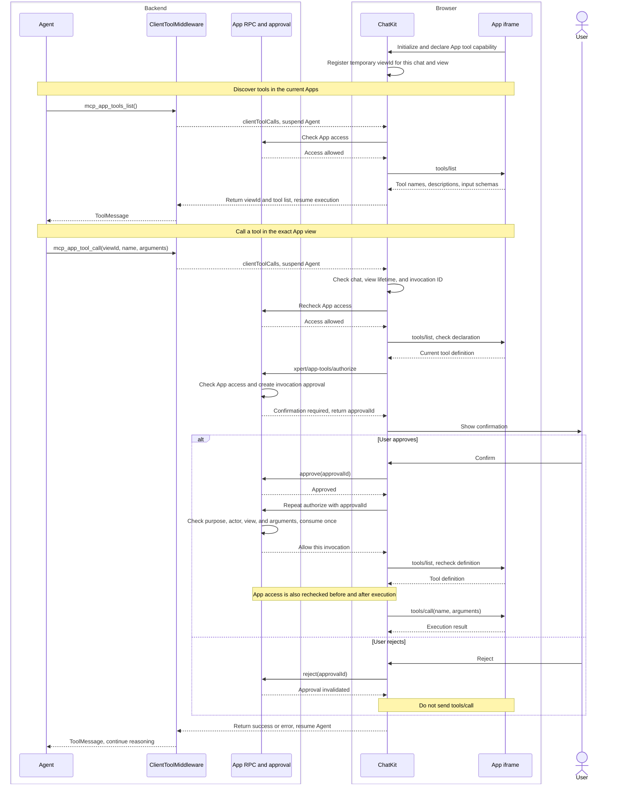

`McpAppToolsMiddleware` lets an Assistant discover and call **tools exposed by live MCP App views in the current chat**. JavaScript inside the App iframe implements these tools and can access the view's current selection, unsaved form values, or chart settings. These are examples of possible capabilities; the App's declarations determine which tools are available.

## Two tool entry points

| Tool                 | Purpose                                                                                                                       |
| -------------------- | ----------------------------------------------------------------------------------------------------------------------------- |
| `mcp_app_tools_list` | Discover live App views in the current chat and return their temporary `viewId`, tool names, descriptions, and input schemas. |
| `mcp_app_tool_call`  | Use a discovered `viewId`, tool `name`, and `arguments` to execute in that exact view after user confirmation.                |

For example, a whiteboard App might expose tools for reading a selection and moving elements. The Assistant can discover those tools before requesting an operation on the current board. Ordinary MCP server tools retain their server execution path. An App that only displays a UI does not automatically acquire view tools.

## Why reuse ClientToolMiddleware

These two entry points are **Client Tools** in Xpert: the backend Agent requests an operation, ChatKit handles it in the browser, and the client returns the result to the backend.

`ClientToolMiddleware` already supplies the execution flow: suspend the Agent, process the request on the client, return the result, and resume execution. It also handles tool-call ID correlation, error results, and tool-step presentation. `McpAppToolsMiddleware` reuses that flow and packages the fixed App tool names, schemas, descriptions, icon, and display labels as a selectable middleware.

The dedicated middleware provides consistent configuration and clear responsibilities. The same two entry points could technically be configured manually in `ClientToolMiddleware`; this wrapper avoids copying protocol definitions into each Assistant and prevents its configuration from replacing the fixed tools.

| Layer                                 | Responsibility                                                                                                                                                       |
| ------------------------------------- | -------------------------------------------------------------------------------------------------------------------------------------------------------------------- |
| `McpAppToolsMiddleware`               | Expose fixed tool definitions to the Agent, configure presentation, and delegate to the existing client-tool execution mechanism.                                    |
| `ClientToolMiddleware`                | Interrupt and resume the Agent, converting the client response into a `ToolMessage`.                                                                                 |
| ChatKit                               | Maintain the current chat's temporary view registry, identify the exact view, validate tool declarations, show confirmation, and call the App through `postMessage`. |
| Backend App RPC and approval services | Check App instance access and request, approve, reject, and consume single-use consent for this invocation.                                                          |
| App iframe                            | Declare and execute view tools and return their results. Any backend operations performed by a tool still require the relevant API authorization.                    |

## When to use it

Add “Tools in open Apps” (`McpAppToolsMiddleware`) to the Assistant workflow and connect it to the target Agent when the AI needs to operate an interactive App that the user is currently using. Registering the middleware in the platform does not enable it for every Assistant.

At runtime, all of the following must hold:

- ChatKit supports these two client-tool entry points and has an active chat.
- The App is open, advertises `appCapabilities.tools` during initialization, and implements view-side `tools/list` and `tools/call`.
- The current user retains access to the App. Each view-tool execution requires user confirmation; discovery alone does not create an execution approval.

Ordinary chat, direct MCP server-tool calls, display-only Apps, and background jobs without a frontend view do not need this middleware. Discovery returns an empty result when the chat has no available views; it does not start a replacement view.

A `viewId` belongs to the current client, chat, and view lifetime. Rediscover tools after remounting. Do not persist or guess IDs, or redirect calls to the most recently opened App. A timed-out mutation can have an uncertain outcome: inspect the actual state before deciding whether to issue another operation.

## Frontend/backend sequence

The `ClientToolMiddleware` participant executes the two tools configured by `McpAppToolsMiddleware`.

Approval uses `purpose: 'view-tool'` and binds the user, App instance, `viewId`, tool name, and complete arguments. It cannot be reused as an approval for an ordinary server tool. An App's read-only annotation does not waive confirmation for these view-tool executions. The backend response authorizes this invocation; ChatKit checks that the view remains live and the tool definition is unchanged before dispatching execution to the iframe.

## Relationship to WebMCP

**Client Tools describes Xpert's execution routing. MCP Apps and WebMCP define interfaces for exposing and calling web application capabilities.** These are separate layers.

| Type                                     | Implementation location              | Invocation mechanism                                                            |
| ---------------------------------------- | ------------------------------------ | ------------------------------------------------------------------------------- |
| MCP server tool                          | Backend MCP server                   | Call the server tool over an MCP connection.                                    |
| MCP App view tool in this implementation | JavaScript in the current App iframe | ChatKit sends `tools/list` and `tools/call` as JSON-RPC over `postMessage`.     |
| WebMCP tool                              | Web page JavaScript                  | Register, discover, and execute tools through the browser's `modelContext` API. |

MCP Apps uses JSON-RPC over `postMessage` between the host and view; see the [MCP Apps documentation](https://apps.extensions.modelcontextprotocol.io/api/documents/Overview.html#bidirectional-communication). The [WebMCP draft](https://webmachinelearning.github.io/webmcp/#api), checked on 2026-11-14, defines `document.modelContext.registerTool()`, `getTools()`, and `executeTool()`. This implementation does not integrate WebMCP APIs, and its App view tools are not automatically exposed to browser WebMCP consumers.

## Implementation locations

- Xpert: `packages/server-ai/src/xpert-middleware/mcp-app-tools.middleware.ts` and `client-tool.middleware.ts`.
- Xpert: `packages/server-ai/src/mcp-app-runtime/mcp-app-view-tools.ts` and `mcp-app-tool-approval.service.ts`; RPC dispatch is in `xpert-toolset/mcp-apps.service.ts`.
- ChatKit: `packages/chatkit-ui/src/components/thread/messages/mcp-app/bridge/app-tools.ts` and `useMcpAppTools.ts`; shared tool definitions are in `packages/chatkit/src/mcp-app-tools.ts`.

See [Agent Middleware](./agent-middleware) for the general middleware model and workflow binding.
