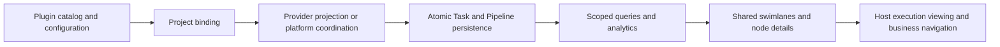

Contracts owns shared protocols and validation. The SDK registers catalogs, Providers and runtime adapters. Server AI persists and coordinates work. Shared remote components render graphs and interactions. Plugins own domain conditions, object resolution and business workbench destinations.

## Data flow and components

| Source entry                                                                        | Responsibility                                                                    |
| ----------------------------------------------------------------------------------- | --------------------------------------------------------------------------------- |
| `packages/contracts/src/ai/project-pipeline`                                        | Definition, binding, state, projection, command, capability and analytics schemas |
| `packages/plugin-sdk/src/lib/project-pipeline`                                      | Contributions, Providers, adapters and Runtime Capabilities                       |
| `packages/server-ai/src/xpert-project/pipeline`                                     | Configuration, persistence, projection, coordination, queries and APIs            |
| `packages/server-ai/src/xpert-project/remote-components/project-tasks/src/pipeline` | Layout, stage icons, analytics, node details and configuration                    |
| Cloud Project / Workbench and Desktop Workbench                                     | Authorized navigation, execution viewing and view restoration                     |

## Identity, versions and atomic projection

Project Bindings, Instances, Runs, Rounds and Node Instances carry tenant, organization and Project scope. Definitions have versions and digests; Runs pin binding snapshots; Rounds pin input digests and Subject Version sets. Evidence references identify the exact object, version, content digest and schema. A reference grants no access by itself.

Provider projections use `sourceKey`, `sourceEpoch` and `sourceSequence` for source identity and ordering. A complete snapshot covers one instance and one round. Tasks, nodes, edges, execution ownership and the projection checkpoint commit within the platform transaction. Repeated receipts are handled idempotently; stale sources cannot roll facts back, and older rounds cannot replace the active round.

Removal, exclusion and supersession require explicit tombstones. An absent task or node is not a cancellation request. Historical rounds retain their business facts and execution associations.

This transaction does not include the plugin database or external systems. Plugins persist their business results before requesting synchronization and need recoverable receipts across that boundary. `synchronize()` waits for the projection and linking receipt without dispatching work. `refresh()` queues a durable refresh of Provider facts without rerunning an Agent.

## Execution coordination

Managed definitions support `work`, `fork`, `join`, `router`, `human_gate`, `external_wait` and `terminal`. Each round is a bounded DAG. Branches match machine outcomes; joins wait for selected, completed predecessors.

The coordinator persists the operation and dispatch intent before calling an executor. Operations bind node, round, input digest and generation. Worker leases and fencing prevent stale callbacks from changing newer state. Ambiguous effects remain `unknown` and are inspected using the original operation and idempotency key rather than automatically replayed.

The host pins actual identity, published Assistant version, workspace and stable execution IDs for native Assistant and Runtime work. Plugin `prepare()` methods supply bounded domain input; `collect()` reads typed evidence after real execution success. Plugins cannot override the actor, Project, model authorization or target. Completion Evaluators or Providers still determine business completion.

Resource claims coordinate canonical resource occupancy; they are not an operating-system sandbox. Executors must enforce filesystem, process and identity isolation. The mechanism does not promise exactly-once external effects or automatic recovery from every unknown result.

## Extension interfaces

| Extension                            | Responsibility and boundary                                                                                        |
| ------------------------------------ | ------------------------------------------------------------------------------------------------------------------ |
| `ProjectPipelineContributor`         | Register configurations, descriptors and forms; metadata checking does not execute domain callbacks                |
| `IProjectPipelineProjectionProvider` | Read-only `snapshot()`, platform links through `linked()`, actor-specific diagnostics through `describeNode()`     |
| Provider Actions                     | Allowlisted `actions()`; paired `executeAction()` and `inspectAction()` recheck domain authorization and versions  |
| Subject / Evidence Resolver          | Resolve exact immutable versions; reauthorize evidence reads and validate digest and schema                        |
| `ProjectPipelineNodeHandler`         | Service execute, inspect and optional cancel; recover effects with a stable idempotency key                        |
| Assistant / Runtime Operation        | prepare supplies domain input; collect reads successful output; host owns execution identity                       |
| Completion / Policy Evaluator        | Evaluate business completion or routing; reevaluation is free of domain writes; human decisions are reauthorized   |
| Resource Resolver                    | Read-only authorization and canonicalization of real resources; no allocation or external writes during resolution |

Catalog metadata and runtime adapters register separately and resolve within actor and plugin-source scope. Template references use `key@version`; forms expose an editable allowlist. Missing adapters, bindings, protocols or host features are rejected explicitly rather than replaced with another template or executor.

Public SDK capabilities include `ProjectPipelinesRuntimeCapability`, `ProjectPipelineCatalogRuntimeCapability`, `ProjectPipelineConfigurationRuntimeCapability`, `ProjectPipelineCommandsRuntimeCapability`, Provider Actions, Evidence, Analytics and Portfolio. APIs and views share validation schemas. Actor and organization scope come from trusted host context, not client identity fields.

## Domain integrations

| Integration point        | BOM                                                                                  | Code Review                                                                           |
| ------------------------ | ------------------------------------------------------------------------------------ | ------------------------------------------------------------------------------------- |
| Authority                | Provider preserves the existing domain engine                                        | Platform coordinates template dependencies and roles                                  |
| Subject                  | Business Case and document versions                                                  | Pinned local Git input or separately configured PR input                              |
| Configuration            | Project domain roles, lanes and stages; bind project Assistants                      | Bind reviewers, verifier and human roles; expose allowed review parameters            |
| Domain logic             | Matching, master data, changes, materials, quotations and contracts                  | Diff parsing, review rules, finding aggregation, verification and delivery            |
| Presentation and actions | Readable branches, blockers, scenario and node workbench entries                     | Review evidence, summaries, decisions and platform delivery                           |
| Shared capability        | Task projection, execution attribution, history, swimlanes, analytics and navigation | The same shared models, coordination, human decisions, execution viewing and evidence |

The BOM adapter reuses domain templates instead of copying its node catalog into shared UI. Provider presentation and host navigation connect business destinations. Code Review's local Git mode retains results on the platform; publishing external comments requires separate configuration, permission and an explicit operation. Shared pipelines do not publish GitHub comments by default.

These boundaries do not substitute for deployed plugin acceptance. Historical `*.proposed.json` files are design references, not ready-to-use production configurations. Use `tools/testing/project-pipeline-neutral` as an extension fixture and verify actual host and plugin artifacts separately.
