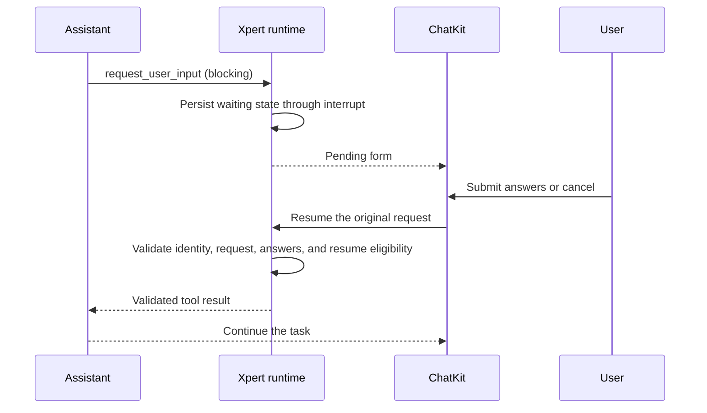

An Assistant can ask for missing information during an ordinary conversation, collect structured answers in a form, and then continue the original task without enabling Plan Mode. This page documents the blocking functionality implemented for [Issue #1288](https://github.com/xpert-ai/xpert/issues/1288). Source implementation and local integration testing do not mean that the shared packages have been published or the feature has been deployed to production.

Non-blocking questions are not implemented. Their persistence, human-message delivery, and scheduling design are described in the [follow-up proposal (Chinese)](../../proposal/issue-1288-non-blocking-user-input.md).

## Usage

1. Start a task in an ordinary Assistant conversation, for example: “Arrange an internal training session. First ask me for the training goals, budget, and participating departments.” The model checks existing context before asking for missing information that affects the result.
2. A question panel appears near the ChatKit composer. Execution waits for input; filling a field does not submit the form automatically.
3. Select “Submit and continue.” The client validates the fields and focuses the first error. The server validates the answers again before resuming the original task.
4. Select “Cancel input” to return an explicit cancellation result to the model. The model should explain what information is missing or proceed with explicit assumptions. Cancellation is neither a successful answer nor authorization to act.
5. Use the separate stop action to stop the entire task. Ordinary conversations can ask follow-up questions when new requirements warrant them.

Answer history cards retain field and option labels and distinguish submitted answers from cancellation. The task summary uses the form title for user-input items. Group conversations retain the originating Agent's response entry point.

Reloading the page restores a pending request from its persisted interrupt. Unsubmitted form drafts are not persisted: request recovery does not provide draft autosave.

## Fields and validation

| Field type    | Answer type      | Component and validation                                               |
| ------------- | ---------------- | ---------------------------------------------------------------------- |
| `text`        | string           | Input; required value and minimum/maximum length.                      |
| `textarea`    | string           | Textarea; required value and minimum/maximum length.                   |
| `number`      | number           | Input; finite number and minimum/maximum value. `0` is valid.          |
| `select`      | string           | Select; only a declared option value can be submitted.                 |
| `multiselect` | string[]         | Checkbox; valid, unique options with minimum/maximum selection counts. |
| `boolean`     | boolean          | Select; explicit yes/no selection. `false` is not empty.               |
| `date`        | string           | Input + Popover + Calendar; a valid `YYYY-MM-DD` date.                 |
| `date_range`  | `{ start, end }` | Two valid dates, with the start no later than the end.                 |

A form contains 1–12 fields. Field IDs must be unique within a form, start with a letter, contain only letters, digits, and underscores, and be no longer than 64 characters. Reserved IDs such as `constructor`, `prototype`, and `__proto__` are rejected. Field IDs and option values are stable data identifiers independent of display labels.

The client and server share validation logic. They reject unknown fields, invalid dates, reversed date ranges, and unknown options. Strings such as `"false"` and `"0"` are not coerced into booleans or numbers. Empty optional values are not stored as completed answers.

Controls use the repository's shadcn/ui components and inherit theme colors, radius, and density. Dates support direct entry, calendar selection, and keyboard navigation. The field scroll area reserves 6px for outer focus rings to prevent clipping by its parent, while preserving alignment with the heading and footer actions.

## Tool protocol

The tool is named `request_user_input`. Ordinary mode uses a versioned form. Currently, only `schemaVersion: 1`, `mode: blocking`, and `purpose: clarification` are supported.

Example tool arguments:

```json
{
  "schemaVersion": 1,
  "mode": "blocking",
  "purpose": "clarification",
  "title": "Additional training requirements",
  "fields": [
    { "id": "budget", "type": "number", "label": "Budget", "min": 0, "required": true },
    { "id": "recording", "type": "boolean", "label": "Record the session", "required": true }
  ]
}
```

The server uses the tool-call ID as `requestId` and treats the form from the original tool call as the trusted definition. The submitted result's `content` contains `type: request_user_input_result`, `schemaVersion`, `requestId`, `purpose`, `status: submitted`, `values`, and the original `form`, with `answers: []` retained for compatibility. For this example, `values` could be `{ "budget": 0, "recording": false }`.

A cancellation result has `status: cancelled` and no `values`. The server reconstructs the purpose and original form and verifies that requestId matches the tool call. It does not trust a client-supplied form or authorization meaning.

Shared types reserve `non_blocking` and future response metadata, and the structural guard can recognize that mode. This does not indicate runtime support. The current tool JSON Schema exposes only `blocking`; the server and ChatKit reject non-blocking requests without silently falling back.

## Execution and recovery



Ordinary input recovery reuses the existing conversation, execution identity, permissions, and LangGraph checkpoint. `run-create-stream.handler.ts` resolves and validates the target execution first, then delegates the single input-resume claim to shared chat admission. This avoids overwriting `input_wait` prematurely and causing the same resume request to fail with 409. Replaying an already consumed request is rejected without clearing or rewriting the current execution.

`client-tool.middleware.ts` creates the server-side tool execution receipt only after the interrupt and input-result resolver have returned. This avoids leaving an in-flight receipt during suspension that would cause recovery to be rejected as a duplicate tool call. Reading history restores only the built-in question panel; it does not execute other client tools.

## Plan Mode and authorization boundaries

- Visible Agents without structured output automatically receive the form tool in ordinary mode. Hidden Agents and structured-output paths do not receive it.
- Plan Mode retains the original `questions` protocol, plan clarification, and `implement_plan` implementation-confirmation flow.
- Ordinary forms always use `purpose: clarification`. Even a field named `implement_plan` cannot authorize implementation.
- Input collection and tool HITL authorization remain separate. Forms do not collect passwords, tokens, or other credentials.

## Implementation locations

ChatKit paths are relative to the separate `chatkit-js` repository. Other paths are relative to this repository.

| Responsibility                 | Key files                                                                                                                                           |
| ------------------------------ | --------------------------------------------------------------------------------------------------------------------------------------------------- |
| Shared protocol and validation | ChatKit `packages/chatkit/src/user-input-form.ts` and `interrupt.ts`.                                                                               |
| Tool and trusted results       | `packages/server-ai/src/shared/agent/user-input.ts` and `runtime-user-input.ts`.                                                                    |
| Agent injection                | `packages/server-ai/src/xpert-agent/commands/handlers/subgraph.handler.ts`.                                                                         |
| Form and date components       | ChatKit `packages/chatkit-ui/src/components/composer/user-input-form-panel.tsx` and `user-input-date-field.tsx`.                                    |
| Client submission and recovery | ChatKit `packages/chatkit-ui/src/providers/stream/interrupts/useStreamUserInput.ts` and `useStreamInterrupts.ts`.                                   |
| History card                   | ChatKit `packages/chatkit-ui/src/components/thread/messages/request-user-input-result-card.tsx`.                                                    |
| Server recovery and receipts   | `packages/server-ai/src/ai/commands/handlers/run-create-stream.handler.ts` and `packages/server-ai/src/xpert-middleware/client-tool.middleware.ts`. |

## Verification scope and known limitations

Local verification on October 30–31, 2026 used Node 22.22.2 / Corepack pnpm 10.24.0 for Xpert and Node 24.14.1 / Corepack pnpm 10.11.0 for ChatKit.

- The ChatKit full-suite baseline passed 324 files and 2,327 tests, with one existing skipped test. Subsequent shadcn changes passed 49 focused tests across seven files; the focus-ring fix passed four form-component tests. These results are not a full-suite rerun after the final styling change.
- The initial server verification passed 46 tests, including real LangGraph + MemorySaver checkpoint recovery. After integration fixes, 64 related regression tests passed. The final dependency-injection and isolation group encountered an existing TS2589 error and passed with a temporary isolatedModules configuration; the repository test configuration was unchanged.
- The shared-package build, UI type check and library/app builds, and full server-library and API builds passed.
- A real Assistant using the existing `qwen3.6-plus` model was tested through the official SDK for all eight field types, preservation of `0`/`false`, submission and continuation, multiple clarification rounds, cancellation, duplicate submission returning 409, Plan Mode cancellation, and reload recovery.
- Browser component checks covered submission/cancellation, required-field errors, keyboard date selection, light/dark themes, rounded/sharp presets, three densities, and narrow layouts. Automated cross-iframe clicking in a real conversation was not completed; SDK integration testing is not equivalent to browser end-to-end form submission.

**Cross-client real-time synchronization remains limited:** submitting from another client can leave a stale pending panel on the original page. Reloading restores the correct state. This scenario is not counted as passing real-time synchronization; the proposal covers future state convergence. Unsubmitted draft persistence is also outside the current capability.

## Development checks and release dependencies

The frontend and backend must use matching shared-protocol and ChatKit UI changes that include the new exports. An older `@xpert-ai/chatkit-types` package cannot run this server source directly. Local integration used a link to the sibling ChatKit package; Xpert's dependency version and lockfile have not yet been updated.

The ChatKit changeset declares minor changes for both the shared and UI packages. Publish the matching packages, then update Xpert's dependencies and lockfile and verify the installed versions. Local package-link testing does not replace verification of released dependencies.

Run these commands in `chatkit-js` with the Node version noted above:

```sh
corepack pnpm --filter @xpert-ai/chatkit-types build
corepack pnpm --filter @xpert-ai/chatkit-ui types
corepack pnpm --filter @xpert-ai/chatkit-ui build
corepack pnpm --filter @xpert-ai/chatkit-ui exec vitest run --maxWorkers=4
```

The component preview uses real components with synthetic data and does not connect to the backend or a model:

```sh
corepack pnpm --filter @xpert-ai/chatkit-ui exec vite --port 5188 --host 127.0.0.1 --strictPort
```

Open `/dev/user-input/`. Separately verify the complete business flow with a real Assistant: empty-submit errors, a mixed form containing `0` and `false`, continuation after submission, cancellation in a second round, reload recovery, and Plan Mode compatibility.
