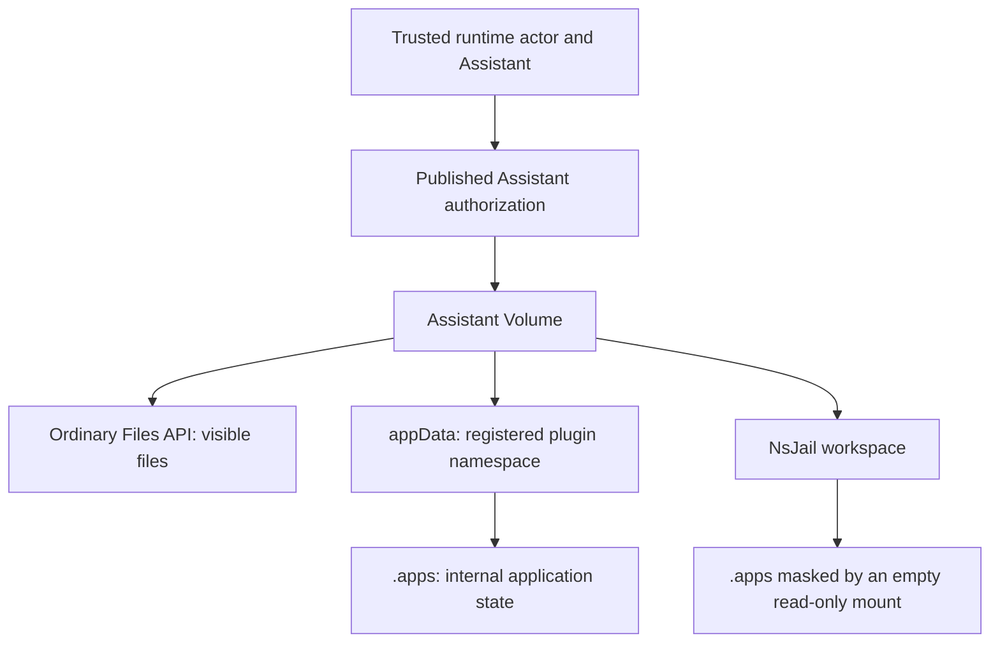

# Volume / Workspace Architecture

This guide documents the current Volume / Workspace split in `xpert`.

There are only two core rules:

- `Volume` always means a filesystem path visible to the server process.
- In this path model, `Workspace` means a filesystem path visible to a sandbox. It does not mean the `XpertWorkspace` authoring entity.

They are related, but they are not the same thing.

## File workspaces versus authoring workspaces

`XpertWorkspace` (`xpert_workspace`, `xpert.workspaceId`) contains authoring resources such as Assistants, skills and connectors. Its owner/member relationship and `canRead/canRun/canWrite/canManage` capabilities are separate from Assistant file authority.

A non-Project Assistant file workspace is selected by `resolveXpertDataVolumeScope()`: tenant + Assistant for `workspaceDataScope=shared`, or tenant + current user + Assistant for `user`. This identity does not use `xpert.workspaceId`. The `workspaceId` field of other Volume catalogs must not be substituted for an Assistant file scope.

Runtime file routes use `AssistantFilesService.forRuntime()` and the exact published Assistant's current user ACL. Studio uses `forAuthoring()` and explicit authoring authorization, including drafts. Both use `ResolveAssistantFileAccessCommand` before Volume IO. A UserGroup grant therefore permits runtime files without authoring workspace membership. Neither generic `XpertService.findOne()` nor workspace-level `canRun` is the file ACL.

The explicit file policy is collaborative CRUD for authorized users in shared volumes, and the same operations within each user's own isolated volume. Server context determines tenant, user and catalog; HTTP input cannot select another owner. Project volumes retain Project membership and Assistant binding checks. The capabilities endpoint is `GET /api/ai/assistants/:assistantId/workspace/capabilities`; operations still reauthorize each request.

Standalone file browsing revalidates current user access behind delegated `USER_XPERT` credentials. A Project-only delegated audience cannot authorize a standalone Assistant volume. General Assistant calls retain Project delegation. Authenticated file requests recheck access; existing cookie-bound content grants retain their separate expiry and explicit revocation lifecycle. Historical shared Volume URLs are unchanged by this API authorization fix.

No file relocation, data-isolation migration or Assistant file API URL change is required. Conversation runtime directories use `/api/ai/conversations/:id/workspace/*`; `/api/ai/conversations/:id/files` remains the parsed attachment FileAsset list. These must never share a route registration. SDK Workbench clients must adopt the `/workspace` path; existing singular-file routes remain compatible.

## Why the split exists

The same underlying data can appear differently depending on where code is running:

- when the server runs directly on a developer machine, it sees local host paths
- when the server runs inside the API Docker container, it sees container paths
- when the sandbox runs in a local shell or a sibling container, it sees its own working directory

If all of those are called `workspacePath`, it becomes very easy to mix up:

- server-visible paths
- Docker bind sources
- sandbox working directories

The new architecture separates those layers and reconnects them through an explicit mapping.

## Core types

### `VolumeScope`

`VolumeScope` in `packages/server-ai/src/shared/volume/volume.ts` describes only the logical volume identity. It does not describe sandbox or provider behavior.

Main fields:

- `tenantId`
- `catalog`
- `projectId`
- `userId`
- `xpertId`
- `knowledgeId`
- `workspaceId`
- `environmentId`
- `rootId`
- `isolateByUser`

### `VolumeClient`

`VolumeClient` is responsible for server-side path resolution.

Main API:

- `resolve(scope): VolumeHandle`
- `resolveRoot(tenantId): { serverRoot, hostRoot }`

It does not manage sandbox lifecycle and it does not infer container working directories by itself.

### `VolumeHandle`

`VolumeHandle` is a resolved server-side volume.

Key fields:

- `scope`
- `serverRoot`
- `hostRoot`
- `publicBaseUrl`

Key methods:

- `ensureRoot()`
- `path(relative?)`
- `publicUrl(relative?)`
- `readFile()`
- `putFile()`
- `deleteFile()`
- `list()`

Semantically:

- `serverRoot` is the path the current server runtime can access directly
- `hostRoot` is the host path needed for Docker bind mounts
- `publicBaseUrl` is the URL prefix consumed by browsers and frontend links

### `WorkspacePathMapper`

`WorkspacePathMapper` converts a Volume into a Workspace view.

Main API:

- `mapVolumeToWorkspace(volume, options?)`
- `mapWorkspaceToVolume(binding, workspacePath)`

`WorkspaceBinding` describes one explicit mapping:

- `volumeRoot`
- `workspaceRoot`
- `workspacePath`
- `bindSource`
- `containerMountPath`

## Runtime implementations

### `DevVolumeClient`

`DevVolumeClient` represents the server running directly against the local filesystem.

In that case:

- `serverRoot === hostRoot`

Root rules:

- in `dev`, when the server runs directly on the host without `SANDBOX_VOLUME`, use `~/data/${tenantId}` by default
- otherwise prefer `${SANDBOX_VOLUME}/${tenantId}`
- if `SANDBOX_VOLUME` is still unavailable, fall back to `~/data/${tenantId}`
- only `SANDBOX_VOLUME_LAYOUT=legacy-flat` opts an unconfigured `dev` environment into the old `~/data` flat root

### `DockerVolumeClient`

`DockerVolumeClient` represents the server running inside the API Docker container.

In that case:

- `serverRoot` uses the API-container view, such as `/sandbox/${tenantId}`
- `hostRoot` uses the host view, such as `${SANDBOX_VOLUME}/${tenantId}`

### `LocalShellWorkspacePathMapper`

A local shell sandbox works directly against server-visible paths.

So:

- `workspaceRoot === volume.serverRoot`
- `workspacePath === volume.serverRoot` or one of its descendants

### `DockerWorkspacePathMapper`

A Docker sandbox mounts one precise Volume root into `/workspace` inside the container.

So:

- `bindSource === volume.hostRoot`
- `containerMountPath === '/workspace'`
- `workspaceRoot === '/workspace'`
- `workspacePath` is the server-side subpath translated into `/workspace/...`

## Runtime Workspace File Capability

Plugins, Agent middleware, and async queues should not read sandbox `/workspace/...` paths with Node `fs` directly. `/workspace` is the sandbox-visible mount point and may not exist at the same path in the API process or on the host server.

The platform exposes a single workspace-file entry point through runtime capabilities:

```ts
const workspaceFiles = context.runtime.capabilities.require(WorkspaceFilesRuntimeCapability)
const file = await workspaceFiles.readRuntimeBuffer('/workspace/report.docx')
```

`platform.workspace.files` accepts three runtime locator shapes:

- sandbox absolute paths: `/workspace/report.docx`
- workspace-relative paths: `report.docx` or `./report.docx`
- platform portable references: `{ source: 'platform.workspace.files', filePath, workspacePath, catalog, scopeId, ... }`

Resolution rules:

- `/workspace/foo.docx` or `workspaceRoot/foo.docx` is normalized to the Volume-relative path `foo.docx`.
- `foo.docx` and `./foo.docx` are resolved relative to the current Agent runtime workspace.
- Persisted portable references carry a catalog/scope, but cannot override the current runtime's bound owner or bypass authorization.
- The runtime supplies the scope: `projectId` selects `catalog: 'projects'`; otherwise the published Assistant's `workspaceDataScope` determines `xperts` or `user-xperts`. Plugins do not select another Assistant data catalog.

Safety rules:

- Empty paths, null bytes, `..`, the workspace root itself, and absolute paths escaping the current workspace root are rejected.
- Business plugins must not hardcode `/workspace -> /sandbox` or local host path mappings.
- Business records should not persist `/workspace/...`, `/sandbox/...`, or host absolute paths as file references.

Read APIs return both file bytes and a platform-generated `WorkspacePortableFileReference`. For delayed sending, retries, or async processing, persist only the portable reference plus validation fields such as `size` and `sha256`; do not store base64 or buffers in queue payloads.

Use `writeRuntimeBuffer()` for new files:

```ts
const written = await workspaceFiles.writeRuntimeBuffer({
  path: 'exports/report.docx',
  originalName: 'report.docx',
  mimeType: 'application/vnd.openxmlformats-officedocument.wordprocessingml.document',
  buffer
})

await outboundQueue.enqueue({
  fileRef: written.reference,
  size: written.size ?? buffer.length
})
```

This keeps business plugins focused on file references while the platform owns path normalization, scope inference, Volume IO, and tenant isolation.

## Assistant application data

`WorkspaceFilesRuntimeCapability.appData()` stores a plugin's internal state in its owning Assistant's file workspace. It uses the same `platform.workspace.files` capability as ordinary files; the separate `AssistantWorkspaceStorageCapability` / `AssistantWorkspaceStorageApi` is removed. The SDK must expose `appData()`, and the running host must implement it. Updating plugin dependencies alone does not upgrade the host.

### Choose the right file API

| Data                                                           | API                                                           | Location within the authorized Assistant Volume                      |
| -------------------------------------------------------------- | ------------------------------------------------------------- | -------------------------------------------------------------------- |
| User-visible exports and documents                             | `readRuntimeBuffer()`, `writeRuntimeBuffer()`, `deleteFile()` | Ordinary paths, such as `meetings/<meeting-id>/notes.md`             |
| Internal manifests, recording chunks, checkpoints and receipts | `appData({ pluginName })`                                     | `.apps/<artifactNamespace>/...`                                      |
| Collaborative document state                                   | Platform Collaboration capability                             | Platform-managed document storage; Markdown files can be projections |



### Bind the actor, Assistant and namespace

Obtain the API from the host-provided scoped runtime:

```ts
import { WorkspaceFilesRuntimeCapability } from '@xpert-ai/plugin-sdk'

const workspaceFiles = context.runtime.capabilities.require(WorkspaceFilesRuntimeCapability)
const state = workspaceFiles.appData({
  pluginName: '@example/plugin-notes',
  requireUserIsolation: true
})
```

`pluginName` is the plugin's own registered identity, supplied by trusted plugin code. The host resolves `artifactNamespace` from the loaded plugin in the current organization, tenant or system installation scope. Callers cannot pass a physical directory or a namespace override. The registered namespace uses lowercase letters, digits and underscores (`^[a-z0-9_]+$`). Plugin runtime metadata must read `version`, `xpert.plugin.level` and `xpert.plugin.artifactNamespace` from its own `package.json`.

Each operation rechecks the authenticated tenant, organization, current user and exact published Assistant. A UserGroup grant is sufficient without authoring workspace membership; authoring workspace `canRun` is not a substitute for the published Assistant ACL. Lock acquisition rechecks access after waiting. Missing identity, changed actor, revoked access or unavailable plugin metadata fails before application data access.

The published Assistant selects the data scope:

| `workspaceDataScope` | Catalog                          | Standard path below the tenant Volume root                            |
| -------------------- | -------------------------------- | --------------------------------------------------------------------- |
| `shared`             | `xperts`, `isolateByUser: false` | `xpert/<assistantId>/.apps/<artifactNamespace>/`                      |
| `user`               | `user-xperts`                    | `user/<currentUserId>/xpert/<assistantId>/.apps/<artifactNamespace>/` |

The organization participates in authorization; it is not an extra path segment. The user is the authenticated caller, never the Assistant creator. `requireUserIsolation: true` rejects shared Assistants. `appData()` currently requires an Assistant binding and rejects Project bindings and other catalogs; it does not fall back to a machine-local directory.

A storage handle stays bound to its first resolved Volume and namespace. If either changes, create a fresh handle only after validating the new business scope. A private ordinary-file binding also refuses to follow a changed policy into shared storage, preventing private projections from being copied there. `workspaceDataScope` is chosen when creating an Assistant; these drift checks do not introduce a supported in-place policy switch or data migration. Background jobs must restore trusted actor/organization context and obtain a fresh scoped API instead of serializing handles or absolute paths. See [Managed Queue](./managed-queue).

Native plugins remain trusted server code. This API governs cooperating plugins; it does not isolate malicious native code that can directly access the host filesystem.

### Storage operations and concurrent updates

| Method                                | Behavior                                                                           |
| ------------------------------------- | ---------------------------------------------------------------------------------- |
| `read(path)`                          | Returns a complete file generation as a `Buffer`                                   |
| `write(path, stringOrBytes)`          | Creates parents and atomically replaces one file                                   |
| `mkdir(path)`                         | Creates directories within the application namespace                               |
| `list(path)`                          | Returns immediate child names, excluding internal lock and temporary entries       |
| `remove(path)`                        | Removes a file or subtree; the namespace root cannot be removed                    |
| `withLock(key, callback, { waitMs })` | Serializes cooperating writers using the same key in the same Volume and namespace |

Paths and lock keys must be canonical relative paths. Absolute paths, backslashes, NUL, `.` / `..` segments, repeated or trailing `/`, and `.locks` segments including case variants are rejected. Only `mkdir('')` and `list('')` accept the namespace root. Do not include `.apps/<artifactNamespace>` in an application-relative path.

Read, validate and write inside the same lock. For example, a schema-validated counter can be initialized and updated across API instances:

```ts
import { z } from 'zod/v3'

const Counter = z.object({ revision: z.number().int().nonnegative() }).strict()

await state.withLock(
  'records/example',
  async () => {
    let bytes: Buffer | undefined
    try {
      bytes = await state.read('records/example/counter.json')
    } catch (error) {
      if (!error || typeof error !== 'object' || !('code' in error) || error.code !== 'ENOENT') {
        throw error
      }
    }
    const current = bytes ? Counter.parse(JSON.parse(bytes.toString('utf8'))) : { revision: 0 }
    await state.write('records/example/counter.json', JSON.stringify({ revision: current.revision + 1 }))
  },
  { waitMs: 10_000 }
)
```

The host writes a temporary file, flushes it, renames it over the destination and flushes the parent directory. Readers see one complete file generation. This is not a transaction across multiple files, and atomic replacement alone does not serialize read-modify-write operations. Plugins still own revision checks, idempotency, tombstones and recovery manifests. Every writer for the same business resource must use the same lock key.

Locks live in `.apps/<artifactNamespace>/.locks/`, outside removable business folders. The current implementation attempts a heartbeat every 10 seconds with a 120-second stale threshold. Only a successful filesystem heartbeat extends the local lease. Ownership and expiry are checked before mutations; stale callbacks cannot release a replacement owner's lock. Lock loss rejects subsequent app-data and ordinary Volume writes/deletes in that callback.

`waitMs` controls acquisition retries, not callback duration: the default is 10 seconds, the maximum is 180 seconds, and `0` disables acquisition retries. Await all work inside the callback; detached work cannot keep using a released lease. External effects such as model calls or network requests are not rolled back by this filesystem lock.

### Protect `.apps`

Generic file listing, reading, editing, uploading, downloading, archives and file-understanding inputs reject or omit managed state. Checks cover lexical paths, resolved aliases, hard-linked files and mounted-workspace root aliases. Generic recursive deletion checks descendants, so deleting a public parent cannot erase a protected `.apps` child. Reserved names are checked case-insensitively, including `.workspace-write-*.tmp`.

NsJail Runner protocol **3** advertises `appDataProtection: true`. Every execution, terminal and service overlays `/workspace/.apps` with an empty read-only mount, even before the first application write. File RPCs and working-directory selection reject `.apps`. The host app-data API continues to access the real storage outside that mount namespace.

The API refuses older Runners or Runners without this capability. Upgrade the Runner before the API and restart existing runtimes during rollout. Local Shell is trusted development execution and does not provide this OS-level protection. A hidden directory by itself is not an access-control boundary.

### Configure persistent storage once

There is no fixed Meetings path such as `/var/lib/xpert/data/plugins/meetings`, and Meetings has no independent `dataDirectory`. The platform's Volume configuration determines the root:

| Runtime                                    | Root and configuration                                                                                   |
| ------------------------------------------ | -------------------------------------------------------------------------------------------------------- |
| API running directly on a development host | `SANDBOX_VOLUME/<tenantId>`, or `~/data/<tenantId>` when unset                                           |
| API container                              | `/sandbox/<tenantId>`; the deployment mounts persistent storage at `/sandbox`                            |
| Docker-host path resolution                | `SANDBOX_VOLUME` supplies the host-side root when configured; it must agree with the actual mount source |
| NsJail Runner                              | Its workspace mount must expose the same underlying data as the API/worker mount                         |

Set `SANDBOX_VOLUME` in the platform's environment configuration and configure the actual API/worker/Runner mounts in the deployment. Setting an environment variable does not create shared storage. The repository's `docker-compose.yml` and `.deploy/nsjail-runner/docker-compose.nsjail.yml` currently bind `./docker/volumes/api/sandbox/` to `/sandbox/`; changing `SANDBOX_VOLUME` alone does not rewrite those literal mounts.

For multiple instances, mount the **same persistent filesystem** on every API/worker instance that accesses these files. Identical local directory names on separate machines do not share data or locks. The filesystem must support atomic directory creation, rename and coherent metadata/heartbeat visibility; an object-storage bucket or object-storage FUSE mount is not this backend. Use the standard tenant/scope layout for this feature, not the development-only `legacy-flat` compatibility layout. See the root matrix below for path resolution details.

### Meetings example and troubleshooting

Meetings requires a user-isolated Assistant. Recording chunks, capture bindings, manifests, checkpoints and synchronization receipts use `.apps/meetings/records/` and `.apps/meetings/captures/`. User-visible Markdown and exports use `meetings/<creation-date-title-meeting-uuid>/` in the same user/Assistant Volume, outside `sessions/`. After document initialization, platform Collaboration stores the CRDT state; Markdown and manifest document checkpoints are projections. This refactor does not migrate data from the old plugin directory.

| Failure                                | Check                                                                                                                                    |
| -------------------------------------- | ---------------------------------------------------------------------------------------------------------------------------------------- |
| `appData` unavailable                  | Host and SDK compatibility; do not add a local filesystem fallback                                                                       |
| `assistant_user_workspace_required`    | The app requires `workspaceDataScope: user`; a shared Assistant cannot hold its private data                                             |
| `403`                                  | Actor, organization and exact published Assistant grant; for generic Files, also check for a managed path                                |
| `404` resolving plugin namespace       | The plugin is loaded in the current installation scope and has valid registered metadata                                                 |
| `EINVAL`                               | Invalid relative path or a handle whose Volume/namespace changed                                                                         |
| `ELOCKED`                              | Another owner holds the same resource; retry according to the business policy                                                            |
| `ELOCKLOST`                            | Stop the stale operation, reacquire and reread before recomputing; check filesystem latency, process stalls and shared mount consistency |
| Different state on different instances | Compare their actual mounts, tenant, current user, Assistant and namespace, not just their path strings                                  |

The implementation is covered by `workspace-storage.spec.ts`, `workspace-managed-path.spec.ts`, `assistant-files.integration.spec.ts` and mounted-workspace upload tests under `packages/server-ai/src`. Runner regressions are in `.deploy/nsjail-runner/test_runner.py`; `verify_app_data.py` exercises real Linux mount/RPC isolation in a disposable container. These checks cover process concurrency, atomic reads, lease takeover, revocation, scope drift and protected-path aliases. Deployment acceptance must additionally verify the actual shared filesystem and mount configuration.

## Root path matrix

Root calculation is centralized in `packages/server-ai/src/shared/volume/volume-layout.ts`.

### API-container root

`getApiContainerSandboxVolumeRootPath(tenantId)`:

| Scenario                                                 | Value                           |
| -------------------------------------------------------- | ------------------------------- |
| `dev`, server outside Docker, without `SANDBOX_VOLUME`   | `~/data/${tenantId}`            |
| `dev`, no volume, `SANDBOX_VOLUME_LAYOUT=legacy-flat`    | `~/data`                        |
| `dev`, server not in Docker, `SANDBOX_VOLUME` configured | `${SANDBOX_VOLUME}/${tenantId}` |
| `dev`, server in Docker                                  | `/sandbox/${tenantId}`          |
| non-`dev`                                                | `/sandbox/${tenantId}`          |

### Host root

`getDockerHostSandboxVolumeRootPath(tenantId)`:

| Scenario                                | Value                                |
| --------------------------------------- | ------------------------------------ |
| `dev`, server outside Docker, no volume | `~/data/${tenantId}`                 |
| explicit `legacy-flat` opt-in           | `~/data`                             |
| `SANDBOX_VOLUME` configured             | `${SANDBOX_VOLUME}/${tenantId}`      |
| other cases without `SANDBOX_VOLUME`    | falls back to the API-container root |

### Layered local development and legacy flat compatibility

When the development server runs directly on the host without `SANDBOX_VOLUME`, it now uses a layered layout by default:

```text
~/data/<tenantId>/project/<projectId>/...
~/data/<tenantId>/xpert/<xpertId>/...
```

Different Projects and shared Xperts therefore no longer treat the entire `~/data` directory as their Volume root. Project asset indexing and conversation attachment projection stay inside the selected logical subtree.

The old flattened mode is enabled only when all three conditions are true:

- `environment.envName === 'dev'`
- `SANDBOX_VOLUME` is not configured
- `SANDBOX_VOLUME_LAYOUT=legacy-flat` is explicitly configured

In compatibility mode:

- `serverRoot` and `hostRoot` both collapse to `~/data`
- legacy shared catalogs continue to share that one root, while private Xpert and runtime-job scopes keep their isolated leaves
- public URLs are normalized by `normalizeSandboxPublicVolumeSubpath()`

Changing the setting does not move, copy, or delete existing files. Keep `legacy-flat` enabled to read old flat data, or migrate files manually after confirming the target tenant, catalog, and ID.

## Logical Volume subpaths

`getVolumeSubpath()` defines the logical subpaths:

| `catalog`                             | Subpath                            |
| ------------------------------------- | ---------------------------------- |
| `environment`                         | `/environment/${environmentId}`    |
| `knowledges`                          | `/knowledges/${knowledgeId}`       |
| `projects`                            | `/project/${projectId}`            |
| `skills`                              | `/skills/${rootId}`                |
| `users`                               | `/user/${userId}`                  |
| `workspaces`                          | `/workspaces/${workspaceId}`       |
| `xperts` shared                       | `/xpert/${xpertId}`                |
| `user-xperts` user-isolated           | `/user/${userId}/xpert/${xpertId}` |
| Legacy `xperts + isolateByUser: true` | `/xpert/${xpertId}/user/${userId}` |

From that subpath we derive:

- the Volume path: `volume.serverRoot`
- the public URL: `getVolumePublicBaseUrl(scope)`

Examples:

| Logical object                    | Server path                                            | Public URL                                            |
| --------------------------------- | ------------------------------------------------------ | ----------------------------------------------------- |
| Project                           | `/sandbox/${tenantId}/project/${projectId}`            | `/api/sandbox/volume/project/${projectId}`            |
| User                              | `/sandbox/${tenantId}/user/${userId}`                  | `/api/sandbox/volume/user/${userId}`                  |
| Shared Xpert volume               | `/sandbox/${tenantId}/xpert/${xpertId}`                | `/api/sandbox/volume/xpert/${xpertId}`                |
| User-isolated Xpert volume        | `/sandbox/${tenantId}/user/${userId}/xpert/${xpertId}` | `/api/sandbox/volume/user/${userId}/xpert/${xpertId}` |
| Legacy user-isolated Xpert volume | `/sandbox/${tenantId}/xpert/${xpertId}/user/${userId}` | `/api/sandbox/volume/xpert/${xpertId}/user/${userId}` |
| Workspace                         | `/sandbox/${tenantId}/workspaces/${workspaceId}`       | `/api/sandbox/volume/workspaces/${workspaceId}`       |

## Xpert Work Area Rules

Xpert runtime working directories are resolved by `XpertWorkAreaResolver` in `packages/server-ai/src/shared/volume/work-area.ts`.

The design rules are:

- The default working directory is the current Xpert / project Volume root.
- A Project Volume is shared by authorized project members. A non-Project Xpert uses the shared or user-isolated root selected by its `workspaceDataScope`.
- `shared` remains as an explicit shared subdirectory for backward compatibility and tools that need a stable shared path.
- Xpert long-term FileMemory follows the resolved data scope; user-isolated Assistants also isolate memory by the current user.
- Agent invoke, terminal, sandbox upload, conversation workspace files, and managed sandbox services should all use the same resolver output so the Agent cwd and terminal cwd do not diverge.
- Conversation workspace file APIs must browse the project / Xpert Volume root directly. They should not add a `users/<userId>` subtree under the root.

Canonical layout:

```text
/sandbox/<tenantId>/
  project/<projectId>/
    shared/
    sessions/<conversationId>/
    .xpert/memory/xperts/<xpertId>/

  xpert/<xpertId>/
    shared/
    .xpert/memory/

  user/<userId>/
    xpert/<xpertId>/
      shared/
      .xpert/memory/
  environment/<environmentId>/
```

### Project conversations

When `projectId` exists, the resolver uses the project Volume:

```ts
{
  tenantId,
  catalog: 'projects',
  projectId,
  userId
}
```

Relative path rules:

| Purpose                              | Relative path inside the Volume  |
| ------------------------------------ | -------------------------------- |
| Default cwd                          | Volume root                      |
| Project explicit shared subdirectory | `shared`                         |
| Xpert memory inside the project      | `.xpert/memory/xperts/<xpertId>` |
| Single-conversation temporary area   | `sessions/<conversationId>`      |
| Project internal state               | `.xpert`                         |

In a local shell sandbox, `workspace_path` is a server-visible path, for example:

```text
/sandbox/<tenantId>/project/<projectId>
```

In a Docker sandbox, the same directory is mapped to:

```text
/workspace
```

### Non-project Xpert conversations

When there is no `projectId` or explicit environment and an `xpertId` exists, the resolver follows the persisted `workspaceDataScope`:

| Policy   | Volume scope                                           | Path below the tenant root      |
| -------- | ------------------------------------------------------ | ------------------------------- |
| `shared` | `catalog: 'xperts'`, `xpertId`, `isolateByUser: false` | `xpert/<xpertId>`               |
| `user`   | `catalog: 'user-xperts'`, `xpertId`, current `userId`  | `user/<userId>/xpert/<xpertId>` |

The policy defaults to `shared` and is chosen at creation. It cannot be changed on an existing Assistant; create or copy an Assistant with the required policy instead. Portable DSL content does not override local data ownership. Changing this model does not automatically move existing files between roots.

Relative path rules:

| Purpose                            | Relative path inside the Volume |
| ---------------------------------- | ------------------------------- |
| Default cwd                        | Volume root                     |
| Xpert explicit shared subdirectory | `shared`                        |
| Xpert long-term FileMemory         | `.xpert/memory`                 |

For `shared`, authorized users see the same files and memory. For `user`, each authenticated user has separate files and memory under their own root. A directory named `shared` inside a user-isolated Volume does not grant access to other users. New runtime references use the actual catalog; the old `xpert/<xpertId>/user/<userId>` layout remains only for compatibility.

### Docker container example

Assume:

- `tenantId = tenant-1`
- `userId = user-A`
- `xpertId = xpert-X`
- this is a non-project conversation with `workspaceDataScope: shared`
- the sandbox provider is Docker

The API service container sees this server-side Volume:

```text
/sandbox/tenant-1/xpert/xpert-X/
  shared/
  .xpert/memory/
```

Directory meanings:

| Directory                                       | Purpose                                               |
| ----------------------------------------------- | ----------------------------------------------------- |
| `/sandbox/tenant-1/xpert/xpert-X`               | Default working directory for Xpert X                 |
| `/sandbox/tenant-1/xpert/xpert-X/shared`        | Explicit shared subdirectory for Xpert X              |
| `/sandbox/tenant-1/xpert/xpert-X/.xpert/memory` | Long-term FileMemory for Xpert X, shared by all users |

The same Volume is mounted into the sandbox Docker container at `/workspace`, so Agent, terminal, and sandbox tools see:

```text
/workspace
/workspace/shared
/workspace/.xpert/memory
```

Mapping:

| API service container path                      | Sandbox Docker path        | Meaning                                                                                     |
| ----------------------------------------------- | -------------------------- | ------------------------------------------------------------------------------------------- |
| `/sandbox/tenant-1/xpert/xpert-X`               | `/workspace`               | Default cwd; ordinary generated files, uploads, and terminal commands write here by default |
| `/sandbox/tenant-1/xpert/xpert-X/shared`        | `/workspace/shared`        | Explicit shared subdirectory                                                                |
| `/sandbox/tenant-1/xpert/xpert-X/.xpert/memory` | `/workspace/.xpert/memory` | Long-term memory directory for `memory_write`, Dream, and memory file APIs                  |

If user B talks to the same Xpert X, the default file directory remains the same Xpert workspace:

```text
/sandbox/tenant-1/xpert/xpert-X
/workspace
```

But user A and user B share the same Xpert memory directory:

```text
/sandbox/tenant-1/xpert/xpert-X/.xpert/memory
/workspace/.xpert/memory
```

If the conversation belongs to project `project-1`, the default directory switches to the project Volume:

```text
/sandbox/tenant-1/project/project-1
/workspace
```

Project shared, Assistant memory, and session directories are:

```text
/sandbox/tenant-1/project/project-1/shared
/sandbox/tenant-1/project/project-1/.xpert/memory/xperts/xpert-X
/sandbox/tenant-1/project/project-1/sessions/<conversationId>
```

In a Docker sandbox, they map to:

```text
/workspace/shared
/workspace/.xpert/memory/xperts/xpert-X
/workspace/sessions/<conversationId>
```

### Conversation workspace file APIs

The ClawXpert file panel and related preview/edit flows use the conversation file endpoints:

```text
GET    /api/chat-conversation/:conversationId/files
GET    /api/chat-conversation/:conversationId/file
POST   /api/chat-conversation/:conversationId/file
POST   /api/chat-conversation/:conversationId/file/upload
DELETE /api/chat-conversation/:conversationId/file
```

These endpoints use the conversation only to resolve the current workspace root:

| Conversation context                 | Volume scope                                           | Subtree scope |
| ------------------------------------ | ------------------------------------------------------ | ------------- |
| `projectId` exists                   | `catalog: 'projects'`, `projectId`                     | Volume root   |
| no Project, Xpert policy is `shared` | `catalog: 'xperts'`, `xpertId`, `isolateByUser: false` | Volume root   |
| no Project, Xpert policy is `user`   | `catalog: 'user-xperts'`, `xpertId`, current `userId`  | Volume root   |
| no `projectId` and no `xpertId`      | invalid for workspace file access                      | N/A           |

The `conversationId` is used for lookup and permission context, not as the workspace root. Project conversations browse the project Volume; non-Project conversations browse the resolved shared or user-isolated Xpert Volume.

### Workspace File Relative Path Resolution

Plugins, managed connections, and runtime capabilities should record workspace files as "relative path plus catalog/scope", not as an absolute path from the current process or sandbox.

Standard input shape:

```ts
{
  tenantId,
  userId,
  catalog: 'projects' | 'users' | 'knowledges' | 'skills' | 'xperts' | 'user-xperts',
  scopeId,
  filePath: 'files/wechat/<integrationId>/<messageId>/<fileName>'
}
```

The shared resolver lives in:

```text
packages/server-ai/src/file-understanding/domain/workspace-file.ts
```

It maps `catalog` / `scopeId` to `VolumeScope` consistently:

| catalog       | Scope fields                             | Volume scope output                                     |
| ------------- | ---------------------------------------- | ------------------------------------------------------- |
| `projects`    | `projectId` or `scopeId`                 | `{ catalog: 'projects', projectId, userId }`            |
| `xperts`      | `xpertId` or `scopeId`                   | `{ catalog: 'xperts', xpertId, userId, isolateByUser }` |
| `user-xperts` | `xpertId` or `scopeId`, current `userId` | `{ catalog: 'user-xperts', xpertId, userId }`           |
| `users`       | `scopeId` or `userId`                    | `{ catalog: 'users', userId }`                          |
| `knowledges`  | `knowledgeId` or `scopeId`               | `{ catalog: 'knowledges', knowledgeId, userId }`        |
| `skills`      | `rootId` or `scopeId`                    | `{ catalog: 'skills', rootId, userId }`                 |

Readers should pass only the relative path to `VolumeHandle.path(relativePath)`:

```ts
const { volumeScope } = resolveWorkspaceVolumeScope(input, { tenantId, userId })
const absolutePath = volumeClient.resolve(volumeScope).path(input.filePath)
```

Do not pass `files/wechat/...` directly to Node `fs.open()`. That path would be resolved against the API process `cwd`, which can produce `ENOENT` in production even when the workspace file panel shows the file. Also do not persist `/workspace/...`, `/sandbox/...`, or local runtime directories as business paths; those are runtime / sandbox mappings and are not portable across deployments.

### Environment sandboxes

Without a Project, an explicit environment uses the environment Volume:

```ts
{
  tenantId,
  catalog: 'environment',
  environmentId,
  userId
}
```

The default cwd is the environment Volume root, `environment/<environmentId>`. If the conversation belongs to a Project, the data root and cwd remain the Project Volume even when execution targets a separate environment.

### Xpert FileMemory

FileMemory follows the resolved work area:

| Context                 | Server-side path                                                         |
| ----------------------- | ------------------------------------------------------------------------ |
| Shared Assistant        | `/sandbox/<tenantId>/xpert/<xpertId>/.xpert/memory`                      |
| User-isolated Assistant | `/sandbox/<tenantId>/user/<userId>/xpert/<xpertId>/.xpert/memory`        |
| Project                 | `/sandbox/<tenantId>/project/<projectId>/.xpert/memory/xperts/<xpertId>` |

Notes:

- Non-Project writes use `.xpert/memory`; Project memory retains an Assistant-specific subtree.
- Topic frontmatter still keeps `scopeId=<xpertId>` so each memory entry states which Xpert owns it.
- FileMemory uses the same data-scope resolver as workspace files and does not independently select a shared catalog.
- Legacy memory initialization copies missing files within the resolved Volume and keeps existing destination files. It does not migrate data across shared, user or Project roots.

## Knowledge Work Area Rules

Knowledgebases and knowledge pipelines use the separate `KnowledgeWorkAreaResolver`. It shares the same Volume / Workspace mapping model as Xpert work areas, but it does not merge knowledge files into the Xpert conversation default cwd.

Design rules:

- A knowledgebase is a shared tenant-scoped data asset, with directories scoped by `knowledgebaseId`.
- Multiple users, Xperts, and pipelines may read and write the same knowledgebase Volume.
- User-private conversation directories and Xpert FileMemory do not store knowledge source files.
- Pipeline temporary files are scoped to a single task when a task id is available, so concurrent ingestion runs do not share one `tmp` directory.

Canonical layout:

```text
/sandbox/<tenantId>/
  knowledges/<knowledgebaseId>/
    files/
    users/<userId>/staging/
    documents/<documentId>/
    pipeline/runs/<taskId>/
    tmp/
    .knowledge/
```

Relative path rules:

| Purpose                                                | Relative path inside the Volume |
| ------------------------------------------------------ | ------------------------------- |
| Canonical knowledge source files                       | `files`                         |
| User import staging                                    | `users/<userId>/staging`        |
| Per-document derived assets                            | `documents/<documentId>`        |
| Per-task pipeline run workspace                        | `pipeline/runs/<taskId>`        |
| Per-task pipeline temporary directory                  | `pipeline/runs/<taskId>/tmp`    |
| Legacy-compatible temporary directory                  | `tmp`                           |
| Knowledgebase internal state, locks, migration reports | `.knowledge`                    |

### Knowledge uploads

The knowledgebase file upload endpoint still resolves the Volume with `catalog: 'knowledges'` and `knowledgeId`, but new files are written under the `files/` subdirectory.

Example:

```text
/sandbox/<tenantId>/knowledges/<knowledgebaseId>/files/<folder>/manual-<unix>-<random>.pdf
```

The returned `filePath` stored on the document is relative to the knowledge Volume, for example:

```text
files/<folder>/manual-<unix>-<random>.pdf
```

Reads still resolve through `volume.path(doc.filePath)`, so older document paths without the `files/` prefix remain readable.

### Knowledge pipelines

Knowledge pipeline processors and transformers use the same knowledge Volume:

```ts
{
  tenantId,
  catalog: 'knowledges',
  knowledgeId,
  userId
}
```

When `taskId` exists, the default run workspace is:

```text
/sandbox/<tenantId>/knowledges/<knowledgebaseId>/pipeline/runs/<taskId>
```

The transformer temporary directory is:

```text
/sandbox/<tenantId>/knowledges/<knowledgebaseId>/pipeline/runs/<taskId>/tmp
```

Regular document processing without `taskId` uses the document-scoped temporary directory when `documentId` is available:

```text
/sandbox/<tenantId>/knowledges/<knowledgebaseId>/documents/<documentId>/tmp
```

Preview flows without a task or document context still fall back to:

```text
/sandbox/<tenantId>/knowledges/<knowledgebaseId>/tmp
```

If a future knowledge pipeline runs inside a Docker sandbox, the same Volume maps to `/workspace`:

```text
/workspace/files
/workspace/pipeline/runs/<taskId>
/workspace/pipeline/runs/<taskId>/tmp
/workspace/.knowledge
```

### Runtime `sys` fields

Agent runtime writes the resolver output into `sys`:

| Field                    | Meaning                                                                                        |
| ------------------------ | ---------------------------------------------------------------------------------------------- |
| `volume`                 | Server-side Volume root                                                                        |
| `workspace_path`         | Sandbox-side default cwd                                                                       |
| `workspace_url`          | Public URL for the default cwd                                                                 |
| `workspace_root`         | Sandbox-side mount root                                                                        |
| `shared_workspace_path`  | Shared workspace path                                                                          |
| `agent_workspace_path`   | Project-scoped Xpert agent workspace path; only set in project context                         |
| `session_workspace_path` | Single-conversation temporary path; only set when a project conversation has a conversation id |
| `memory_workspace_path`  | Xpert long-term memory path; only set in non-project Xpert context                             |

`workspace_path`, `workspace_url`, and `volume` are compatibility fields and must remain. New code that needs shared, agent, session, or memory directories should prefer the explicit new fields.

## Additional path families

### Workspace paths

From `packages/server-ai/src/xpert-workspace/types.ts`:

- workspace root: `${volumeRoot}/workspaces/${workspaceId}`

From `packages/server-ai/src/skill-repository/types.ts`:

- workspace skills root: `${workspaceRoot}/skills`

### Organization shared skill paths

Also from `packages/server-ai/src/skill-repository/types.ts`:

- organization shared skills root: `${volumeRoot}/organizations/${organizationId}/skills/public`
- global shared skills root: `${volumeRoot}/skills/public`

## Mapping Work Areas into Workspace

Generic Volume usage can still use the two-step flow:

1. resolve a Volume
2. map it into a Workspace

But runtime entry points such as Xpert conversations, project conversations, terminal, sandbox upload, managed services, and Agent invoke should prefer `XpertWorkAreaResolver`.

Recommended usage:

```ts
const workArea = await this.workAreaResolver.resolve({
  tenantId,
  userId,
  provider,
  xpertId,
  projectId,
  conversationId,
  environmentId
})
```

The result means:

- `workArea.volumePath` identifies the server-side Volume root
- `workArea.workspaceBinding` is passed to the sandbox provider for mounting
- `workArea.workingDirectory` is the sandbox cwd
- `workArea.sharedPath`, `agentPath`, `sessionPath`, and `memoryPath` are explicit business paths

## Field semantics in runtime flows

Under the new model, the common runtime fields should keep these meanings:

- `sys.volume`: server-side Volume path
- `sys.workspace_path`: sandbox-side Workspace path
- `sandbox.workingDirectory`: sandbox-side Workspace path
- `workspaceBinding`: explicit mapping between Volume and Workspace

Do not pass a server path such as `/sandbox/...` directly into a Docker sandbox `workingDirectory`.

## Skills middleware fallback sandbox

Skills middleware normally reads the runtime sandbox from `request.runtime.configurable.sandbox`. If a tool call needs a backend and the runtime sandbox is missing, the fallback sandbox must use the same workspace ownership rules:

| Context                              | Fallback Volume scope                                  |
| ------------------------------------ | ------------------------------------------------------ |
| `projectId` exists                   | `catalog: 'projects'`, `projectId`                     |
| no Project, Xpert policy is `shared` | `catalog: 'xperts'`, `xpertId`, `isolateByUser: false` |
| no Project, Xpert policy is `user`   | `catalog: 'user-xperts'`, `xpertId`, current `userId`  |
| neither exists                       | `catalog: 'users'`, `userId`                           |

This keeps skill file reads and skill shell execution within the Assistant's persisted data scope.

## File-upload semantics

Three target modes matter most here:

### `volume`

- the destination path is a server-side Volume
- the returned link is a public URL

### `sandbox:mounted_workspace`

- `workspacePath` now means a server-visible mounted path
- in practice it writes directly into the Volume mounted into the server

### `sandbox:backend_upload`

- `workspaceId` and backend `workspace_id` refer to the sandbox-side working directory
- the actual file write happens inside the sandbox backend

Those path families should not be mixed together.

## `VolumeSubtreeClient`

The older `WorkspaceVolumeClient` has been reframed as `VolumeSubtreeClient`, defined in `packages/server-ai/src/shared/volume/volume-subtree.ts`.

Its job is not to represent a full Workspace. Instead it:

- browses a subtree below a `VolumeHandle`
- reads and writes text files in a constrained subtree
- generates file URLs relative to that subtree

It is a good fit for:

- conversation workspace file APIs, using the project / Xpert Volume root as the subtree
- xpert memory file directories
- controlled subdirectories inside projects or workspaces

## Dependency injection entry points

The new architecture is exposed through `packages/server-ai/src/shared/volume/volume.module.ts`:

- `VOLUME_CLIENT`
- `WorkspacePathMapperFactory`
- `XpertWorkAreaResolver`
- `KnowledgeWorkAreaResolver`

Recommended usage:

```ts
@Inject(VOLUME_CLIENT)
private readonly volumeClient: VolumeClient
```

For Xpert runtime entry points, inject the resolver directly:

```ts
constructor(
  private readonly workAreaResolver: XpertWorkAreaResolver
) {}
```

For knowledgebase and knowledge pipeline entry points, inject:

```ts
constructor(
  private readonly knowledgeWorkAreaResolver: KnowledgeWorkAreaResolver
) {}
```

Do this instead of manually joining `project/users/agents/sessions/.xpert/memory` or `knowledges/files/tmp` in business code.

## Recommended usage

- Decide first whether you need a Volume or a Workspace.
- Use `VolumeHandle` when the server must read or write files.
- Use `WorkspacePathMapper` when a sandbox needs an execution path.
- Use `XpertWorkAreaResolver` when resolving Xpert, project, or environment runtime directories.
- Use `KnowledgeWorkAreaResolver` when resolving knowledgebase uploads, knowledge pipelines, or document-derived assets.
- Use `VolumeSubtreeClient` when you need a controlled subtree browser.
- Keep the old static helpers only for compatibility, not as the main entry point for new code.
