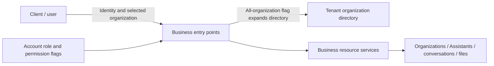
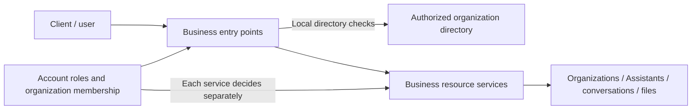
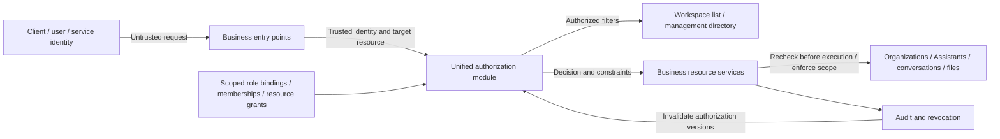
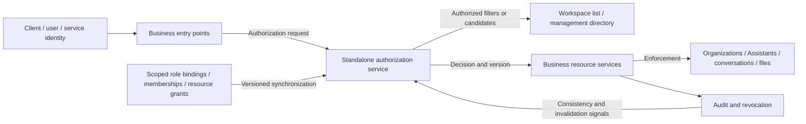

**Status: Design proposal for review.** This document describes a proposed architecture. It does not claim that the current release implements it or that production permissions have been changed.

## Decision

We recommend Option 2: scoped role assignments, explicit resource collaboration relationships, a small set of mandatory conditions, and one authorization module within the application. A tenant represents a customer; an organization represents a department or business unit within that customer. This is the target business model adopted by this proposal. Role templates can be shared, but every role assignment must specify its scope.

This document is a proposal, not an implemented design. We do not derive the intended product rules from the existing ALL*ORG*\* enumeration, or treat an account seeing the entire organization directory as proof that it has accessed business data across departments.

## Executive Recommendation

We compare three alternatives: Option 1, **separate administrative roles and strengthen individual entry points**; Option 2, **a unified scoped authorization module**; and Option 3, **a standalone authorization service**. Option 1 can restrict known entry points quickly. Option 2 establishes a common model and enforcement contract within the product. Option 3 becomes attractive when independently deployed services need shared authorization facts and consistency protocols.

We recommend Option 2 as the target while retaining the temporary restrictions introduced by Option 1. It addresses the structural problem of combining roles and scope without immediately adding an authorization service to the network path. Product semantics should stabilize before service scale and measured performance determine whether to adopt Option 3.

## Background and Design Inputs

This proposal starts from the target business model, not from existing role names or permission constants. Organization directory behavior motivates the discussion of scope; the proposed design must not be read as an already delivered security guarantee.

| ID  | Design input                                                    | Design constraint                                                                                                                                                                                                       |
| --- | --------------------------------------------------------------- | ----------------------------------------------------------------------------------------------------------------------------------------------------------------------------------------------------------------------- |
| E1  | Product authorization redesign                                  | Define actions, roles, assignment scopes, and resource boundaries rather than only renaming permissions.                                                                                                                |
| E2  | A single-organization member receives the tenant-wide directory | In an observed scenario, an account belonged to one organization, but a shared administrator role expanded its directory visibility. Membership and customer governance responsibilities need separate representations. |
| E3  | Xpert resources and agent execution                             | Distinguish Assistant authoring, execution, conversations, files, projects, the plugin control plane, and delegated execution.                                                                                          |
| E4  | Organizations are internal customer departments                 | Tenants represent customers; organizations represent their departments or business units. Different customers require isolation.                                                                                        |

E2 describes observed directory behavior. It does not establish access to all business data in other organizations. It identifies a risk of conflating membership, administrative scope, and data access; other endpoints still require independent validation.

The principles draw on the [NIST definition of ABAC](https://csrc.nist.gov/pubs/sp/800/162/upd2/final), which separates subject, object, operation, and environment attributes, and the [OWASP Authorization Cheat Sheet](https://cheatsheetseries.owasp.org/cheatsheets/Authorization_Cheat_Sheet.html), which recommends default denial, authorization on every request, and least privilege. These principles do not replace product decisions about responsibilities within a customer.

## Existing Problem and Failure Mode

In the motivating scenario, a tenant-scoped role flag expanded the organization directory visible to an account. That may be appropriate for a customer administrator, but it is too broad for an administrator of one department. We therefore need a clearer representation of identity and authority. Neither “every administrator sees only their own department” nor “every administrator sees every department” is a sufficient product rule.

Seeing a department name, entering its workspace, managing its members, running a published Assistant, and reading someone else's conversations are distinct operations. Combining them into two broad view/edit flags encourages directory rules to be reused in unrelated business operations.

## Required Invariants and Authorization Model

The design should establish these verifiable rules:

- Customers are isolated. Organizations, groups, workspaces, projects, and resource grants belong to an explicit customer. A client-supplied scope selects a target; it does not authorize access.
- Every role assignment has a scope. Edit authority in Department A cannot combine with read authority in Department B to produce edit authority in Department B. One complete authorization path must match the principal, action, resource, and scope.
- A role assignment can target a tenant, organization, workspace, project, or individual resource. Parent relationships express ownership; inheritance is an explicit policy for each action.
- Default denial applies. Mandatory constraints and explicit prohibitions override permits. Sharing cannot bypass resource ownership boundaries, principal status, or expiration.
- Directory visibility, workspace entry, and business-resource access are evaluated separately. Lists, search, counts, details, exports, and real-time delivery follow the same rules.
- Managing a container does not automatically grant access to private content. Ordinary permission administrators cannot evade this rule by assigning themselves another role.
- Human delegation, Assistant tools, background jobs, service accounts, and user requests follow the same customer boundaries and resource authorization semantics.
- Revocation has a defined and measurable maximum propagation delay. Sensitive writes cannot continue solely on stale cached authorization.

### Business Hierarchy and Identity

The proposed hierarchy is platform → tenant (customer) → organization (department or business unit) → workspaces and projects → business resources. Workspaces and projects are different containers; not every resource must fit a single inheritance tree. Each resource has one owning customer and, where applicable, an owning organization. Other relationships express collaboration.

Platform operators have platform management identities. Customer users join a customer through TenantMembership; the same account may separately join several customers. Organization membership and RoleBinding are separate facts: joining a department does not make someone its administrator. Roles may be assigned to an individual or to an authorized group.

A child department does not automatically inherit every permission assigned at its parent. Someone responsible for a department subtree receives an explicit subtree scope, with inheritance defined for each action category. The assignment interface must make clear whether the scope includes existing and future child departments.

### Separate Actions from Scope

Permission defines an action. RoleDefinition groups actions into a reusable responsibility template. RoleBinding assigns that role to a principal with a scope, expiration, and any required conditions.

| Example                          | Role and actions                  | Assignment scope    | Result                                                                                                        |
| -------------------------------- | --------------------------------- | ------------------- | ------------------------------------------------------------------------------------------------------------- |
| Alex manages Procurement         | Department administrator          | Procurement         | Manage its settings, membership, and roles that may be delegated                                              |
| Alex participates in Engineering | Department member                 | Engineering         | Enter Engineering and use resources granted through sharing                                                   |
| Alex reviews a bid               | Project reviewer                  | One bidding project | Read material available to project reviewers without gaining department administration                        |
| Blair manages customer IT        | Customer governance administrator | One customer        | Govern that customer's departments, accounts, and policies without automatic access to personal conversations |

ALL_ORG_VIEW and ALL_ORG_EDIT should not form the foundation of the new model. Replace the broad concepts with organization.read, organization.update, organization.members.manage, organization.roles.assign, organization.enter, and customer-scoped organization.create and organization.directory.read. The last two actions operate on the customer as a parent container and on its directory; they do not imply other organization operations.

To manage every department of a customer, explicitly assign the required organization actions to a customer governance role and bind it to that customer's departments. There is no need to put “all” in every action name. Each permission definition must declare whether a tenant-scoped assignment is supported; callers cannot arbitrarily broaden its scope.

“Organizations the user may view” is the result of evaluating policy, not an undefined premise for authorization. A normal workspace selector lists organizations allowed by organization.enter. A corporate directory may expose department names according to customer policy, with restricted departments hidden where necessary. Directory access does not confer entry, membership administration, or business-content access.

### Responsibility Templates and Data Access

| Role template                      | Administrative scope                                                         | Default business-content access                                                                           |
| ---------------------------------- | ---------------------------------------------------------------------------- | --------------------------------------------------------------------------------------------------------- |
| Platform operator                  | Deployment, customer lifecycle, operational status                           | No default access to customer content; bounded support access is separately granted                       |
| Customer owner                     | Customer governance, administrator assignments, organizational structure     | Ownership alone does not unlock personal conversations                                                    |
| Customer governance administrator  | Explicit customer-wide organization, membership, and policy responsibilities | Business content requires a data responsibility or resource grant                                         |
| Department administrator           | Assigned departments and explicitly included subdepartments                  | Manage department settings and membership, without automatically opening private content                  |
| Workspace administrator / designer | Assigned authoring workspaces                                                | Design and publish Assistants according to responsibility, without automatic access to user conversations |
| Project owner / member / reviewer  | Assigned projects                                                            | Access project material according to project role and content visibility                                  |
| Assistant user                     | Assigned Assistants or audience groups                                       | Run published Assistants without automatically editing them or reading other users' conversations         |
| Data auditor                       | Explicit data categories and scope, with expiration where required           | Read approved audit material with separate audit records, without unlimited permanent access              |

Cross-department collaboration is supported within a customer. An Engineering member can join a Procurement bidding project and receive project access without becoming a Procurement administrator. Cross-department groups can receive project grants, but members and resources must remain within the same customer boundary. Future cross-customer collaboration should use an explicit guest/sharing protocol, not weaken customer boundary checks for everyone.

A department administrator's roles.assign must specify the roles they may delegate and the maximum scope. It cannot allow self-assignment of customer administration, platform identity, or controlled audit authority. Combining governance and data-audit responsibilities must be explicit and auditable. If the product promises that administrators cannot obtain personal content themselves, it must also restrict changing that protection and self-granting audit authority. Hiding a read button is insufficient.

Organization deletion, customer ownership transfer, removal of the last owner, and bulk data export should be distinct high-risk actions. A generic edit capability must not imply them.

### Xpert Resource Policies

Assistants need at least discover, run, configure, publish, and share actions. Members of a published Assistant's audience can run it without authoring-workspace membership. A designer's ability to modify or publish an Assistant does not automatically grant access to its users' conversations.

Conversations declare visibility such as personal, explicitly shared, project-shared, or department-shared. A trusted service persists that choice; a client cannot override it temporarily. Personal conversations are readable by their owner and explicit participants by default. Merely linking a conversation to a project must not silently make it project-shared.

Files distinguish user runtime storage, Assistant shared storage, project storage, and authoring assets. Each defines read, write, delete, and share separately. Whether an Assistant run role also includes shared-storage read/write must be declared in the product's role template, not inferred by each file endpoint. Attachments, search, knowledge retrieval, memory retrieval, exports, and download links all obey resource policy. Retrieval must not fetch across authorization boundaries and rely on the UI to hide results.

Plugin installation belongs to the platform or customer control plane; plugin enablement, business grants, and connector use are separate. Installing a system plugin does not authorize its author or callers to read all customer data. Credential use and secret.read are different capabilities: ordinary business execution should use credentials through a controlled broker rather than receive plaintext secrets.

For a user-initiated agent call, effective authority is constrained by the executing user's current authorization, the delegation credential's upper bound, the Assistant/application's allowed capabilities, and tool policy. Reading a target resource or performing a side effect requires fresh authorization; child agents cannot expand the scope. Automation that must outlive an interactive session needs an explicitly authorized and independently audited service identity. It must not silently become a system administrator when its initiating user leaves.

### Data and Decision Contracts

The logical model includes Principal, TenantMembership, OrganizationMembership, GroupMembership, RoleDefinition, RoleBinding, ResourceRelation/Grant, Delegation, and AuditEvent. RoleDefinition is reusable; user.roleId must not represent a person's single global business identity.

A common decision takes principal, action, resource, and context. The server resolves customer and department from trusted authentication and resource ownership; a client-selected department is a constraint to validate. Allow requires a valid principal, valid resource boundaries, at least one complete permit path, no matching prohibition, and satisfaction of execution conditions. Subscription and quota checks are additional gates, not sources of data authorization.

Provide authorize for one object, authorizeMany for batches, authorized list filtering, and controlled explain functionality for grant provenance. Rejection details can appear in server-side audit records without revealing hidden resource existence to ordinary callers. Filtering after pagination is not an authorization-list implementation. Counts, aggregates, search suggestions, downloads, and WebSocket subscriptions must not bypass scope.

Resource moves, grant changes, and membership removal need checks against consistent transactional state or versions to prevent a resource changing departments between authorization and use. Batch operations must authorize every target and explicitly define atomic or partial-failure behavior.

## Constraints and Non-Goals

The design serves the customer/internal-department model; it does not mechanically turn every department into a separate tenant. If existing data places unrelated customers in one technical tenant, customer ownership needs a separate migration. Changing role names alone cannot establish customer isolation.

This proposal does not mean that database migration, production role renaming, or shared ADMIN permission changes have been implemented. It does not assume that every customer must adopt the same approval workflow. Conditions for support access, auditing responsibilities, and high-risk delegation are design recommendations whose product experience still needs a decision.

There are no measured latency, memory, or revocation budgets. All performance statements below are architectural expectations, not benchmark results. Application authorization also does not protect against an operator with unrestricted database or host access. Stronger separation from those operators requires a separate key-management and infrastructure-responsibility design.

## Authorization Boundaries Before the Change

The diagram summarizes the directory behavior above and the separate business-resource checks. It is not evidence that every resource endpoint has been audited.

One role flag affects directory scope, encouraging users to interpret “administrator” as a universal identity. The new model should expose both role actions and assignment scope in its data and interfaces.

## Alternatives

### Option 1: Separate Administrative Roles and Strengthen Individual Entry Points

Keep authorization decisions distributed across business entry points, separate customer administrators from department administrators, and add explicit checks to the known directory, selection, detail, and membership operations. This is the strongest choice when a short release window requires an immediate restriction of directory scope. It changes little about calling protocols or runtime topology.

Its limitation is that each entry point still interprets scope and inheritance itself. New search, export, and plugin endpoints may introduce divergent rules. There need not be an additional network hop per request, and memory may increase only for local membership/role data. Repeated membership queries can nevertheless cause N+1 behavior in lists. Those expectations require measurement.

Rollout can proceed by endpoint, retaining reviewable account mappings and audit records. Rollback must use a compatibility path that still enforces scope, not restore an all-organization fallback. This option can address the known directory behavior, but it does not provide a durable common guarantee for agent execution, project collaboration, and every resource category.

| Change            | Before                        | After                                                    | Security consequence                          | Cost                                   |
| ----------------- | ----------------------------- | -------------------------------------------------------- | --------------------------------------------- | -------------------------------------- |
| Directory checks  | Generic all-organization flag | Explicit customer/department roles and membership checks | Restricts directory expansion                 | Several entry points change            |
| Control ownership | Each entry point decides      | Checks improve but remain distributed                    | Known paths improve; future paths may diverge | Ongoing review and regression coverage |

### Option 2: A Unified Scoped Authorization Module

Keep the existing service deployment and introduce one product-wide authorization model and module. Business services continue to own resources and business constraints, but decisions use the same role, scope, relationship, and condition contract. Decision logic is centralized while enforcement stays where resources are actually read or changed. A gateway-only check would leave background work uncovered.

The platform can provide role templates. Customer-defined roles can combine only permitted actions and scopes. The authorization model is versioned. New plugin resource types and actions must declare supported assignment scopes, inheritance, sensitivity, and delegability. Unknown actions are denied. Policy changes need validation and traceable publication; arbitrary JSON supplied with a request cannot become authorization policy.

The main benefit is less policy drift while using relationship tables and a constrained policy model to cover organizations, projects, and Assistants. List operations use controlled query predicates or batched decisions from the authorization module rather than one remote call per row. The cost is a shared resource catalog, authorization facts, permission caching, and adapters at business entry points. A mistake in a common policy can also affect more callers, making versioning, shadow decisions, and negative contract tests essential.

Start with an in-process module, without a new authorization network service. Relationship queries, indexes, batched results, and caches still consume resources. Workloads with many departments, deep group relationships, and large project lists must measure p95/p99 latency, query count, cache behavior, memory, and revocation propagation. Cache keys include customer, principal, action, resource, and relevant membership/policy versions; a role name alone is insufficient.

Revocation propagates to every API instance through shared versions or invalidation events, with a defined maximum delay. Sensitive operations consult sufficiently fresh authoritative state and deny when it cannot be established. Long jobs reauthorize before important reads and side effects; real-time subscriptions close on revocation. Failure of authorization infrastructure must not activate a broader legacy policy.

During migration, compare decisions through dual reads or shadow evaluation while making the new authorization facts the single write path. Do not let two systems independently grant new authority. Enforcement can move by resource category. Rollback uses a previously safe policy version or restricts unadapted sensitive operations, rather than returning to bare role checks.

| Change                       | Before                                               | After                                                        | Security consequence                                   | Cost                               |
| ---------------------------- | ---------------------------------------------------- | ------------------------------------------------------------ | ------------------------------------------------------ | ---------------------------------- |
| Authorization representation | Account roles and flags                              | Principal, role, scope, relationships, and conditions        | Reduces cross-scope composition and implicit expansion | Migrate bindings and relationships |
| Directory versus data        | May share an all-organization flag                   | Separate directory, entry, and resource decisions            | Directory access does not become content access        | Change list/detail contracts       |
| Enforcement ownership        | Entry points and services interpret rules separately | Common decisions, enforcement at resource boundaries         | Covers background and plugin callers                   | Adapt business services            |
| Revocation                   | No common design guarantee                           | Versions, invalidation, and rechecks at important operations | Explicit stale-authorization window                    | Cache protocol and observability   |

Every enforcement point still needs adoption. An authorize function does not prove that exports, downloads, retrieval, or jobs call it. Acceptance by resource category remains necessary.

### Option 3: A Standalone Authorization Service

Keep Option 2's product semantics, but move policy and relationship decisions into a separate service. This can serve independently deployed systems and teams using different languages, and establish dedicated ownership for batch authorization, centralized explanations, and policy upgrades.

The security benefit comes from the common model and enforcement contract, not from a network service alone. Callers must still supply trusted resource attributes and enforce the returned constraints. Incorrect relationship synchronization can still produce incorrect permits. Read-after-write visibility, revocation consistency tokens, candidate-list filtering, and safe failure behavior are necessary to avoid introducing new stale-authorization windows.

Remote decisions can add network and serialization costs. Batching and bounded caching may reduce them, but increase consistency complexity. Service processes and index replicas add memory and operational burden; an outage can affect every dependent service. No specific product or engine has been benchmarked, so this proposal does not prescribe one.

This option can follow Option 2 through shadow evaluation behind the same decision contract. A fallback to an equivalent local policy requires the same model version and sufficiently fresh authorization facts; otherwise the affected operation must pause. Independent publication and governance may justify the added cost once the number of independent services grows. There is not yet evidence that the product needs that separation immediately.

| Change              | Before                             | After                                              | Security consequence                              | Cost                                              |
| ------------------- | ---------------------------------- | -------------------------------------------------- | ------------------------------------------------- | ------------------------------------------------- |
| Decision ownership  | Individual entry points            | One authorization service                          | Services share policy semantics                   | New availability dependency                       |
| Authorization facts | Distributed business relationships | Versioned relationship synchronization and indexes | Central auditability with consistency obligations | Synchronization, revocation protocols, operations |
| Enforcement points  | Business services                  | Still business services                            | Gateway checks cannot replace resource checks     | Client integration and failure handling           |

## Comparison

These are expected directions, not measurements. Review should examine the mechanism behind each cost rather than invent an aggregate score.

| Dimension                   | Option 1: Local checks                                    | Option 2: Unified module                                            | Option 3: Standalone service                                   | Validation                                                                    |
| --------------------------- | --------------------------------------------------------- | ------------------------------------------------------------------- | -------------------------------------------------------------- | ----------------------------------------------------------------------------- |
| Security and residual risk  | Known paths improve; policy divergence remains            | Shared semantics; missed enforcement points remain possible         | Shared cross-service decisions; synchronization adds risk      | Run the same positive and negative cases across entry points                  |
| Performance and latency     | No new network hop; queries may repeat                    | Relationship queries and batched filters; decisions can be local    | Network and serialization; batching and caching required       | Compare p95/p99 and DB queries for the same list, detail, and agent workloads |
| Memory and resources        | Small local caches may duplicate facts                    | Shared policies, relationship indexes, bounded caches               | Extra services, index replicas, client caches                  | Measure RSS, index size, and caches with high principal cardinality           |
| Availability and isolation  | Distributed failures and inconsistent behavior            | A common policy error has wider impact; versioned rollout is needed | A central outage can affect more services                      | Inject timeouts, disconnects, stale versions, and instance changes            |
| Operations and explanation  | Scattered logs                                            | Common decision reason, version, and provenance                     | Also requires service and synchronization monitoring           | Trace denials and sensitive permits to their source                           |
| Compatibility and migration | Fast, but risks becoming a permanent patch                | Binding migration and entry-point adapters                          | Also requires protocols and authorization-fact synchronization | Review shadow differences and old-client contracts                            |
| Developer consistency       | Relies on remembering rules                               | Typed contracts and domain policies expose omissions                | Cross-language clients and model contracts need maintenance    | Exercise new-resource integration and unknown-action denial                   |
| Rollback                    | Per-entry-point rollback must preserve scope restrictions | Restore a safe policy version or restrict functionality             | Restore an equivalent local engine or pause                    | Verify rollback does not turn established denials into permits                |

Option 2 is expected to improve security consistency and explainability with medium confidence, based on its design mechanism. Performance and memory effects remain unmeasured. Option 3 clearly introduces network and process costs, but a diagram cannot establish cost, latency, or throughput. Option 1 should have the lowest initial migration cost, without necessarily having the lowest long-term maintenance cost.

## Recommendation

We recommend Option 2 and making the customer/department distinction part of the product contract. Existing services and databases can host a unified authorization module without simultaneously changing databases or introducing a policy service.

Customer governance administrators may be explicitly authorized to view or manage all departments of their customer. A department administrator manages only assigned scope. The customer's department directory may have its own visibility policy. Personal conversations and sensitive business data must not become available merely through directory or organization-management permissions.

Option 1 is a reasonable bridge when only a few known entry points need immediate work and the release window is tight. Revisit Option 3 when independent services and cross-service policy governance become the dominant costs. The decision should follow product and operational constraints rather than an authorization library's feature list.

## Requirement Coverage and Residual Risk

| Input                                            | Option 1                                      | Option 2                                             | Option 3                                              | During migration                                                                                  |
| ------------------------------------------------ | --------------------------------------------- | ---------------------------------------------------- | ----------------------------------------------------- | ------------------------------------------------------------------------------------------------- |
| E1 — Product authorization redesign              | Partial mitigation; no unified representation | Addresses the modeling objective                     | Addresses the modeling objective                      | Freeze product semantics and permission vocabulary first                                          |
| E2 — Single member receives the tenant directory | Can address the known directory path          | Addresses scope and directory semantics structurally | Same semantics as Option 2 with centralized decisions | Review accounts individually; neither mass promotion nor shared-role changes are safe assumptions |
| E3 — Resource and agent execution requirements   | Partial mitigation with distributed logic     | Common contract, accepted by entry point             | Shared service, accepted by entry point               | Preserve effective resource checks; avoid permissive compatibility fallbacks                      |
| E4 — Customer-internal department model          | Supports basic levels                         | Supports collaboration and explicit governance scope | Same model as Option 2                                | Verify existing customer and department ownership                                                 |

“Addresses” describes design coverage, not completed implementation. Missed entry points, incorrect authorization facts, incorrect customer ownership, database administrator authority, third-party permissions, and untrusted model-generated tool arguments still need their own controls.

## Migration and Rollout

First establish whether each existing account has customer governance responsibilities or department administration responsibilities. Do not map every legacy ADMIN to a customer administrator, or downgrade all of them to ordinary members without review. A shared role may have several users; create new scoped bindings per account. Do not directly copy ALL*ORG*\* into broad new grants. Unverified grants should remain in an explainable restricted state while reviewed.

Next introduce role definitions and bindings, then shadow-evaluate known business requests and examine allow/deny differences. Shadow evaluation must not exercise new authority. The known directory issue still needs an interim restriction; waiting for the architecture is not a reason to leave it open.

Roll out organization directory, entry, and membership operations first, followed by Assistant runtime/authoring, projects/conversations/files, retrieval/exports, and finally service identities, plugins, and long-running jobs. Each stage covers list, detail, write, and asynchronous paths. Retire the corresponding legacy branches so a union of old and new rules cannot expand access.

Revocation also updates caches, session authorization versions, resource links, and background delegations. Signed download URLs need a documented non-revocable window; sensitive downloads should prefer an online authorization proxy or short validity. Rollback must not restore authority already confirmed to be too broad. Pause affected administrative operations if necessary.

## Validation Plan

Product acceptance includes: one person is an administrator in Department A and a reader in Department B; a customer administrator can see that customer's departments without automatically reading personal conversations; guessed cross-customer resource IDs are rejected; a project is shared across departments without granting department administration; an Assistant audience member can run it without authoring-workspace membership; a designer cannot automatically read other users' conversations; and a department administrator cannot self-promote or self-grant audit authority.

Entry-point coverage includes directory, selector, details, statistics, search, aggregates, downloads, exports, WebSockets, jobs, plugins, and child agents. Test concurrent resource-parent and authorization changes to ensure resource movement cannot create an out-of-scope write between check and use. Measure revocation across API instances, caches, long connections, and queued jobs.

Benchmark the baseline and candidate against the same datasets and authorization distributions: cold/warm caches, few/many departments, single/batch objects, deep groups, and ordinary/sensitive writes. Record p50/p95/p99, database query count, CPU, RSS, index size, and revocation propagation. Agree on acceptable budgets before rollout; do not claim zero overhead or a fixed improvement percentage without measurements.

All positive and negative authorization cases must match the product matrix. Indeterminate decisions, inactive principals, unregistered actions, and invalid delegations must deny access. When shadow evaluation changes an old permit to a new denial, distinguish a genuine regression from an intentional correction of overly broad authority. Compatibility is not a reason to restore every old permit.

## Implementation Work Areas

The design implies the following work, without asserting that implementation has been selected or started: define tenant/organization/resource semantics and the role matrix; define actions, supported scopes, and delegation rules; establish authorization facts and a common decision contract; adapt directories and resource enforcement points; implement delegation, revocation, and explanations; migrate accounts individually and validate all entry points. A formal implementation plan should be tied to the source revision available when an option is selected.

## Open Decisions

Organizations represent departments or business units within one customer. Remaining product decisions are: whether the customer-wide department directory is visible by default; which content is personal, project-shared, or held under enterprise stewardship; whether governance and data auditing may be assigned to the same person and under what conditions; whether existing Default Tenant data contains unrelated customers; and the latency and revocation acceptance budgets.

The recommended defaults are a workspace selector containing only enterable organizations, a separately authorized department directory, and private personal conversations.
