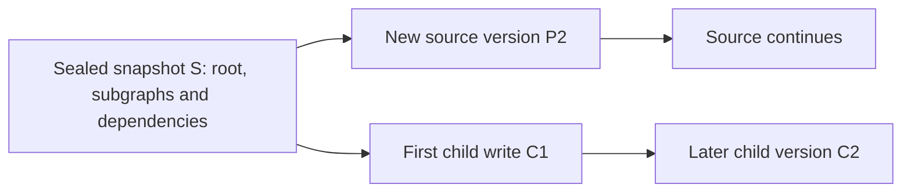

**Status: proposed, not implemented.** This document describes the target shared-checkpoint architecture. Side chats currently copy the checkpoint dependency closure of the latest sealed reply into the child thread. Reference storage has not been implemented, migrated or deployed.

## Goal and current behavior

Allow a side chat to start from the latest fully sealed reply while the source keeps running, without copying historical checkpoint payloads for every child. The proposed model shares a sealed snapshot and saves subsequent versions independently in each thread.

The existing `POST /api/ai/threads/:thread_id/copy` mode, `latest-sealed-reply`, already expresses the business boundary: create a new thread, share the selected message's ancestor path, preserve the source execution, and deduplicate retries with `requestId`. `parentThreadId` records provenance; it does not make LangGraph inherit state.

`SideChatForkService` currently selects and validates the sealed message, then calls `copyBranchCheckpoints()` to copy root, subgraph and ancestor dependencies and rebind platform identities. It excludes pending writes, queued input, run control, approvals and live Goals. The API and frontend can retain these semantics while storage changes from payload copying to references.

The first phase covers side chats within one conversation. Independent conversation forks, deleting a parent while retaining children, message/channel-level delta storage and filesystem snapshots are outside that phase.

## Existing storage constraints

| Location                                                      | Current behavior                                                                                                | Required change                                                                                     |
| ------------------------------------------------------------- | --------------------------------------------------------------------------------------------------------------- | --------------------------------------------------------------------------------------------------- |
| `copilot-checkpoint/checkpoint-saver.ts`                      | Looks up thread, namespace and checkpoint ID; serializes whole payloads and upserts them                        | Separate logical addresses from immutable content versions and resolve inherited state consistently |
| `copilot-checkpoint/copilot-checkpoint.service.ts`            | Provides a separate read/upsert path for management APIs                                                        | Apply the same version and reference rules as the Saver                                             |
| `chat-conversation/message-checkpoint.service.ts`             | Scans physical rows at root completion to pin subgraphs, then seals the persisted final reply                   | Capture the effective local and inherited namespace boundaries                                      |
| `chat-conversation/conversation-branch/branch-checkpoints.ts` | Traverses `parent_id` and `metadata.parents`, copies payloads and rebinds identities                            | Extract reusable dependency resolution and state projection while retaining legacy copying          |
| `ai/commands/handlers/thread-delete.handler.ts`               | Deletes checkpoints by thread; primary deletion removes the conversation, non-primary parents cannot be deleted | Release ownership and references before collecting content                                          |
| `copilot-checkpoint/retention.service.ts`                     | Protects message output anchors, same-namespace ancestors, run control and input anchors                        | Include cross-thread and cross-namespace dependencies and concurrent reference creation             |

Paths are relative to `packages/server-ai/src/`. Historical edits, resume validation and execution queries also read checkpoint rows directly. Updating only `getTuple()` would leave inconsistent behavior.

Sealing currently establishes a business boundary. Message and path hashes validate the associated history; they do not enforce immutable checkpoint bytes in the database. Both the Saver and management API permit upserts, and subgraph persistence has its own update semantics. Separate mutable logical mappings from immutable versions before restricting writes; simply rejecting every upsert is insufficient.

## Proposed data model

These names describe responsibilities, not deployed tables. Every record carries trusted tenant, organization and, where needed, conversation scope.

| Concept                    | Stored information                                                                                    | Lifetime                                                                                       |
| -------------------------- | ----------------------------------------------------------------------------------------------------- | ---------------------------------------------------------------------------------------------- |
| `CheckpointObject`         | Unique content version ID, serializer format/version, state and metadata bytes, integrity digest      | Immutable after publication; collect only when unreferenced and expired                        |
| `ThreadCheckpointEntry`    | Mapping from `(threadId, namespace, checkpointId)` to a content version, with queryable dependencies  | Owned by its thread; saving the same logical address cannot overwrite an older content version |
| `SealedCheckpointSnapshot` | Graph revision, fixed root and namespace boundaries, content versions and required dependency closure | Publish atomically after validation; membership remains immutable                              |
| `ThreadSnapshotReference`  | Child-to-snapshot reference, fork message and creation request identity                               | Register with thread creation in one transaction; release on deletion                          |

Snapshot members point to concrete content versions, not parent addresses that can advance. Dependencies must be queryable and constrained in the database rather than hidden only in serialized metadata or thread JSON. Foreign keys protect referenced content, and cross-scope references are rejected.

`parentThreadId` remains provenance, not the sole owner of payload lifetime. Digests support integrity and optional scoped deduplication; they are not authorization credentials. Cross-tenant content deduplication is not required.

Both paths share S and own their subsequent versions. A new checkpoint can still contain full state; this proposal does not promise message- or channel-level byte deltas.

## Creation, reading and first writes

### Creation and idempotency

1. Select the latest sealed reply on the source head's ancestor path. Validate the message, path and graph revision; never use a streaming reply as the boundary.
2. Pin concrete root and namespace versions and their dependencies. Convert a legacy boundary to immutable storage once, then reuse its published snapshot.
3. Revalidate the boundary and authorized scope, then register the child, snapshot reference and idempotent result in one controlled transaction. Use a consistent lock order with deletion and retention. A committed child must never exist without its snapshot being protected.
4. Retry unknown network outcomes with the same `requestId`, returning the original child without registering another reference or selecting a newer snapshot. Retries must not increment reference counts twice.

Persisted request results need a unique constraint consistent with the existing source-thread, conversation and request identity scope. Reusing a key for a different fork mode must conflict. Supporting delayed retries after child deletion requires a retained deletion result so an old request cannot recreate the deleted thread; define its expiry with the supported retry window.

### Unified reads

Resolve the requested logical namespace and checkpoint address to a local mapping or an explicitly inherited snapshot version. Without a checkpoint ID, each namespace uses its local current state or pinned inherited boundary. Never fall back to the parent's latest state. Explicit historical reads must also stay within the thread's permitted dependency history.

Return the child's logical identity in LangGraph `config`, `parentConfig` and related references. The current Saver returns the physical row's `thread_id`; returning a parent row unchanged would introduce the parent identity into runtime configuration.

Apply the existing platform identity projection to independently deserialized state: rebind `sys.thread_id`, clear session paths and pending follow-ups as required, preserve model messages, tool-call/result pairing and opaque application values. Never mutate a shared cached object or inherit parent pending writes. Unsupported knowledge-task state remains rejected.

Sealing must combine local namespaces with inherited boundaries. Historical edits, execution details, state queries, further forks and resume validation need the same resolver; private writes created by a pause remain local to the thread. The existing `list()` does not implement complete history enumeration and must not be assumed to cover these consumers.

### First writes and further forks

`put()` saves a new content version and mapping for the child. `putWrites()` always uses the child's space, including when writes precede a new checkpoint or the first run fails and retries. Neither path may write to the parent or resume its scheduled work.

The first write is not an atomic detachment of the entire thread. The root may have a local version while some subgraphs still depend on inherited state. Historical editing and future forks may also require old dependencies. Do not release the snapshot automatically after the first write; early release requires a separately defined and validated history truncation or compaction policy.

When a child is forked again, resolve effective dependencies to concrete content versions rather than building an unbounded parent-lookup chain. Share versions while preserving each thread's identity projection and authorized scope.

## Isolation boundaries

- Source writes cannot change a published snapshot. The child sees its sealed boundary and its own later state.
- Thread heads, execution leases, `runControl`, cancellation, resume, approvals, Goals and input queues remain independent. Registering a reference does not pause, cancel, replay tools or send a message.
- References do not grant access. Entry points retain conversation contribute and Assistant checks. Internal resolution verifies tenant, organization, conversation and snapshot membership; clients cannot select arbitrary physical content versions.
- Workspace files, file assets, long-term memory and sandboxes retain their existing sharing and authorization models. Checkpoint sharing does not copy, roll back or isolate external side effects.
- Graph revision, message and path validation remain necessary. Content integrity checks do not replace business validation.

## Deletion and collection

| Operation                                         | Proposed rule                                                                                                         |
| ------------------------------------------------- | --------------------------------------------------------------------------------------------------------------------- |
| Delete a side chat                                | Clean up private runtime state and release thread/message references; retain content with other live references       |
| Delete a non-primary thread with children         | Keep the existing rejection in phase one; allowing it also requires message-tree and execution-relation changes       |
| Delete the primary thread or conversation         | Preserve deletion of the whole thread family, release references together, then collect unreferenced content          |
| Delete a parent but retain children               | A later product capability; preserve shared message history, snapshots and display dependencies, not just checkpoints |
| Delete a checkpoint through a lower-level command | Apply the same reference checks; do not bypass protection with a payload delete by `thread_id`                        |

Coordinate deletion with run claims, forks and collection so a deleting thread cannot introduce new writes or references. Audit entity cascades, management APIs, commands and background entry points; changing only the public deletion endpoint is insufficient.

Current retention selects candidates before its deletion transaction. Reference storage must recheck collectability inside that transaction and use an explicit lock protocol or restrictive foreign keys so reference creation and payload deletion cannot both commit. The advisory lock between cleanup workers does not provide this protection.

Retention roots include existing message input/output anchors, valid runtime recovery state and new thread snapshot references. Protect roots, subgraphs and required dependencies through explicit relations. Collect content only when it has no retention references and has expired. Clean pending writes according to their own thread ownership and recovery requirements.

Reference rows and dependency reachability are the source of truth; counters may optimize queries but cannot be the only evidence. Unreferenced objects left by failed snapshot publication can be collected after a controlled grace period. Observe orphan objects, bytes pinned by references, oldest reference age, resolution failures and cleanup retries without logging message bodies, credentials or checkpoint content.

## Scope and expected benefit

| Area                                                                    | Relative scope                      |
| ----------------------------------------------------------------------- | ----------------------------------- |
| Data model, migrations, immutable publication and reference constraints | Large                               |
| Shared Saver/management reads, identity projection and writes           | Large                               |
| Sealing, historical edits, subgraph recovery and further forks          | Medium to large                     |
| Deletion, retention, concurrent references and recovery                 | Large                               |
| Side-chat creation and durable idempotent results                       | Medium                              |
| SDK, frontend entry points and API semantics                            | Small; current contracts can remain |

This is a substantial backend storage refactor. It primarily avoids serializing and writing the whole dependency closure for every fork. Building a snapshot initially still requires dependency resolution and validation. Only reusing a published snapshot can approach a fixed number of metadata writes; the complete operation is not unconditionally O(1).

Later checkpoints can still save full history, so the proposal does not remove duplication between every runtime step. Shared references can also extend retention. Compare retained bytes and creation latency, not just thread counts.

## Migration and rollout

1. Add content versions, snapshots and references with compatible reads for legacy rows. Existing threads and copied forks remain usable.
2. Keep reference-based creation disabled while deploying the resolver, immutable publication, deletion and retention protection. Verify all instances and background workers have upgraded.
3. Convert sealed boundaries on demand while preserving validation. Publish a snapshot atomically before allowing references; do not rewrite all history at once.
4. Enable same-conversation side chats first, keeping API mode, request IDs, error contracts and frontend behavior. Measure creation latency and storage changes.
5. Evaluate independent conversation forks, legacy compaction, independent parent deletion and finer-grained deduplication later.

Disabling new reference forks does not convert existing reference-backed threads. Before rolling back to reference-unaware services, materialize all surviving reference threads and validate subgraph/history dependencies, or retain compatible reads and collection. Old services or cleanup workers must not run unprotected against reference-backed data.

## Acceptance criteria

- Use real LangGraph execution to fork while the source runs: inherit H1/A1, exclude in-flight H2, continue independently and never replay completed tools.
- Cover multiple namespaces, nested subgraphs, mixed local/inherited state, historical edits, further forks and graph revision changes.
- Verify that updating a source logical address cannot change published snapshot bytes and that unknown-outcome retries do not duplicate objects, threads or references.
- Use an isolated PostgreSQL schema to race reference creation against retention, deletion against forks, and first writes against deletion. Exercise rollback, foreign keys and unique constraints rather than relying only on repository mocks.
- Verify child deletion, whole-conversation deletion, message soft deletion, reference release and expiry. Long-lived children without any local write must remain recoverable.
- Reject cross-tenant, cross-organization and cross-conversation access; execution details and resume must not expose newer parent state or pending writes.
- Measure copied bytes, creation latency, query counts and cleanup duration for long histories and multiple forks at comparable data sizes.

No performance or PostgreSQL concurrency experiment for reference storage has been run as part of this proposal. Existing copy-based tests do not satisfy these criteria or establish deployment of shared storage.
