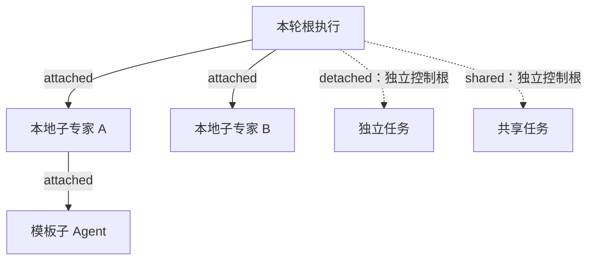
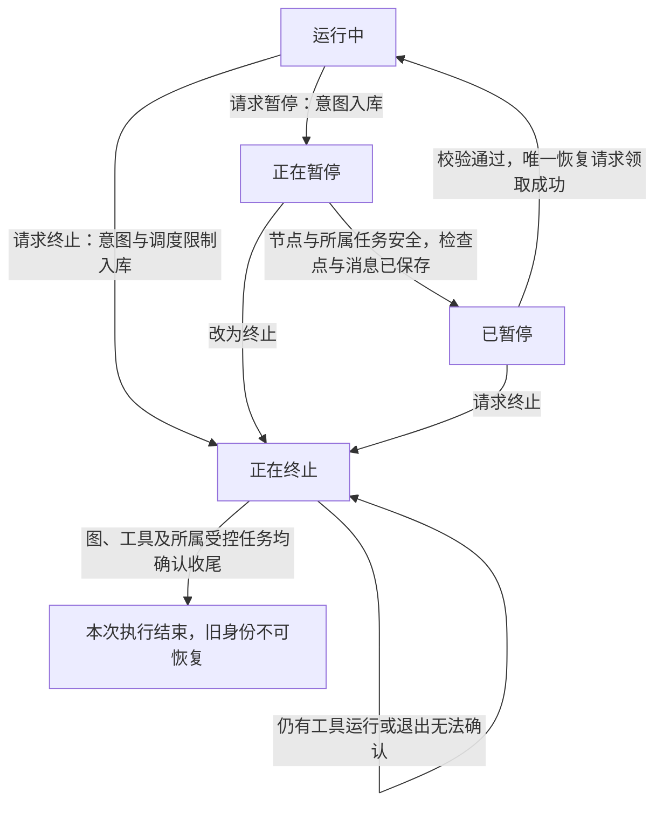
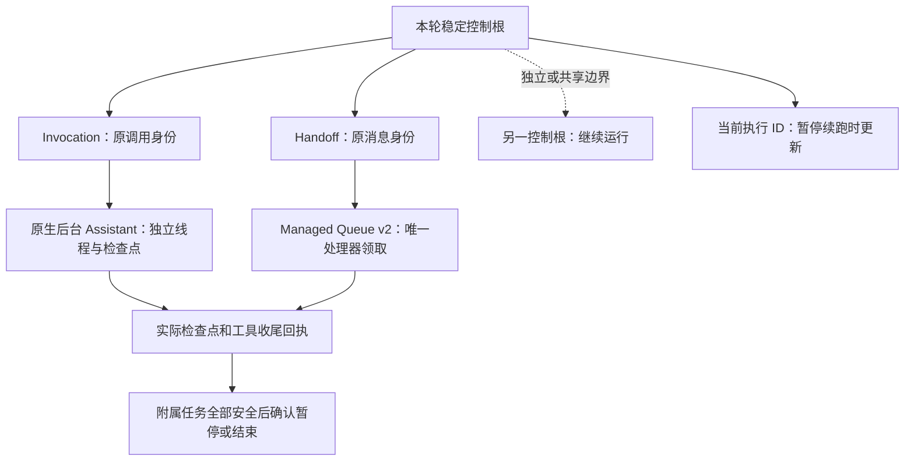
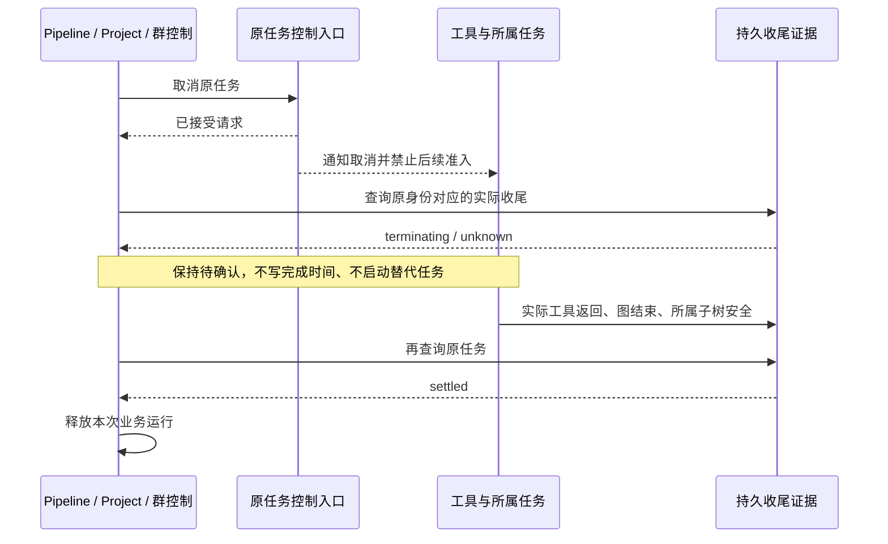
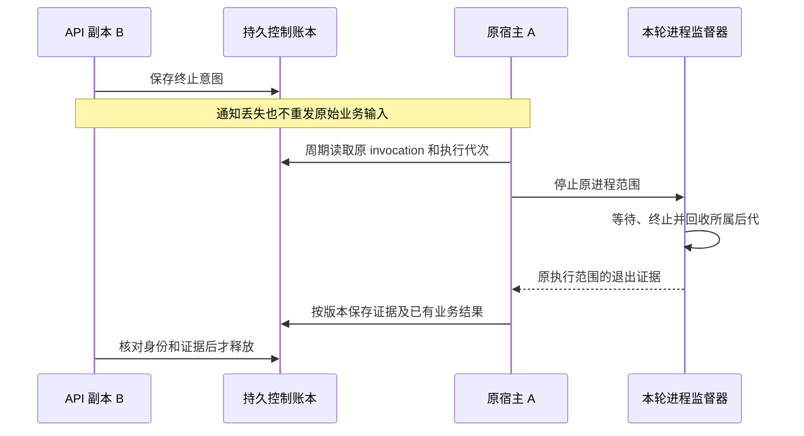
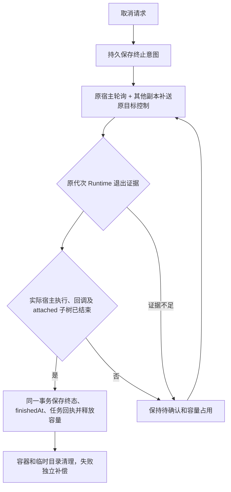
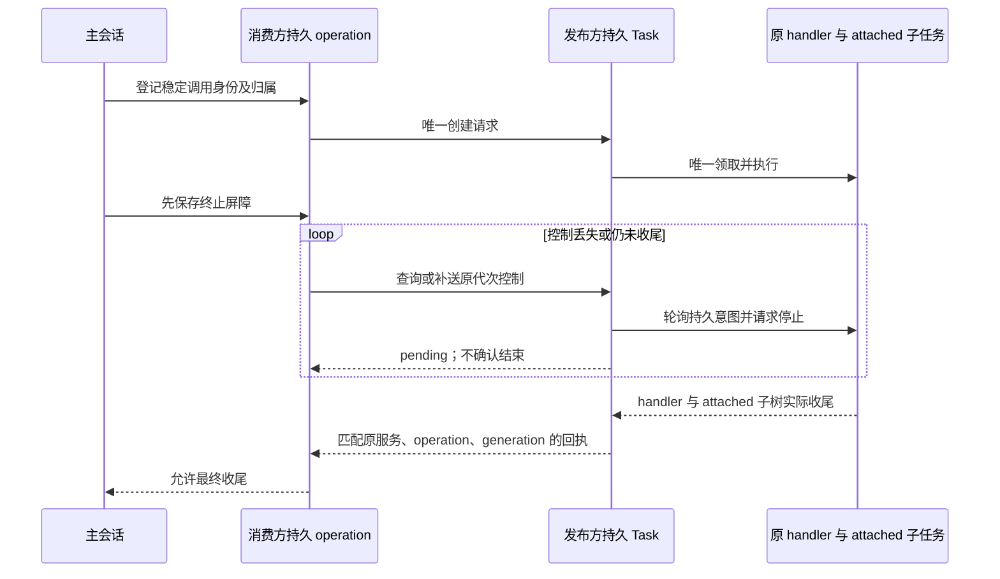
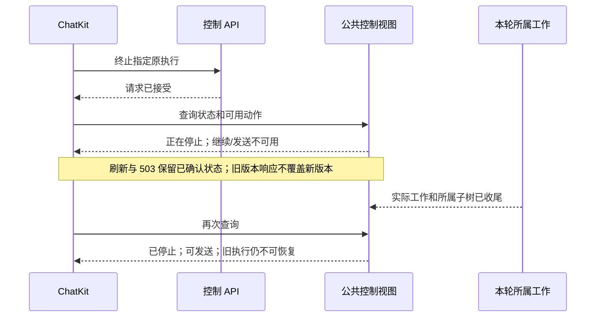

# 会话执行控制：暂停、继续与终止

本文维护会话执行控制的**已实现功能**，供后端开发、测试和后续功能迭代使用。后续阶段完成后继续更新本文；尚未实现的设计保留在[升级计划](./proposal/issue-1217-execution-pause-and-termination.md)中。

当前审核阶段：**第七批——公共控制视图与状态接口（4.1 后端）**。Xpert 前六批已提交，最近一批为 `b21c640d7`；本批待审核提交。Pro、独立 SDK 与 ChatKit 配套改动另行审核，未部署。本文描述本地实现能力，不代表生产环境已具备这些能力。

## 模块与契约边界

`IExecutionControl` 定义在 contracts；`ExecutionControl` 实体实现该接口，并保留显式数据库列类型。
独立的 `ExecutionControlModule` 位于 `packages/server-ai/src/execution-control`，拥有控制账本、工具收尾回执和本地取消送达。消费者显式导入该模块，不依赖全局注入。LangChain 工具回执位于 `adapters`。
会话占用、检查点和恢复领取仍由会话领域管理。控制账本继续在原事务中校验线程身份和租约，模块整理不改变执行语义，也不把内部控制字段加入客户端响应。

## 功能范围

第一阶段解决取消通知丢失后旧执行继续运行，以及暂停、恢复、终止并发时旧执行重新获得执行资格的问题。

| 能力           | 当前实现                                                                                                               |
| -------------- | ---------------------------------------------------------------------------------------------------------------------- |
| 执行归属       | 统一根执行、父执行和 `attached` / `detached` / `shared` 策略；接入本地会话、同步子专家和模板子 Agent                   |
| 持久控制       | PostgreSQL 保存控制意图；Redis 通知加速送达，执行副本轮询补偿遗漏                                                      |
| 暂停           | 等待当前完整图节点收尾，在可持久化的节点边界暂停                                                                       |
| 继续           | 校验检查点、工作流兼容性和恢复令牌；并发请求只允许一个获得恢复资格                                                     |
| 终止           | 撤销旧执行的调度资格，通知本地执行取消，等待图和实际本地工具结束后释放会话                                             |
| 独立、共享工作 | 控制账本支持独立根隔离；不因父执行终止而级联取消这些根                                                                 |
| 业务收尾确认   | 3.1 接入 Pipeline Assistant / Runtime、Project 重试准入和群控制；取消应答与实际执行结束分离                            |
| 后台与队列任务 | 第二阶段接入原生跨线程 Assistant、Invocation、受控 Handoff，以及显式接入的 Managed Queue；远端物理退出仍需各适配器确认 |
| Sandbox Job    | 3.3.1 将 Job、宿主回调及其受控子任务接入同一归属；实际收尾证据齐全后释放容量，按原环境和代次补送控制                   |

4.1 另提供公共控制视图、持久单调版本与统一按钮能力，详见后文对应章节。

## 暂停和终止的区别

| 操作 | 当前执行如何处理                                                    | 后续操作                                                 |
| ---- | ------------------------------------------------------------------- | -------------------------------------------------------- |
| 暂停 | 保存暂停意图，不直接 abort 当前节点；等待节点、检查点和消息保存完成 | 确认已暂停后，从该检查点继续                             |
| 继续 | 领取唯一恢复资格，绑定执行身份，从保存的边界续跑                    | 不把恢复请求作为新输入重新执行已完成工具                 |
| 终止 | 持久标记 `terminated`，拒绝后续调度并发送取消信号                   | 不能恢复已终止的执行身份；需要继续业务时另起明确的新请求 |

**暂停边界是完整图节点，不是任意一条工具指令。** 已进入节点的工具组允许收尾，其中尚未开始的工具也可能在收到暂停请求后开始。这样可以保存完整节点结果，避免在半个节点中间暂停、恢复时再次执行已经完成的工具。后续节点在执行前被暂停守卫拦截。

例如，一个节点顺序调用工具 A、B，之后执行节点 C。在 A 运行时请求暂停，A 和 B 会完成并保存结果，然后在 C 前暂停。恢复后执行 C，A 和 B 不重放。如果本轮在到达可暂停边界前已自然完成，则按实际完成结果收尾，不补造暂停检查点。

终止不能撤销工具已经产生的业务副作用。工具不响应取消信号时，后端继续等待实际调用结束，不因断开 SSE、取消包装层 Promise 或等待超时而认定工具已经停止。

## 执行归属与控制范围

归属由可信后端在创建工作时明确指定；客户端不能通过自报根执行或父执行改变控制范围。



- `attached`：继承所属根和祖先控制。终止根执行影响其所属子树；仅终止 A 时，不影响父执行和兄弟 B。
- `detached`：建立独立控制根，不继承父执行的暂停或终止。
- `shared`：同样隔离父执行的生命周期控制；不能因一个调用方停止而终止共享工作。

`background`、异步、等待模式只描述调用方式，不能据此判断是否独立。第一阶段已验证控制账本的隔离规则，尚未把所有后台任务入口迁入这套归属体系，也未完成共享任务订阅、等待和结果消费的统一控制。历史记录不通过名称、同一工作空间或同一线程猜测归属。

## 控制流程与确认条件



这里的“执行结束”仅指当前已接入的控制范围，不表示未接入的远端任务已物理退出。

### 暂停与继续

1. 在会话线程行锁内保存暂停意图和 `pauseId`，线程进入 `pausing`。重复暂停请求返回同一有效暂停标识。
2. 当前节点继续完成；节点守卫阻止后续节点执行。先保存检查点，再完成消息持久化，等待所属受控子树安全后确认 `paused`。
3. 恢复时核对线程、执行身份、`pauseId`、检查点所属租户和组织，以及工作流指纹。只有确认暂停且检查点存在的会话可恢复。
4. 行锁保证并发恢复只有一个请求领取成功；`resumeClaimId` 将后续绑定、失败回滚限定到同一次领取。过期请求不能回滚新的恢复，也不能覆盖终止。
5. 普通会话恢复绑定新的执行身份，旧身份失去继续调度资格；群会话的既有恢复路径可在同样的领取约束下绑定原身份。绑定只生效一次。

工作流兼容性沿用[布局发布与检查点恢复规则](./conversation-branching.md#工作流兼容性与布局发布)：布局变化可兼容，执行逻辑变化仍拦截；无法验证的旧检查点不猜测恢复。

### 终止与通知补偿

1. 在事务中先保存终止意图、线程的 `terminating` 控制状态和禁止自动续跑的标记，再尝试 Redis 广播。
2. 运行副本向已登记的本地 `AbortController` 传递取消。广播失败不撤销持久终止意图。
3. 每个执行副本按约 1 秒的周期检查其本地控制器对应的持久状态，补偿丢失通知；控制器登记后、开始工作前也立即检查，覆盖“通知先到、控制器后登记”的竞态。
4. 新节点、工具调用及检查点写入继续核对执行身份和控制状态，拒绝已终止、已结束、被替换或租约失效的旧执行。轮询只补送控制，不重新启动业务或重试工具。
5. 等图结束、已登记本地工具及所属受控任务实际收尾，才解除会话占用。若包装层提前结束而工具仍在执行，线程保持占用；维护任务补查后完成收尾。

1 秒是轮询周期，不是停止时限。数据库或网络不可用时不能保证这一时间内送达；工具调用前无法取得有效控制事实时拒绝准入。租约过期也不能单独作为执行已经退出的证据，新协议下尚未确认退出的运行保持终止待确认和占用限制。

## 持久数据与并发保证

`execution_control` 保存控制事实；业务结果仍由原有消息与检查点保存。

`ExecutionControl` 继承 `TenantOrganizationBaseEntity` 并实现 contracts 中的 `IExecutionControl`；接口继承 `IBasePerTenantAndOrganizationEntityModel`。统一继承 `id`、创建/更新审计字段及租户组织关系；`executionId` 是有唯一索引的业务身份，不再另设主键。登记入口要求明确租户，控制查询及锁仍以 `executionId` 定位，重复登记不能覆盖终止记录。SQL 同时支持新建表和早期表结构升级，保留原有控制事实；升级补入的时间是迁移时间，不代表历史创建时间。

| 数据                                                    | 用途                                                                                  |
| ------------------------------------------------------- | ------------------------------------------------------------------------------------- |
| `executionId`、`tenantId`、`organizationId`、`threadId` | 标识执行及其授权范围                                                                  |
| `rootExecutionId`、`ownership`、`ancestors`             | 表达父子关系、控制根和附属祖先路径；独立或共享边界不继承父路径                        |
| `desired`、`revision`                                   | 保存 `running` / `paused` / `terminated` 意图及其版本；已终止身份不能重新注册为可运行 |
| `graphEnded`                                            | 记录图已结束，不能单独证明其工具已退出                                                |
| 根记录的 `work`                                         | 保存工具调用 ID、所属执行和 `settled` 回执；不保存工具输入输出                        |

线程行锁串行化暂停、恢复和终止；控制根行锁串行化子执行登记、控制变更及工具准入。工具准入检查归属、当前线程执行身份、租约和祖先状态；同一工具调用 ID 只能登记一次，已结算的 ID 也不能重复准入。

本地工具回执通过 `StructuredTool` 回调包围实际 `_call`：执行前完成持久准入，实际返回或抛错后才结算。LangChain 外层 Runnable 被 abort 并不等于 `_call` 已返回，不能代替该回执。

这些保证覆盖已接入的本地工具及受控恢复路径，**不构成任意外部工具跨崩溃的 exactly-once 保证**。进程消失或回执缺失时保留未确认状态，不通过重放工具补造成功或退出证据。

## 状态接口与前端边界

控制意图、线程运行状态和实际退出证据分别表达，不能相互替代：

- `desired = terminated` 表示旧执行已被撤销调度资格，不代表所有工具已经停止。
- 等待终止确认时，`runControl.state = terminating`，线程继续保持 `busy`，防止新运行与旧工具重叠。确认本地收尾后，线程使用现有 `interrupted` 状态并清除活动 `runControl`，持久终止记录仍保留。
- `canceledExecutionIds` 是兼容字段，表示取消请求涉及的执行身份，不能作为远端物理退出回执。
- 迟到的旧执行收尾、检查点写入或恢复回滚不能覆盖当前执行状态。取消迟到时也不会把已完成的 `SUCCESS` 业务结果改成失败。

第一阶段没有新增 ChatKit 技术信息展示或管理员调试界面。ChatKit 仍以简短提示和按钮可用状态为边界；执行归属、控制版本、回执与补偿原因留在后端，后续管理员调试功能再提供查询入口。

## 数据库与运行兼容性

新增表及索引见[数据库脚本](../packages/server-ai/src/execution-control/migration.sql)。脚本应在承载新控制逻辑的 API / worker 启用前执行，可重复运行，不推断或回填历史执行归属。当前仅在隔离测试数据库中验证，未执行部署。

发布时需要统一支持这套控制协议，不能让缺少身份检查和持久控制逻辑的旧 worker 继续执行新协议任务。第一阶段未实现自动混合版本隔离开关；上线迁移仍需另行安排。历史执行的兼容处理不代表它们已经全部获得新的归属和停止确认保证。

## 验证覆盖与源码入口

第一阶段回归覆盖以下行为：

| 场景                                   | 验证结果                                                     |
| -------------------------------------- | ------------------------------------------------------------ |
| Redis 取消通知丢失、控制器迟到登记     | 持久控制通过轮询和启动前检查生效；旧执行不能越过守卫调用工具 |
| 同一节点包含两个工具，执行中请求暂停   | 两个工具完成后暂停；恢复只执行后续节点，不重复这两个工具     |
| 并发暂停、恢复、终止及迟到回滚         | 有效暂停标识稳定，恢复仅一个领取者，终止不可被旧请求撤销     |
| 工具忽略取消，外层 Runnable 已结束     | 工具实际返回前仍保持 `busy` / `terminating`，阻止启动新运行  |
| 取消所属子树                           | 父执行、兄弟执行及独立、共享控制根保持隔离                   |
| 工具并发登记、数据库不可用、迟到子执行 | 重复准入和无有效控制依据的调用在工具函数执行前被拒绝         |
| 迟到检查点、收尾和取消                 | 不能覆盖新执行或改写已完成结果；群会话恢复路径保持兼容       |

测试使用隔离 PostgreSQL、Redis 和实际 LangGraph / 工具调用，并在同一测试进程中创建两个服务实例模拟副本。覆盖实际数据库锁及通知遗漏，不等同于生产多进程、远端运行时或真实业务端到端验收。

主要实现与回归入口：

- [公共归属与控制类型](../packages/contracts/src/ai/execution-control.model.ts)、[控制账本](../packages/server-ai/src/execution-control/execution-control.store.ts)。
- [线程状态与恢复领取](../packages/server-ai/src/chat-conversation/thread-run-control.service.ts)、[取消送达与补偿](../packages/server-ai/src/execution-control/execution-cancel.service.ts)。
- [实际工具回执](../packages/server-ai/src/execution-control/adapters/execution-tool-receipts.ts)、[PostgreSQL / Redis / LangGraph 集成回归](../packages/server-ai/src/chat-conversation/thread-run-control.integration.spec.ts)。
- [检查点恢复回归](../packages/server-ai/src/copilot-checkpoint/checkpoint-recovery.postgres.spec.ts)、[本地执行范围回归](../packages/server-ai/src/execution-control/execution-abort-scope.spec.ts)。

运行集成回归前，显式设置 `XPERT_PAUSE_TEST_DATABASE_URL` 和 `XPERT_CONTROL_TEST_REDIS_URL`，分别指向可丢弃的测试 PostgreSQL 和 Redis。数据库名必须以 `_test` 结尾；数据库测试使用随机 schema 并清理。未设置数据库 URL 时该套件跳过，不能视为验证通过。

```sh
corepack pnpm exec jest --config packages/server-ai/jest.config.ts --runInBand \
  --runTestsByPath packages/server-ai/src/chat-conversation/thread-run-control.integration.spec.ts
```

## 第二阶段：稳定任务身份与跨线程控制

第二阶段保留第一阶段的实际工具回执，增加两张表：`execution_task_control` 保存稳定任务树、当前执行尝试、意图版本、领取和确认；`execution_task_publication` 保存入队参数、派发重试及 Handoff 最终业务结果。控制投递使用目标行上的最新意图、到期时间和领取租约合并重复请求，不另起业务执行。



### 已接入的行为

| 目标                   | 暂停与继续                                                                                     | 终止与确认                                                                           |
| ---------------------- | ---------------------------------------------------------------------------------------------- | ------------------------------------------------------------------------------------ |
| 原生同步专家           | 保留本地节点收尾与检查点语义；调用身份跨父执行尝试保持稳定                                     | 原生调用结束及本地工具回执分别确认，不要求通用 provider 提供远程取消                 |
| 原生后台 Assistant     | 子线程独立保存暂停点；父会话等子树安全后确认暂停；从该子线程保存的检查点续跑，更新当前尝试绑定 | 包含跨线程及 pending 子任务；终止先写入控制根，旧检查点、迟到写入和旧尝试不能继续    |
| 在途 Invocation        | 没有安全暂停适配器时等待原任务收尾；保留原句柄及结果                                           | 尚无句柄也保存取消意图；迟到句柄补送到原 provider；不重新调用业务 start              |
| 受控 Handoff           | 未准入的异步消息保留；`enqueueAndWait` 明确登记为当前节点的同步收尾依赖，允许完成              | 原消息身份持久化；取消不依赖扫描时恰好看到 active；处理器实际返回后确认              |
| 显式受控 Managed Queue | 排队暂停转 delayed，不消耗失败重试；恢复只领取一次                                             | 处理器获得 `control.signal` 和 `control.desired()`；忽略取消时继续等待，不能伪造退出 |

`AgentMiddlewareAssistantTaskInput.controlPolicy`、Handoff 的 `controlPolicy` 和 Managed Queue 的 `controlPolicy` 是可信宿主/插件选择的生命周期策略，不由 background 模式推断。Managed Queue **显式提供 controlPolicy 且位于受控宿主上下文中才接入**；Handoff 适配器为自己的受控消费作业提供 attached 策略。现有未迁移的插件队列保留原有调度。已由 Project、Pipeline 或群任务领域受理的工作保留独立生命周期，其完整业务控制桥接属于第三阶段。

### 无句柄、补偿和并发边界

- Invocation 在取消调用前保存 `control.intent = terminated`。启动仍未返回时保留 cancelling，句柄到达后对原任务补送。控制请求使用独立的受限信号，业务 abort 不会提前撤销取消请求。
- 只有显式声明 `idempotentCancellation` 的 provider 可以在响应丢失后重复投递取消；其他 provider 后续只查询原任务。原 provider 变化、权限撤销或状态未知时保留待确认，不切换 provider 或再次 start。
- 登记、领取、恢复绑定、终止和检查点写入都检查同一稳定根。扫描时的 queued 快照不能当作“尚未执行”证明，必须在领取锁下重新核对。
- 根暂停后，普通排队作业等待；已经准入节点的同步依赖可以收尾。因此不会形成“父节点等子任务完成，但子任务被父暂停禁止启动”的互等。
- 子线程不能在祖先仍暂停时独自继续。恢复失败只允许回到同一保存边界；若终止已经生效，回滚不能撤销它。
- 原任务句柄在续跑后仍映射到同一逻辑任务的当前执行；查询和取消沿用原有领域授权，并拒绝跨租户、组织或线程的映射。

### 结果和实际退出

Handoff 的业务结果持久化后，等待方即使不在执行 worker 的进程，也可读到原结果。进度事件仍是原有的进程内 best effort 通道。迟到取消不覆盖已经返回的成功事实；后续派生仍要检查控制根。

向父会话自动回传结果时，原有结果 ID/订阅领取去重之外，还检查稳定任务意图和当前执行绑定。即使线程显示 idle，原轮次已经暂停或终止也不能自动唤醒。独立或共享任务自身及其他消费者不受本调用方停止影响。

实际处理器领取不因租约过期自动释放。worker 被杀、队列 stalled 重领或回执丢失时，缺少退出证据就保持待确认；另一个 worker 只能补偿控制，不能再次执行该 handler。已返回的失败也保存结果类别，重投递不能把它改成成功。本阶段不提供任意外部副作用的 exactly-once 承诺。

### 兼容与运行条件

- [第二阶段数据库脚本](../packages/server/src/task-control/migration.sql) 可重复执行；需在未来正式启用新 host/worker 前执行。本轮只在可丢弃的测试库执行，不回填历史任务归属。
- 新受控作业走 `plugin-jobs-control-v2` / `plugin-jobs-browser-control-v2`，使用原 Managed Queue Redis 前缀。旧 worker 不订阅这些队列；新 worker 拒绝缺少 v2 控制身份的 envelope。原物理队列仍服务未迁移作业。
- 新版队列暂保留完成/失败记录，并依赖数据库终局记录防重。未来清理策略必须保留防重和审计证据，不能单独删除未知任务的领取记录来触发重跑。
- 旧 Handoff 作业补充持久取消检查和轮询；未登记的历史关系不补造为附属树。既有周期调度、Project/Pipeline 业务控制、Runner/Sandbox/MCP 的远端物理退出和管理员调试界面仍不在本阶段保证范围内。
- ChatKit 没有增加技术状态界面或补丁；用户只需看到简短提示和按钮状态。

### 第二阶段回归入口

- [故障复现与修复回归](../packages/server-ai/src/execution-control/execution-control-phase2.spec.ts)：无句柄取消、跨线程 pending 子任务、queued→active 取消遗漏。
- [稳定任务数据库回归](../packages/server-ai/src/execution-control/task-control-phase2.integration.spec.ts)：归属与终止竞争、独立/共享隔离、唯一领取、恢复绑定及迁移幂等。
- [双进程队列回归](../packages/server-ai/src/execution-control/task-control-workers.integration.spec.ts)：SIGKILL 后重领不重复执行；无 pub/sub 通知仍通过持久控制收尾。
- [Handoff / Managed Queue 集成](../packages/server-ai/src/handoff/handoff-control.integration.spec.ts)：同步父子暂停收尾、跨等待注册表读结果、入队补偿、成功结果保留。
- [线程与实际 LangGraph 回归](../packages/server-ai/src/chat-conversation/thread-run-control.integration.spec.ts)：跨线程暂停/终止、原检查点续跑、已完成工具不重放、恢复失败回滚。
- [Invocation 控制与投递](../packages/server-ai/src/agent-invocation/invocation-runtime.spec.ts)、[控制协调器](../packages/server-ai/src/agent-invocation/task-control-coordinator.spec.ts)：迟到句柄、丢失控制响应、当前授权、provider 固定及 DI。
- [迟到结果回传](../packages/server-ai/src/handoff/runtime-messaging/testing/reliable-return.cases.ts)：原控制根暂停/终止时不唤醒 idle 线程，恢复后仍只消费一次。

这些验证使用隔离数据库、Redis、实际队列 worker 和 LangGraph；模型与外部 provider 使用可控替身，不是生产远端运行时验收。

2026-10-25 重新分层验证：在保留第一批独立模块和基础实体继承调整的隔离快照上，19 套、188 项定向回归通过，包括真实 PostgreSQL/Redis、双 worker 进程及检查点恢复。该结果不替代第三阶段远端收尾和此前暂缓的产品全链验收。

## 第三阶段 3.1：收尾证据与业务桥接

取消入口返回成功、`canceledExecutionIds` 包含目标、投递记录变成 `canceled`，都只证明控制请求或投递撤回。它们不能证明实际工具已结束。3.1 将这些事实与业务释放条件分开。



### 证据契约

共享类型 `ExecutionControlEvidence` 的 `version: 1` 明确区分以下来源：

| 来源             | 证明内容                                                                                      | 不能据此推断的内容                                           |
| ---------------- | --------------------------------------------------------------------------------------------- | ------------------------------------------------------------ |
| `platform`       | 稳定任务身份、当前执行尝试、目标版本及所属子树状态                                            | 不包含 detached/shared 根；不证明未接入的远端工作已退出      |
| `provider`       | 声明 `completionEvidence: 1` 的固定适配器确认原 invocation/session/run 收尾；结果类别必须匹配 | cancel 请求返回成功、进程 Map 查无记录、超时均不能生成此证据 |
| `host_admission` | 宿主通过同一启动 CAS 确认任务尚未启动，或明确的启动前失败                                     | 不能由插件自报；已有启动句柄时不得补造                       |
| `unavailable`    | 未登记、不支持或尚未确认                                                                      | 不允许推断已退出或据此重放                                   |

平台读取使用 PostgreSQL `REPEATABLE READ`，在同一快照内核对第一阶段的图结束及工具实际回执，和第二阶段的稳定任务及附属子树。缺失账本保留未知；当前尝试变化后，原 ID 仍查询同一个稳定任务，不使用旧尝试的完成状态释放新尝试。原生证据只由宿主适配器提供，普通 Runtime 不得伪造这一来源。

安全暂停是 `paused`，不是 `settled`。尚有同步收尾依赖时是 `pausing`；依赖按第二阶段规则继续完成，父节点不与它互等。恢复继续使用原调用身份和保存结果；终止仍保留不可撤销的准入限制。版本字段用于诊断快照，终局单调性、原任务身份及已有恢复屏障共同防止迟到回执覆盖新执行。

### 已接入入口

- **Pipeline Assistant**：取消后查询原 Task；只有实际收尾证据才能生成取消终局。暂停保持等待。恢复后的执行别名必须由平台证据确认，业务 operation 身份保持不变。
- **Pipeline Runtime / Invocation**：取消应答没有有效证据时保持 `cancelling` / pending；后续查询原任务并沿用已有控制投递去重。旧 `cancelled` 快照可继续查询，不能直接解锁新任务。正常成功/失败仍保留既有业务结果语义；控制过程中返回结果但尚无收尾证据时，保存结果并继续等待，不改写成业务失败。
- **Project**：状态读取返回控制证据；新尝试准入和展示投影不把缺少证据的取消状态当成完成，也不补造运行完成时间。
- **群成员控制**：`accepted: true` 仍只表示请求接受，新增独立 `controlEvidence`。仅查询授权成员的明确 run；投递撤回和其他成员的调度规则不变。
- **群内 Project 任务**：检查消息、成员、invocation 的精确关联，再查询实际执行账本。图已经 interrupted 或投递 finalized，也不能跳过工具收尾确认。未启动投递的撤回由现有准入锁保证，不需启动执行来完成取消。

Project、Pipeline、群任务仍可拥有独立根。主会话的停止不会把这些独立领域任务改成 attached；共享任务与其他消费者继续运行。对应领域的取消入口仍执行当前授权，不能借证据读取绕过组织、成员或 Assistant 权限。

### 兼容与验证范围

3.1 复用第一、二阶段表，证据随 Invocation / Pipeline JSON 回执保存，不增加环境变量或数据库表。历史未登记任务及未声明新能力的远端适配器不会获得虚假的强确认；取消后可能继续处于待确认，直到原适配器提供可验证证据。正常业务结果和实际退出确认是不同事实。

混合版本的旧 worker 不理解这些释放条件，未来发布时必须确保同一控制链全部使用新 host / SDK。3.1 没有升级或部署 ProcessRuntime、OpenCode、Computer/Desktop、Sandbox、MCP 的物理控制实现，也未验收这些外部适配器；它们仍属于 3.2 / 3.3。没有增加 ChatKit 技术细节展示，管理员诊断界面留待后续。

回归入口：

- [Pipeline 故障与真实账本集成](../packages/server-ai/src/xpert-project/pipeline/runtime/pipeline-control-evidence.postgres.spec.ts)：延迟工具忽略取消、实际退出后释放、Runtime 应答与证据分离、子工具收尾、父子暂停依赖、恢复身份及独立/共享隔离。
- [Invocation 证据边界](../packages/server-ai/src/agent-invocation/invocation-control-evidence.spec.ts)：旧适配器、伪造宿主来源、错 invocation/session/run、结果不匹配、取消与领取 CAS 竞争、重建控制服务后不重复启动。
- [原生任务桥接](../packages/server-ai/src/xpert-agent-execution/runtime/control-assistant-task.handler.spec.ts)、[群内任务桥接](../packages/server-ai/src/chat-group/group-project/group-task-execution.spec.ts)、[群控制](../packages/server-ai/src/chat-group/group-control.spec.ts)：请求接受、投递撤回、安全暂停和实际完成分开。
- [Project 数据库回归](../packages/server-ai/src/xpert-project/runtime/project-task-dispatch.integration.spec.ts)：取消已接受时拒绝新尝试，实际确认后才允许显式发起新尝试；旧调用不会重放。
- 同时回归第一、二阶段的真实 PostgreSQL / Redis / LangGraph 控制、恢复和 Handoff 路径。外部模型及 Runtime 边界使用可控替身，不能替代第三阶段后续批次的真实进程验收。

核心故障在隔离 PostgreSQL 中的结果：修复前工具仍运行且只调用 1 次，Pipeline 已 `cancelled` 并写入完成时间；修复后相同时点保持 `cancelling`、完成时间为空，工具实际返回后才 `cancelled`，工具及业务启动次数均保持 1。

## 第三阶段 3.2：原宿主控制与进程收尾

实现日期：2026-10-24。普通业务结果、取消应答和实际退出证据继续分别保存；本阶段将持久控制送到原执行器，并接入可以核对的进程收尾边界。



### 原宿主与代次

- `hostAffinity: 1` 的适配器在唯一启动 CAS 中登记 `executionTarget`：宿主启动 UUID 和本次执行 UUID；拥有该目标的进程才会调用本地适配器。其他副本只保存控制意图或读取结果。
- 原宿主从持久记录补送控制，不依赖 Redis 通知。投递领取和实际退出仍为两个事实；重复投递只允许声明幂等的取消，不重复调用 `start` 或发送业务输入。
- 宿主重启后不会接管旧 Map 或重新发起任务；缺少原运行对象时保持未知。迟到 checkpoint、回执及控制都必须匹配原目标，旧代次不能释放或控制新任务。
- 远端审批响应先持久化，由原宿主只领取一次。领取后响应丢失不自动重放；已提交的终止优先于尚未投递的审批。
- 正常查询仍验证当前权限。原宿主补送已持久接受的终止时，只允许操作自己登记的原目标，不提供启动、批准、恢复或跨范围读取能力。

### 进程与适配器支持范围

| 路径                                                       | 实现与确认条件                                                                                                      | 保守边界                                                                                                           |
| ---------------------------------------------------------- | ------------------------------------------------------------------------------------------------------------------- | ------------------------------------------------------------------------------------------------------------------ |
| 本机 Codex / Pi                                            | 通过原宿主调用既有协议，再由监督器收尾；协议结果先持久化                                                            | `turn/completed` / `agent_settled` 本身不释放任务                                                                  |
| 本机 Claude SDK                                            | 接入 SDK `spawnClaudeCodeProcess`；实际进程退出后再提供证据                                                         | SDK result、AbortSignal 和包装层迭代结束不能代替后代退出                                                           |
| Linux 本机进程 / Desktop                                   | Python 3 监督器作为 subreaper 收养孤儿及脱离进程组的后代；回收全部 waitable 子进程后，通过独立描述符返回证据        | Python、内核能力或证据不可用时保持 unknown；不对已退出、可能复用的 PID/进程组补发信号                              |
| Computer                                                   | 新回执标记 `supervision: 1`；原容器实例、Docker exec、PID/startTime 与 pidfd 联合限制停止目标；原监督器确认后代退出 | 不停止共享 Computer；原监督器被强杀且缺少完整证据时，尽力清理可定位工作，但仍保留未知与原记录                      |
| Computer 上 Codex、Qwen、CodeBuddy、Kimi、Claude、OpenCode | 核对 invocation、容器实例、processId、监督协议版本和后代退出证据                                                    | 历史回执或单独 `state: exited` 不能升级为强证据                                                                    |
| 远端 OpenCode                                              | 每次 invocation 创建独占 session；取消检查原代次和消息身份，重复送达仍只针对原 session                              | `abort=true` 和 idle 不足以证明后台工具退出；本批不为远端模式宣称强完成能力，也不关闭共享服务                      |
| macOS 等缺少本实现所需 subreaper 能力的平台                | 可停止已知进程组、保留业务输出及原操作日志                                                                          | 无法证明逃逸后代全部退出，最终保持 unknown；不自动续跑或重放。需要强确认的工作应使用已验证的 Linux / Computer 路径 |

这些是可信执行器的收尾证据，不是对恶意进程的安全沙箱。不能据此宣称通用 exactly-once，或撤销外部系统中已经发生的副作用。

### 暂停、终止与结果恢复

本阶段不把 abort、SIGSTOP 或停止 SDK 当作暂停。暂停继续使用前两阶段的准入规则：已准入 turn 及必要同步依赖正常收尾，保存结果后进入安全边界；继续时消费原结果，不重新启动原工具。长时间未收尾、等待审批或缺少证据时，保持正在暂停/待处理。

`completionEvidence: 2` 同时要求原目标代次与 3.1 的 invocation/session/run 一致。即使业务结果成功，只要所属进程尚未退出，就不能释放控制屏障。`reportedOutcome` 和业务结果先保存；若清理时连接断开，恢复仅查询/停止原 Runner，再消费已保存结果，不再次发送 prompt。清理临时配置失败不抹除已取得的退出事实。

Desktop 操作与 `desktop-shell` 控制子节点在同一事务登记和领取，避免“命令已投递但控制账本尚未建立”。暂停允许该已准入操作收尾；终止通过设备的原操作 ID 补送。设备重连重报同一回执；旧设备回执不会自动升级。独立、共享根的边界及父子同步收尾许可沿用第二阶段，未扩大取消范围。

Desktop 的旧操作若仍为 `unknown` 且没有完整收尾证据，服务端与设备端都会保留占用，拒绝启动下一条命令，避免与可能残留的旧进程并行。监督器初始化时也检查启动参数中固定的原父进程身份；原宿主已经退出时不会再启动业务子进程。

### 升级与回归

- 无新增业务环境变量。SDK 内置无外部依赖的进程监督程序，Desktop 保留设备端实现，并通过回归测试校验两端一致；运行本机/设备路径需要 Python 3。Computer 的强停止还需要内核和 Python 的 pidfd 支持。
- 新增可重复执行的 [Desktop completion 迁移](../packages/server-ai/src/desktop-shell/migrations/20261023-desktop-shell-completion.sql)，只增加可空字段，不给历史记录补造证据。
- Invocation 新字段保存在既有 JSON 记录中，读取时解析控制目标、代次、结果类别和待投递审批。旧记录保留原能力版本；发布前需协调 host、SDK、协议包、运行时插件和 Computer 服务版本。
- [跨进程 PostgreSQL 验证](../packages/server-ai/src/agent-invocation/invocation-host.postgres.spec.ts)：两个独立宿主，没有通知通道；控制从 B 落库后由 A 补送，业务工具启动和退出各 1 次，退出前不释放。
- [宿主竞态回归](../packages/server-ai/src/agent-invocation/invocation-host-control.spec.ts)：无句柄取消、重复审批、审批与终止、旧代次回执、撤权后的原目标停止，以及成功结果与收尾证据分离。
- [真实进程监督测试](../packages/desktop-protocol/test/process-supervisor.test.cjs)、Desktop 引擎/协议测试及 Computer 隔离容器测试覆盖父退出、后代继续运行、脱离进程组、忽略 TERM、独立进程隔离及旧 PID 代次。
- 运行时插件通过 Nx 源码验证和 dist-first plugin-dev-harness；使用真实已安装 Claude SDK 验证自定义 spawn 接线，使用受控 CLI 协议替身及真实 OS 进程验证 Codex/Pi/Claude 收尾。这不等于已验收所有供应商 CLI 的真实模型/外部工具组合。
- 同时回归前两阶段及 3.1 的 PostgreSQL / Redis / LangGraph：暂停恢复、父子暂停互等、终止后旧执行禁止恢复、独立/共享根隔离、队列领取和 Pipeline 实际收尾后释放。

Sandbox 的实现见下文 3.3.1；MCP 双端控制见下文 3.3.2。管理员调试界面仍待后续实现。ChatKit 没有新增技术细节界面或 patch。

## 第三阶段 3.3.1：Sandbox Job 与宿主回调收尾

### 修复的故障

修改前的隔离复现证明了两条不同路径：另一副本调用 `cancel()` 后已保存 `cancelled` 和 `finishedAt`，原副本的实际工作仍在运行且未收到终止；宿主 callback 忽略取消时，包装层已结束并销毁 Runtime，但 callback 仍在运行。它们都是“等待结束”被误当作“工作结束”。



`cancel()` 只接受持久终止意图。`cancelling` 表示正在终止，`settling` 表示已有业务结果但执行仍待确认；两者都不是终态。`controlState` 区分 `pending` / `settled` / `unknown`。技术字段供后端与未来管理员调试使用，不增加 ChatKit 技术提示。

### 归属、唯一准入和补送

- `sandbox-job` 与 `sandbox-callback` 是明确的 TaskControl 类型。默认 attached，继承可信调用上下文；`controlPolicy: 'detached' | 'shared'` 建立独立控制根，父任务停止不终止这些工作。调用方停止等待与任务终止分别处理。
- PostgreSQL 保存一次性 generation、原宿主、Provider 版本、原环境、Runtime Profile、Runtime 身份及回执。幂等键登记和 TaskControl 领取在事务中完成；两个副本发出的十二个并发请求只产生一个执行资格。
- 相同 `(tenantId, idempotencyKey)` 永远只等待或读取原结果；输入变化被拒绝。失败、丢失、超时或终止不会自动重开旧调用。明确的业务重试使用新幂等键和 `retryOf: { jobId, generation }`，必须核验原 Job 的范围、代次及实际收尾。普通不同调用不根据业务名称推断为重试。
- 原宿主独立轮询持久意图；其他副本按投递租约补送。控制使用独立的十秒超时，异常退避一至三十秒；重复投递只查询或停止原目标，不携带业务输入。Provider 版本、环境或代次不匹配时保留未知。
- 创建准入与根控制互斥。控制目标在实际创建前持久保存；取消发生在句柄返回前时，迟到句柄仍只能绑定原代次，禁止进入 Action。状态写入、回执、清理都绑定 generation。
- 业务结果、原宿主退出、callback 实际退出回执在瞬时数据库故障后保留本机待写队列，补写时不重新调用业务代码。原宿主永久丢失且没有可信退出证据时保持待确认，不凭租约失效接管或重放。

### 暂停与父子互等

暂停保留当前已准入 Job 的收尾许可，不取消或重启容器。它的必要同步 callback 和受控后代也可完成，从而避免父等子、子又被父暂停挡住。结果持久化并确认子树安全后，外层图在已有节点边界暂停；继续时消费原结果或检查点。新的业务分支仍受暂停准入限制。

终止是单向屏障，不能恢复旧 TaskControl claim 或重新执行原 Action。暂停后终止、重复恢复、队列重领等沿用第二阶段的根锁和唯一领取规则。未响应取消的 callback 可以继续收尾，其真实 Promise 和文件写入一直被跟踪；不发布迟到协议响应，也不因此执行第二次 callback。

### 容量、资源与 Provider 证据

容量改为 PostgreSQL 的 `capacityHeld` 持久账本。全局、tenant、user 配额在短事务中原子检查；只有确认收尾的事务释放。默认仍为 **20 / 4 / 2**，配置统一经 `getConfig().sandboxJobOptions` 获取，现有环境变量在配置模块解析。Redis TTL、心跳过期和硬超时都不能证明物理空闲。

Runtime 已退出、实际宿主工作已结束、attached 子树已收尾，三个条件齐全才设置 `finishedAt` 和释放容量。尚未进入 create 的任务可凭持久准入阶段及实际宿主返回证明“未启动”。清理失败不覆盖成功结果；临时目录每个 Job 独立，重试建立新 Job，不复用旧工作目录。

| Provider                        | 本批证据与代次隔离                                                                         | 边界                                                                                         |
| ------------------------------- | ------------------------------------------------------------------------------------------ | -------------------------------------------------------------------------------------------- |
| Local Browser                   | 每次进程启动的宿主身份、原目标登记、Linux 监督器确认后代收尾；执行只准入一次               | 其他宿主 Map 为空不算退出；macOS 缺少强后代证明时保持 unknown                                |
| Docker Job（Pro，后续单独审核） | 原 Docker engine ID、容器名、generation 标签和 profile；停止后 wait + inspect 确认容器退出 | 创建中、另一引擎或容器不存在均不补造退出；只处理精确 Job 容器，不销毁交互式/共享 Sandbox     |
| NsJail Compute / Document       | 原 Runner 环境 ID、持久控制账本、generation 和 runtimeId；执行函数结束且 cgroup 无存活进程 | 控制账本在 Job 目录之外保留；启动/终止准入持久封闭；环境改变或 cgroup 无法核验时保持 unknown |

新 Job 的运行时选择和健康检查要求 `executionControl: 1` 及完整的 prepare/control 方法。旧 Provider 不能被误选为可安全控制的新 Job 执行器；未修改 Runtime Definition 的隔离协议。

### 迁移、测试和交付边界

- 在启用新代码前应用 [Sandbox 迁移](../packages/server-ai/src/sandbox/sandbox-job/migration.sql)；TaskControl 表及其[迁移](../packages/server/src/task-control/migration.sql)是前置条件。新字段与索引可重复应用。历史 active/lost 或 cleanupPending 记录缺少可信证据，标记 unknown 并保留容量；不为它们生成假回执。历史占用须核验原执行后再处理，本批不提供管理员解除占用界面。
- 必须协调升级同一控制链的 Host、SDK 和 Provider/Runner，旧、新 worker 不能同时写同一批 Job。NsJail 控制账本随原 Runner 的 state storage 保留；不是允许多个 Runner 同时共享写入，文件锁会拒绝第二个 owner。Runner 状态存储丢失时使用新环境身份，旧控制保持未知。
- [公共 API 数据库回归](../packages/server-ai/src/sandbox/sandbox-job/sandbox-job-api.postgres.spec.ts)覆盖并发 `run()`、真实文件 materialize、迟到 create 和未响应取消的 callback；[控制数据库回归](../packages/server-ai/src/sandbox/sandbox-job/sandbox-job-control.integration.spec.ts)覆盖原目标补送、容量、显式重试、父子暂停互等、回执补写、独立/共享根与迁移；[两个 OS 进程回归](../packages/server-ai/src/sandbox/sandbox-job/sandbox-job-host.postgres.spec.ts)验证无通知通道时只启动一次并等待真实 callback 返回。
- 原阶段实现曾完成真实 Linux 子进程监督、Docker 容器及 NsJail HTTP/cgroup 控制验证；这些是历史验收记录，不替代当前分批快照的验证。本次仅重新审核 Xpert；Pro Docker 配套后续单独审核，Document 全部办公/媒体镜像及此前暂缓的产品验证不在本批重跑范围内。
- 本批按已审核的 `server/task-control`、contracts 接口及显式模块依赖重新整理，并保留 SDK 独立监督程序。Pro 公共宿主及 Provider 的配套改动不纳入本批；完成 Xpert 分层审核后再处理，不能据本批宣称 Pro 全链路已通过审核。
- 任意外部副作用无法回滚；本批保证唯一准入、禁止自动重放及证据不足时不释放，不能声称通用 exactly-once。MCP 的后续实现见 3.3.2。Sandbox 的 Xpert 改动已提交为 `47c4d1701`，未部署，ChatKit patch 未纳入。

## 第三阶段 3.3.2：MCP 双端持久控制与输入续接

### 用户可见行为

停止会先阻止旧执行继续推进，然后持续向原任务补送终止；工具或所属子任务尚未结束时不会提前确认完成。暂停允许已准入调用安全收尾，并在检查点继续。需要输入的 MCP 任务保留原会话归属，输入后沿用原任务，不重新执行已经发生的写操作。ChatKit 继续使用简短状态和按钮，代次、控制重试和收尾证据保留在后端。



### 发布方：一次准入、持续控制、原执行续接

- `mcp_task.control` 保存目标、代次、原宿主、领取标识、实际 handler 退出及收尾阶段。与 TaskControl 注册在同一事务完成；入队通过持久发布记录补送。队列消息只是唤醒提示，实际输入读取已授权的数据库快照。
- 根锁后再锁 Task，唯一领取不能因超时或宿主失联而重新获得执行资格。重复投递和并发领取最多进入一次 handler；旧代次及不匹配的输入摘要拒绝。
- 终止先写数据库，再通知队列与本地 signal。原宿主轮询补收控制。`cancel` 的成功响应仅表示接受；只有原 handler Promise 已退出、attached 子树也完成，才写入协议终态及完整收尾回执。
- `input.request` 保存唯一输入请求，在原 Promise 内等待数据库响应。`tasks/update` 仅保存去重后的回答，不重新入队或重跑 handler。继续前重新校验执行权限，输入提交和终止使用同一控制锁。
- TTL 不删除控制墓碑。历史 `control IS NULL` Task 只能按旧数据读取，不伪造退出证据、不自动重投、不通过补充输入重跑。

### 消费方：稳定身份与补送

`mcp_remote_operation` 在业务请求发出前记录归属、输入摘要、原连接修订、协议能力、原服务及代次。受控调用必须提供稳定 `operationKey`；LangChain 使用原 tool-call ID，ToolRuntime 使用 request ID，宿主 MCP API 显式传递该字段。相同身份只观察原任务，输入变化或连接修订变化会拒绝。

独占发送资格一旦使用，补偿器只能查询、提交已保存的输入响应或停止原任务，不能调用 `tools/call`。句柄、结果或退出回执写库暂时失败时，原宿主保留待写内容，重试保存而不重执行业务。投递租约避免副本间叠加控制请求；失败退避为 1–30 秒。

同平台显式协商 `ai.xpert/execution-control` v1，通过 `xpert/tasks/control` 查询或终止。回执核验原 publication、operation、generation 和已有 task ID；请求也绑定主体、租户组织、工具及输入摘要。无句柄终止先在发布方建立不可逆屏障，迟到创建不能越过；单次“未找到”只表示 unknown。

控制补送只使用原连接及原凭据引用。当前业务访问撤销后，结果读取和输入被拒绝；停止使用仅限原任务的宿主能力，响应不携带业务结果。失去本地连接时，仅允许对已保存、版本匹配的 HTTP 连接重新建立控制客户端；不启动其他 stdio 项目，不加载插件管理的动态连接。凭据或原配置不可用时保留待确认，不转发到修改后的地址。

授权继续使用原业务来源：Assistant 的运行授权、Publication 的用户/服务账号授权或管理侧工作空间授权，不能把运行用户误当作空间作者。后台经类型化 CQRS 在原业务域复核；服务账号不伪造用户身份。

初始工具参数和裸凭据不写入消费方控制账本。输入回答、工具结果和任务快照属于业务数据，按原租户、组织、主体与工作空间权限读取；它们不属于可向客户端公开的诊断信息。

`McpRemoteOperation` 继承 `TenantOrganizationBaseEntity` 并实现 contracts 中的 `IMcpRemoteOperation`；记录、归属、授权来源与任务快照类型也由 contracts 统一定义。沿用原 operation ID 作为继承的唯一主键，不重新生成恢复身份；租户与组织关系、审计字段来自基类。登记仍要求明确租户。迁移兼容已有表并保留代次、输入响应与回执，历史审计时间为迁移时间，未知操作人留空；审计字段不替代控制版本和收尾证据。

### 会话桥接、暂停与终止

内部 `input_wait` 保留原 execution 与 TaskControl 归属，避免图中断后丢失远端任务；再次输入只允许恢复同一执行。暂停时仅允许保存检查点明确标识的输入节点完成必要收尾，后续节点仍暂停。输入等待前后发起暂停均已验证，父子不会因相互等待而阻塞必要收尾。

图执行自然结束但 attached 远端工作尚未收尾时，内部 `settling` 保存待提交的会话结果，维持处理中。补偿确认子树收尾后再提交原结果。终止永久封闭旧执行与输入恢复；迟到结果不会恢复资格或进入下一节点。独立/共享任务沿用自己的控制根，本会话停止等待不会终止它们。

### 兼容及未覆盖能力

- 第三方任务仍使用其真实协议。`cancelled`、404、断连、TTL 到期以及取消 ack 都不构成强退出证明；已知句柄可重复补送，证据不足继续待确认。
- 同步 MCP 调用自然返回可确认该调用返回；超时或断连不能确认远端退出。未显式登记的远端后台工作不在本轮收尾证明内。
- 不恢复任意 JavaScript 栈。原 handler 宿主消失且没有真实退出证据时保持 pending/unknown，不接管后重跑。标准同步 elicitation 不具备本批 task 输入续接保证。
- 不强杀共享 stdio 服务、不提供通用 exactly-once、不回滚外部已发生的副作用；管理员诊断界面及全平台配额改造留待后续。
- 本次仅整理 Xpert 的 MCP 发布方与消费方；Pro 公共实现、受控队列及会话控制桥在完成 Xpert 分批审核后单独处理，不纳入本批。

### 迁移与验证入口

未来启用前应用 [MCP 幂等 SQL 迁移](../packages/server-ai/src/mcp-consumer/execution/migrations/20261024-mcp-execution-control.sql)，前置包括 `packages/server/src/task-control/migration.sql` 与 `packages/server-ai/src/execution-control/migration.sql`。协调更新 Host、消费方、发布方和 SDK；旧 worker 不能进入同一新控制链。迁移在隔离库连续运行两次验证，不删除历史记录或补造证据；未收尾记录及防重放墓碑不做 TTL 清理。本次没有在业务环境应用迁移。

回归入口：

- 发布方 `mcp-publication/control/mcp-task-control.postgres.spec.ts`、`mcp-task-durability.postgres.spec.ts`：取消丢失、真实退出、并发领取、无句柄屏障、输入副作用一次、父子收尾、独立任务、旧代次、数据库/队列故障与迁移。
- 消费方 `mcp-consumer/execution/*.postgres.spec.ts`：真实 HTTP 双端与 PostgreSQL、输入 LangGraph 中断/恢复、原服务重新连接、权限撤销、协议边界、迟到回执和第三方弱证据。
- `mcp-control-wiring.spec.ts` 与 `invoke-input.handler.spec.ts`：CQRS/DI 及实际业务桥；现有 runtime/tasks/publication 测试验证兼容。
- `thread-run-control.integration.spec.ts` 与 `task-control-workers.integration.spec.ts`：真实 PostgreSQL/Redis、两个独立 OS 队列 worker 验证取消补收和唯一准入。MCP HTTP 双端测试使用隔离服务实例；独立 OS worker 用例验证其共用队列控制层，两者不能混称同一部署验收。
- 既有 Sandbox Job 控制、宿主回调与容量回归验证共享 TaskControl 未退化。未连接生产 MCP 或部署真实业务流程。

## 4.1：统一公共控制视图

本次分批审核仅包含 Xpert 后端、共享 contracts、迁移及回归。下文 SDK/ChatKit 行为描述原配套实现和接入要求，相关仓库另行审核；本批不证明客户端的 503 重试、迟到响应过滤或完整产品行为。

本阶段修复“终止请求已接受，但工具仍在运行时，刷新后的停止提示和按钮不一致”。后端仍以实际收尾证据决定何时释放占用；客户端结束 loading 或收到取消应答不能替代收尾。



### 公共接口与内外边界

新增 `GET /api/ai/threads/:thread_id/control-view`。线程详情、单个 run 查询、activity 快照及原 capabilities 入口复用同一 CQRS 查询。历史列表不逐项扫描任务树；ChatKit 获取当前线程视图。run 的 `controlView` 表达该线程**当前**控制状态，使用其中 `runId` 识别目标，不能把历史 run URL 当作当前执行身份。

本批共享 contracts 的 `ThreadControlView` 包含：`version: 1`、`threadId`、`runId`、十进制字符串 `revision`、`state`、`actions` 及按需提供的不透明 `pauseId`。动作包括 `canPause / canResume / canTerminate / canSend / canQueue / canRetry / canRespond`；所有控制请求继续在后端重新校验。`canQueue` 仅允许在仍连接的当前执行中排队后续消息，不能当作立即开始新执行的许可。

| 状态                                  | 可见含义及约束                                               |
| ------------------------------------- | ------------------------------------------------------------ |
| `running`                             | 当前工作仍在运行；按能力暂停、终止或排队                     |
| `pausing`                             | 正在等待安全边界；不允许恢复或新一轮，必要的已准入输入可完成 |
| `paused`                              | 只有检查点、图兼容性、祖先控制及领取状态通过检查才开放继续   |
| `input_required`                      | 原输入请求可续接；暂停不能封死当前工作的必要输入             |
| `stopping`                            | 已接受终止，但尚无完整收尾证据；不能继续、新开或重复停止     |
| `settling`                            | 图已结束，所属子工作仍在收尾；保留占用                       |
| `confirming`                          | 证据缺失或旧状态不能安全解释；不猜测已结束                   |
| `idle / completed / stopped / failed` | 已确认允许后续动作时才开放发送；终止的旧执行仍不能恢复或重试 |

`canRespond` 只授权完成已存在、已准入的原输入请求：既覆盖持久 `input_wait`，也覆盖节点收尾中的活跃客户端输入。客户端必须实际持有请求，不能凭此布尔值制造输入或新开运行。终止后禁用；暂停期间仍可完成必要输入，从而避免父等子、子等父。输入身份、已完成结果和防重放账本仍由已有领域处理器校验。

普通 ChatKit 只显示简短提示和按钮状态。公共 `runControl` 通过白名单保留 `executionId / state / pauseId` 供旧客户端过渡；不再自动序列化 checkpoint、节点名、pendingFinish、恢复领取信息。原内部控制账本和错误诊断继续保留在后端，未新增管理员页面。

### 一致性、刷新与 503

`ThreadControlProjection` 继承 `TenantOrganizationBaseEntity` 并实现 contracts 的 `IThreadControlProjection`。使用继承的 UUID 主键、审计字段和租户组织关系，`threadId` 保留唯一索引；更新展示版本复用原记录 ID。查询要求明确租户，审计字段不进入公共视图。迁移兼容旧 `threadId` 主键表，保留原 revision 和 fingerprint，重复应用不重置记录或版本；历史审计时间为迁移时间，未知操作人留空。

- 在同一 `REPEATABLE READ` 事务内，以普通快照读取线程、执行、所属子树证据和检查点，复用 `ExecutionControlEvidenceService`，保留作用域和控制根存在性校验。查询不对线程或控制根加悲观写锁，也不修改执行任务、启动工具、恢复执行或调用第三方取消接口；暂停、恢复、终止等控制命令仍保留原有写锁。
- 表 `chat_thread_control_projection` 保存范围、内容指纹和持久单调版本，并沿用基类审计字段。查询仅在内容指纹变化或记录不存在时写入该投影；执行资料读取和投影发布保持在同一事务内。根控制意图 revision 不能代替展示版本，因为子任务收尾也会改变可见状态。服务重建不重置版本；并发首次创建、序列化冲突以新事务有限重读，不覆写更新的投影。未变化的旧快照只能返回旧版本，不能将旧状态配上较新版本。
- 会话与 Assistant 的权限、工作流及原有重试资格先在事务外预检查，避免持有事务连接时再次向连接池借连接；事务内再校验相同原执行、线程状态和更新时间，恢复检查点及控制证据在同一快照内检查。只读用户的动作全部为 false；权限授予不缓存到表中。公共能力是提示，执行命令仍再次授权。
- SDK 验证返回契约和 thread 身份，使用 `BigInt` 比较版本。ChatKit 丢弃旧版本和已切换线程的迟到结果；本地已接受停止意图保留到确认终态或新执行。
- 控制读取与既有读取共用 `ReadRecovery`，同目标单一在途请求，退避后再读；所有重试都只是读取。连续 503 保留已有状态和进度，仅更改简短连接提示，禁用依赖新鲜状态的继续、输入和发送。停止可通过独立 HTTP 请求作用于已确认的原运行。

attached 子树继续决定收尾；detached/shared 不被级联停止，也不阻塞本轮结束。本阶段不改变工具、队列、Sandbox、MCP 的原控制机制和旧代次隔离规则。

### 迁移、兼容与验证

启用前应用 [控制视图 SQL](../packages/server-ai/src/chat-conversation/control-view/migration.sql)；在隔离 PostgreSQL 中重复应用已验证。前置仍为既有线程控制及任务控制迁移。不会回填假收尾证据，也不会删除旧记录。本次未在业务环境应用迁移。

部署需要配套 Host、SDK 与 ChatKit 源码版本。SDK 新增 `threads.getControlView()`，ChatKit 经 SDK 读取，不直接 fetch 控制业务接口。现有 ChatKit patch/锁文件改动不属于本批。原配套实现曾在隔离快照冻结安装后配对本地构建的 SDK 验证；这不是当前分批提交的产物验收，未发布 npm 包。Pro 保留其原图兼容策略；没有恢复重试入口，因此 `canRetry` 保持 false，不凭视图补造重放能力。

回归入口：`chat-conversation/control-view/*.spec.ts` 覆盖 PostgreSQL 持久视图、并发冷读、迁移、DI、HTTP、真实工具收尾、权限屏蔽、检查点和输入能力；`thread-run-control.integration.spec.ts` 与 `mcp-conversation-bridge.postgres.spec.ts` 继续验证暂停续跑、终止不可恢复、唯一执行、父子必要输入及独立/共享任务。SDK 契约、传输及版本合并测试；ChatKit 覆盖控制应答迟到、旧视图、503、刷新和按钮。

可选的跨仓库 HTTP 验收由 `thread-control-view.http.spec.ts` 启动隔离生产查询链及故障驱动器，再运行 ChatKit `control-view-http.test.tsx`：实际 PostgreSQL 工具持续运行、HTTP 取消、连续 3 次 503、卸载重挂载组件、实际工具收尾。测试中的故障路由与认证替身只存在于测试文件；这条组合测试不替代完整凭据授权或生产部署验收。原配套实现中主仓库和 Pro 分别通过该组合链，工具调用 1 次、控制读取最大并发 1；本次只重验 Xpert 后端，不将历史组合结果计入本批回归。

原配套实现曾在 Web 与原生 Electron renderer 以实际 ChatKit 控制 Hook/提示/按钮复查修复前后显示。它们是隔离组件验收，不等于完整 Desktop/Project 产品链路或安装包升级验收；4.2 的独立进程、混合版本和完整产品链，4.3 的管理员界面尚未实施。

## 功能演进记录

| 阶段           | 实现日期   | 已实现范围                                                                  | 验证与交付状态                                         |
| -------------- | ---------- | --------------------------------------------------------------------------- | ------------------------------------------------------ |
| 第一阶段       | 2026-10-23 | 统一归属、持久控制、本地安全暂停与终止、并发恢复和工具回执                  | 已提交、审核通过，未部署                               |
| 第二阶段       | 2026-10-23 | 稳定任务身份、跨线程原生任务、Invocation 控制、受控队列和结果限制           | 已提交 `7eb273ccb`；未部署                             |
| 第三阶段 3.1   | 2026-10-23 | 类型化收尾证据、Pipeline / Project / 群业务桥接及准入限制                   | 已提交 `94bc86fb6`；未部署                             |
| 第三阶段 3.2   | 2026-10-24 | 原宿主补送、执行代次、Linux 后代监督、Desktop/Computer 收尾及远端取消保护   | Xpert 已提交 `4820bf36b`；Pro 配套待审核；未部署       |
| 第三阶段 3.3.1 | 2026-10-24 | Sandbox 持久控制、代次隔离、宿主 callback 收尾、容量账本、Local/NsJail 证据 | Xpert 已提交 `47c4d1701`；Pro 后续单独审核；未部署     |
| 第三阶段 3.3.2 | 2026-10-24 | MCP 双端持久控制、唯一领取、输入续接、会话收尾桥与控制协议                  | Xpert 已提交 `b21c640d7`；Pro 后续单独审核；未部署     |
| 第四阶段 4.1   | 2026-10-24 | 公共控制视图、持久版本、状态接口及权限边界                                  | 第七批 Xpert 待审核；客户端及 Pro 配套另行审核；未部署 |

后续阶段完成后，在本文补充对应功能章节并追加本表，同时更新“功能范围”、接口状态、兼容要求及回归入口。每次补充说明实际接入的执行器、暂停与终止的确认条件、失败或未知状态如何处理，以及验证范围；不要仅把计划中的能力改成“已支持”。

未接入队列、缺少可靠证据的第三方 Runtime/MCP，以及管理员调试界面，仍以[升级计划](./proposal/issue-1217-execution-pause-and-termination.md)跟踪，完成实现后再写入本文的已实现范围。

### 模块与契约分层

- `server/task-control` 导出 `TaskControlModule`：通用任务身份、归属、持久控制、领取及事务发布记录，供 Managed Queue 等基础设施复用，不依赖 AI 图运行时。
- `server-ai/execution-control` 导出 `ExecutionControlModule`：将图执行尝试、工具回执和会话状态接入通用任务控制，依赖方向为 `server-ai → server`。
- `contracts/task-control.model.ts` 定义共享任务类型、`IExecutionTaskControl` 和 `ITaskControlPublication`；接口继承 `IBasePerTenantAndOrganizationEntityModel`。SDK 的 `lib/execution-control/` 重导出共享类型，并提供带 `AbortSignal` 的 handler context，不包含持久化实体。
- 两个任务实体继承 `TenantOrganizationBaseEntity`。任务仍显式写入原确定性 `id`，不改变稳定身份；发布记录使用继承的记录主键，`targetId` 唯一，租户组织仅从已登记任务取得。继承的审计字段用于持久记录，不能替代控制版本或实际退出回执。
- SQL 兼容早期任务表：保留任务 ID、领取与终止事实、投递结果；按目标任务回填发布记录归属，无法确认归属时拒绝迁移。新增审计时间为迁移时间，历史操作人留空。
