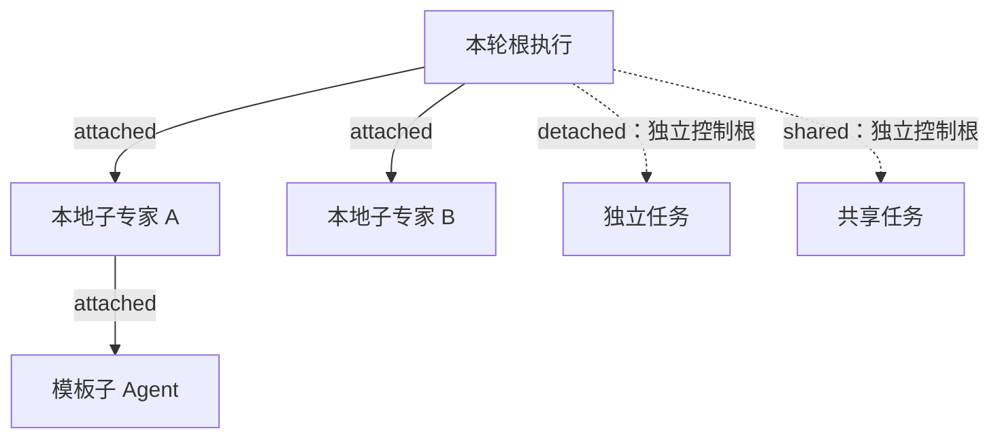
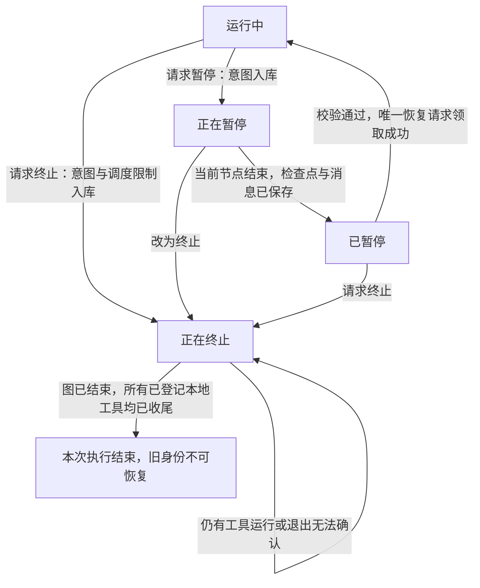

# 会话执行控制：暂停、继续与终止

本文维护会话执行控制的**已实现功能**，供后端开发、测试和后续功能迭代使用。后续阶段完成后继续更新本文；尚未实现的设计保留在[升级计划](./proposal/issue-1217-execution-pause-and-termination.md)中。

当前实现阶段：**第一阶段——统一归属、持久控制和本地暂停与终止**。截至 2026-10-23，代码及本地回归验证已完成并通过审核，尚未部署。本文描述实现能力，不代表生产环境已具备这些能力。

## 模块与契约边界

`IExecutionControl` 定义在 contracts；`ExecutionControl` 实体实现该接口，并保留显式数据库列类型。
独立的 `ExecutionControlModule` 位于 `packages/server-ai/src/execution-control`，拥有控制账本、工具收尾回执和本地取消送达。消费者显式导入该模块，不依赖全局注入。LangChain 工具回执位于 `adapters`。
会话占用、检查点和恢复领取仍由会话领域管理。控制账本继续在原事务中校验线程身份和租约，模块整理不改变执行语义，也不把内部控制字段加入客户端响应。

## 功能范围

第一阶段解决取消通知丢失后旧执行继续运行，以及暂停、恢复、终止并发时旧执行重新获得执行资格的问题。

| 能力           | 当前实现                                                                                             |
| -------------- | ---------------------------------------------------------------------------------------------------- |
| 执行归属       | 统一根执行、父执行和 `attached` / `detached` / `shared` 策略；接入本地会话、同步子专家和模板子 Agent |
| 持久控制       | PostgreSQL 保存控制意图；Redis 通知加速送达，执行副本轮询补偿遗漏                                    |
| 暂停           | 等待当前完整图节点收尾，在可持久化的节点边界暂停                                                     |
| 继续           | 校验检查点、工作流兼容性和恢复令牌；并发请求只允许一个获得恢复资格                                   |
| 终止           | 撤销旧执行的调度资格，通知本地执行取消，等待图和实际本地工具结束后释放会话                           |
| 独立、共享工作 | 控制账本支持独立根隔离；不因父执行终止而级联取消这些根                                               |
| 远端和后台任务 | 尚未完成跨线程专家、队列及远端运行时的全链路适配，不能据此认定所有后台任务均已接入                   |

## 暂停和终止的区别

| 操作 | 当前执行如何处理                                                    | 后续操作                                                 |
| ---- | ------------------------------------------------------------------- | -------------------------------------------------------- |
| 暂停 | 保存暂停意图，不直接 abort 当前节点；等待节点、检查点和消息保存完成 | 确认已暂停后，从该检查点继续                             |
| 继续 | 领取唯一恢复资格，绑定执行身份，从保存的边界续跑                    | 不把恢复请求作为新输入重新执行已完成工具                 |
| 终止 | 持久标记 `terminated`，拒绝后续调度并发送取消信号                   | 不能恢复已终止的执行身份；需要继续业务时另起明确的新请求 |

**暂停边界是完整图节点，不是任意一条工具指令。** 已进入节点的工具组允许收尾，其中尚未开始的工具也可能在收到暂停请求后开始。这样可以保存完整节点结果，避免在半个节点中间暂停、恢复时再次执行已经完成的工具。后续节点在执行前被暂停守卫拦截。

例如，一个节点顺序调用工具 A、B，之后执行节点 C。在 A 运行时请求暂停，A 和 B 会完成并保存结果，然后在 C 前暂停。恢复后执行 C，A 和 B 不重放。如果本轮在到达可暂停边界前已自然完成，则按实际完成结果收尾，不补造暂停检查点。

终止不能撤销工具已经产生的业务副作用。工具不响应取消信号时，后端继续等待实际调用结束，不因断开 SSE、取消包装层 Promise 或等待超时而认定工具已经停止。

## 执行归属与控制范围

归属由可信后端在创建工作时明确指定；客户端不能通过自报根执行或父执行改变控制范围。



- `attached`：继承所属根和祖先控制。终止根执行影响其所属子树；仅终止 A 时，不影响父执行和兄弟 B。
- `detached`：建立独立控制根，不继承父执行的暂停或终止。
- `shared`：同样隔离父执行的生命周期控制；不能因一个调用方停止而终止共享工作。

`background`、异步、等待模式只描述调用方式，不能据此判断是否独立。第一阶段已验证控制账本的隔离规则，尚未把所有后台任务入口迁入这套归属体系，也未完成共享任务订阅、等待和结果消费的统一控制。历史记录不通过名称、同一工作空间或同一线程猜测归属。

## 控制流程与确认条件



这里的“执行结束”仅指当前已接入的本地控制范围，不表示未接入的远端任务已物理退出。

### 暂停与继续

1. 在会话线程行锁内保存暂停意图和 `pauseId`，线程进入 `pausing`。重复暂停请求返回同一有效暂停标识。
2. 当前节点继续完成；节点守卫阻止后续节点执行。先保存检查点，再完成消息持久化，最后确认 `paused`。
3. 恢复时核对线程、执行身份、`pauseId`、检查点所属租户和组织，以及工作流指纹。只有确认暂停且检查点存在的会话可恢复。
4. 行锁保证并发恢复只有一个请求领取成功；`resumeClaimId` 将后续绑定、失败回滚限定到同一次领取。过期请求不能回滚新的恢复，也不能覆盖终止。
5. 普通会话恢复绑定新的执行身份，旧身份失去继续调度资格；群会话的既有恢复路径可在同样的领取约束下绑定原身份。绑定只生效一次。

工作流兼容性沿用[布局发布与检查点恢复规则](./conversation-branching.md#工作流兼容性与布局发布)：布局变化可兼容，执行逻辑变化仍拦截；无法验证的旧检查点不猜测恢复。

### 终止与通知补偿

1. 在事务中先保存终止意图、线程的 `terminating` 控制状态和禁止自动续跑的标记，再尝试 Redis 广播。
2. 运行副本向已登记的本地 `AbortController` 传递取消。广播失败不撤销持久终止意图。
3. 每个执行副本按约 1 秒的周期检查其本地控制器对应的持久状态，补偿丢失通知；控制器登记后、开始工作前也立即检查，覆盖“通知先到、控制器后登记”的竞态。
4. 新节点、工具调用及检查点写入继续核对执行身份和控制状态，拒绝已终止、已结束、被替换或租约失效的旧执行。轮询只补送控制，不重新启动业务或重试工具。
5. 等图结束且所有已登记的本地工具实际收尾，才解除会话占用。若包装层提前结束而工具仍在执行，线程保持占用；维护任务补查后完成收尾。

1 秒是轮询周期，不是停止时限。数据库或网络不可用时不能保证这一时间内送达；工具调用前无法取得有效控制事实时拒绝准入。租约过期也不能单独作为执行已经退出的证据，新协议下尚未确认退出的运行保持终止待确认和占用限制。

## 持久数据与并发保证

`execution_control` 保存控制事实；业务结果仍由原有消息与检查点保存。

`ExecutionControl` 继承 `TenantOrganizationBaseEntity` 并实现 contracts 中的 `IExecutionControl`；接口继承 `IBasePerTenantAndOrganizationEntityModel`。统一继承 `id`、创建/更新审计字段及租户组织关系；`executionId` 是有唯一索引的业务身份，不再另设主键。登记入口要求明确租户，控制查询及锁仍以 `executionId` 定位，重复登记不能覆盖终止记录。SQL 同时支持新建表和早期表结构升级，保留原有控制事实；升级补入的时间是迁移时间，不代表历史创建时间。

| 数据                                                    | 用途                                                                                  |
| ------------------------------------------------------- | ------------------------------------------------------------------------------------- |
| `executionId`、`tenantId`、`organizationId`、`threadId` | 标识执行及其授权范围                                                                  |
| `rootExecutionId`、`ownership`、`ancestors`             | 表达父子关系、控制根和附属祖先路径；独立或共享边界不继承父路径                        |
| `desired`、`revision`                                   | 保存 `running` / `paused` / `terminated` 意图及其版本；已终止身份不能重新注册为可运行 |
| `graphEnded`                                            | 记录图已结束，不能单独证明其工具已退出                                                |
| 根记录的 `work`                                         | 保存工具调用 ID、所属执行和 `settled` 回执；不保存工具输入输出                        |

线程行锁串行化暂停、恢复和终止；控制根行锁串行化子执行登记、控制变更及工具准入。工具准入检查归属、当前线程执行身份、租约和祖先状态；同一工具调用 ID 只能登记一次，已结算的 ID 也不能重复准入。

本地工具回执通过 `StructuredTool` 回调包围实际 `_call`：执行前完成持久准入，实际返回或抛错后才结算。LangChain 外层 Runnable 被 abort 并不等于 `_call` 已返回，不能代替该回执。

这些保证覆盖已接入的本地工具及受控恢复路径，**不构成任意外部工具跨崩溃的 exactly-once 保证**。进程消失或回执缺失时保留未确认状态，不通过重放工具补造成功或退出证据。

## 状态接口与前端边界

控制意图、线程运行状态和实际退出证据分别表达，不能相互替代：

- `desired = terminated` 表示旧执行已被撤销调度资格，不代表所有工具已经停止。
- 等待终止确认时，`runControl.state = terminating`，线程继续保持 `busy`，防止新运行与旧工具重叠。确认本地收尾后，线程使用现有 `interrupted` 状态并清除活动 `runControl`，持久终止记录仍保留。
- `canceledExecutionIds` 是兼容字段，表示取消请求涉及的执行身份，不能作为远端物理退出回执。
- 迟到的旧执行收尾、检查点写入或恢复回滚不能覆盖当前执行状态。取消迟到时也不会把已完成的 `SUCCESS` 业务结果改成失败。

第一阶段没有新增 ChatKit 技术信息展示或管理员调试界面。ChatKit 仍以简短提示和按钮可用状态为边界；执行归属、控制版本、回执与补偿原因留在后端，后续管理员调试功能再提供查询入口。

## 数据库与运行兼容性

新增表及索引见[数据库脚本](../packages/server-ai/src/execution-control/migration.sql)。脚本应在承载新控制逻辑的 API / worker 启用前执行，可重复运行，不推断或回填历史执行归属。当前仅在隔离测试数据库中验证，未执行部署。

发布时需要统一支持这套控制协议，不能让缺少身份检查和持久控制逻辑的旧 worker 继续执行新协议任务。第一阶段未实现自动混合版本隔离开关；上线迁移仍需另行安排。历史执行的兼容处理不代表它们已经全部获得新的归属和停止确认保证。

## 验证覆盖与源码入口

第一阶段回归覆盖以下行为：

| 场景                                   | 验证结果                                                     |
| -------------------------------------- | ------------------------------------------------------------ |
| Redis 取消通知丢失、控制器迟到登记     | 持久控制通过轮询和启动前检查生效；旧执行不能越过守卫调用工具 |
| 同一节点包含两个工具，执行中请求暂停   | 两个工具完成后暂停；恢复只执行后续节点，不重复这两个工具     |
| 并发暂停、恢复、终止及迟到回滚         | 有效暂停标识稳定，恢复仅一个领取者，终止不可被旧请求撤销     |
| 工具忽略取消，外层 Runnable 已结束     | 工具实际返回前仍保持 `busy` / `terminating`，阻止启动新运行  |
| 取消所属子树                           | 父执行、兄弟执行及独立、共享控制根保持隔离                   |
| 工具并发登记、数据库不可用、迟到子执行 | 重复准入和无有效控制依据的调用在工具函数执行前被拒绝         |
| 迟到检查点、收尾和取消                 | 不能覆盖新执行或改写已完成结果；群会话恢复路径保持兼容       |

测试使用隔离 PostgreSQL、Redis 和实际 LangGraph / 工具调用，并在同一测试进程中创建两个服务实例模拟副本。覆盖实际数据库锁及通知遗漏，不等同于生产多进程、远端运行时或真实业务端到端验收。

主要实现与回归入口：

- [公共归属与控制类型](../packages/contracts/src/ai/execution-control.model.ts)、[控制账本](../packages/server-ai/src/execution-control/execution-control.store.ts)。
- [线程状态与恢复领取](../packages/server-ai/src/chat-conversation/thread-run-control.service.ts)、[取消送达与补偿](../packages/server-ai/src/execution-control/execution-cancel.service.ts)。
- [实际工具回执](../packages/server-ai/src/execution-control/adapters/execution-tool-receipts.ts)、[PostgreSQL / Redis / LangGraph 集成回归](../packages/server-ai/src/chat-conversation/thread-run-control.integration.spec.ts)。
- [检查点恢复回归](../packages/server-ai/src/copilot-checkpoint/checkpoint-recovery.postgres.spec.ts)、[本地执行范围回归](../packages/server-ai/src/execution-control/execution-abort-scope.spec.ts)。

运行集成回归前，显式设置 `XPERT_PAUSE_TEST_DATABASE_URL` 和 `XPERT_CONTROL_TEST_REDIS_URL`，分别指向可丢弃的测试 PostgreSQL 和 Redis。数据库名必须以 `_test` 结尾；数据库测试使用随机 schema 并清理。未设置数据库 URL 时该套件跳过，不能视为验证通过。

```sh
corepack pnpm exec jest --config packages/server-ai/jest.config.ts --runInBand \
  --runTestsByPath packages/server-ai/src/chat-conversation/thread-run-control.integration.spec.ts
```

## 功能演进记录

| 阶段     | 实现日期   | 已实现范围                                                 | 验证与交付状态             |
| -------- | ---------- | ---------------------------------------------------------- | -------------------------- |
| 第一阶段 | 2026-10-23 | 统一归属、持久控制、本地安全暂停与终止、并发恢复和工具回执 | 本地回归及审核通过，未部署 |

后续阶段完成后，在本文补充对应功能章节并追加本表，同时更新“功能范围”、接口状态、兼容要求及回归入口。每次补充说明实际接入的执行器、暂停与终止的确认条件、失败或未知状态如何处理，以及验证范围；不要仅把计划中的能力改成“已支持”。

跨线程后台专家、AgentInvocation、Handoff / Managed Queue、Runner / Sandbox / MCP 的实际退出确认，以及管理员调试界面，仍以[升级计划](./proposal/issue-1217-execution-pause-and-termination.md)跟踪，完成实现后再写入本文的已实现范围。
