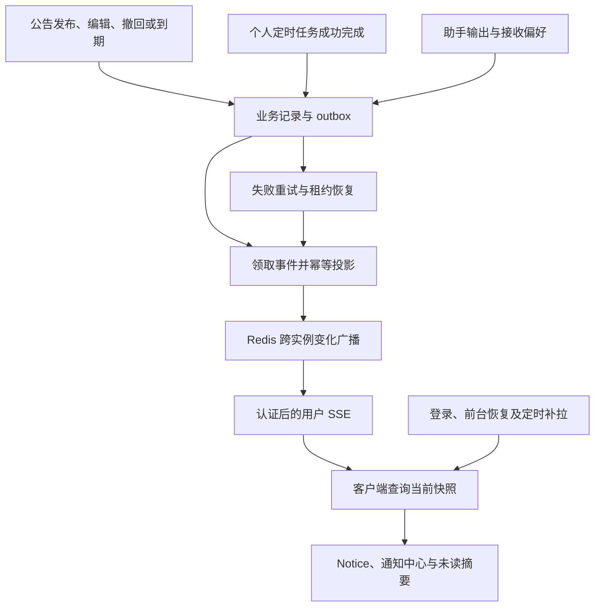

# 公告、用户通知与助手发件箱

本文供维护通知客户端、开发插件和排查投递的人员使用。用户操作见[公告与通知中心](../zh-Hans/guides/notifications.mdx)和[助手发件箱](../zh-Hans/guides/agent-outbox.mdx)。

## 公告发布与修订

`ANNOUNCEMENT_MANAGE` 控制当前租户的管理接口，默认授予 `SUPER_ADMIN`。如角色刚获授权限，需刷新登录身份。公告关闭记录按租户、用户和公告 ID 去重；关闭后编辑同一公告不会再次弹出。普通用户只能读取已经生效、适用于其客户端且未撤回的公告。历史列表也包含已关闭和过期的公告。

| 字段       | 约束与行为                                                       |
| ---------- | ---------------------------------------------------------------- |
| 标题       | 必填，最多 160 字符                                              |
| 正文       | 必填，最多 20,000 字符；支持行文本、一级到三级标题及简单列表标记 |
| 类别       | 一般公告、维护通知、模型下线，使用 Radio Group 单选              |
| 重要程度   | 普通、重要，使用 Radio Group 单选；影响展示顺序与标记            |
| 适用客户端 | Web、Desktop，至少一个；发布后固定                               |
| 生效时间   | 必填；表单按当前设备时区选择，提交为带时区的 ISO 时间            |
| 失效时间   | 可选，必须晚于生效时间；可清除                                   |
| 动作链接   | 可选；名称最多 80 字符，URL 最多 2,048 字符且必须为 HTTPS        |

正文通过文本插值渲染，不执行 HTML，不加载正文中的外部图片；不是完整 Markdown 渲染器。需要可点击的外部入口时使用独立动作链接。

保存期间禁用重复提交和关闭 Dialog；保存失败保留填写内容并显示错误。并发编辑由 `revision` 控制，过期修订返回 409，重新加载后再编辑。

数据库状态为 `draft`、`published`、`withdrawn`。列表中的“待生效”“生效中”“已过期”由已发布状态与起止时间推导。编辑、发布和撤回生成新的修订与审计记录，审计保存操作者和当时的内容。

### 定时任务结果

个人定时任务成功完成会产生 `agent.completed`。执行存储将状态从 `RUNNING` 转为 `SUCCEEDED` 时，在同一事务内检查接收者并写通知 outbox：

- 任务有 `runAsUserId` 和 Assistant，且不是 Project 任务。
- 接收者属于同一租户，是普通用户身份；存在组织时仍为有效成员。
- 结果会话属于该用户、同一租户和 Assistant，且会话已经 `idle`。
- 幂等键为 `scheduled:<executionId>:completed`，重复完成处理不会增加重复通知。

通知类型为 `agent.completed`，来源保存 task、execution、Assistant 和 conversation 标识。客户端通过 `open_conversation` 语义动作打开结果，不把具体 Web URL 存入事件。

新产生的任务结果可以显示轻提示；用户正在查看对应会话时抑制额外提示。登录或断线后的补拉更新列表和数字，不逐条补弹历史任务结果。读取结果通知使用独立 `readAt`，不会推进聊天消息的阅读游标，也不会重新执行任务。

## 插件如何向收件人发布业务结果

插件在业务事务中同时保存领域结果和待交接标记，由 `PluginAgentEventSource.outputs` 声明可投递的结果类型。平台以启用的事件绑定和接收人的身份扫描。采购插件首次发布 `DeliveryCheck` 时交接 `procurement.delivery_check`。Code Review 从已完成或已发布、且有明确个人接收人的评审产生 `code_review.result`，GitHub 写评审走原有发布流程。飞书插件提供私聊投递渠道。

| SDK 方法                               | 宿主与插件的约定                                                                                                                                                     |
| -------------------------------------- | -------------------------------------------------------------------------------------------------------------------------------------------------------------------- |
| `listPending(context, limit)`          | 插件从当前绑定返回到期的未确认引用。每条都有 `kind`、`key`、`revision`、`recipientId`、`publishedAt` 和 `schemaVersion: 1`。收件人来自业务记录，并须与绑定用户一致。 |
| `acknowledge(context, ref, messageId)` | 在宿主提交事务后确认交接。重试同一引用复用同一个平台消息 ID。对同一记录确认不同 ID 返回 `'conflict'`。                                                               |
| `defer(context, ref, retryAt)`         | 临时失败只推迟这一项。不可变引用或确认冲突时传入 `null`，插件隔离此项并保留交接记录。其他项继续处理。                                                                |
| `resolveForRecipient(context, ref)`    | 返回 `visible` 和获准展示的标题、字段及可选会话引用。`superseded`、`forbidden` 的成员从待发内容中剔除；`unavailable` 在派发时可重试，在用户查询时隐藏该项。          |

宿主在同一个事务中保存逻辑输出、当前启用渠道的投递及其成员和派发任务。相同的租户、组织、插件、类型、输出键和接收人对应一个逻辑输出。重投时还须匹配原绑定、绑定修订、输出修订和发布时间。变更后的业务结果需要独立的输出键。[SDK 接口](../../packages/plugin-sdk/src/lib/agent-event/index.ts) · [共享契约](../../packages/contracts/src/always-on/agent-output.model.ts)

## 按渠道核对投递

| 要核对的事实       | 记录与判读方式                                                                                                                                                                              |
| ------------------ | ------------------------------------------------------------------------------------------------------------------------------------------------------------------------------------------- |
| 业务是否已交接     | 用插件的业务输出键和接收人找到 `agent_output_message`，核对来源绑定及修订。插件确认的 `messageId` 就是这条记录的 ID。                                                                       |
| 哪些事项组成了摘要 | 用 `agent_output_member.messageId` 找到各渠道的 `deliveryId`。同一消息在每个渠道只加入一次。每份摘要最多 20 项；投递前重新检查每项的可见性。                                                |
| 接收人允许什么渠道 | `agent_output_preference` 按租户、组织、用户、类型和渠道保存开关、静默时区和时段。飞书偏好固定到已验证的集成与用户绑定。变更目标后，旧版本的待发投递会取消。                                |
| 渠道处理到哪一步   | 看 `agent_output_delivery.state`。站内 `delivered` 表示已写入 `user_notification`；飞书 `accepted` 表示渠道已返回消息 ID，保存在 `providerMessageId`。站内阅读另看 `readAt`。               |
| 是否适合重试       | `pending` 表示待处理，`cancelled` 表示目标或事项失效，`failed` 表示渠道明确拒绝。已发起外部请求后断线或接手时只有 `attemptId`，记为 `unknown`。此时先核对原尝试，自动重发可能造成重复私聊。 |

静默按接收人的 IANA 时区计算，支持跨午夜和夏令时。修改静默窗口时，尚未开始的同类事项会重新归组。已经开始投递的成员保留原批次。用户打开通知时，系统重新检查业务可见性和会话授权；会话入口不可用时仍可展示获准的标题。站内通知记录与飞书渠道结果分别保存。

## 实时机制与恢复

数据库中的公告、关闭记录和用户通知是站内展示的权威状态。Redis Pub/Sub 与 SSE 只发送变化提示，提示不包含通知正文、聊天内容或长期凭据。事件丢失或重复由快照查询修复，不使用游标增量协议。

| 环节         | 当前实现                                                                                 |
| ------------ | ---------------------------------------------------------------------------------------- |
| outbox 领取  | 每秒检查一次，每批最多 20 条；`SKIP LOCKED` 加 30 秒租约，支持多 API 实例竞争            |
| 投影与广播   | 先幂等生成用户通知，再广播变化；广播失败可以重试，不重跑业务任务                         |
| 重试         | 指数退避，最长 5 分钟；累计 20 次失败进入 `blocked`，管理员可以重新排队                  |
| 定时公告     | 发布或修改时间时写入持久化起止事件；触发前重查状态、修订和时效，跳过旧版本调度           |
| SSE 变化合并 | 服务端每 250ms 合并当前用户可见的变化，连接建立后先发一次同步提示                        |
| 心跳与认证   | 每 25 秒心跳并检查用户存在性/类型；连接最长 60 秒，或随 JWT 更早到期而结束，重连重新认证 |
| 连接上限     | 每个 API 实例中，同一租户/用户最多 8 条连接，超过返回 429                                |
| 客户端恢复   | 登录、重连提示、恢复前台及作用域变化触发补拉；90 秒定时校准；重连指数退避加抖动          |
| 数据保留     | 每小时清理已发送超过 7 天的 outbox、超过 90 天的用户通知；用户通知查询也限制最近 90 天   |

90 秒是兜底校准间隔，并非请求频率上限；变化和重新认证后的首次提示也会触发查询。公告关闭记录及审计不随短期传输数据清理。

Desktop 在 Electron 主进程持有认证信息、维护连接和关闭重试，渲染进程只通过受控 IPC 接收结构化数据。原有 15 秒 Assistant 活动刷新保留，因为通知事件尚未覆盖所有聊天变化。

账号、租户、组织或服务地址变化会取消旧连接，清空当前视图并丢弃晚到响应。通知接口返回 404 时，客户端兼容旧服务端，停止本功能重试并隐藏入口；服务端升级后，重载、重新登录或切换作用域可重新探测。没有通知启用环境开关。

SSE 依赖客户端运行并保持连接。应用退出、系统休眠或网络中断后，客户端在下次打开或重连时查询持久化结果。

## 身份与接口

用户和租户由受信任的请求身份确定。通知 API 拒绝通信技术账号和 client-secret principal。个人任务通知复核用户与组织、来源会话的关系；业务输出复核来源绑定及领域权限，再单独验证会话读取权限。SSE 的变化提示只触发新查询。

`announcement` 保存公告，`announcement_audit` 保存每次修订，`announcement_dismissal` 保存每位用户的关闭状态。`notification_outbox` 是技术任务队列，`sent` 表示任务处理完毕。外部渠道是否接受消息应查上表的投递记录。

### 接口

以下路径均在 `/api` 下。分页默认 `offset=0&limit=30`，`limit` 为 1–100；未知 query/body 字段由严格 Zod schema 拒绝。`client` 仅允许 `web`、`desktop`。

| 方法与路径                                    | 用途                                           |
| --------------------------------------------- | ---------------------------------------------- |
| `GET /announcement-admin`                     | 分页管理列表                                   |
| `POST /announcement-admin`                    | 创建草稿                                       |
| `PATCH /announcement-admin/:id`               | 完整内容及 `revision` 更新                     |
| `POST /announcement-admin/:id/publish`        | 发布；body 为 `{ revision }`                   |
| `POST /announcement-admin/:id/withdraw`       | 撤回；body 为 `{ revision }`                   |
| `GET /announcement-admin/:id/audit`           | 审计历史                                       |
| `GET /announcements/pending?client=web`       | 当前待展示公告，最多 30 条                     |
| `GET /announcements/history?client=web`       | 分页公告历史                                   |
| `GET /announcements/:id?client=web`           | 当前有权查看的公告详情                         |
| `PUT /announcements/:id/dismissal`            | 幂等关闭                                       |
| `GET /user-notifications`                     | 分页用户通知，含 `hasMore` 和 `nextOffset`     |
| `GET /user-notifications/sync?client=web`     | 公告与用户通知摘要                             |
| `GET /user-notifications/stream`              | 认证后的 SSE 连接                              |
| `PUT /user-notifications/:id/read`            | 标记通知已读，业务输出返回当前可见的成员和动作 |
| `GET /user-notifications/preferences`         | 当前组织中本人的渠道偏好、可用类型和飞书集成   |
| `PUT /user-notifications/preferences`         | 修改本人的一个类型和渠道                       |
| `GET /notification-delivery-admin`            | 当前租户投递状态与本实例连接数                 |
| `POST /notification-delivery-admin/:id/retry` | 将当前租户 blocked 事件重新排队                |

快照含 `supported: true`、内容哈希 `version`、`announcements`、`notifications`、`hasMoreAnnouncements` 和 `hasMoreNotifications`。`version` 用于内容比较，不是可供增量回放的数据库游标。

SSE 的 `change` 数据为 `{ schemaVersion: 1, type: 'sync.required', eventId }`；`heartbeat` 不触发内容查询。常见错误为 400 `NOTIFICATION_INVALID`、403 `NOTIFICATION_DENIED`、404 `NOTIFICATION_UNAVAILABLE`、409 `NOTIFICATION_CONFLICT`、429 `NOTIFICATION_BUSY`。

通知客户端在列表和同步请求发送 `Accept: application/json; profile="xpert-agent-output-v1"` 以接收 `agent.output`。旧服务可忽略该请求头并继续返回基础通知；使用普通 JSON 的旧客户端继续收到支持的 `agent.completed`。公告仍通过快照的 `announcements` 返回。

## 迁移与运维

迁移组件为 `ai.user-notifications`，编号 `20261031010000`，见 [迁移 SQL](../../packages/server-ai/src/user-notification/migrations/20261031010000-user-notifications.sql) 和 [只读 checks](../../packages/server-ai/src/user-notification/migrations/checks/20261031010000-user-notifications.sql)。公告和基础通知的五张表已登记到 [数据库迁移清单](../../.deploy/api/database-migrations.json) 的 managedTables；迁移幂等补充已有 `SUPER_ADMIN` 的管理权限。

按[统一数据库迁移流程](../development/database-migrations.md)先应用并验证结构，再运行对应 API/Web/Desktop 构建。功能默认启用，复用现有 PostgreSQL、Redis 和认证配置。

代理需要允许 SSE 持续连接并禁用响应缓冲；接口设置 `Cache-Control: no-store` 和 `X-Accel-Buffering: no`。发布后检查代理链路中的实际连接、重连和跨实例通知，不能只检查 API 健康状态。

投递管理接口提供 pending 数、已到期数、最早到期时间、最多 50 条 blocked 记录，以及当前实例的租户连接数。服务内部另有连接、变化、Redis 失败、发送和重试计数；当前没有完整 Prometheus 面板或生产延迟/容量基准。

遇到未送达时，检查公告是否已发布、起止时间、当前租户、适用客户端和关闭记录；任务通知还需核对是否满足个人定时成功条件及来源授权。Redis 提示失败时保留持久化事件并重试；被阻塞的事件可通过管理接口重排，不删除业务记录或重跑任务来修复通知。

发件箱还需要[四张输出表的迁移](../../packages/server-ai/src/user-notification/migrations/20261116090000-agent-output.sql)及其[结构检查](../../packages/server-ai/src/user-notification/migrations/checks/20261116090000-agent-output.sql)。先部署兼容读端、数据库和支持 `agent.output.dispatch` 的全部 worker，再启用插件生产者。采购与 Code Review 各自的 `migrations/` 目录包含 `20261116-agent-output.sql` 和后续的 `20261116-output-handoff-retry.sql`，按此顺序升级已有业务库。已发布的历史提醒不会因升级而补发。

现有飞书集成必须可供接收人调用。平台优先使用同一飞书应用 OAuth 确认的 open ID；否则由目标应用解析已验证的绑定主体。无法确认目标时不启用该渠道。飞书 `accepted` 只证明服务商接受了消息，站内阅读和业务审批需要各自的记录。

## 公共日期时间组件

公告编辑使用 `@xpert-ai/headless-ui` 的 `ZardDateTimePickerComponent`（`z-date-time-picker`），源码位于 [packages/ui 日期时间组件](../../packages/ui/src/lib/components/date-time-picker/)。它组合 Zard Calendar、Popover、Button、Input 与独立的 `ZardTimeDialComponent`，可供其他业务复用。

- 同一面板选择日期及 24 小时时间；时钟为内外双圈，选完小时自动进入分钟。
- 支持点击、拖动、精确到一分钟、方向键微调及手动 `HH:mm` 输入。
- 弹层中的更改是草稿，确认后回填；Escape 丢弃草稿并恢复焦点。窄屏自动上下布局，操作栏保持可达。
- Calendar 日期格高 44px、日期与星期字号 14px，网格填满左侧；内容区与底部操作栏分别处理间距。
- 支持 Reactive Forms、`ngModel` 或 `[(value)]`，同一个实例选择一种绑定方式。值为本地时间 `YYYY-MM-DDTHH:mm`；空值为 `''`，兼容表单 reset 写入 `null`。
- 禁用状态合并表单与组件输入，并关闭已打开弹层。UTC 转换、开始/失效关系等业务校验仍由消费页面负责。
- 通用文案来自 UI 包的 `xp-ui:dateTimePicker.*` 中英繁体资源；Cloud 直接加载 UI 包资源，不再维护覆盖它的重复副本。字段名与业务清除文案由调用者传入。

完整 API 和接入示例见 [UI 包 README](../../packages/ui/README.md#date-and-time-picker)。公告管理页采用 Zard UI；“新建公告”按钮为 `lg`，新建和编辑共用 Dialog，类别与重要程度采用 Radio Group。

## 代码入口

| 入口                             | 位置                                                                                                     |
| -------------------------------- | -------------------------------------------------------------------------------------------------------- |
| 共享 schema 与扩展类型           | [user-notification.schema.ts](../../packages/contracts/src/user-notification.schema.ts)                  |
| 公告服务与接口                   | [announcement/](../../packages/server-ai/src/announcement/)                                              |
| 通知、outbox、worker、SSE 和迁移 | [user-notification/](../../packages/server-ai/src/user-notification/)                                    |
| 个人定时任务事件生产             | [scheduled-task-notification.ts](../../packages/server-ai/src/xpert-task/scheduled-task-notification.ts) |
| Web 状态同步                     | [user-notifications.service.ts](../../apps/cloud/src/app/@core/services/user-notifications.service.ts)   |
| Web 公告管理                     | [announcements/](../../apps/cloud/src/app/features/setting/announcements/)                               |
| Web Notice 与中心                | [notifications/](../../apps/cloud/src/app/@shared/notifications/)                                        |
| Desktop 主进程                   | [user-notifications.cjs](../../apps/desktop/electron/user-notifications.cjs)                             |
| Desktop 展示                     | [notifications/](../../apps/desktop/src/notifications/)                                                  |
| 公共日期时间组件                 | [date-time-picker/](../../packages/ui/src/lib/components/date-time-picker/)                              |
