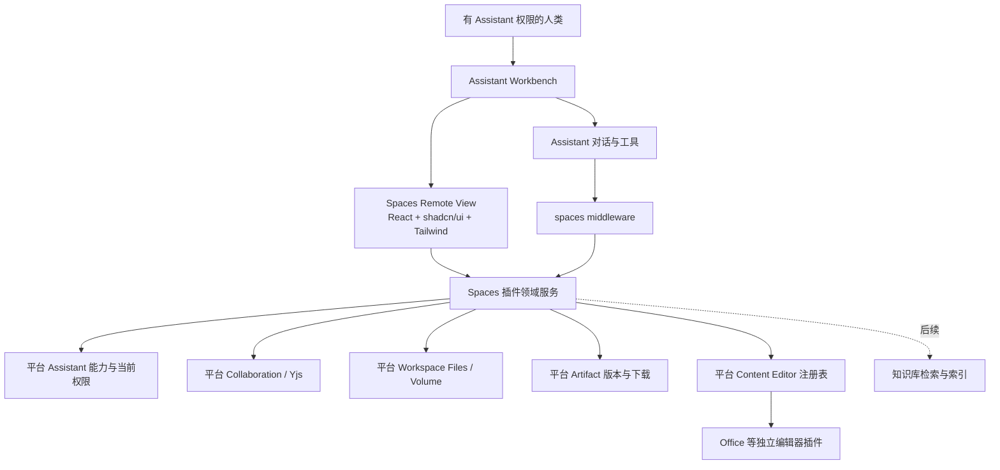

# Xpert Assistant 协作空间方案

更新：2026-10-16。本文以用户确认的 Assistant 能力架构为准，替代前一版独立 Spaces 应用方案。

协作空间是 Assistant 的插件能力。主 Agent 配置 `spaces` 中间件并发布后，有权使用该 Assistant 的人类账号在 Workbench Views 中进入同一空间，与 AI 共同生成、维护和使用页面、文件及 Artifacts。内容独立于单次聊天保存，归属绑定的 Assistant。

## 产品入口与授权

```text
组织
  已授权的 Assistant
    对话：生成、查找、读取内容，提出修改
    Workbench → Views → 协作空间
      文档与文件夹
      文件和固定版本 Artifact
      可插拔编辑器
      评论、修改提案、历史
```

不新增 Cloud 全局内容导航，也不要求再创建一个空间或重复邀请成员。默认共享模式遵循 Assistant 文件的 CRUD 权限：有权使用 Assistant 的组织成员均可共同编辑和管理。创建 Assistant 时选择 `workspaceDataScope: user` 则隔离每位用户的数据；已有隔离策略不被插件覆盖。

访问权限不是仅在入口检查。文档、目录、搜索、AI 输入与结果提交、文件下载、Artifact 链接和实时广播都检查当前组织身份、当前 Assistant 人类访问权限、已发布能力配置和资源绑定。移除用户组成员、组织成员或 `spaces` 能力后，旧页面会话和下载链接失效。已下载副本无法远程收回。

## 分层与解耦



| 层次 | 职责 | 不承担的职责 |
| --- | --- | --- |
| 平台身份和 Assistant 能力 | 当前人类权限、组织成员、已发布 feature、共享／用户隔离 | 不含 Spaces 专用表或界面 |
| 平台协作 | Yjs 更新、会话、presence、持久化、序列与重试、按接收者鉴权 | 不决定页面产品布局 |
| 平台文件与 Artifact | 可移植文件引用、版本字节、受控下载、成果身份与资源策略 | 不导入 Spaces 私有服务 |
| 平台编辑器接口 | 类型化格式读写、Provider 发现、并发模式与能力说明 | 不内嵌 Office 产品 UI |
| Spaces 插件 | Assistant 绑定、文档树、评论、提案、检查点、工具与 Remote View | 不另建一套用户权限体系 |
| 编辑器插件 | XLSX 等格式的读取、修改、导出 | 不耦合 Spaces 的表结构 |

插件可以作为内置插件预装，仍通过相同 SDK 契约和 Provider 注册工作。Cloud 仅使用既有 Workbench 远程视图宿主，插件 UI 随插件包发布。

## 平台能力合同

`platform.assistant.middleware-access.assertAccess({ actor, assistantId, scope, provider, requiredFeature })` 在能力入口每次调用时检查权限。`scope: { type: 'assistant' }` 使用发布 Assistant 的目录访问策略；`scope: { type: 'project', projectId }` 使用当前项目成员与 Assistant 绑定，不再叠加目录或创作工作区可见性。两者均要求有效组织成员，并确认请求的已发布 Assistant 主 Agent 只连接一个指定 provider 的已安装中间件且声明目标 feature。它与 View Middleware Runtime 共用解析规则；身份与 scope 只能来自可信服务端上下文，不接受 iframe 或工具参数覆盖。View 数据、动作、文件传输和工具调用在入口执行此校验；资源服务与协作广播继续检查项目及资源操作权限，不逐文档重复检查中间件，也不因能力卸载改变文档所有权。没有跨请求权限缓存；其他 provider 的同名 feature、未连接节点和草稿均不能授予后台访问。

后台任务与 WebSocket 广播的 actor 来自服务端已认证身份，不能继承当前发送者的请求上下文。插件不得把浏览器输入当作 actor 或 Assistant 绑定。平台的公共聊天／Project 委托入口也不能代替空间需要的当前人类授权。

`platform.content.resources` 将通用资源引用映射到插件权限策略；`platform.content.editors` 发现和调用格式适配器。Collaboration、Workspace Files、Artifact 继续使用已有平台能力。授权 Provider 缺失或卸载时默认拒绝访问。

## 持久化与并发

空间唯一绑定 `(tenantId, organizationId, assistantId, scopeUserId)`。首次打开或调用工具时以唯一索引加幂等插入建立空间；共享模式的 `scopeUserId` 为空，个人隔离模式为认证用户。原地发布保持 Assistant id 和空间；复制与历史版本快照不自动共享存储。

旧独立空间没有 Assistant 绑定，保留数据但默认不可访问，禁止静默迁移给更广受众。未来迁移必须显式选择目标 Assistant 并确认其受众。

页面权威状态是平台 Yjs 文档；Markdown 是可重建投影。块具有稳定 id。AI 修改以原文、目标块、序号、mutationId 和理由形成提案，用户接受时检查原文和版本；并发冲突要求刷新基线。已准备的提交更新可安全重试。检查点和导出读取权威状态，而非滞后索引。

文件由平台 `spaces` Volume 保存，目录为 `items/<itemId>/versions/<versionId>/<name>`。版本不可覆盖，下载需授权，不生成匿名 Volume URL。页面 Artifact 的 `resourceRef` 指向内容资源；外部 Artifact 收藏保留原始访问策略和固定版本。

## 视图与 Assistant 协作

Remote View 使用 React、仓库共享 shadcn/Radix 组件和 Tailwind，消费宿主主题。页面编辑器、表格编辑器、消息桥和业务服务分离。当前页面、选区、序号和保存状态通过 `assistant.context.set` 传给聊天；这些上下文仅帮助定位，服务端操作重新鉴权。

首期工具：`spaces_list`、`spaces_read_page`、`spaces_search`、`spaces_create_page`、`spaces_propose_patch`。工具绑定实际执行 Assistant，拒绝跨 Assistant 文档 id。新文档可由 Assistant 生成，已有正文修改必须经人类接受。视图内的选区润色和来源问答使用组织默认模型，Assistant 聊天使用 Assistant 已配置的模型。

第一期页面支持段落、标题、列表和代码，XLSX 由独立 Office Provider 提供版本式编辑。格式能力不足时明确显示限制，不把表格保存机制称为字符级实时协作。DOCX、PPTX 等在后续独立编辑器中接入。

## 知识与持续维护

第一期从当前有权访问的页面正文检索并返回带序号引用，先保证权限和版本闭环。后续接入现有知识库的向量检索、解析与引用定位；索引保存来源版本和内容 hash，查询与结果提交再次检查当前 Assistant 和来源权限。

周期维护在后续通过独立调度插件执行，使用明确身份、触发条件和审核策略。维护任务不因 Assistant 曾经有权限而永久授权；已有正文依然走提案／接受流程。

## 阶段与验收

| 阶段 | 交付 |
| --- | --- |
| 第一期 | Assistant 能力配置与 Workbench 入口、绑定与权限、页面协作、提案审核、评论历史、文件和 Artifact、可选 XLSX |
| 第二期 | 知识库索引与来源同步、更多文档编辑器、模板与目录交互完善 |
| 第三期 | 定期维护、来源变更驱动任务、组织级迁移与治理 |

第一期验收必须同时覆盖：已配置／未配置 Assistant，成员／非成员，双用户共享和个人隔离，跨 Assistant 拒绝，能力移除与权限撤销后的 HTTP／文件／Artifact／WebSocket，AI 新建与审核后修改，服务重启持久化，以及真实 Workbench 浏览器入口。不能用独立内容页面的旧验收替代。

本次实现与证据见 [第一期交付报告](DELIVERY_xpert_spaces_phase1.md)。配套 SDK 和平台能力需要协调发布后才能供已发布插件包安装。

## 调研来源

最初的产品参考为 ChatGPT Space 的内容归集、页面、多人协作和 Agent 维护流程：[Space](https://learn.chatgpt.com/docs/space)、[Pages](https://learn.chatgpt.com/docs/space/pages)、[Agents](https://learn.chatgpt.com/docs/space/agents)、[Collaboration](https://learn.chatgpt.com/docs/space/collaboration)。Xpert 的入口和权限架构遵循本项目的 Assistant 能力要求，并不照搬外部产品的存储或授权实现。
