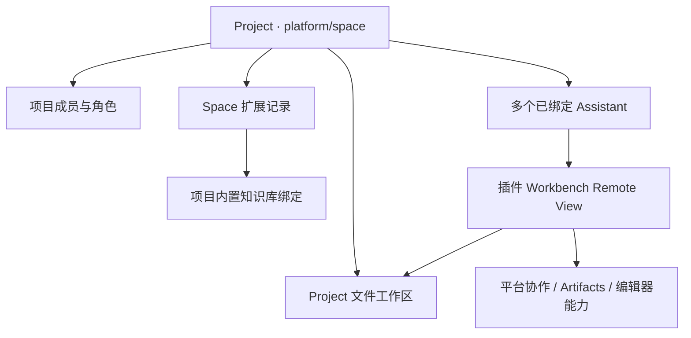

# Spaces：基于 Project 和文件的升级计划

2026-10-24 架构收敛：本模块按全新功能开发，不保留独立 Space 卷或旧空间迁移兼容。Space 必须绑定 Project，通用文件引用只使用 `catalog: 'projects'`、`projectId` 和对应的 `scopeId`。下文早期交付记录中的迁移验收只属于历史记录，不再作为当前要求。

状态：代码落地、服务闭环和界面设计 QA 完成；浏览器下载落盘验收仍有工具限制，H 未关闭。2026-10-21。

本计划按用户最新架构要求替代 `PLAN_xpert_spaces.md` 中“Space 绑定单个 Assistant、独立文件卷”的设计。保留原交付记录作为历史证据；历史测试结果不代表本次升级验收通过。完整实现和验收后，再由用户确认将计划转换为功能文档、产品文档。

后续架构演进见 [Spaces 长期架构计划：Project 文件与可插拔协作编辑器](PLAN_xpert_spaces_editor_plugin_architecture.md)。最新方向为统一文件提交、Tiptap Markdown 协作编辑器插件，以及 Assistant 自身的审阅/AI 内容接入；Spaces View 不承载通用审阅与 AI，其他类型仅保留规划、后续讨论。以下已有界面与交付记录保留历史事实，不作为后续职责设计，不改变本计划已有验收状态。

## 1. 目标与边界

协作空间是内置 Project Type：`platform / space`，使用真实的 `xpert_project` 记录。Project 统一管理名称、成员、角色、归档、多 Assistant 绑定和文件工作区。插件提供协作空间 Remote View、写作工具、编辑器适配及协作业务。

一个 Project 对应至多一个 Space 扩展记录。`space` 表存储 Project 未覆盖的业务属性，例如知识库绑定和同步状态；`projectId` 必填。不复制项目成员表，不因拥有某个 Assistant 的访问权限自动获得项目内容权限。

正文和附件尽量使用 Project 文件。Markdown 是原生页面的持久化交换格式；表格、图片、HTML、PDF 和 Office 文件保留原格式。CRDT 操作、评论、AI 建议、版本检查点、来源信息及文件索引元数据仍由数据库承载，不能把这些能力简单压缩为一个 Markdown 文件。

## 2. 归属、入口与授权

- 创建空间走平台 Project 创建流程，项目类型目录显示“协作空间”。
- Assistant 配置 Spaces 能力后，在当前 Project 上打开协作空间；未选 Project 时显示选择/创建提示，不再隐式创建 Assistant 私有空间。
- 同一 Project 的多个 Assistant 打开同一个 Space、同一组文件和协作文档。
- 每次资源、文件、下载、AI、索引及 WebSocket 操作都重新校验租户、组织、有效项目成员；Assistant 入口额外校验当前 Assistant 已绑定项目且有 Spaces 能力。
- owner/manager 管理项目；owner/manager/editor 编辑内容；member 只读。归档项目只读。移除成员或解除 Assistant 绑定后立即失去对应权限。
- 后台协作回调依据持久化资源归属授权，不依赖客户端上传 Assistant 或 Project 身份。

## 3. 文件及协作一致性

- 新空间文件使用现有 `/project/<projectId>` 卷，不再写 `/space/<spaceId>`。
- 页面有稳定 item ID 和规范文件路径；目录、重命名、移动反映在真实工作区中。文件名冲突明确报错，禁止静默覆盖。
- 文件列表可发现同项目其他 Assistant 创建的文件；原生 Markdown 可以进入协作编辑。
- 在线编辑由平台 CRDT 序列合并；提交后的 Markdown 写回对应文件。记录内容哈希和物化序列，失败可重试且不得显示“已保存”。
- 打开页面前对比磁盘哈希与已物化哈希；发现外部变化后冻结旧编辑器，由用户明确选择采用文件内容或保留协作文档。两种选择均保留版本和本地草稿，并再次校验哈希，禁止静默覆盖。
- AI 块级修改沿用建议→接受/拒绝流程；接受、恢复历史同样更新文件和索引。版本检查点保留可恢复内容，恢复产生新版本。
- 附件导入保留文件字节；收集 Artifact 固定具体版本并保留来源，必须有源读取权限。不能通过目标空间绕过源权限读取原资源。
- 删除/恢复遵循明确回收站策略；目录操作对整棵子树一致。旧文件和迁移来源不在升级中直接清除。

## 4. 知识检索

空间可以绑定一个项目内置知识库，使用平台知识库/文件理解基础能力，不在插件实现另一套向量数据库。

- 绑定和管理需要项目管理权限；知识库归属与项目范围一致。
- 文件内容与索引记录关联，记录文件路径、内容哈希、索引状态和失败原因。
- 新建、更新、恢复和删除触发同步；失败可重试，不阻塞文件编辑。
- 搜索和问答先做项目授权，再检索有效的文件版本；引用可定位到项目文件/页面。
- 无 Embedding 服务时明确呈现能力状态，保留已有文本检索，不能把文本匹配称为已验证的向量检索。
- 同项目所有已授权 Assistant 使用相同的项目知识绑定。

## 5. 原型对应与实现范围

沿用 `DESIGN_xpert_spaces_review_20261020.md` 和 `design-reviews/xpert-assistant-spaces-2026-10-20/screens` 的六张原型。调整归属、成员和入口文字以反映新的 Project 架构。

| 原型 | 本次实现 |
| --- | --- |
| 01 资源库 | Workbench 内空间导航、真实目录、页面/文件筛选、搜索、最近修改、列表、新建、回收站 |
| 02 页面与审阅 | 文档画布、保存状态、协作状态、按需侧栏、AI 建议接受/拒绝、评论 |
| 03 新建模板 | 空白页、项目简报、会议纪要、周报；标题、目录和项目权限提示 |
| 04 添加资料 | 本地上传、已有 Artifact 固定版本收集、目标目录 |
| 05 历史 | 检查点列表、只读预览、恢复确认、返回当前版本 |
| 06 能力配置 | Assistant Spaces 能力说明及 Project 类型/绑定入口；共享权限说明改为 Project 成员 |

React + shadcn/ui + Tailwind 作为插件 Remote View。复用 Workbench 的聊天能力，避免第二套永久 AI 输入框。Loading、空态、无权限、只读、失败重试、冲突和移动端窄屏状态都属于交付范围。

## 6. 全新模块的存储边界

1. `Space.projectId` 必填且在租户、组织内唯一；未绑定项目的记录拒绝访问，不回退到 Assistant 权限。
2. 正文、附件和版本快照都使用 `/project/<projectId>` 卷。平台契约、上传目标、运行时和卷解析不增加 `spaceId` 或 `spaces` 文件目录类型。
3. `SpaceItem.spaceId` 只作为插件内部关联；Artifact 复用已有 `resourceId`，由 `authorizationProviderKey` 指定附加资源授权；`scope: { projectId, userId: null }` 显式声明项目共享归属，操作人与审计身份保留。资源授权、项目归属、文件存储引用和链接访问策略分别校验；列表按授权结果分页。
4. 移除独立空间迁移服务、视图动作、菜单及其专属数据库字段，不提供旧空间兼容入口。
5. 本次代码收敛不执行本地数据库清理、数据迁移或服务重启；部署使用最新实体结构初始化，开发测试数据不视为需要支持的旧版本数据。

## 7. 实施顺序与检查项

- [x] A. 平台内置类型、Project runtime 授权及所需文件/知识库公共契约。
- [x] B. 插件 Project 归属、权限、共享目录与文件持久化。
- [x] C. CRDT/外部文件变化、历史、评论、AI 建议及 Artifact 一致性。
- [x] D. 内置知识库绑定、同步状态、检索和引用。
- [x] E. 六个原型对应界面及主路径交互；06 按 Project 归属调整为能力/访问说明，配置与发布复用现有 Studio。
- [x] F. Project 唯一存储归属，移除独立 Space 卷与旧空间迁移兼容。
- [x] G. 构建、类型检查、必要单元/集成测试、插件 lifecycle 验证。
- [ ] H. 本地部署、真实浏览器和真实模型闭环验收、重启持久性。

每阶段完成后在本计划补充实现证据和未完成项；不得以 mock 模型、HTTP 健康检查或编译成功代替用户流程验收。

H 当前仅剩浏览器下载后的本机文件字节确认。浏览器已获得真实下载链接；API 字节校验、其余浏览器主流程、真实模型与重启检查已通过。不能用 API 下载成功替代这一剩余检查。

## 8. 完整验收标准

| 场景 | 必须证明 |
| --- | --- |
| 两个人、两个 Assistant、一个项目 | 看到同一文件和页面，在线编辑与文件一致 |
| 不同项目/租户/组织 | 拒绝越权枚举、读取、下载、编辑、检索和 WebSocket 访问 |
| 只读/归档/撤权/解绑 | 写入受限，撤权后的新请求与已有会话均失效 |
| 文件互通 | UI 创建的 Markdown 可被另一 Assistant 读；Assistant 写入的文件可在空间发现和编辑 |
| 并发和外部写入 | 不丢字，不静默覆盖；冲突可解释、可恢复 |
| 真实模型 | 依据项目内容生成文档和带引用回答，建议经过人类接受再写入 |
| 知识索引 | 更新、删除、恢复、失败重试与检索结果一致；语义检索单独记录实际配置及结果 |
| 下载及重启 | 浏览器下载得到真实文件字节，重启后文件/协作状态/版本/知识绑定仍一致 |
| 原型对照 | 同视口截图逐屏比较，P0/P1/P2 问题修复后通过设计 QA |
| 插件解耦 | 仅使用 SDK 公共契约，打包及 lifecycle 通过；卸载视图不删除项目文件 |

## 9. 实施记录

- 2026-10-20：完成现状核对。Project 已有成员角色、多 Assistant 绑定和知识库关联；现有 Spaces 仍独立绑定 Assistant，正文以协作状态及数据库投影保存。开始实施本次升级。
- 2026-10-21：完成 Project Type、公共文件 API、资源知识库授权以及插件项目归属改造。项目文件使用原有 Volume；Space 元数据、CRDT、评论、建议和历史保持各自职责。共享文件下载重新校验 Project 成员与源资源权限。
- 2026-10-21：真实隔离部署通过 14 组闭环：双成员双 Assistant、并发编辑、审阅与历史、外部文件冲突、文件发现、知识索引、附件与成果归集、XLSX、目录回收恢复、成员撤权、Assistant 解绑、真实模型、旧空间迁移、跨项目成果来源授权与归档只读。
- 2026-10-21：通过官方插件 refresh 接口刷新后重启 API，验证正文、协作序列、文件 SHA-256、历史、评论、不可变版本、知识库绑定及 3 篇迁移页面一致。新增可重复运行的 `project-restart-acceptance.mjs`。
- 2026-10-21：六屏与原型同视口比较，修复继承宿主字号导致的文字偏小、模板卡片错位、历史预览 Markdown 标记、窄屏主区被挤压和滚动侧栏关闭入口不可见。最终设计 QA 见仓库根目录 `design-qa.md`，截图见本目录 `space-project-upgrade-evidence/`。
- 2026-10-21：浏览器完成模板建页、编辑、评论、历史预览与恢复、本地上传、固定版本成果归集，以及真实模型建议生成、接受后写回 Project 文件。ChatKit 创建的 Markdown 在同一 Project 可读。补充 90 秒 AI 完整调用边界与迟到结果不落库测试；重启后两次真实改写请求成功。
- 2026-10-21：浏览器原生下载文件尚未取得可核验的落盘路径：IAB 未提供下载事件/Blob 文件读取结果，macOS 下载目录访问被拒绝，原生 Codex 界面检查亦被自动审批拒绝。保留 H 未完成，不宣称完整浏览器下载闭环通过。

## 10. 验证与部署记录

平台仓库：`xpert`；插件仓库：`xpert-plugins/xpertai/apps/spaces`；共享组件：`xpert-plugins/packages/shadcn-ui`。未转换或替代本计划为功能、产品文档。

| 检查 | 结果 |
| --- | --- |
| 平台 Project / Volume / runtime / view / document 定向测试 | 9 suites，149 tests 通过 |
| 文件授权范围补充测试 | 2 suites，47 tests 通过；与上一组有重叠，不累加为总数 |
| 知识库 service / content runtime | 2 suites，64 tests 通过 |
| 知识检索 handler | 1 suite，25 tests 通过 |
| 归档项目 Remote View / 上传权限 | 1 suite，11 tests 通过 |
| 插件 CRDT / bridge / AI 超时测试 | 5 tests 通过 |
| 平台类型、插件后端与 Remote View 类型、插件打包 | 通过 |
| 插件 metadata / entity tables / lifecycle | 通过；开发 harness 加载及关闭成功 |
| 本地真实服务闭环 | 14 组通过；原始结果保存在隔离验收目录 |
| 插件刷新与重启 | 6 类持久性检查通过 |
| 浏览器主流程与真实模型 | 通过；建议接受后重新读取 Project 文件核对正文 |
| 设计 QA | passed；1586×992 桌面、768×1024 平板、390×844 手机；原型 06 为明确的 Project 架构适配 |
| 浏览器控制台 | 无 error；保留宿主 Vite stream 与未启用 Sandbox 的 warning，重启期间有一次临时 fetch warning |
| 浏览器下载落盘 | 未验证；下载接口字节一致已通过，不等同浏览器本机文件检查 |

可重复验收脚本位于插件 `scripts/project-live-acceptance.mjs` 和 `scripts/project-restart-acceptance.mjs`。脚本从环境变量读取验收身份、fixture 和报告路径，从 macOS Keychain 读取密码，不在仓库保存凭据。真实模型和归档分别由 `SPACES_TEST_MODEL=1`、`SPACES_TEST_ARCHIVE=1` 启用。旧空间迁移场景及其开关已于 2026-10-24 移除。

本地验收使用独立数据库 `spaces_phase1`（55436）、独立 Redis（56436）、API（3000）、Cloud（4200）；项目文件保存在隔离验收 Volume。原系统数据库仅用于读取既有模型配置，未重置或迁移其业务数据。真实模型采用既有 Tongyi 兼容配置下的 `qwen3.6-plus`；已验证改写建议经接受写入、带引用问答及聊天创建真实 Markdown。

全新部署使用最新实体结构初始化，不执行旧的独立 Space 升级脚本（该脚本已移除）。知识库关键词检索需已有 PostgreSQL `pg_trgm` 及全文/关键词索引，沿用 `PLAN_knowledge_retrieval_pipeline_refactor.md` 的部署要求；历史隔离验收库建立过对应索引。生产部署不能依赖开发环境 TypeORM 自动同步。

本期实际边界：

- 原生 Markdown 支持 CRDT 多人编辑；XLSX 通过编辑器插件保留值和公式并拒绝过期版本覆盖。其他 Office、PDF、图片、HTML 保留原始文件；不宣称已实现全部 Office 格式的多人实时编辑。
- 无 Embedding 模型时仍可进行关键词入库与检索；本次未配置、也未宣称验证向量语义检索。
- 文件外部变化需明确协调；迁移是保留来源的快照复制，不持续双向同步旧空间。
- 插件卸载不删除 Project 文件；编辑器与知识检索继续通过 SDK 公共契约提供，界面由 React + shadcn/ui + Tailwind Remote View 提供。
- 原型 06 的能力说明和 Project 访问语义已落地；添加能力、发布 Assistant、项目成员和 Assistant 绑定继续使用现有 Studio/Project 管理流程，没有复制另一套管理界面。
- 本次截图验收使用浅色模式；深色使用宿主主题 token，尚未做独立深色逐屏截图验收。

## 11. 剩余验收与后续文档整理

在当前已登录的本地浏览器中，打开「上线准备会议纪要」并点击「下载文件」，如出现「保存文件」入口再点击保存。确认下载得到 `.md` 文件，正文包含当前可见的会议结论；再比对项目文件的内容或 SHA-256。记录结果后才能关闭 H。

本计划、设计 QA 和脱敏 `service-acceptance.json` 保持为实施与验收记录。完整验收闭环后再进行功能文档和产品文档转换。
