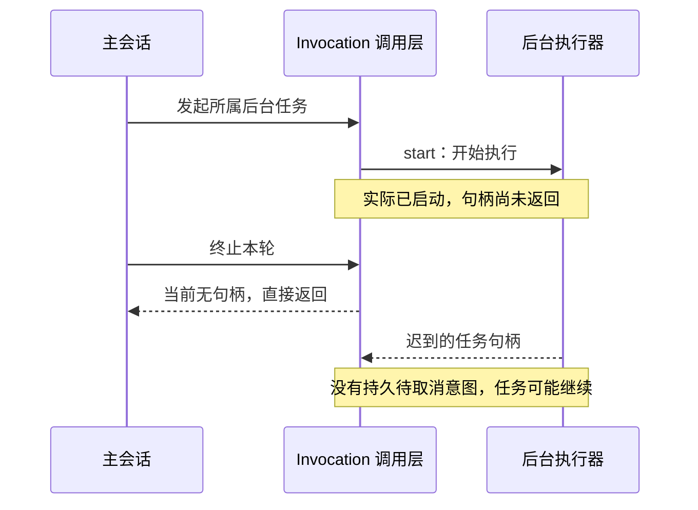
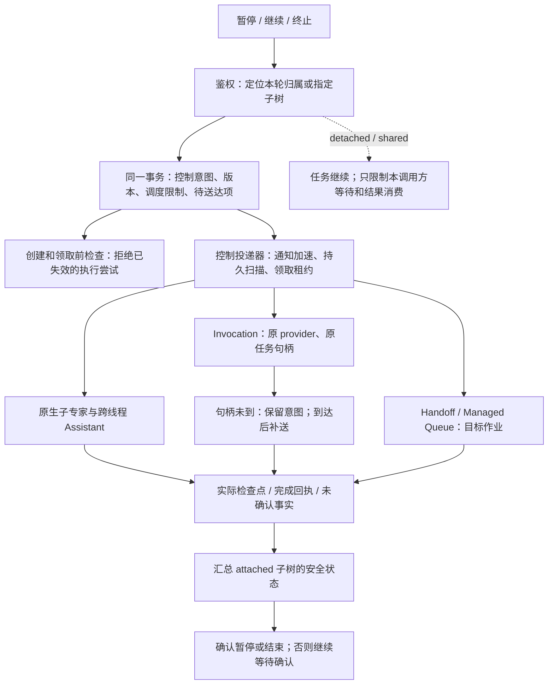

# #1217 第二阶段：外部专家与后台任务的执行控制

- 日期：2026-10-23。
- 状态：已有实现按功能重新分批；第二批待审核提交，未部署。下文保留实施前方案，实际接入能力及限制以功能文档为准。
- 第一批已按审核意见调整并重新提交：`a6b9b85a9e`；当前能力见[功能文档](../execution-control.md)。
- 总体设计见[暂停和终止升级计划](./issue-1217-execution-pause-and-termination.md)。实际功能已追加到功能文档。

## 1. 本阶段要解决什么

**让主会话的暂停、继续和终止能够沿可信归属到达平台内的子任务，并有持久的执行确认。** 第一阶段已经保护本地图执行和实际工具调用；但启动工具返回任务句柄之后，后台业务可以继续运行，其生命周期不能只用这次工具调用的完成回执表达。

以下保留实施前源码核对发现的缺口。实现阶段已重现无句柄取消、跨线程遗漏和队列领取竞态并补齐回归，仍不能直接归因为 Issue #1217 现场事故。

| 缺口                     | 当前代码事实                                                                                         | 后果或风险                                                              |
| ------------------------ | ---------------------------------------------------------------------------------------------------- | ----------------------------------------------------------------------- |
| 跨线程任务不在本地子树内 | 外部专家取消只遍历同线程且 `RUNNING` 的执行；后台 Assistant 创建自己的 conversation/thread/execution | `PENDING`、跨线程子任务及取消期间新登记的后代可能漏掉                   |
| 启动中没有句柄           | Invocation 的 `cancel` 在 `handle` 不存在时直接返回；持久 `cancelling` 在取得句柄后才写入            | 先终止、后返回句柄时，没有可靠的待送达控制意图                          |
| 扫描队列与领取并发       | Handoff 先扫描，再分别删除 queued 和广播 active；广播服务只有内存控制器，没有持久补偿                | 扫描时 queued、删除时 active，或通知先到、worker 后登记，都可能错过取消 |
| 通用队列缺少运行期控制   | Managed Queue 对 active 返回 `reason: active`；处理器上下文没有统一控制能力                          | 队列移除不能停止已领取作业；插件处理器缺少标准取消和状态检查入口        |
| 等待与任务是两个生命周期 | `CancelTaskWaitsCommand` 明确只废弃父流程的继续领取；结束观察不终止领域任务                          | 父会话已停止等待，所属后台任务仍可能运行                                |
| 请求接收与实际退出混用   | `canceledExecutionIds` 和 Handoff 的 `aborted.messageIds` 不是实际执行退出回执                       | 不能据此确认整棵所属任务树已暂停或已停止                                |

已有“启动期间允许取消”的测试先保存了句柄，因此没有覆盖上图的无句柄窗口。实施时首先补出这个最小失败用例。

## 2. 实施范围

| 纳入第二阶段         | 完成标准                                                                                             |
| -------------------- | ---------------------------------------------------------------------------------------------------- |
| 原生外部专家子树     | 通过可信归属查找子树，覆盖 pending / 启动中 / running；单独停止子专家不影响父和兄弟                  |
| 跨线程后台 Assistant | 创建前登记归属和稳定任务身份，绑定真实子 conversation/thread/execution；控制其节点边界与本地工具收尾 |
| Invocation 宿主层    | 无句柄也先保存控制意图；迟到句柄补送；保留原 provider 来源和原任务；控制副本重启后可继续核对         |
| Handoff              | 持久目标与消费前检查，覆盖 queued→active 竞态、迟到登记、重试及 outbound 派生                        |
| Managed Queue        | 为显式接入的所属作业增加控制上下文、领取前限制、协作取消及完成回执；保留现有领域处理器和物理队列     |
| 结果回传与暂停续跑   | 父流程暂停或终止时不被结果自动唤醒；恢复复用原任务和已有结果，按结果身份去重                         |
| 平台内状态聚合       | 当前已接入的 attached 目标全部达到安全边界或终局后，才确认暂停或结束；保留待确认状态                 |

第二阶段的队列集成覆盖公共执行通道，以及由本阶段 Assistant / Invocation / Handoff 链路创建的、显式登记归属的作业。不一次性迁移全部插件、历史作业、周期计划或 Project 业务调度器。

第三阶段继续负责各 Runtime 插件、Runner/进程、Desktop/Shell、Sandbox、MCP，以及 Project/Pipeline/群任务业务桥接的逐个适配和实际退出确认。第二阶段可向已声明取消能力的原 provider 投递控制，但不能据此替未验证的远端执行器承诺物理退出。管理员调试界面和完整 ChatKit 状态收口仍保留到后续阶段。

## 3. 解决方案总图

### 3.1 任务归属不随一次执行尝试消失

第一阶段的控制记录直接关联执行 ID；恢复普通会话时会绑定新的执行 ID。跨线程任务和保留的排队任务需要在这种切换后仍能定位原任务，因此第二阶段必须明确区分：

- **控制根**：本轮所属任务的稳定身份，跨暂停和继续保持不变。
- **执行尝试**：当前获准驱动父/子线程的执行 ID 与代次。新尝试取得资格不使旧尝试复活。
- **控制目标**：类型化的原生执行、Invocation、Handoff 消息或 Managed Queue 作业引用，各自保留原始领域 ID。

基于现有控制账本增量增加稳定控制根与尝试绑定，不覆盖历史 `executionId`，也不把非 UUID 的消息/作业 ID 强塞进执行主键。子线程保留自己的执行所有权和检查点校验，同时校验所属控制根；不能只检查父线程或把所有子线程改写成父线程 ID。

创建目标前，由可信后端在同一根的控制锁下登记 `attached` / `detached` / `shared`、父目标、领域目标引用和幂等身份。先登记后启动；终止与登记竞争时，不能再派生未获准的工作。跨租户、跨组织或无目标资源权限的关系拒绝建立，不根据 task 名称、background 模式或 correlation 文本推断归属。

独立和共享任务继续使用自己的控制根。主会话仅关闭自身的等待/自动消费关系，保留结果和其他订阅者。已独立受理的 Project 业务任务不因调用方式为 background 就纳入主会话级联。

### 3.2 先保存意图，再投递控制

新增持久的目标控制和投递记录，与根意图、调度限制在同一事务提交。记录至少包含目标身份、控制版本、动作、投递状态、下次核对时间、领取租约、确认来源及错误分类。唯一键限制同一目标、版本、动作的重复投递项；扫描有公平排序、退避和分页，避免失联目标占满扫描窗口。

网络调用在事务外进行，使用独立于业务取消信号的受限控制信号。多个副本通过领取租约协调，崩溃后其他副本可以接管；重试只投递控制或查询原任务，不再次调用业务 `start`。

句柄未到时，终止意图照常保存并关闭启动/派生资格。句柄到达后先持久保存并检查最新版本，再对原任务补送控制。完全未派发的排队任务可以直接拒绝执行；已派发但结果未知时保留未知，不根据超时猜测“没有启动”。只有适配器提供稳定操作 ID 查询能力时，才查询找回原任务；找不到证据不重新启动。

控制命令不能安全重复的 provider，应先查询原结果或使用 provider 的幂等控制键，不盲目重发。原 provider 不可用或来源版本变化时保留待确认，不切换到其他 provider。授权仍由目标领域校验；权限变化需要明确的停止专用授权策略，不能靠旧凭据快照绕过当前权限。

### 3.3 暂停：保存进度，不用终止模拟暂停

| 目标当前状态                               | 暂停处理                                                       | 恢复处理                                               |
| ------------------------------------------ | -------------------------------------------------------------- | ------------------------------------------------------ |
| 尚未批准启动的目标/排队作业                | 保留原身份和参数，禁止领域处理器执行；不暂停整个共享物理队列   | 唯一领取后释放原作业，保持原操作幂等身份               |
| 原生跨线程 Assistant                       | 通过已实现的节点边界暂停，保存子检查点和父等待关联             | 校验父子边界，按依赖恢复原任务，不重新发送初始业务输入 |
| 已获准节点内的同步依赖                     | 延续第一阶段完整节点收尾规则，不在半个节点中间制造需重放的失败 | 从完整保存的节点之后继续                               |
| 不具备安全暂停能力的在途 Invocation/处理器 | 等待原任务完成并保存结果，禁止后续派生；整体保持正在暂停       | 消费已有结果，不重跑已完成任务                         |
| detached / shared 任务                     | 任务继续；暂停本调用方的自动结果消费                           | 恢复本调用方订阅，去重消费原结果                       |

**避免父子互等**：如果父节点必须等待某个子工作才能形成可恢复边界，该依赖必须在节点准入时明确登记为收尾单元，允许完成，或者由适配器提供可持久化的暂停等待回执。不能一边禁止该子工作开始，一边等待父节点完成，也不能把暂停抛成普通错误导致整个节点重跑。此边界列为必须单独通过的回归用例。

父图已经暂停但所属子任务尚未安全静止时，只记录父边界已保存，整体仍为“正在暂停”。第二阶段默认不为任意 Runtime 新增远端 pause/resume 承诺；原生图使用检查点能力，其他已启动任务先采用等待原任务收尾的方式。

继续要领取一次新的控制版本，并恢复原有任务关联。原生子任务只有在最新版本仍允许运行时才可继续；终止优先，旧暂停回执、旧恢复 RPC 和迟到结果均不能撤销终止。

### 3.4 队列取消：检查领取资格，确认真实收尾

1. 入队前登记领域目标和控制关系，数据库提交与 Redis 入队采用持久派发记录和稳定 job ID 协调；入队失败可以补发同一作业，不能创建新业务身份。
2. queued 作业被暂停时保留为待恢复，不能用普通异常消耗重试次数或热循环重新入队。终止时先持久拒绝执行，再尽力移除队列记录。
3. worker 在调用处理器前原子领取执行资格并核对最新控制版本；即使删除作业失败、已经由 queued 变成 active，也必须受此检查约束。
4. 已获准执行的 handler 接收协作取消信号和类型化控制查询能力。控制意图晚于准入时，通过取消与实际完成回执收尾；不能承诺消除已经开始的副作用。
5. 同一目标只能有一个有效执行尝试。worker 丢失后，若无法证明旧 handler 已退出，不因 Bull/BullMQ stalled 重领而再次执行有副作用的 handler。控制补偿可以接管，业务重放需要另外的领域幂等或恢复证明。
6. Handoff 的 outbound 派生与业务重试都重新校验控制版本；用户终止不会走普通异常重试路径。处理器返回时同时保存业务事实与控制观察，不把已成功结果改成失败。

Managed Queue 通过 plugin-sdk 的明确控制契约和注入能力接入，底层队列不得反向依赖 server-ai 的具体服务。已有独立作业保持原调度逻辑；缺少新协议能力的 worker 不能领取新式受控作业，需有版本化 envelope 和明确的 worker 能力隔离。

### 3.5 汇总与迟到结果

请求被接受、控制已送达、任务实际停止分别保存。只有目标处理器已返回、原生执行和工具已结束，或领域适配器提供可信终局证据，才确认该目标收尾。广播成功、HTTP 成功、404、超时、租约过期、旧 `interrupted` 状态或取消 ID 列表均不足以证明物理退出。

控制根的当前已接入 attached 目标均已安全暂停/终结，且父检查点及消息保存完成，才能确认已暂停；全部停止/终结后才释放终止中的本轮。未接入或无法确认的目标必须保留能力不足/待确认，不能从汇总中悄悄删掉。这个平台内最小聚合是第二阶段完成条件，跨所有 Runtime 的聚合和产品呈现仍由后续阶段扩展。

迟到结果保存在原任务账本。向父流程发回结果前，以控制根、当前执行代次、订阅身份及结果 ID 校验和去重；暂停或终止时不能自动领取继续、写入新的检查点或启动新一轮推理。独立/共享任务的其他合法订阅者仍可收到结果。

## 4. 实施顺序和验收

建议在一次第二阶段范围内按以下顺序开发，每步保留独立证据，不先改变 ChatKit 展示来掩盖后端未确认状态。

| 顺序 | 工作                                                 | 必须验证的结果                                                       |
| ---- | ---------------------------------------------------- | -------------------------------------------------------------------- |
| 1    | 隔离复现无句柄取消、跨线程遗漏、queued→active 漏取消 | 记录修复前实际 start 次数、handler 次数、目标 ID 和控制结果          |
| 2    | 稳定控制根、类型化目标、事务投递记录                 | 登记与终止并发无遗漏；不同租户和独立/共享目标不误关联                |
| 3    | 原生专家、后台 Assistant 与 Invocation 宿主适配      | 迟到句柄补送；原任务 start 次数为 1；恢复不丢原任务关系              |
| 4    | Handoff / Managed Queue 消费与收尾                   | 领取前拦截；忽略取消时保持待确认；暂停不耗尽重试；重启不重放未知业务 |
| 5    | 平台内聚合、结果消费与恢复                           | 父子无暂停互等；完成工具不重跑；结果最多消费一次；终止后旧执行不复活 |

验收至少包含：

- 真正隔离的 PostgreSQL、Redis 和两个 worker 进程；模拟控制通知丢失、领取后崩溃、延迟句柄、控制响应丢失和重复消息。
- 暂停→继续、暂停→终止、继续与终止并发；终止先落库则无新准入，准入先获准则按在途处理，不能伪报零副作用。
- 一个父节点含已完成工具及未完成依赖，暂停恢复后每个已完成工具调用次数仍为 1；不发生父子互等。
- 终止本轮只影响其 attached 子树；父、兄弟、detached/shared 和其他订阅者不受误伤。
- handler 无视取消、worker 消失但远端仍可能运行时，状态保持待确认；控制扫描不调用 `start`。
- 原 provider 丢失/变化、撤销授权、跨组织/租户访问、旧 worker 收到新 envelope 时明确拒绝或保留未知。
- 迁移重复运行、历史记录不补造归属；第一阶段及现有恢复回归继续通过。

实现已提供修复前后结果、明确适配器清单及不支持项，并更新[功能文档](../execution-control.md)。ChatKit patch 不提交，不部署。

## 5. 源码核对入口

- [外部专家子树取消](../../packages/server-ai/src/chat-conversation/commands/handlers/cancel-external-assistant.handler.ts)：同线程和 RUNNING 筛选。
- [后台 Assistant 创建与取消](../../packages/server-ai/src/xpert-agent-execution/runtime/assistant-task-runtime.service.ts)、[Invocation 桥接](../../packages/server-ai/src/agent-invocation/assistant-task-adapter.ts)。
- [Invocation 启动/控制](../../packages/server-ai/src/agent-invocation/invocation-runtime.ts)、[已有启动期测试](../../packages/server-ai/src/agent-invocation/invocation-runtime.spec.ts)、[Runtime 策略契约](../../packages/plugin-sdk/src/lib/agent/runtime/strategy.ts)。
- [Handoff 扫描取消](../../packages/server-ai/src/handoff/commands/handlers/stop-handoff-message.handler.ts)、[通知服务](../../packages/server-ai/src/handoff/handoff-cancel.service.ts)、[处理器入口](../../packages/server-ai/src/handoff/message-dispatcher.service.ts)、[派生与重试](../../packages/server-ai/src/handoff/message-queue.processor.ts)。
- [Managed Queue 取消](../../packages/server/src/managed-queue/managed-queue.service.ts)、[worker 入口](../../packages/server/src/managed-queue/managed-queue.processor.ts)、[SDK 上下文](../../packages/plugin-sdk/src/lib/managed-queue/index.ts)。
- [等待取消边界](../../packages/server-ai/src/agent-invocation/task-wait-control.ts)、[观察语义](../../packages/server-ai/src/runtime-task/README.md)。
- [第一阶段执行控制账本](../../packages/server-ai/src/execution-control/execution-control.store.ts)、[暂停恢复身份绑定](../../packages/server-ai/src/chat-conversation/thread-run-control.service.ts)。
