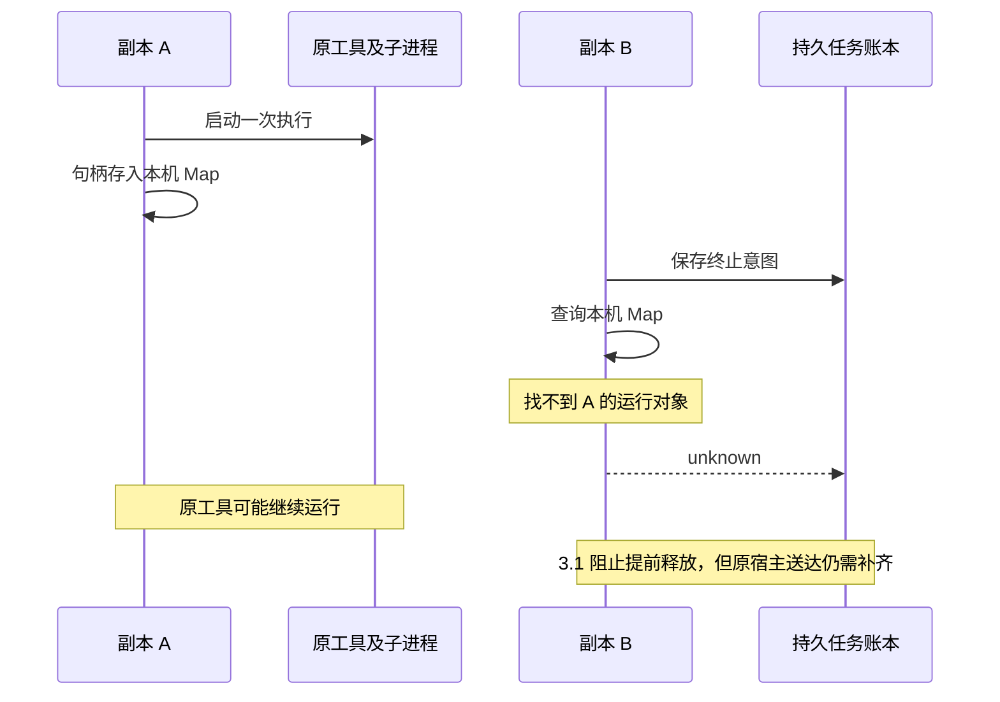
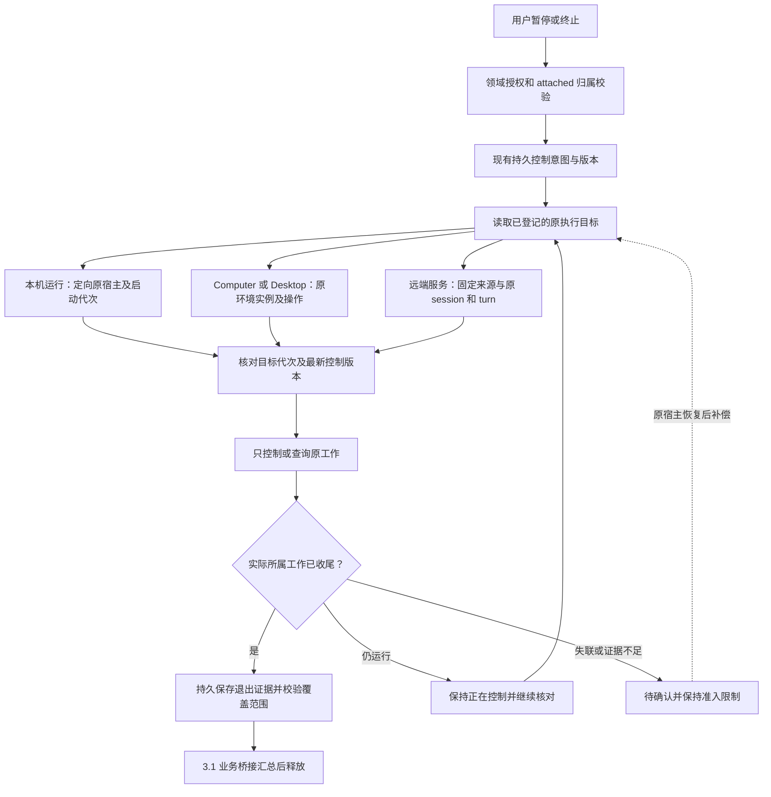
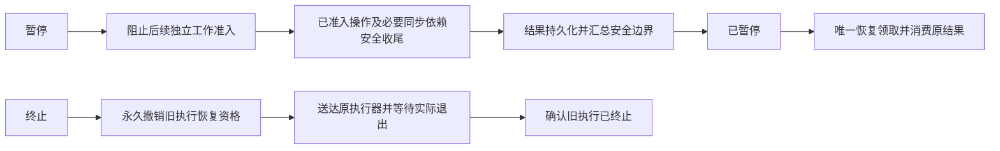

# 第三阶段 3.2 原执行宿主与进程控制方案

日期：2026-10-23；更新：2026-10-24。状态：实现已按第四批重新整理，待审核提交，未部署。实际支持范围和保守边界见[功能文档](../execution-control.md#第三阶段-32原宿主控制与进程收尾)。3.1 的修复、回归测试和功能文档已提交为 `94bc86fb6`，未部署。

3.2 要补齐两件事：让持久控制到达原执行器，以及让原执行器提供可信的实际收尾证据。沿用第一、二阶段的任务归属、准入和补偿，接入 3.1 的业务释放条件。主会话只控制本轮 attached 任务，独立或共享任务继续运行。

## 当前缺口与影响

3.1 已让取消缺少证据时保持待确认。部分执行器尚不能跨副本找到原运行，或者只能证明接收了控制、父进程退出；因此仍可能出现“平台等待确认，旧工具继续运行”的情况。以下是源码确认的缺口，实施时需先隔离复现，不直接作为线上事故根因。

| 路径              | 当前已有行为                                                                                     | 3.2 需要补齐                                                                                 |
| ----------------- | ------------------------------------------------------------------------------------------------ | -------------------------------------------------------------------------------------------- |
| 本机 Codex / Pi   | ProcessRuntime 使用进程内 Map；Codex 等待 turn/completed，Pi 等待 agent_settled                  | 原宿主定向投递；原 turn 核对；协议完成与所属进程收尾分开记录                                 |
| 本机 Claude       | 进程内 Map、AbortController、SDK 流消费                                                          | 原宿主路由；流结束或抛错不能单独证明工具退出；补可信执行边界                                 |
| JSONL 子进程      | stop 只对直接 child 发 TERM/KILL；close 后删除运行对象                                           | 监督所属进程范围，保存最终回执；不能只检查父进程                                             |
| OpenCode 远端服务 | 已保存 session/message 身份，恢复只查询；abort 返回 true 被映射为 cancelled                      | 应答只记接收；核实固定协议版本的原 message/turn 及所属工具终局                               |
| Desktop Shell     | 服务端 cancel_requested、Gateway 补发、设备日志、连接 epoch；父 close 后发进程组 KILL 并上报终态 | 将操作接入稳定控制归属；核对执行代次并等待所属进程退出；重启后未知可继续核对                 |
| Computer Runner   | 持久 receipt、实例和权限校验、授权撤销、进程代次检查、exited/stopping/unknown                    | 复用既有 Runner；补控制版本与持久退出证据、后代覆盖；让各 Computer 策略输出 3.1 可消费的证据 |

Computer 范围包括当前共用 Runner 的 Codex、Qwen、CodeBuddy、Kimi、Claude，以及 OpenCode 的 Computer 分支。共用停止路径可以复用测试，但每个策略仍须单独验证身份映射和能力声明，不能自动认定整组适配器已支持。

## 控制链设计

### 稳定目标与持久投递

增加一个有版本的执行目标登记契约，在 contracts / SDK 中定义明确类型。它关联现有稳定任务，不复制业务调度状态机。建议登记以下事实：

| 事实                                          | 用途                                   |
| --------------------------------------------- | -------------------------------------- |
| 租户、组织、稳定 task/invocation/operation ID | 验证归属和控制范围，避免跨领域误停     |
| provider 来源、固定配置版本、目标类型         | 插件升级或同名 provider 不能接管旧任务 |
| 宿主 ID 与启动代次，或设备/容器实例 ID        | 分清原宿主与重启后的新宿主             |
| 执行代次、原 session/turn、受管进程范围引用   | 防止迟到控制或旧 PID 操作新工作        |
| 已应用的控制版本、回执序号与持久证据引用      | 重复投递去重，迟到回执不覆盖新意图     |

本机 Runtime 的目标登记和回执由宿主提供的能力统一保存；插件不直接另连平台数据库。Computer、Desktop 保留已有 receipt 和设备日志，通过明确引用接入统一账本。若需要新的目标表或字段，附带迁移和索引；不把可变 JSON metadata 或日志文本作为隐式控制协议。

业务启动前先获得现有唯一准入并登记启动目标，原 turn 返回后将待绑定身份一次性绑定到实际 turn。准备身份和最终身份使用显式状态，避免把临时 invocation ID 当成最终 turn。绑定后身份固定，旧回执不能改写。启动和外部副作用无法跨数据库原子提交：在这段窗口崩溃时保留未知，禁止重发输入。

终止意图先落库；即使尚无句柄，迟到的绑定也必须读取最新意图并进入停止流程。定向通知只负责唤醒，原宿主扫描持久控制作为补偿。现有 worker 领取租约用于减少并发投递，目标端再按执行代次和控制版本去重。网络调用放在事务外，并使用独立、限时的控制信号，不能复用已经 abort 的业务信号。

宿主心跳过期、内存 Map 为空、HTTP 超时都不能授权业务重启。宿主重启后，只恢复日志核对和停止原进程的能力；无法重建原协议连接时不声称可以续跑原 turn。目标回执保留到业务确认消费及必要保留期之后，避免回执丢失导致永久无法确认。

### 实际退出证据

将三类事实分开保存：业务结果、实际运行收尾、资源清理。业务成功结果可以先持久化；对本次接入强确认的适配器，所属工作结束前不得据此释放后续执行。迟到取消不改写已经完成的成功结果。清理失败可补偿，但不能从“临时目录删除”反推进程退出。

扩展 3.1 的证据契约或增加显式能力版本，携带目标登记、执行代次、控制版本和覆盖范围；不能仅把这些值塞进 receiptKey 字符串。新契约必须允许终态业务结果之后继续补写收尾证据，而不被“终态不可更新”逻辑丢弃。旧版本没有这些事实时仍保持未确认，不自动升级为强证据。

- **本机进程**：使用受管执行范围记录所属进程、启动代次和监督回执。先请求协议停止；超过合理宽限后，仅终止本操作所属的进程范围，再核对退出。父 close、发送信号成功、PID 不存在均不能单独证明所有后代退出。
- **进程后代**：单次枚举进程树有竞态；运行期间持续跟踪并结合可用的系统隔离边界。脱离进程组、重新挂到其他父进程或无法验证启动代次时，不伪造整棵树退出。缺少可靠隔离/监督能力的平台保持 unknown；不能承诺任意 shell 命令的后代都可证明已停止。
- **Claude SDK**：SDK 流结束只提供协议观察。需要通过受管子进程/监督层，或该固定 SDK 已验证的退出能力，确认本调用所属工具结束后再生成证据；未验证时不声明支持。
- **共享远端服务**：只控制原 session/turn 所属工作。核实固定 OpenCode 版本的 abort、message 和工具状态语义，不能用服务可访问、idle 或 abort=true 单独证明退出。若协议只能按 session 取消，必须保证该 session 的独占绑定且不复用到新 turn；不能关闭整个共享服务。协议无足够证据时保留未知。
- **Desktop**：连接 epoch 只用于校验当前连接，不能替代执行代次。设备日志需记录操作所属进程范围及最终确认；重连可重报同一证据，重启可核对原工作，不能再执行原命令。保留取消早于启动时的持久撤回记录。
- **Computer**：复用现有容器实例、exec、进程 startTime 和停止专用授权。检查正常退出、TERM/KILL、孤儿后代、停止期间继续 fork 等路径；只有可靠覆盖的所属范围结束才报告 exited。拒绝旧实例不代表旧工作已退出，也不能转向新实例发送控制。不要为了停止一次 invocation 关闭共享 Computer。

这批不引入透明执行迁移、任意远端任务接管或通用 exactly-once 承诺。已发出的外部副作用不能靠取消撤销；目标是禁止未知执行重放，确认可验证的旧工作结束后再开放后续准入。

## 暂停与终止

| 情况                       | 处理                                                                                           |
| -------------------------- | ---------------------------------------------------------------------------------------------- |
| 暂停时原 turn 正在执行     | 默认等待该已准入 turn 完成，可能继续执行它内部的工具；不承诺立刻冻结                           |
| 原 turn 完成后恢复         | 从持久边界继续，消费原结果，不再发送同一 prompt 或调用已完成工具                               |
| 等待用户批准或长时间无进展 | 保持正在暂停/待处理；不能按超时自动转为终止，或假装取得安全检查点                              |
| 适配器提供 pause/resume    | 本批默认不启用；需另外验证持久安全点和恢复幂等性。interrupt、SIGSTOP、断开连接都不等于安全暂停 |
| 暂停后终止                 | 最新终止意图优先，继续控制原任务；迟到暂停回执不能解除终止限制                                 |
| 恢复与终止并发             | 按持久准入顺序裁决；终止先提交则拒绝恢复，先准入的工作仍需实际收尾                             |
| 父子暂停互等               | 保留第二阶段对已准入节点必要同步依赖的收尾许可；父节点不能等待一个被自己禁止收尾的子节点       |
| 独立或共享任务             | 原工作继续；只结束本调用方等待和后续自动消费，不扩展控制归属                                   |

正常查询、控制和恢复仍走当前领域权限。权限撤销后的后台停止仅使用明确授权的停止专用路径，限定原持久目标，不能借此启动、读取新业务内容或跨租户操作。

## 实施顺序与交付范围

| 顺序 | 工作包                                                                                  | 主要仓库                             |
| ---- | --------------------------------------------------------------------------------------- | ------------------------------------ |
| 1    | 执行目标登记、原宿主投递、证据版本与准入衔接；本机 ProcessRuntime、Codex/Pi/Claude 接入 | xpert、xpert-plugins                 |
| 2    | Desktop 日志与进程确认；Computer Runner 收尾证据和各 Computer 策略接入                  | xpert、xpert-pro、xpert-plugins      |
| 3    | OpenCode 远端协议证据、独占 session 控制、故障和共享服务隔离验收                        | xpert-plugins，必要的 xpert 契约校验 |

三个工作包均按“先复现、后修复、再展示同一场景结果”交付，逐适配器报告支持范围。旧适配器、旧 Desktop 和混合版本 worker 不能被默认视为已支持；使用显式能力协商与迁移策略。上线前需要同一控制链版本兼容，但本轮不发布、不安装到业务环境、不部署。

Sandbox Job、MCP 双端物理收尾仍属于 3.3。管理员诊断界面后续实现。ChatKit 继续只有简短提示和按钮状态，不暴露宿主、进程代次等技术细节，不提交 ChatKit patch。

## 复现与验收

| 场景                                 | 修复前观察重点             | 修复后必须证明                                                 |
| ------------------------------------ | -------------------------- | -------------------------------------------------------------- |
| A 启动、B 终止，定向通知丢失         | B 查不到原 Map，A 继续执行 | 持久补偿送到 A；start=1，业务输入=1                            |
| 启动与返回句柄之间收到终止           | 控制目标尚未绑定           | 迟到句柄受原终止约束；不重发业务输入                           |
| 接收控制后响应丢失，多 worker 重试   | 重复控制和回执竞争         | 原身份/版本去重，只查询或幂等停止；工具不重复执行              |
| 宿主重启或失联                       | 原运行对象丢失             | 能核对则控制原工作，否则 unknown；不得自动另起任务             |
| 父进程退出而后代持续写入             | 父 close 早于后代停止      | 有可靠边界时清空所属范围后才确认；越界后代证据不足时保持未知   |
| 旧 PID/turn、旧容器或设备代次        | 迟到控制可能命中新工作     | 拒绝旧目标，不操作新运行，不用旧回执释放新工作                 |
| OpenCode abort=true 但工具仍在执行   | 应答被直接转终态           | 继续待确认；原 turn 和所属工具实际收尾后才确认                 |
| 暂停恢复与父子同步依赖               | 半节点中断或互相等待       | 完整安全边界；恢复只消费原结果；输入、工具调用及结果消费不重复 |
| 暂停后终止，终止与恢复竞争           | 旧暂停/恢复回执迟到        | 终止不被覆盖，旧执行不可恢复                                   |
| attached、detached、shared 并存      | 控制范围扩大               | 只停止 attached；独立和共享工作继续                            |
| 领域权限撤销、跨租户伪造、回执损坏   | 不可信控制目标             | 正常访问拒绝；停止专用路径仅操作已授权归属的原工作             |
| 已成功、工具仍在收尾，或资源清理失败 | 结果与退出被混用           | 保留成功结果；按证据释放；清理另行补偿                         |

使用隔离 PostgreSQL/Redis、两宿主进程、真实可控子进程和后代、临时目录写入计数以及目标身份/版本日志验证。故障用例注入失联、响应丢失、重复消息、进程崩溃和延迟退出；每个用例展示 start、prompt、工具执行和结果消费次数。无法证明进程范围时，验收结果应明确为 unknown，而不是强确认通过。

插件按仓库要求通过 Nx 构建/测试和 plugin-dev-harness 生命周期验收。Desktop、Computer、各 CLI/SDK 和 OpenCode 固定版本分别验证真实控制边界；协议替身测试不能替代实际适配器验收。测试后更新功能文档，只在已验证的具体运行模式声明强确认能力。

## 源码入口

- [ProcessRuntime](../../../xpert-plugins/xpertai/integrations/agent-runtimes/src/lib/process-runtime.ts)、[JSONL 进程](../../../xpert-plugins/xpertai/integrations/agent-runtimes/src/lib/jsonl-process.ts)、[Claude](../../../xpert-plugins/xpertai/integrations/agent-runtimes/src/lib/claude.strategy.ts)、[OpenCode](../../../xpert-plugins/xpertai/integrations/agent-runtimes/src/lib/opencode.strategy.ts)。
- [Computer 策略公共路径](../../../xpert-plugins/xpertai/integrations/agent-runtimes/src/lib/computer-jsonl.ts)、[Computer Runner](../../../xpert-pro/packages/server-ai/src/computer/cli/computer-agent-runner.service.ts)、[代次检查与停止](../../../xpert-pro/packages/server-ai/src/computer/cli/computer-cli-stop.ts)。
- [Runner 契约](../../packages/plugin-sdk/src/lib/agent/runtime/execution-runner.ts)、[证据契约](../../packages/contracts/src/ai/execution-control-evidence.schema.ts)、[持久控制协调](../../packages/server-ai/src/agent-invocation/task-control-coordinator.service.ts)。
- [Desktop 操作](../../packages/server-ai/src/desktop-shell/desktop-shell-operation.service.ts)、[Gateway](../../packages/server-ai/src/desktop-shell/desktop-shell.gateway.ts)、[设备执行引擎](../../apps/desktop/electron/shell/engine.cjs)。
