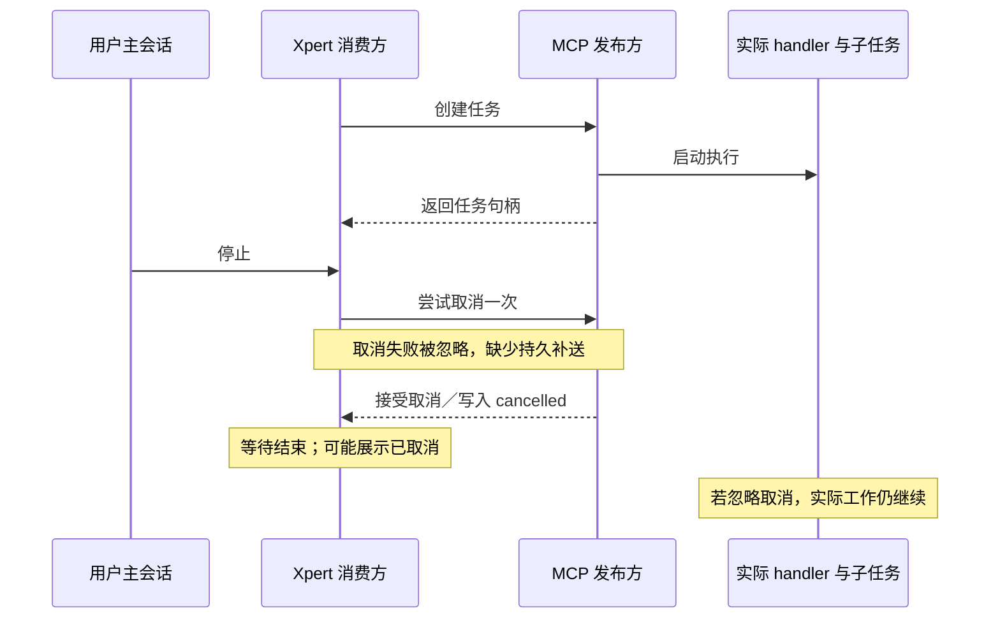
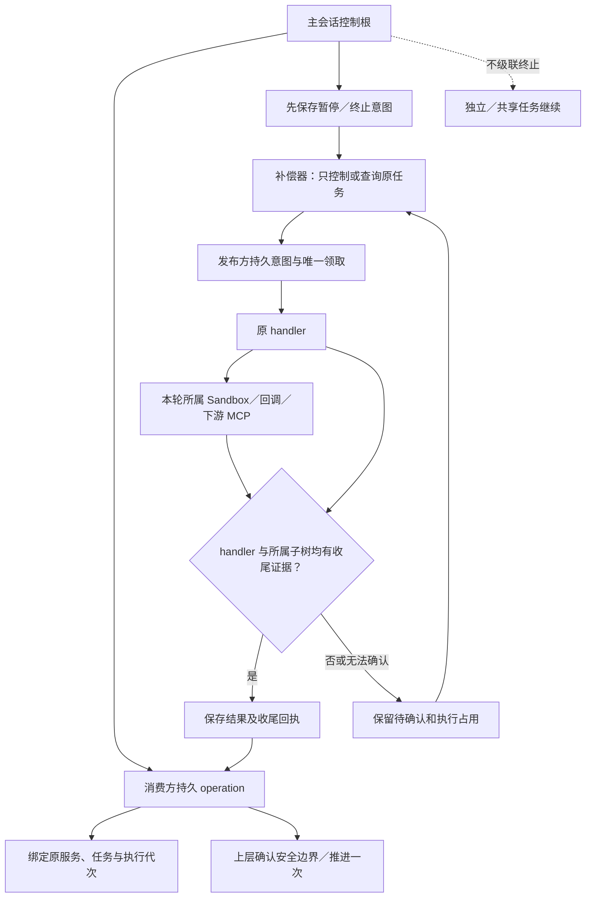
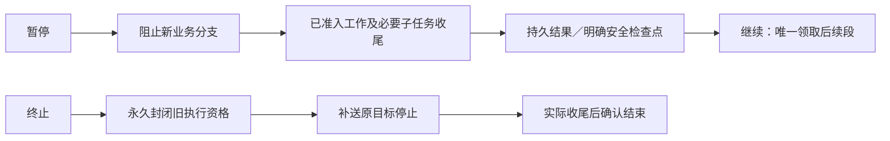

# Issue #1217：3.3.2 MCP 双端执行控制方案

日期：2026-10-24。状态：**Xpert 3.3.2 重新整理为第六批，包含修复、回归与功能文档，待审核提交，未部署；Pro 配套后续单独审核**。实施范围与兼容限制见[功能文档 3.3.2](../execution-control.md#第三阶段-332mcp-双端持久控制与输入续接)。下文保留审核时的设计；故障已在隔离 PostgreSQL/HTTP 环境先复现，再补充回归。

前置 3.3.1 的 Xpert 改动已审核并重新提交为 `47c4d1701`。原实现参考为 Xpert `30d1af028`、Pro `61dad7fc2`；Pro 当前分批审核尚未推进至该层，不纳入本批。没有提交 ChatKit patch，没有推送或部署。已实现能力见[执行控制功能文档](../execution-control.md)及 [Pro 的接入边界](../../../xpert-pro/docs/sandbox-job-execution-control.md)。本方案细化 [3.3 总体计划](./issue-1217-execution-control-phase-3-3.md)中的 MCP 部分。

## 目标与问题

3.3.1 已处理 Sandbox 内部的真实收尾；3.3.2 把相同原则接到 MCP 两端：Xpert 调用外部任务时是消费方，Xpert 把工具发布给外部调用时是发布方。同一条执行链可能同时经过两端。

**接受取消、停止等待、实际执行收尾是三个不同事件。** 任务状态或连接结束，不能单独证明 handler、远端任务及本轮所属子任务已结束。

图中取消可能送达，也可能丢失；两种情况都需要独立确认收尾。当前发布方已有数据库状态及一秒轮询，并非完全依赖通知；但其轮询没有解决可靠准入、取消保存顺序和实际退出证据。

| 源码确认的缺口                                                      | 影响                                                 | 本批修复方向                                                                 |
| ------------------------------------------------------------------- | ---------------------------------------------------- | ---------------------------------------------------------------------------- |
| 发布方先调用 queue cancel，再保存 cancelled                         | 队列异常可能导致意图未落库；协议状态早于实际收尾     | 意图先落库，队列及原宿主异步补送；独立保存执行证据                           |
| MCP 入队没有启用现有受控队列；process 没有独占执行 claim            | 重领、并发 process 或迟到 worker 可能再次进入工具    | 接入 TaskControl 与持久发布记录，唯一准入、代次校验                          |
| 消费方 wait 在 abort 时 cancel 一次并忽略异常；task ID 仅在调用栈中 | 重启后无法补送；创建已接受但句柄丢失时无法定位       | 发起前保存 operation；句柄绑定及控制补偿持久化                               |
| Toolset 在等待异常时按本地 signal 拼出 cancelled/failed             | 本地等待状态被当作远端执行状态                       | 分开等待、控制意图和远端证据；简短提示待确认                                 |
| input.request 抛出中断，tasks/update 再入队执行原 handler           | 补充输入前已经发生的业务副作用可能重复               | 在原执行中等待输入，或使用明确的持久 continuation；禁止任意 handler 从头重放 |
| 当前连接服务校验配置变化，但没有原任务专用的持久控制目标            | 不能在重启后安全补送；重新加载新连接可能指向另一服务 | 固定原连接修订、远端身份、任务代次与凭据引用                                 |

当前 `io.modelcontextprotocol/tasks` 协议采用 `tasks/get/update/cancel`、`resultType` 和 `ttlMs`。其取消是协作式意图，ack 不保证工作已停止；本方案不把协议终态升级为物理收尾证明。[官方 Tasks 2026-07-28 取消语义](https://tasks.extensions.modelcontextprotocol.io/specification/2026-07-28/tasks#task-cancellation)

## 控制原理

复用现有 TaskControl 的根锁、唯一 claim、暂停收尾许可及持久发布，不另建一套彼此独立的取消状态机。MCP 专属记录保存协议状态、远端身份、输入请求、结果和证据；与 TaskControl 的注册、准入和终态更新保持事务一致。

拟新增类型化的 MCP 控制种类及版本化契约。每次已准入执行绑定不可复用的 generation；控制版本单调增加，终止不可逆。过期结果或回执可以保留审计，但不能恢复旧执行、覆盖新状态或操作新任务。

## 发布方实施范围

1. **准入与发布原子化。** 保存 Task、控制引用及队列发布记录，再由补偿器投递。取消在未领取时先封闭准入并证明未启动；已领取时只控制原执行。队列 Job ID、Task ID 与 generation 绑定，消息重投不产生新执行。现有 HTTP/JSON-RPC 请求 ID 的去重保留，但不能把每次连接生成的新请求 ID 当成持久业务身份。
2. **实际执行跟踪。** 原宿主继续轮询持久意图，通知只是加速。跟踪实际 handler Promise 及通过宿主登记的 attached 子工作；包装层返回、超时、AbortSignal、队列删除和 finally 都不是单独的收尾证据。裸插件自行创建且未登记的外部工作不能被宣称已收尾，需显式接入宿主控制 API。
3. **取消与过期。** API 成功响应前先持久保存终止意图；队列或网络故障不丢失意图。内部状态区分 pending/settled/unknown，业务结果与控制结果分别保存。协议 ack 保持兼容，不能给协议增加未协商的状态枚举；上层必须读内部或协商后的证据。TTL 过期可以结束协议可用性，但不能删除未确认的控制记录、释放实际执行占用或重开旧任务。
4. **父子归属。** 宿主从可信执行上下文登记必要子任务。来自网络的外部请求默认新建独立控制根；只有服务器验证的委托才能关联内部父节点。跨服务由消费方持久 operation 桥接，不能信任对方自报的 root ID。父停止只覆盖 attached；detached/shared 不受影响。
5. **输入与审批安全续接。** 每个输入请求持久唯一标识，响应以任务、代次、请求标识去重，并与终止及恢复互斥。普通 handler 在原 Promise 内等待持久输入，通过轮询与通知继续，不能因补充输入重跑整段 handler。原宿主丢失后，只有声明并验证的持久 continuation/检查点才可领取下一段；普通 JavaScript 调用栈不能跨进程恢复，保留待确认。初始工具审批仍在副作用前完成，不能借恢复绕过重新授权。
6. **结果与占用。** 先持久保存结果，实际 handler 与 attached 子树收尾后才出具完整回执。已有队列并发槽不等于业务已收尾；MCP 对外承诺的执行占用、子任务占用和父节点收尾条件必须依赖持久记录。失联或旧租约失效不能被当成安全释放依据。本批不重做全平台配额体系。

## 消费方实施范围

发起前建立稳定 `operationId`，保存可信归属、输入摘要、协议能力、原连接修订和远端身份。调用方重试或图恢复只能观察同一 operation，不根据参数相似度猜测重复调用。

| 情况                                       | 处理原则                                                                                                    |
| ------------------------------------------ | ----------------------------------------------------------------------------------------------------------- |
| 收到远端 task ID                           | 持久绑定后开始等待；重复绑定仅接受同一远端身份和代次                                                        |
| 取消早于句柄                               | 保留终止意图；迟到句柄只绑定、补送停止，不推进业务                                                          |
| 创建已接受但响应丢失                       | 同平台按协商的 operation 身份查询；第三方无查询能力则 unknown，不重发 tools/call                            |
| cancel 或 get 失败、响应丢失、消费进程重启 | 独立控制超时、退避与投递租约；继续 cancel/get 同一任务，不能携带业务输入重建任务                            |
| 连接配置或凭据变化                         | 只定位原版本及原服务；无法授权访问原目标时待确认，不把旧 task ID 发到新服务                                 |
| 本地等待到期或调用方断开                   | 结束该等待，不自动推断远端终止；任务是否终止取决于持久控制意图及归属                                        |
| 远端结果重复到达                           | 原结果可重复读取；通过结果回执与恢复 claim 只推进一次，不在检查点落库前提前标记已消费                       |
| 同步调用没有 task handle                   | 登记原在途调用、阻止终止后的新调用、跟踪结果；没有远端退出证据时不假定停止，不关闭共享 MCP 进程来杀单个调用 |

所有现有入口都必须检查：`McpConsumer` 的 task runner、LangChain tools 路径、`MCPToolset.callMcpTaskTool()`、`ToolRuntimeService` 及宿主 `platform.mcp.client`。不能只修一个 wait 方法而让其他路径绕过归属。宿主 MCP client 的现有只读政策保留，不在本批扩展写权限或新交互产品功能。

连接控制通过平台保存的配置和凭据引用解析，不接受工具结果提供的任意控制 URL，不持久保存裸令牌。发起、读结果、输入与恢复继续检查当前业务权限。终止补偿使用发起时建立的、仅限原任务停止的宿主控制能力；不能用于读结果或调用新工具，也不能绕过远端已撤销的凭据。凭据不可用时保留待确认。

## 同平台扩展与第三方兼容

为同平台双端设计显式协商、独立命名空间及版本的控制扩展，至少包括：稳定 operation 查询、原任务控制、执行 generation、控制 revision、handler/attached 子树收尾证据和安全 continuation 能力。具体名称在共享契约中统一，不把扩展字段塞进业务工具参数，也不冒充 MCP 标准能力。

- 远端实例身份来自已授权的原连接及可信服务身份，不能仅用可随意修改的 server name/version 判断“同一服务”。
- 无句柄时按 operation 查询与终止。远端必须先持久记录该 operation 的终止屏障；即使 tools/call 迟到，也不得越过屏障启动。单次查询“未找到”不能证明请求从未到达。
- 查询、停止和结果回执均核验 publication/主体/租户组织、operation、输入摘要与代次。跨租户 task ID、伪造父引用、旧回执、错误服务均拒绝。
- 不支持扩展的第三方继续使用其实际支持的协议；协议 cancelled、404、TTL 过期或断连都不能作为强退出证明。已知 task ID 可持续补送，无法确认时保留 unknown。
- 本批不实现任意远端服务接管、不强杀共享 stdio 服务、不恢复任意第三方内存调用栈，也不承诺通用 exactly-once 或回滚已发生的业务副作用。

## 暂停与终止

暂停不走当前 wait-abort→cancel 路径，也不模拟远端进程冻结。已准入远端调用、必要同步子任务及完成它们所需的输入响应允许安全收尾；新的无关分支仍禁止启动。不能把“父任务暂停”变成禁止子任务完成，从而父等子、子等父。

需要用户输入而不能立即完成时，可以在明确的持久安全等待点停住；若仍有活动子工作或没有可验证安全点，则显示正在暂停/待确认。原 handler 可以继续等待，但不能据此声称它已退出。继续只恢复该等待或已验证的后续段，不重发原始工具调用。

终止后禁止后续输入推进和旧 generation 恢复，迟到结果只留存。恢复与终止在同一控制锁下比较版本；终止已提交则拒绝恢复，恢复先准入的工作仍受随后终止约束。独立/共享任务保持自身生命周期，本调用方停止自动消费结果。

## 实施顺序与验收

建议作为一批双端功能实施，内部依次完成发布方、消费方和端到端集成，避免只有一侧支持时宣称闭环。先用现有实现执行隔离复现并保存日志，再修复；不修改业务环境。

| 优先级 | 先复现的场景                                                  | 修复后必须证明                                                            |
| ------ | ------------------------------------------------------------- | ------------------------------------------------------------------------- |
| P0     | A 执行、B 取消；handler 忽略 signal                           | 意图可补收，真实 handler/子树未结束时不能确认收尾                         |
| P0     | 发布方队列 cancel 异常；通知与 Redis 消息丢失                 | 终止仍持久存在，恢复后只控制原任务                                        |
| P0     | 创建已接受但句柄响应丢失；取消先于迟到创建                    | 同平台找回或封闭原 operation；第三方 unknown；tools/call 与实际启动不重复 |
| P0     | 两个 worker 并发领取、重投、终止竞争                          | handler 最多一次准入，已封闭旧代次不能复活                                |
| P0     | handler 写一次业务记录后请求输入，再恢复                      | 记录仍只有一条；重复 update/审批响应不能重跑 handler                      |
| P1     | 消费者重启、DB 暂时不可用、控制响应丢失                       | 补写句柄/结果/收尾证据，重试不叠加、不重执行业务                          |
| P1     | 暂停、父子互等、暂停后终止、恢复与终止并发                    | 必要子任务可收尾，保存结果后安全续接；终止优先约束旧执行                  |
| P1     | 主会话、发布 handler、Sandbox、下游 MCP 串联，含独立/共享工作 | attached 全链路受控；detached/shared 继续；结果只推进一次                 |
| P1     | 老 task 的回执/控制到达，连接已修改或新代次存在               | 新服务及新任务不受影响；旧状态不覆盖新状态                                |
| P1     | TTL、404、旧记录、服务失联、凭据撤销                          | 不伪造退出或恢复资格；跨范围查询和输入拒绝                                |
| P1     | 同步 MCP 和不同能力第三方服务                                 | 不误报远端终止，不强杀共享服务，不因等待重试而重发副作用                  |

验收使用隔离 PostgreSQL/Redis、至少两个 OS worker、实际 HTTP 的 Xpert 发布方与消费方、可控第三方 MCP 服务，以及已有 Sandbox 控制测试。记录 operation 数、tools/call 数、handler 准入数、实际副作用计数、结果推进计数、控制代次和真实收尾时间；不能只断言协议状态。补充模块 DI、schema、权限、迁移与兼容测试。

新增表/字段和索引附可重复迁移。旧 active/input_required/协议终态记录没有执行证据时不补造回执，不允许重新入队重放。控制墓碑与未收尾记录保留独立于协议 TTL；清理与数据保留规则必须保留防重放所需的最小信息。

Pro 同步 MCP 公共实现，同时补齐 MCP 链路所需的受控队列、可信上下文及会话控制桥前置依赖，并单独验收。不能把 3.3.1 已新增的 TaskControl 基础模块等同于 Pro 已有完整业务桥；不无差别合并主仓库其他功能，也不顺带宣称 Pro 所有 Project/Desktop 链路已验收。

完成后把实际支持能力、限制、迁移和测试入口追加到[功能文档](../execution-control.md)，展示同一故障用例的修复前后结果，交用户审核。ChatKit 仅保留简短连接/控制提示及按钮状态，内部代次、补送和证据留在后端；管理员 debug 界面、ChatKit patch、部署均不在本批。

## 源码依据

- [发布方 Task、取消、输入恢复与队列](../../packages/server-ai/src/mcp-publication/mcp-task.service.ts)，重点为 `cancel()`、`process()`、`createTaskInput()`、`update()`、`enqueue()`。
- [Task 实体](../../packages/server-ai/src/mcp-publication/entities/mcp-task.entity.ts)、[执行前权限检查](../../packages/server-ai/src/mcp-publication/mcp-task-execution.service.ts)、[发布运行时](../../packages/server-ai/src/mcp-publication/mcp-publication-runtime.service.ts)。
- [消费方 wait/cancel](../../packages/server-ai/src/mcp-consumer/tasks/mcp-consumer-tasks.ts)、[内部 task runner](../../packages/server-ai/src/mcp-consumer/mcp-consumer.ts)、[LangChain/Toolset 桥](../../packages/server-ai/src/xpert-toolset/provider/mcp/mcp-toolset.ts)。
- [HTTP 连接](../../packages/server-ai/src/mcp-consumer/connection/langchain-mcp-connection.ts)、[授权与连接关闭](../../packages/server-ai/src/mcp-consumer/runtime/mcp-client-connection.service.ts)、[宿主只读 MCP API](../../packages/plugin-sdk/src/lib/runtime/capabilities/mcp-client-runtime.ts)。
- [现有 TaskControl](../../packages/server/src/task-control/task-control.store.ts)、[实际 Promise 跟踪](../../packages/server/src/task-control/task-control.runner.ts)、[受控队列准入](../../packages/server/src/managed-queue/controlled-job.ts)。
