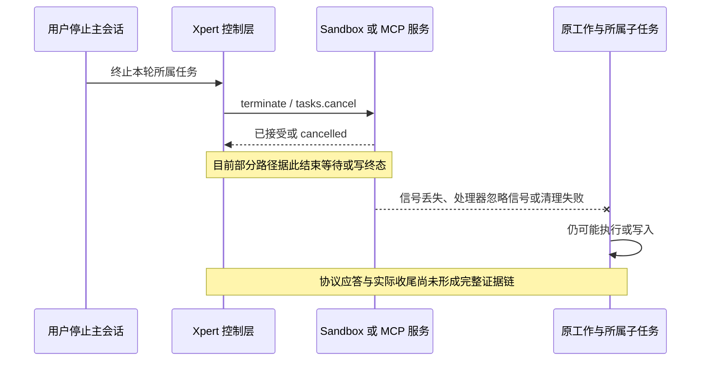
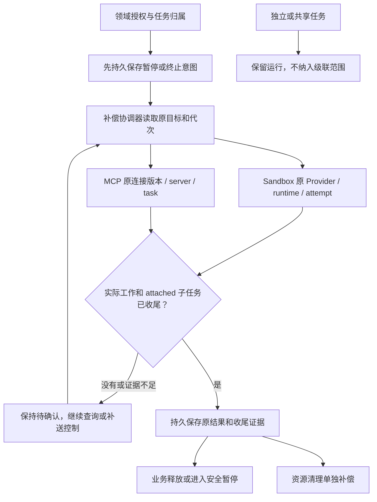
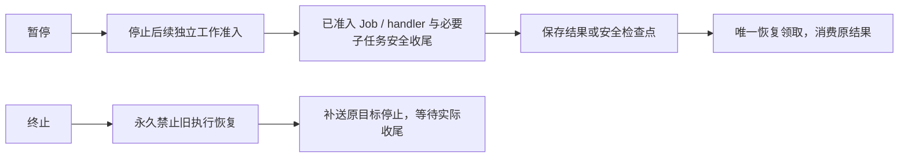

# 第三阶段 3.3：Sandbox Job 与 MCP 双端执行控制

日期：2026-10-24。状态：**3.3.1 的 Xpert 改动重新整理为第五批，待审核提交，未部署；Pro 配套与 3.3.2 留待后续批次审核**。下文保留批准时的问题与范围，实际行为、验证和边界见[功能文档](../execution-control.md#第三阶段-331sandbox-job-与宿主回调收尾)。

3.2 的 Xpert 改动已重新审核并提交为 `4820bf36b`；Pro 配套保持原暂存，待 Xpert 审核完成后再处理。原阶段实现参考提交为 Xpert `3ca914a9d`、xpert-plugins `9bef3e87`、Pro `ad823ee72`，不代表这些仓库的当前审核状态。本批不包含 ChatKit patch。已有能力见[功能文档](../execution-control.md)。

## 要解决的问题

3.2 已解决原宿主补送和受支持进程的收尾。3.3 补齐 Sandbox Job、MCP 消费方与发布方，以及这些任务调用的宿主工作。以下是方案批准时源码中的缺口；实施时须先隔离复现，再报告修复前后的实际计数，不把源码推断当成线上事故结论。

| 路径                         | 已有机制                                                                         | 尚需补齐                                                                                                                          |
| ---------------------------- | -------------------------------------------------------------------------------- | --------------------------------------------------------------------------------------------------------------------------------- |
| Sandbox Job                  | 幂等 Job、attempt、Provider/Binding/runtimeRef、容量租约及 `cleanupPending` 补偿 | `cancel()` 先写 `cancelled/finishedAt`，再停止；`finally` 释放容量，不以实际执行证据为条件。缺少 attempt 级的控制和收尾准入       |
| Sandbox 创建与重试           | 首次幂等键冲突保护、丢失 Job 的重新等待/重试                                     | 创建期间取消、迟到 runtimeRef、旧 attempt 的保存/清理与新 attempt 竞态；终止后的旧调用不能重新领取                                |
| Sandbox 宿主回调             | invocation 操作白名单、调用预算、AbortSignal、禁止迟到结果回写                   | `untilClosed()` 用 Promise.race 结束等待，真实 callback 可能还在运行。容器退出不能证明宿主回调及其子任务结束                      |
| Local Browser Provider       | 本机 Map、进程组停止和有限等待                                                   | 其他副本 Map 为空时 destroy 直接返回；父进程退出不证明所有后代退出                                                                |
| Docker / NsJail Job Provider | Docker 有容器停止/删除；NsJail 已有 cgroup kill、进程等待与回收                  | SPI 的 terminate/destroy 目前返回 void；缺少统一、可查询、按代次绑定的收尾回执。部分资源定位按 Job ID，须避免旧清理影响新 attempt |
| MCP 消费方                   | start/get/update/cancel/wait 和当前连接授权                                      | wait abort 后仅尽力调用一次 cancel，错误被忽略；远端任务引用及补送未持久登记，本地停止等待可能被展示为 cancelled                  |
| MCP 发布方                   | 持久 Task、请求幂等、队列、通知及轮询取消、执行前重验权限                        | 先撤回队列再保存 cancelled；handler 可继续运行。缺少稳定控制归属、领取 fencing、实际 handler/子任务退出回执                       |

MCP 发布方已有持久状态及轮询，不能简单归因于“没有持久取消”。本批要补的是控制意图先落库、队列领取和业务执行的竞态、以及实际收尾证据。

## 共同原理：三个事实分别记录

| 事实     | 说明                                                       | 能否释放执行限制                                       |
| -------- | ---------------------------------------------------------- | ------------------------------------------------------ |
| 控制意图 | 已请求暂停或终止，带单调版本                               | 不能                                                   |
| 执行收尾 | 原代次的实际工作及 attached 子树已结束，或到达安全暂停边界 | 对应执行限制才可释放或进入已暂停                       |
| 资源清理 | 容器、挂载、临时目录等清理成功或待补偿                     | 不能反推执行已结束；清理失败也不改写已持久化的成功结果 |

复用前两阶段的 TaskControl、受控队列、唯一准入及父子收尾许可，扩展明确的 `sandbox-job` / `mcp-task` 类型和共享证据契约。执行目标需明确保存原任务、attempt/执行 UUID、Provider 来源与 Binding、环境/宿主身份、MCP 连接版本与远端 task、控制版本。具体字段放在 contracts/SDK 的类型和边界 schema 中，不能靠名字、日志或 metadata 文本猜测。

控制 API 的失败、超时、404、租约过期、Map 为空都不自动证明已退出。只有在原环境身份已核对且 Provider 能证明该执行范围消失时，才把“资源不存在”解释为收尾证据。未知不触发 create、tools/call 或重发原始输入。

## 3.3.1：Sandbox Job、宿主回调及真实 Provider

建议先实施这个批次，形成可独立复现和验收的范围。

1. **稳定归属和代次准入。** 启动前持久登记任务与 attempt，CAS 领取后才创建 Runtime。创建请求使用稳定代次身份；句柄尚未返回时也能保存终止。迟到句柄只能绑定原 attempt，并立即遵守已有终止意图。进度、结果、清理、容量释放都按原代次条件更新。
2. **终止不可重开。** 对已终止控制根的同一调用拒绝恢复，不能沿用现有 lost/failed 分支自动开新 attempt。确需业务重试时建立显式的新调用身份，核验旧执行收尾；重复等待、断线恢复仍只能消费原结果。
3. **控制补送与 Provider 回执。** 在 SDK 增加声明式能力版本及原目标的停止/查询/收尾契约；Core 统一持久投递、退避和补偿，Provider 负责其执行边界。控制使用独立超时，不复用已 aborted 的业务 signal。原配置不再可解析时保持未知，不能改用最新 Provider/端点操作别的环境。
4. **宿主回调一起收尾。** callback 登记为该 Job attempt 的 attached 子工作。停止等待可立即结束 UI/协议交互，但保留真实 Promise 的收尾跟踪；回调发起的受控子任务也必须登记。回调不响应取消时保持待确认，不能因容器已销毁就释放。迟到结果不自动启动后续工作，也不重新调用 callback。
5. **容量与资源分离。** 旧执行未确认结束时保留容量占用与重试限制；Redis 租约过期不当作物理空闲，需结合持久未收尾记录续租/重建。执行已确认退出后，可按证据释放计算配额；挂载、目录等清理独立补偿。仍可能冲突的存储或环境继续受隔离限制，下一 attempt 使用独立目录及资源身份。
6. **边界内授权。** 沿用可信 tenant/organization/actor、业务归属和 Workspace 文件权限。正常查询和恢复重验当前权限；已接受的终止只允许沿原目标执行停止专用动作，不扩大成重新授权、启动或读取其他业务内容。

Provider 按实际模式分别验收：

| Provider                      | 实施内容                                                                            | 确认条件                                                                                |
| ----------------------------- | ----------------------------------------------------------------------------------- | --------------------------------------------------------------------------------------- |
| Local Browser                 | 复用 3.2 原宿主和监督器，保存原代次回执                                             | Linux 后代退出后确认；无可靠后代监督的平台保留 unknown                                  |
| Docker Sandbox Job            | 容器标签、runtimeRef 和清理都绑定 attempt；对准确容器停止、等待并核验               | 只确认这个 Job 的容器范围，不能因查不到另一引擎上的容器而确认；不销毁共享交互 Sandbox   |
| NsJail Compute / Document Job | 复用 cgroup、owner 记录与回收；将退出事实作为可查询回执持久保存，删除资源后仍可核对 | 原 runner 环境、Job 代次、cgroup 无存活工作及执行结束匹配；单独 terminate HTTP 200 不够 |

NsJail 的稳定 runtimeId 和 Docker 标签必须包含 attempt，旧控制不得按宽泛 Job ID 扫描并清理新 attempt。缺少 runtimeRef 的孤儿清理也须限定原代次。历史记录缺少这种信息时使用保守兼容路径，不给新任务制造强证据。

本批修改预计涉及 `xpert` 的 contracts/SDK、SandboxJob 服务与控制桥、Local Provider，及 `xpert-pro` 的 Docker/NsJail Provider 和 `.deploy/nsjail-runner`。OSS 与 Pro 共有的契约/宿主逻辑要同步；只在明确拥有这些能力的分发中接入具体引擎。

## 3.3.2：MCP 发布方与消费方闭环

发布方先提供真实收尾语义，再完成消费方的持久控制，作为一个批次验收。

**发布方（Xpert 执行别人发来的工具任务）**

- 复用现有 Task、幂等请求和权限恢复；先持久保存控制，再尝试队列撤回及原 handler 通知。接入 TaskControl 和受控队列；领取、执行、审批恢复和终止均绑定同一任务代次，重复 worker 不重新进入 handler。
- 协议中的 `cancelled` 与内部收尾状态分开。只有真实 handler 返回/抛错，且其登记的 attached 子工作已收尾，才提供可信完成证据。`finally`、AbortSignal、队列 remove 或 `Promise.race` 单独都不够。
- 为同平台客户端增加明确的能力协商和带版本的证据扩展，保留现有 MCP 消息兼容性；不得把扩展当作所有 MCP 服务都有的标准保证。外部请求默认建立独立控制根，只有经宿主验证的委托才能绑定内部父任务，不信任客户端自报 root ID。
- `input_required`、审批及恢复响应按请求身份去重。恢复只能使用已验证的检查点或持久结果；不得为了“继续”而重跑此前已经产生副作用的整段 handler。尚不具备安全点时保持等待，不自动暂停/终止或重启。

**消费方（Xpert 调用外部 MCP 任务）**

- 发起前登记稳定本地 operation、归属和固定连接来源；拿到远端 task ID 后先持久绑定，再等待。取消早于句柄时保留意图，迟到句柄必须补送；同平台可通过协商的幂等身份查询已创建任务。
- `tasks/cancel` 失败、响应丢失、连接重建或换 worker 后，补偿仍只 cancel/get 原任务；结果持久保存并只消费一次。第三方创建已接受但句柄丢失、又无幂等查询能力时保留未知，不重发 `tools/call`。
- 控制连接从平台保存的 toolset/server 配置及授权解析，固定原连接版本、服务身份和凭据引用。配置变化不能把旧 task ID 发到新服务；不接受工具结果里的任意控制 URL，不保存裸令牌。
- 区分“取消调用方等待”与“终止拥有的任务”。主会话只级联 attached 工作，独立/共享远端任务继续；本调用方停止自动消费。普通同步 MCP 调用没有可靠远端控制/证据时，只阻止后续调用并跟踪在途结果，不能伪装成已经强制停止。
- 分离等待信号与任务终止意图；暂停不能沿用当前 wait abort 分支去取消正在安全收尾的远端任务。
- 旧服务与第三方服务按声明和实际验证能力处理；只有请求终态、缺少可靠执行证据时保持待确认。不能通过关闭共享 MCP 服务来停止一个调用。

本批预计涉及 `xpert` 的 MCP Task 服务、队列桥、Consumer/ToolRuntime/Toolset 调用入口和 SDK/契约；Pro 对应宿主代码保持同步。原生插件工具通过宿主注入的控制上下文登记子工作，不要求业务插件另建控制数据库。管理员调试界面不在本批。

## 暂停、继续与终止的共同规则

- 暂停不通过 abort、断开连接、SIGSTOP 或销毁环境模拟。没有安全边界时显示正在暂停/待处理。
- 父节点等待子节点时，已准入节点的必要同步子任务保留收尾许可；不能父等子、子又被父暂停挡住。新业务分支仍禁止启动。
- 终止先提交则拒绝恢复；先准入的工作必须进入实际收尾流程。迟到暂停、结果或旧清理不能覆盖更高版本终止，也不能操作新代次。
- 取消既有外部副作用无法回滚。本方案防止自动重放和误释放，不承诺通用 exactly-once。

## 先复现、后修复的验收矩阵

| 场景                                               | 修复后必须证明                                                     |
| -------------------------------------------------- | ------------------------------------------------------------------ |
| Sandbox 在 A 执行、B 取消，通知丢失或 destroy 失败 | 原目标补送；退出前保持待确认和容量占用；启动、Action、工具各不重复 |
| 创建已接受但 runtimeRef 尚未保存，随后终止/崩溃    | 原代次可定位则只控制原运行，否则 unknown；不再创建业务工作         |
| 旧 attempt 的迟到状态和清理到达，新 attempt 已存在 | CAS 拒绝过期写入；新容器/cgroup/目录不被停止或删除                 |
| 容器已退出，宿主 callback 忽略 signal 并继续写入   | callback 实际结束前不能释放；迟到结果不重启后续工作                |
| 执行已结束，目录/挂载清理失败                      | 保留成功结果及执行证据；清理单独重试，不重跑 Action                |
| MCP cancel 请求或响应丢失                          | 重启消费进程后仍补送/查询同一 server/task；`tools/call` 保持 1 次  |
| MCP 协议 cancelled，但 handler 或其子任务继续运行  | 对外协议兼容，内部保持待确认；实际收尾后才释放                     |
| MCP 创建接受但句柄丢失                             | 同平台幂等查询原任务；不支持的第三方保持 unknown，不重发输入       |
| 队列领取、取消、审批恢复并发                       | 唯一启动/恢复；终止优先约束后续准入；已完成工具不重复              |
| 父子暂停互等、暂停后终止、恢复与终止竞态           | 必要子任务可收尾；保存原结果；旧执行不能恢复                       |
| attached / detached / shared 并存                  | 只终止本轮 attached；独立/共享任务持续运行                         |
| 连接修改、租户不符、权限撤销、旧端点/错误回执      | 不切换到新目标；查询/恢复拒绝；停止专用路径只控制原授权目标        |
| 数据库/Redis 重建、容量租约过期、Provider 失联     | 未知执行不算已退出，不自动给旧调用开新 attempt                     |

验收采用隔离 PostgreSQL/Redis、多 worker、真实可控进程、实际 Docker/NsJail 边界，以及本地可控 MCP server + Xpert 发布方/消费方集成。展示启动、Action/handler、工具和结果消费计数及旧代次/新代次隔离结果。NsJail 需要真实 cgroup 权限环境；缺少时列为未验收，不能用 mock 代替。

每批先保存能复现故障的回归用例，再实现并展示前后结果，更新[功能文档](../execution-control.md)，完成后交用户审核。旧表/JSON 字段升级附迁移和索引，不给历史记录补造退出证据；受控队列和补偿只使用已验证的能力。新增后端配置仍经 `@xpert-ai/server-config` 管理；若触及容量配置，按现有规范迁移对应直读环境变量，不扩展成无关配置重构。

## 本轮审核边界

建议按 **3.3.1 Sandbox → 3.3.2 MCP 双端** 分批实施、分批复现及验收。复用已有队列和控制机制，不做透明任务迁移、通用远端接管或任意交互 Sandbox 的整体销毁。

3.2 已说明的 macOS 强确认、远端 OpenCode 证据不足边界不在本批自动变更。ChatKit 继续简短连接/控制提示和按钮状态，不展示内部代次与进程细节，不提交 patch；暂不部署。

## 源码依据

- [Sandbox 生命周期、取消、attempt 与清理](../../packages/server-ai/src/sandbox/sandbox-job/sandbox-job-runtime-capability.service.ts)、[宿主 callback](../../packages/server-ai/src/sandbox/sandbox-job/sandbox-job-invocation.ts)、[容量](../../packages/server-ai/src/sandbox/sandbox-job/sandbox-job-capacity.service.ts)。
- [Provider SPI](../../packages/plugin-sdk/src/lib/sandbox/runtime-provider.ts)、[Local Provider](../../packages/server-ai/src/sandbox/sandbox-job/local-browser-runtime.provider.ts)。
- [Docker Job Provider](../../../xpert-pro/packages/server-ai/src/sandbox-docker/plugins/docker-runtime.provider.ts)、[NsJail Job Provider](../../../xpert-pro/packages/server-ai/src/sandbox/nsjail/nsjail-job-runtime.provider.ts)、[NsJail 进程与 cgroup](../../../xpert-pro/.deploy/nsjail-runner/compute_process.py)、[Runner API](../../../xpert-pro/.deploy/nsjail-runner/server.py)。
- [MCP 消费方等待与取消](../../packages/server-ai/src/mcp-consumer/tasks/mcp-consumer-tasks.ts)、[Toolset task 桥](../../packages/server-ai/src/xpert-toolset/provider/mcp/mcp-toolset.ts)、[当前授权连接](../../packages/server-ai/src/mcp-consumer/runtime/mcp-client-connection.service.ts)。
- [MCP 发布方 Task/队列/取消](../../packages/server-ai/src/mcp-publication/mcp-task.service.ts)、[执行前权限恢复](../../packages/server-ai/src/mcp-publication/mcp-task-execution.service.ts)、[稳定控制账本](../../packages/server/src/task-control/task-control.store.ts)。
