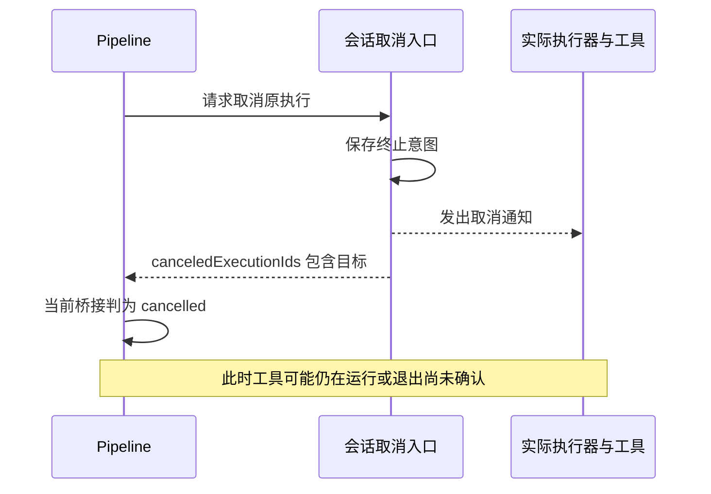
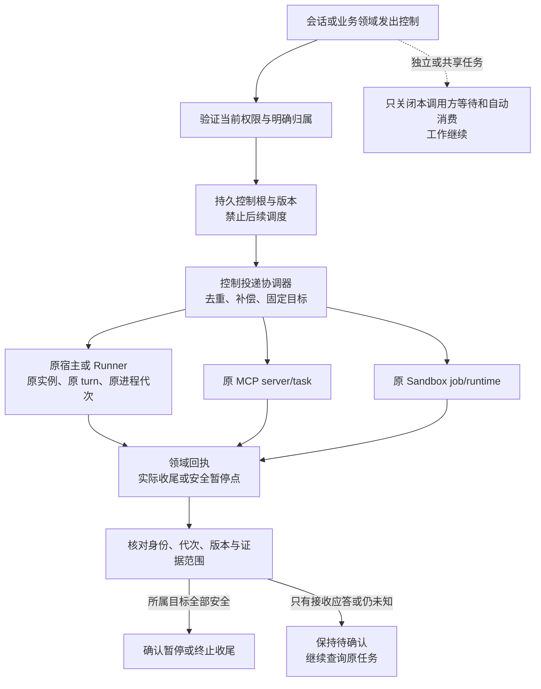
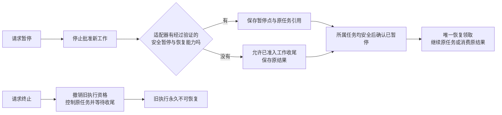

# 第三阶段执行控制实施方案

日期：2026-10-23；更新：2026-10-25。状态：Xpert 3.1、3.2、3.3.1 已审核并重新提交；3.3.2 作为第六批待审核提交，均未部署。Pro 配套在 Xpert 审核完成后单独处理。已实现行为、支持边界与回归见[功能文档](../execution-control.md#第三阶段-31收尾证据与业务桥接)。

3.1 提交：`94bc86fb6`；3.2 提交：`4820bf36b`；3.3.1 提交：`47c4d1701`。3.2 的具体边界、实施顺序和验收见[原执行宿主与进程控制方案](issue-1217-execution-control-phase-3-2.md)。

第二阶段已提交为 `7eb273ccb`，已实现的控制树、持久意图、跨线程恢复和队列领取规则见[功能文档](../execution-control.md)。第三阶段要把这些规则接到实际执行器和业务编排领域：控制必须到达原任务，只有可信的收尾证据才能释放所属运行。

## 当前问题

第二阶段能保存终止意图并补送控制，但部分领域仍以“已接受取消”表示取消结果。它们与实际进程、工具或子任务的退出之间还有一段距离。如果上层提前认定结束，后续运行可能与旧工作重叠。

最明确的例子是 Pipeline 的原生 Assistant 桥接：`cancelTask()` 返回的 `canceledExecutionIds` 包含目标 ID 后，桥接立即生成 `status: cancelled`。该兼容字段只说明请求涉及哪些执行，不能证明工具和所属任务都已收尾。以下是源码路径确认的风险，需在实施时先做隔离复现，不能直接当作 Issue #1217 现场根因。

| 路径                    | 已有机制和具体缺口                                                                              | 第三阶段处理                                                                        |
| ----------------------- | ----------------------------------------------------------------------------------------------- | ----------------------------------------------------------------------------------- |
| Pipeline Assistant 桥接 | 把取消 ID 列表转为终局回执；Pipeline 自身已有等待 operation 终局的汇总                          | 桥接改读真实控制回执；pending/unknown 不能提前释放业务运行                          |
| 进程型 Runtime          | Codex/Pi 的 ProcessRuntime 及 Claude 使用进程内运行对象；另一个副本无法凭自己的注册表控制原宿主 | 持久登记宿主和原执行代次，送达原宿主；宿主失联保留未知，不另起业务                  |
| OpenCode 远端服务分支   | 当前把 `/session/.../abort` 返回 true 映射为 cancelled                                          | 核对服务协议的确认含义，并观察原 turn 的终局；未验证的应答只算接收                  |
| Computer Runner         | SDK 已区分 exited/stopping/unknown；xpert-pro 的实现已有实例校验、授权撤销和进程清理            | 复用现有事实，接入稳定控制根和投递版本；验证迟到控制不会打到复用环境中的新运行      |
| Desktop Shell           | cancel_requested 入库、Gateway 补发，设备持久日志和进程 close 后报告                            | 将操作及所属进程范围接入控制树；验证子进程收尾，不能只用发信号或父 shell 退出作证明 |
| Sandbox Job             | 先写 cancelled/finishedAt，再 terminate 和 destroy；cleanupPending 另存                         | 分开取消意图、执行收尾和资源清理；destroy 返回的证据由具体 provider 确认            |
| MCP 消费方              | wait 被 abort 后尝试 tasks/cancel，失败被忽略；此路径没有持久取消补偿                           | 保存原 server/task 引用、控制意图和投递；补偿只控制或查询原 task                    |
| MCP 发布方              | 保存 cancelled 后通知和轮询 abort；该字段描述请求状态，未单独证明 handler 退出                  | 保留协议兼容状态，另记内部执行回执；接入受控队列和真实 handler 收尾                 |
| Project 与群任务        | 领域拥有独立调度、取消和结果处理规则；群控制返回 accepted                                       | 由各领域命令控制所属运行，复用第二阶段屏障；业务结果、投递撤回和运行退出分别处理    |

## 控制如何到达实际工作

沿用第二阶段稳定任务树，增加领域目标适配和可核验的执行回执，不另建一套通用业务调度器。

### 持久身份与送达

目标记录至少关联稳定控制节点、领域任务 ID、原 provider 来源、宿主/环境实例、执行尝试或 turn 代次。具体契约使用有版本的类型联合，进入 contracts / plugin-sdk；不从任务名、background 模式或日志文本推断类别。句柄未返回时保留待绑定意图，迟到句柄仍受已保存的终止约束。

控制命令沿用持久投递和领取租约，加入目标代次及控制版本。网络调用在事务外进行，使用独立于业务 abort 的受限信号。目标先保存接收状态，再执行控制；只对明确幂等的动作重投，其他动作通过查询原操作核对。控制响应丢失和宿主重启都不能触发 `start` 或重发业务输入。

对进程内 Runtime，增加宿主定向控制与持久回执。宿主活着但 API 请求落到其他副本时，仍能送到原宿主；宿主已丢失且没有持久 supervisor/Runner 接管能力时，保留未知和准入限制。不能把宿主租约过期、Map 查无记录或 PID 不存在直接提升为所有后代已退出。后续可复用受管 Runner 扩展接管能力，不以重启原任务代替恢复。

Computer/Desktop 复用既有执行环境和日志。控制必须精确到本次操作及被授权的所属进程，不关闭整个共享设备、容器、session 服务或其他业务运行。进程代次和环境实例校验必须先于发送信号，防止 PID 或 session 被复用后误伤新工作。

### 请求与执行事实分开保存

| 事实                            | 含义                                                              | 能否确认所属运行已停止                     |
| ------------------------------- | ----------------------------------------------------------------- | ------------------------------------------ |
| 控制意图已持久化                | 不再批准旧执行的后续工作                                          | 不能                                       |
| 控制请求已接收                  | 原执行器收到命令                                                  | 不能                                       |
| 协议返回 cancelled 或 HTTP 成功 | 仅按该适配器已验证的语义解释                                      | 默认不能；需匹配明确的终局证据契约         |
| 原操作及所属工作已收尾          | 实际 handler 返回、目标进程集合退出，或服务提供可信的原 turn 终局 | 可以结算该目标；仍需汇总其他 attached 目标 |
| 安全暂停回执                    | 已持久化进度、没有未跟踪的在途副作用、允许按原身份继续            | 可参与暂停汇总，不能当终止                 |
| 资源清理完成                    | 临时文件、租约或专属环境已释放                                    | 单独记录；不等同于任务结果或进程退出       |
| 未知或失联                      | 无法取得上述证据                                                  | 保持待确认，不自动重放                     |

回执记录证据来源、目标身份、执行代次、适用控制版本和覆盖范围。迟到暂停回执不能覆盖终止；旧执行回执不能释放新执行。业务已经成功时，迟到终止不把成功改成失败，但后续调度仍受终止限制。

对于共享远端服务，目标是本次 turn 及其所属工作的终局，不要求关闭整个服务进程。对于本机进程树，单个父进程 close 不足以证明独立存活的后代全部结束。无法证明的部分保持未知，并明确暴露在后端诊断中。

### 暂停与终止

本阶段默认沿用安全边界暂停；只有逐适配器验证了持久暂停点和恢复幂等性，才启用远端原生 pause/resume。协议 interrupt/cancel、SIGSTOP 或断开连接均不自动等同于可恢复暂停。等待收尾超时只保持正在暂停或待确认，不能自动升级为杀进程。

父子暂停继续遵守完整节点原则：已准入的同步收尾依赖可以完成，不能一边禁止子任务开始、一边等待父节点结束。没有持久等待回执的适配器不得把半个节点暂停成普通失败，导致恢复重放已完成工具。终止与恢复竞争时，以持久准入顺序为准；终止先提交则拒绝恢复，恢复先准入则作为在途工作继续控制，不能承诺已经开始的副作用消失。

## 各领域的控制边界

Project/Pipeline 和群任务可以拥有独立控制根。主会话暂停或终止只影响本轮 attached 子树，以及本调用方的等待和自动结果消费。已独立受理的业务任务继续运行；只有对应业务入口的授权取消，才控制该领域拥有的工作。第三阶段不把第二阶段明确 detached 的领域任务悄悄改成主会话附属任务。

Pipeline 继续负责暂停调度、证据收集和业务验收；稳定控制树负责执行资格和运行收尾。两者通过类型化桥接传递事实。成功/失败的业务结果保留，原生 Assistant 桥接不得再把 `canceledExecutionIds` 当作终局。群控制保留已有成员投递撤回规则，核对当前成员、消息回执和 run 关联，不扩大到其他成员或未来消息。

MCP 消费方按固定连接配置及当前授权重新建立控制连接，不能把 model/插件自报 URL 当控制目的地。原 server 或 task 无法解析时保留未知；第三方同步工具没有远端取消能力时，阻止后续调用并跟踪在途结果，不伪装成可强制停止。MCP 发布方的内部真实执行回执与协议字段分开，兼容原客户端。

正常控制和恢复继续校验当前领域权限。权限撤销后的清理只能复用或定义明确授权的停止专用通道：限定已持久归属的原任务，不允许启动、恢复、读取业务内容或跨租户寻址。不能因清理方便绕过资源授权。

## 按风险安排实施

建议第三阶段分三个可单独审核的交付批次，后续批次复用前一批的证据契约。

| 批次                   | 实施范围                                                                            | 完成条件                                                                                           |
| ---------------------- | ----------------------------------------------------------------------------------- | -------------------------------------------------------------------------------------------------- |
| 3.1 收尾确认与业务桥接 | 类型化控制证据；Pipeline Assistant/Runtime、Project 和群控制接入；保留各领域调度权  | 先重现取消已接受但工具仍运行时被提前判终局；修复后保持待确认，实际收尾后才释放；独立业务任务不误停 |
| 3.2 原执行宿主与进程   | ProcessRuntime、Codex/Pi/Claude、OpenCode；Desktop Shell；xpert-pro Computer Runner | 两副本控制到达原宿主；重启/失联不重放；旧 turn、旧 PID/实例回执不误伤新工作；实际后代退出证据通过  |
| 3.3 Sandbox 与 MCP     | Job/runtime 归属、执行与清理分离、MCP 双端持久控制与实际 handler 回执               | cancel/destroy 失败可补偿；原任务查询及取消不重复启动；协议应答不能伪造物理收尾；共享环境不被销毁  |

3.1 的证据契约需为后续适配器保留明确的“不支持/未知”状态；不能为完成第一批而给所有旧适配器默认宣称强确认。每批先重现，再修复并更新功能文档；完成一个适配器不代表同名模型或同族 provider 自动获得相同能力。

代码涉及 `xpert`、`xpert-plugins/xpertai/integrations/agent-runtimes`，以及 Computer 实现所在的 `xpert-pro`。实现时分别提交最小改动并核对宿主与 SDK 版本；第二阶段已提交；3.1 仅修改 xpert 宿主、contracts 和 SDK，后续批次的外部插件及进程控制实现尚未修改。插件改动须按所在仓库要求通过构建、回归和 plugin-dev-harness 生命周期验收，全部使用隔离环境，不安装到业务环境。

## 必须通过的回归

| 故障或竞争                                              | 需要展示的证据                                                            |
| ------------------------------------------------------- | ------------------------------------------------------------------------- |
| Pipeline 已收到取消 ID，工具忽略 abort 继续运行         | 保持取消中/待确认；工具实际结束后才确认，完成次数为 1                     |
| 副本 B 取消副本 A 启动的进程；通知丢失                  | 控制到达原宿主或明确未知；业务 start 次数仍为 1                           |
| 启动后未收到句柄，随后终止、宿主重启                    | 迟到原句柄补送；未知启动不重发，重建控制补偿不重建业务                    |
| 控制应答丢失、重复命令、多个补偿 worker                 | 同一身份/版本幂等或只查询；不重复启动、执行工具或消费结果                 |
| 旧 turn 控制迟到，环境/PID/session 已复用               | 拒绝不匹配代次；新运行和兄弟任务不被终止                                  |
| 父进程退出但所属后代仍运行                              | 不能以父 close 或发送 SIGKILL 的返回值伪造整棵树退出                      |
| 暂停后继续、暂停后终止、恢复与终止并发                  | 原暂停边界有效；已完成工具不重放；终止不可被旧恢复撤销                    |
| 父节点等待子任务，同时暂停                              | 合法收尾依赖完成或保存可恢复等待回执，无父子互等                          |
| Sandbox terminate/destroy 失败或状态查询断连            | 意图、运行事实和 cleanupPending 分开；未知保持限制                        |
| MCP tasks/cancel 失败、协议 cancelled 但 handler 未返回 | 持久补偿继续；等待真实回执，不提前释放所属运行                            |
| detached/shared、共享容器和其他订阅者                   | 工作及其他消费者继续；本调用方不自动续跑                                  |
| 撤销授权、跨组织、provider 升级/替换、旧 worker         | 普通恢复和越权控制被拒绝；只有明确授权的原目标清理可执行；不切换 provider |

测试分层包括真实服务与数据库状态机、隔离 PostgreSQL/Redis 多进程、可控子进程及 MCP server、真实 Desktop/Computer/Sandbox 适配器验收。每个适配器记录实际请求/执行次数、目标代次、确认来源及结果。未具备真实环境验收条件的适配器保持未验收，不用通用 SDK mock 测试代替。

## 兼容与交付范围

历史任务不推断归属、不伪造退出证据。新增契约按能力版本启用；混合版本期间，未实现新检查的 worker 不得承接新受控任务。新增配置仍统一由 `@xpert-ai/server-config` 管理，业务通过 `getConfig()` 使用。

本阶段补齐后端最小汇总和诊断事实，ChatKit 仅消费简短状态及按钮能力。管理员 debug 界面、全链路产品交互收口留在第四阶段。数据清理策略、生产发布和升级执行另行审核；本方案不授权部署，也不提交 ChatKit patch。

## 源码入口

- [Pipeline Assistant 取消桥接](../../packages/server-ai/src/xpert-project/pipeline/runtime/pipeline-assistant-bridge.service.ts)、[Pipeline Runtime 桥接](../../packages/server-ai/src/xpert-project/pipeline/runtime/pipeline-runtime-bridge.service.ts)、[Pipeline 终止汇总](../../packages/server-ai/src/xpert-project/pipeline/runtime/pipeline-cancellation.ts)。
- [群成员控制](../../packages/server-ai/src/chat-group/group-control.service.ts)、[第二阶段控制协调器](../../packages/server-ai/src/agent-invocation/task-control-coordinator.service.ts)。
- [Runner 契约](../../packages/plugin-sdk/src/lib/agent/runtime/execution-runner.ts)、[Desktop 操作](../../packages/server-ai/src/desktop-shell/desktop-shell-operation.service.ts)、[Gateway 补发](../../packages/server-ai/src/desktop-shell/desktop-shell.gateway.ts)、[Desktop 进程引擎](../../apps/desktop/electron/shell/engine.cjs)。
- [Sandbox Job 控制和清理](../../packages/server-ai/src/sandbox/sandbox-job/sandbox-job-runtime-capability.service.ts)、[MCP 消费方](../../packages/server-ai/src/mcp-consumer/tasks/mcp-consumer-tasks.ts)、[MCP 发布方](../../packages/server-ai/src/mcp-publication/mcp-task.service.ts)。
- 同级 `xpert-plugins` 仓库：`xpertai/integrations/agent-runtimes/src/lib/process-runtime.ts`、`jsonl-process.ts`、`codex.strategy.ts`、`claude.strategy.ts`、`pi.strategy.ts`、`opencode.strategy.ts` 及 Computer 策略。
- 同级 `xpert-pro` 仓库：`packages/server-ai/src/computer/cli/computer-agent-runner.service.ts`、`computer-cli-stop.ts`。
