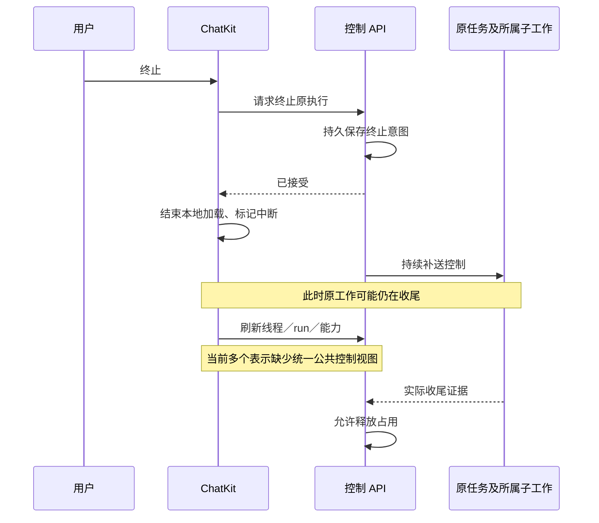
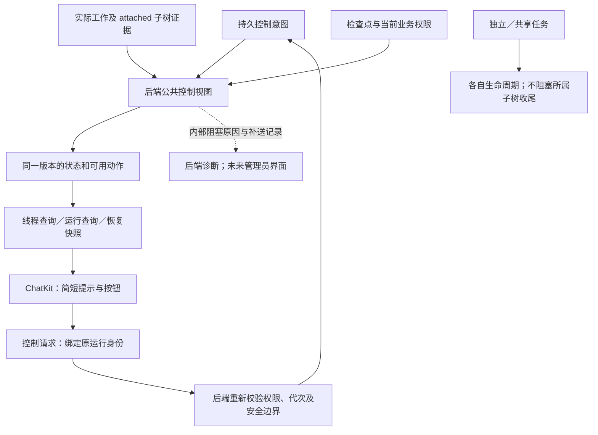

# Issue #1217：第四阶段——统一控制视图与全链路验收

日期：2026-10-24；分批审核更新：2026-10-26。状态：**第七批 4.1 Xpert 后端待审核，未提交、未部署**。已实现功能见[功能文档](../execution-control.md#41统一公共控制视图)；4.2、4.3 仍为后续方案。下文 4.1 问题与方案保留为实施前的设计记录。

3.3.2 Xpert 已按审核意见重新提交为 `b21c640d7`。Pro、独立 SDK 与 ChatKit 配套改动另行审核；ChatKit patch 不纳入，未推送、发包或部署。已实现能力及限制见[功能文档](../execution-control.md)。第四阶段沿用[原升级计划](./issue-1217-execution-pause-and-termination.md#6-分阶段实施和审核)，不重新实现各执行器的取消机制。

## 优先解决的问题

后端现在会区分“接受终止”和“实际收尾”，但面向聊天客户端的状态和按钮能力尚未统一。刷新、断线恢复或旧响应晚到时，客户端仍需拼接本地 loading、线程状态、run 状态及 runControl 判断。这会使界面结束等待与后端完成收尾发生在不同时间。

| 已核对的源码事实                                                                                                               | 影响与待验证风险                                                             |
| ------------------------------------------------------------------------------------------------------------------------------ | ---------------------------------------------------------------------------- |
| `ThreadDTO` 直接返回持久 `runControl`，其中已有 checkpoint、inputNodes、pendingFinish 等内部字段                               | 公共表示与内部状态机耦合；不符合技术细节留在后端的边界                       |
| run 查询及 activity 快照主要返回执行业务 status                                                                                | 业务结果不能单独表示 attached 子树是否收尾，也不能决定是否可继续或发送下一轮 |
| capabilities 入口目前只返回 canRetry                                                                                           | 暂停、继续、终止、输入续接和发送新消息没有统一的后端能力投影                 |
| ChatKit 的 stop 在取消请求成功后 disconnect、清除 loading 并标记本地中断；按钮另由 loading、thread.status、runControl 组合判断 | 页面刷新、控制响应丢失、SSE 中断和收尾延迟的组合需要一致性回归               |
| 后端已有真实收尾证据、线程占用与恢复准入保护                                                                                   | 本阶段复用这些保护；不能把界面风险描述为“后端已允许重复执行”的既成事实       |

以上是源码确认的接口缺口；具体可见故障必须先隔离复现，不能直接当作线上事故结论。客户端已有连续 503 的连接恢复保护，应保留并补充与控制状态交叉的测试。

## 分批范围

| 批次 | 范围                                                                       | 本次建议                          |
| ---- | -------------------------------------------------------------------------- | --------------------------------- |
| 4.1  | 后端统一控制视图、状态与按钮一致性、必要 SDK/ChatKit 接入；组合故障回归    | **先实施，完成后审核**            |
| 4.2  | 完整多进程任务链、混合版本准入与升级演练；Web/Desktop/Pro 产品链路分别验收 | 后续细化，不以 4.1 的组件测试替代 |
| 4.3  | 管理员只读诊断界面、权限、任务树与补送证据查询                             | 独立产品方案，暂不实施            |

4.1 不扩展第三方 Runtime/MCP 的强终止能力，不恢复丢失的任意 JavaScript 栈，不自动释放未知工作，也不增加“强制标为完成”操作。原有受控队列已按 control-v2 使用独立队列，4.2 应验证剩余协议代次及业务处理器兼容性，不能笼统假定当前完全没有旧 worker 隔离。

## 4.1 的原理与方案

### 一个公共视图，复用现有证据

由所属领域提供类型化查询，在一致的数据库视图中组合线程、控制根、已登记的 attached 子树收尾证据与检查点。复用 `ExecutionControlEvidenceService` 和领域现有证据，不让公共查询重新解释 MCP cancelled、Sandbox 状态、404 或 TTL。

公共契约只表达显示状态、原运行标识、用于判断新旧的视图版本，以及 `canPause`、`canResume`、`canTerminate`、`canSend`、`canRetry`、`canRespond` 等实际需要的能力。字段名称在共享 contracts/SDK 中统一。业务成功/失败结果仍独立保存；“正在收尾”不能把成功改成取消。

所有动作必须结合当前访问权限。恢复能力还依赖安全检查点、图兼容性、未被终止及尚未领取等条件，不能仅看 paused。`canRespond` 专指已有输入请求的续接，不允许借补充输入新开一轮。

现有 capabilities、线程详情和 run/activity 入口复用同一投影逻辑；避免每次历史列表加载都扫描整棵任务树。当前运行与恢复入口提供完整公共视图，历史已收尾记录采用其已确认摘要。状态读取不调用远端工具、不触发 tools/call，也不因查询失败更改执行结果。

### 防止乱序和刷新倒退

视图绑定 thread、run/generation 和独立的单调视图版本。控制意图 revision 不能直接充当视图版本：子任务收尾或输入等待变化时，根意图可能没有变化。

投影发布在原线程／控制根的既有互斥规则下读取、比较并保存版本；不允许拿锁前的旧快照覆盖新投影。状态与能力必须来自同一快照。新 HTTP 响应、SSE 快照和刷新按同一身份及版本合并，切换线程后丢弃旧订阅响应。消息展示快照的事件位置继续使用已有机制，不与控制视图版本混用。

查询 503 或 SSE 断开只改变连接提示，不把任务变成失败或已终止。保留最后一次确认状态，并禁止凭过期数据恢复或新开冲突运行；恢复连接后读取当前完整快照。控制请求使用独立 HTTP 路径，不因 SSE 已断开就停止补送。

### 暂停与终止保持不同语义

| 实际情况                         | 界面简短提示   | 操作原则                                       |
| -------------------------------- | -------------- | ---------------------------------------------- |
| 正常运行                         | 正在运行       | 根据能力允许暂停／终止                         |
| 暂停已接受，当前节点尚未安全结束 | 正在暂停       | 不允许继续或新一轮；仍允许终止                 |
| 等待完成当前工作的必要输入       | 等待输入       | 允许已授权的原输入续接；暂停不封死必要子任务   |
| 已到达安全暂停点                 | 已暂停         | 校验通过才允许继续；可以终止                   |
| 图已返回、所属子工作仍在结束     | 正在收尾       | 保留占用，不允许新一轮；控制能力由后端判断     |
| 终止已接受、实际工作仍未结束     | 正在停止       | 不允许恢复或新一轮；补送由后端持续执行         |
| 缺少可靠收尾证据                 | 正在确认状态   | 不虚报完成、不启动替代执行                     |
| 原执行及所属子树已结束           | 已完成／已停止 | 根据结果及权限开放后续动作；旧终止执行不可恢复 |

连接恢复提示是独立维度，例如“正在恢复连接”，不能覆盖持久任务状态。终止响应成功仅确认请求已接受；重复终止同一目标保持幂等，不能因页面已切换而终止新运行。

父任务暂停时，已准入节点、必要子任务及必要输入允许收尾；如果子任务还需要父级展示输入，必须提供原请求的响应通道，不能形成父等子、子等父。detached/shared 继续自身生命周期，也不作为本轮 attached 收尾的阻塞项。

### 内外表示和兼容

公共 DTO 不再直接序列化整个持久 runControl。保留旧 SDK 必需的白名单字段和 opaque 恢复标识作为兼容过渡，新增内部字段不再自动暴露。checkpoint、节点名、原宿主、generation 细节、重试栈、控制回执和 pendingFinish 留在后端。

ChatKit 只消费简短提示与能力布尔值；原运行标识和版本仅用于请求及防乱序，不做技术信息展示。先更新 `@xpert-ai/xpert-sdk` 的契约与 Client，再接入 ChatKit 维护源码，不能以直接 fetch 或新 patch 绕过 SDK。现存 ChatKit patch 及其锁文件改动继续排除提交。

后端保存稳定阻塞原因和可关联请求记录，便于测试及后续管理员查询；不把模型输入、工具参数、输入回答、凭据或整份结果作为诊断载荷。4.1 不新建管理员页面，也不提供绕过真实收尾的解除占用按钮。

### 授权与并发边界

查询沿用原会话、Assistant、Project 或 Publication 授权入口，不能额外要求运行用户具有作者工作空间权限。公共能力只是操作提示；每次控制或恢复仍在领域内重新校验权限、精确目标、版本及准入，不能信任客户端传来的 canResume 等字段。

终止先提交则旧恢复请求拒绝；已准入的继续仍受随后终止约束。迟到控制响应、输入响应或事件只能更新原目标，不能覆盖新一轮。已完成工具仅从账本/检查点读取原结果，不因 UI 刷新、轮询、继续或输入重发而重新执行。

## 4.1 先复现、后修复的验收矩阵

| 故障注入                                                 | 修复后必须证明                                                                |
| -------------------------------------------------------- | ----------------------------------------------------------------------------- |
| 取消返回成功，handler 忽略 signal；关闭并重新打开页面    | 始终显示正在停止／确认；实际收尾前不能继续或新开，执行计数不变                |
| 根图结束，attached MCP 或 Sandbox callback 仍运行        | 公共视图仍正在收尾；实际结束后状态与按钮一同变化                              |
| 旧 running 快照晚于 paused/terminated 到达；立即切换线程 | 旧版本被忽略，不能恢复按钮或污染新线程                                        |
| 连续 503、SSE 中断、控制响应丢失后恢复                   | 连接问题不改执行终态；单一恢复链，不叠加轮询，不重发业务调用                  |
| MCP input_wait 下暂停、必要输入、父子互等                | 原输入可完成必要收尾；下一无关节点不启动；继续后工具仍一次                    |
| 暂停→继续、暂停→终止、恢复与终止并发                     | 恢复唯一准入，终止后旧执行与旧输入不可恢复                                    |
| attached、detached、shared 同时存在                      | 只受控本轮所属子树，独立／共享任务继续且不阻塞本轮终态                        |
| 第三方 ack、404、TTL、宿主失联、旧代次回执               | 未知保持未知，不能释放或用新任务替换旧任务                                    |
| 只读权限、撤销授权、跨租户、仅 Assistant 运行权限        | 能力与实际接口权限一致；越权拒绝；不误加作者权限要求                          |
| 公共 JSON 响应和旧 SDK 兼容                              | 不含 checkpoint、inputNodes、pendingFinish 等内部字段；旧客户端必要控制仍可用 |

验收记录公共视图版本、按钮状态、工具/handler/start 次数、结果推进次数和真实收尾时间。使用隔离 PostgreSQL/Redis、可控真实 HTTP MCP、已有 Sandbox 控制夹具及前端集成测试；新增的同一任务树组合测试必须覆盖从 API 到控制账本和界面的实际桥接，不能只测试纯布尔函数。

主仓库与 Pro 分别验证公共后端路径。Web 与 Desktop 使用实际客户端检查刷新、重连及简短提示；仅浏览器验证不能算原生 Desktop 验收。4.2 再安排完整独立 OS 进程部署链及混合版本演练；4.1 不提前声称所有 Project/Desktop/Provider 链路已覆盖。

完成后追加功能文档，展示相同故障的修复前后结果，交用户审核。仅获得 4.1 批准时不自动实施 4.2/4.3；提交和部署仍分别授权。

## 源码依据

- [ThreadDTO 的 runControl 投影](../../packages/server-ai/src/ai/dto/thread.dto.ts)、[run 查询](../../packages/server-ai/src/ai/thread.controller.ts)、[activity 快照](../../packages/server-ai/src/ai/thread-activity/thread-activity.service.ts)。
- [现有 canRetry 入口](../../packages/server-ai/src/ai/thread-recovery/thread-recovery.controller.ts)、[控制字段](../../packages/contracts/src/ai/chat.model.ts)。
- [后端一致证据查询](../../packages/server-ai/src/execution-control/execution-control-evidence.service.ts)、[线程占用与控制准入](../../packages/server-ai/src/chat-conversation/thread-run-control.service.ts)。
- [ChatKit 按钮推导](../../../chatkit-js/packages/chatkit-ui/src/components/chat/session/useChatRunControl.ts)、[取消响应后的本地处理](../../../chatkit-js/packages/chatkit-ui/src/providers/stream/runs/useStreamRunControl.ts)。
- [已有受控队列隔离](../../packages/server/src/managed-queue/constants.ts)、[领取校验](../../packages/server/src/managed-queue/controlled-job.ts)。
