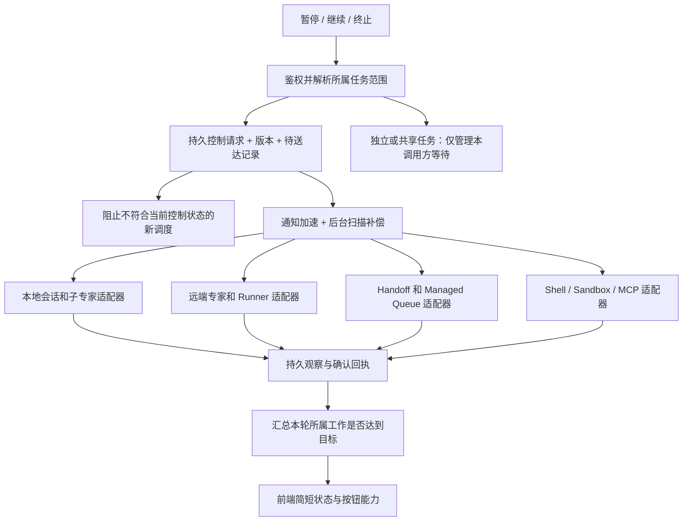
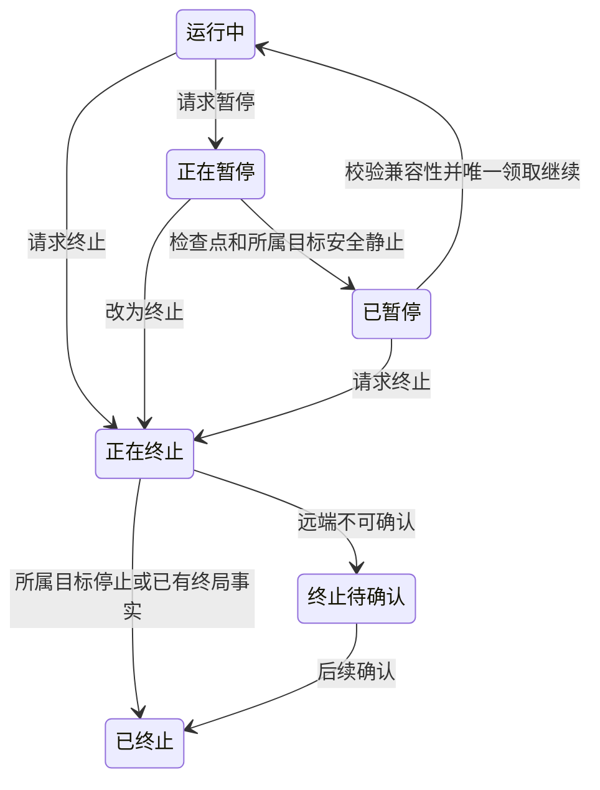

# #1217：会话、外部专家与后台任务的暂停和终止升级计划

- 日期：2026-10-23。
- 状态：第一、二阶段已有实现；第一批已重新审核提交，第二批重新分层待审核提交，未部署。第三、四阶段仍为升级计划，源码调查章节保留初始设计时的事实。
- 已实现功能见[会话执行控制功能文档](../execution-control.md)，后续完成的阶段继续追加到该文档；本文保留升级设计和待实施范围。
- 用户已确认：停止主会话时级联停止本轮所属任务；明确独立或共享的任务继续运行。
- 关联：[Issue #1217](https://github.com/xpert-ai/xpert/issues/1217)。取消竞态已经在本地隔离探针中观察到，但不能认定其是事故现场 503 或长时间 Thinking 的原因。
- 本轮新增：把暂停、继续、终止放入同一套控制范围，分别定义语义、送达与确认条件。

## 1. 产品语义

**暂停保留续跑机会；终止结束本次执行的调度资格。两者都必须控制本轮拥有的工作，不能只改变会话状态。**

| 行为                     | 暂停                                                     | 终止                                           |
| ------------------------ | -------------------------------------------------------- | ---------------------------------------------- |
| 新节点、新工具、新子任务 | 停止批准，保留尚未执行的意图                             | 拒绝批准，取消尚未执行的意图                   |
| 已开始的本地工具         | 等到可持久化的安全边界；不默认 abort                     | 传递取消；确认实际执行退出或结果已终结         |
| 外部专家                 | 有明确暂停能力则暂停；否则等待当前任务结束后停止后续调度 | 向原任务发送终止请求，持续核实原任务结果       |
| 尚未开始的队列任务       | 保留任务并禁止领取；不能暂停整个共享物理队列             | 持久标记取消，并移除或拒绝消费目标任务         |
| 独立或共享任务           | 任务继续，本调用方不自动消费结果并续跑                   | 任务继续，仅解除本调用方等待与自动续跑关系     |
| 恢复                     | 从已确认的检查点和原任务句柄继续                         | 不恢复这次已终止的执行；另起请求需明确用户意图 |
| 用户提示                 | 正在暂停 → 已暂停；未确认时说明仍有任务运行              | 正在终止 → 已终止；失联时为终止待确认          |

暂停不是停止 UI 渲染、断开 SSE、结束一次 `task_status` 等待，也不是杀死远端进程。终止不是撤销已经完成的业务操作。关闭页面或断流不等于上述任何控制命令。

外部任务不支持暂停时采用**安全边界暂停**：阻止新工作，允许已经发出的任务完成并保存结果，之后不继续推理或派生任务。在途任务未收尾前，整个所属任务集合仍是“正在暂停”，不能声称全部已暂停。用户可以改为终止；等待超时不会自动转换为终止。

## 2. 任务归属：异步执行不等于独立任务

创建工作前由可信后端持久保存任务关系与生命周期策略。以下为拟议契约，具体字段在实现前统一进入 contracts / plugin-sdk：

- `attached`：本轮拥有的工作。同步子专家、异步专家任务、派生队列作业都可属于此类，暂停或终止递归传播。
- `detached`：经过明确产品入口或受授权策略创建的独立任务。主会话停止不改变其生命周期。
- `shared`：多个调用方使用的工作。控制本调用方的订阅、等待和结果消费；不擅自终止共享任务。

关系至少记录 tenant / organization、资源所有者、根运行、直接父操作、业务任务引用、策略和能力版本。跨 conversation/thread 的专家任务仍可属于同一根运行；不能只按 threadId 扫描。只取消一个专家时仅控制它的所属子树，不影响父会话、兄弟专家或其他租户。

`background`、`wait`、`auto` 只描述调用/观察方式，不能据此推断生命周期策略；也不能按任务名称、提示词、插件名或同一 workspace 推断归属。共享后台服务、已独立接受的 Project 任务和周期计划须由各自领域明确归属，停止一次会话不能顺带删除计划或关闭共享环境。

旧记录只有在可信持久关系能证明归属时才纳入级联；无法确定时保留其状态并标记范围不明，允许授权用户针对具体任务操作。不追溯猜测后批量终止。

## 3. 源码调查：已有机制与需要补齐的部分

以下是当前本地源码事实；除第一项已有隔离探针外，其余需在实施阶段补充故障复现。没有用本次审查代替实际远端协议或部署验收。

| 路径                            | 已有机制                                                                                                   | 升级点                                                                                                                                    |
| ------------------------------- | ---------------------------------------------------------------------------------------------------------- | ----------------------------------------------------------------------------------------------------------------------------------------- |
| 本地会话 / LangGraph            | 节点前暂停检查、持久检查点、单一恢复领取；根信号向本地子执行传播                                           | 取消依赖 Redis 通知；新运行出现后旧 executionId 不匹配未被拒绝。增加持久控制、严格归属检查和停止确认                                      |
| 平台外部数字专家                | 单独取消入口遍历同线程 RUNNING 子执行，保留父与兄弟；本地 AbortScope 向下传播                              | 覆盖 PENDING、取消期间新登记的子工作、跨线程后台任务和广播遗漏；不能把通知 ID 列表视为执行退出回执                                        |
| AgentInvocation / 远端专家      | start 前 CAS 占位、固定 provider 来源、已有 cancelling、cancelled、unknown；迟到 running 不覆盖 cancelling | 没有 handle 时 cancel 直接返回原记录，尚无持久待取消意图；补齐排队、启动中、迟到句柄和跨副本送达                                          |
| 本机进程型 Runtime              | Codex/Pi/Claude 等保存本进程运行注册表；部分具有协议 interrupt                                             | 其他副本没有该注册表时不能据此终止原进程。需要执行宿主路由或迁到带持久回执的 Runner；失联保留未知，不能重启替代                           |
| Handoff                         | 排队任务删除、active 任务广播 AbortSignal、取消结果不重试                                                  | 扫描后任务可能从 queued 转 active；广播仍可能丢失。返回的 aborted.messageIds 当前取 active 匹配列表，并非远端确认                         |
| Managed Queue                   | 可移除排队任务；保留领域处理器和原有调度器                                                                 | 通用 cancel 对 active 返回失败；JobContext 没有统一控制信号/状态接口。增加领域任务控制适配和消费前检查，不能只删除 Bull 记录              |
| Desktop Shell / Computer Runner | Shell 的 cancel_requested 入库，Gateway 轮询补发；Runner 契约规定 stop 返回 exited/stopping/unknown        | 复用已有回执；补齐父运行到操作的稳定映射。取消只针对确切操作/进程及其授权子进程，不关闭整个共享设备或环境                                 |
| Sandbox Job / MCP Task          | 有 terminate、持久任务状态、部分轮询取消；MCP 消费方等待被 abort 时会调用 tasks/cancel                     | Sandbox 部分路径先写 cancelled 再尝试清理；MCP 消费方取消失败被忽略。将领域取消状态与实际执行退出证据分开，补齐持久补偿与失败分类         |
| Project Pipeline / 群任务       | 已有调度隔离、租约、取消意图、结果回传保护；Pipeline 暂停时仍观察在途任务                                  | 复用而非创建第二套调度器。原生 Assistant 桥接将 canceledExecutionIds 当 cancelled，需要接入真实停止回执；业务 Task 决策与执行尝试状态分开 |

Runtime SDK 当前有 recovery/cancellation/background 能力，但没有通用 pause/resume 契约。`recovery: session` 不能被解释为支持暂停。远端 OpenCode 的布尔 abort 返回、Claude SDK 的流结束等是否充分证明作用域内任务停止，列为适配器验收项，不能只靠返回 HTTP 成功或连接关闭下结论。

## 4. 统一控制架构

### 4.1 一份控制事实，多种领域适配

新增聚焦的执行控制能力，保存控制请求、目标引用、版本、送达尝试和确认依据。各领域保留现有任务账本与执行器，控制层不复制所有任务状态，也不成为另一套队列。

公共类型放 contracts / plugin-sdk；server-ai 协调会话与调用关系；底层 Managed Queue 通过 SDK 的控制上下文接入，避免反向依赖 server-ai。领域动作通过明确的 CQRS / 类型化能力适配，不增加通用 service locator。

请求被接受时，同一事务保存控制意图、根运行调度限制和待送达记录；网络调用在事务外执行。通知仅用于加速，后台持久扫描负责恢复。取消请求不能使用已经中止的业务 AbortSignal 发送，控制 RPC 使用独立、受限的超时信号。

任务创建与取消/暂停按同一根运行的版本裁决，关闭“扫描完孩子，孩子又创建孙任务”的窗口。启动前必须登记所有权与幂等身份。若任务已经发出、回执尚未返回，则保留控制意图，迟到回执入库后直接补发控制，不重新执行 start。

### 4.2 请求、执行事实、业务结果分别保存

建议分开记录：

- **期望控制**：运行、暂停、终止，以及递增的控制版本。
- **观察事实**：请求已保存、已送达、等待安全边界、已暂停、执行已停止、暂不可确认、不支持或拒绝，并附确认来源。
- **业务结果**：原有成功、失败、取消等领域结果和制品，不被控制请求伪造覆盖。

“已送达”不是“已停止”。某个任务在收到终止前已经成功，则保留成功事实，该目标也已无需继续运行；不能改写成被取消。失联、租约到期、404、插件缺失或单纯的广播成功，都不能自动证明远端已经停止。

暂停确认与终止确认只能由符合本控制版本的回执推进。终止优先于暂停和继续；重复请求幂等，旧暂停确认不能把终止中的运行恢复成 paused，迟到运行状态不能撤销已持久化的终止意图。

### 4.3 暂停：到达安全边界后再允许继续

适配器显式声明暂停方式：可持久化检查点暂停、可确认的远端暂停，或只支持等待在途任务结束。未声明视为不支持真正暂停，不能从 provider 名称推断能力。

1. 保存暂停意图，阻止本轮新工具、新子任务及排队任务开始。
2. 本地 graph 到安全节点边界，保留已完成并行写入；外部支持暂停的任务发送 pause，不支持的只观察当前任务至终结。
3. 保存父检查点、图兼容指纹、所有所属任务的句柄/控制版本及暂停或终结证据。父 graph 已停但孩子仍运行时，内部可记录父已停，整体仍为“正在暂停”。
4. 所有所属目标安全静止且父检查点/消息持久化后，确认“已暂停”。独立或共享任务不计入这个集合。
5. 继续时以单次领取和新控制版本协调父子恢复；只重连原任务、消费已有结果并执行未完成步骤。恢复顺序以依赖为准，不因重试恢复 RPC 启动第二个业务任务。

这是控制状态图，不替代业务成功/失败状态。已终止没有返回 Running 的边；显式新请求创建新的运行身份。暂停继续沿用已完成的布局兼容性规则，执行逻辑改变仍拒绝直接恢复。

### 4.4 终止：送达、阻止后续动作、确认退出

1. 持久终止意图后立即停止批准新工作，关闭本轮 owned 子树的派生入口。
2. 排队任务以持久标记防止消费；已启动任务通过原宿主/原句柄发送幂等取消。只重试控制投递，不重放业务操作。若适配器取消命令不能安全重复，则先查询原结果，不盲目补发。
3. 严格限制旧执行调度和覆盖状态的权限。迟到结果仍作为原执行的审计事实保存，但不能写进新运行检查点、覆盖新消息状态或自动唤醒父会话。
4. 对本轮独占授权，可按领域现有机制撤销后续模型/工具访问；不能撤销共享凭据或其他任务授权。远端进程/子进程退出应由对应 Runner 验证，不能用网络断开代替。
5. 所有所属目标均有停止或终局证据后释放本轮运行权。未知时维持待确认及后台核对，不自动恢复或自动重试工具。管理员解除阻塞的界面和强制接管策略另议。

控制必须保持租户、组织、调用方和确切资源授权。绑定/插件版本变化或用户权限撤销需要显式的停止专用授权规则；不能为了结束进程改用其他租户、随意更换 provider 或绕过原权限校验。

## 5. 各类适配的具体要求

- **平台专家与后台 Assistant**：统一根运行到子执行、Invocation、后台 conversation 的映射。改造 CancelExternalAssistant、CancelConversation 和 AssistantTaskRuntime 的回执，覆盖 pending 与启动中任务；同线程限制不能作为级联关系的唯一依据。
- **进程型与远端 Runtime**：持久定位所属 worker / runner / session / run 及其代次，控制请求送达实际宿主。控制一次会话中的一个 turn，不能误伤复用 session 中的新 turn。缺少宿主或状态未知时保留 unknown，不启动替代进程。
- **Handoff / Managed Queue**：目标工作领取前、派生下一作业前检查控制状态；停止请求不会变成普通异常后重试。进程内 handler 接收协作取消信号；不响应信号的任务仍须由独立进程/领域执行器提供结束证据，不能声称普通 Promise 已被强制杀死。
- **Shell / Sandbox**：复用持久 cancel_requested 与设备轮询；补齐无本机 active 对象、远端运行中、清理失败后的核对。停止任务与释放资源是不同事实；共享 sandbox/service 不随单次会话销毁。
- **MCP**：任务句柄及其归属持久化；显式 tasks/cancel 失败进入补偿记录。协议任务状态与实际执行退出证据分开；同步工具无远端取消能力时，只能阻止后续调用并保留在途结果未知，不能承诺强制终止。
- **Project / Pipeline / 群任务**：复用已有暂停调度、持久取消与结果消费屏障；替换把请求接收列表当终止确认的桥接。停止一个执行尝试不擅自将 Project 业务任务判定为取消或完成。
- **异步结果回传**：独立/共享任务可完成并保留结果，但 paused/terminated 父运行不自动续跑。其他合法订阅者不受影响，恢复后只消费原结果一次。

## 6. 分阶段实施和审核

各阶段单独提供修复前后证据与提交范围；完成实现不等于授权部署。

第一阶段已提交为 `a6b9b85a9e`。第二阶段的具体范围、源码缺口、控制流程和验收条件见[外部专家与后台任务实施方案](./issue-1217-execution-control-phase-2.md)，已实现、审核并重新提交。

第二阶段提交为 `7eb273ccb`。第三阶段的适配器范围、收尾证据、分批顺序和验收条件见[第三阶段执行控制实施方案](./issue-1217-execution-control-phase-3.md)，3.1 已实现并按第三批重新整理，待审核提交；后续实现不在本批暂存范围。

| 阶段                      | 内容                                                                            | 交付与验收门槛                                                                                       |
| ------------------------- | ------------------------------------------------------------------------------- | ---------------------------------------------------------------------------------------------------- |
| 1：统一契约和本地控制基础 | 所有权策略、控制状态与版本、持久送达和确认、本地旧执行隔离；暂停/终止竞争       | 先重现已发现竞态；两个副本下漏通知可补偿，旧工具不再获准执行，已有暂停续跑测试保持通过               |
| 2：外部专家及后台任务     | 原生专家子树、跨线程 Assistant、Invocation 启动中控制、Handoff/Managed Queue    | 从主会话到实际子任务闭环；延迟句柄、排队转 active、worker 重启后仍能送达；独立/共享任务不误停        |
| 3：远端执行与业务编排     | 逐个 Runtime 插件、Computer/Desktop、Sandbox、MCP、Project/群任务/Pipeline 桥接 | 每个受支持适配器给出停止或暂停确认依据；对不支持/未知如实报告；不能用统一 SDK 测试替代真实执行器验证 |
| 4：全链路与前端收口       | 聚合状态、按钮能力、简短提示、后端诊断、故障注入与升级兼容                      | 同一任务树覆盖暂停→继续、暂停→终止、远端失联；无重复派发和误伤。提交审核后仍不部署                   |

阶段 1–2 已完成本地实现；没有适配的领域明确报告能力不足，不能提前宣称“所有任务已停止”。不一次性重写各领域调度器，也不把压缩预算、布局恢复或结构变化继续对话并入本项。

## 7. 回归与验收矩阵

| 场景                                  | 暂停验收                                | 终止验收                                       |
| ------------------------------------- | --------------------------------------- | ---------------------------------------------- |
| 工具已完成，下一步未开始              | 记录完成边界，继续后工具次数仍为 1      | 不执行下一步，不撤销已完成结果                 |
| 外部任务启动中，没有句柄              | 保留意图，不重启；迟到句柄纳入暂停/排空 | 持久取消；迟到句柄补发取消，start 次数仍为 1   |
| queued 与 active 竞争                 | 工作不越过暂停版本，队列任务不丢失      | 消费前查取消；漏掉队列删除也不能执行副作用     |
| 两副本、Redis 丢消息、API/worker 重启 | 从持久请求与回执恢复，不虚报 paused     | 控制补偿可重试，业务执行不自动重放             |
| 父/子/孙与跨线程任务                  | owned 子树安全静止，独立/共享继续       | owned 子树终止，父兄弟及独立/共享不误伤        |
| 不支持远端暂停                        | 保持正在暂停并观察至安全终局            | 使用显式取消能力；没有能力则待确认/不支持      |
| 取消响应丢失、远端实际已结束          | 不伪造可恢复点                          | 查询原任务确认；不另开任务或误杀复用 session   |
| 迟到结果与旧检查点                    | 存原任务账本，不能自动唤醒已暂停父流程  | 存原执行审计，不污染新执行或重新驱动业务       |
| 暂停、继续和终止并发                  | 一次有效恢复，旧版本回执无效            | 终止优先，不被迟到 pause/resume 撤销           |
| 任务先完成、终止后到达                | 保留真实成功/失败                       | 不把已成功改成取消；视为目标已终结             |
| 跨租户、撤销授权、provider 变化       | 拒绝越权恢复                            | 拒绝越权控制；必要清理遵守专用授权，不越权兜底 |
| 执行器忽略取消、远端断连              | 不声称静止                              | 保留未知；不能把广播/HTTP 成功当退出证明       |

验证分四层记录：真实服务的单元/状态机测试、隔离 PostgreSQL/Redis 多进程故障测试、可控远端执行器协议测试、Web/Desktop 简短状态验收。使用合成任务和临时测试进程，验证精确工具调用次数、目标 ID、控制版本及实际退出证据，不重放客户业务。

## 8. 兼容与发布边界

- 公共契约采用版本化增量；不把旧 interrupted、cancelled、canceledExecutionIds 或队列删除回执直接提升为新式物理停止证明。
- 现有暂停检查点、任务句柄、provider 来源、业务结果和历史记录保留；不通过迁移伪造归属或可恢复点。
- 先准备持久结构与兼容读取，再升级 host/API/worker/SDK 和所需插件；能力就绪后才允许创建使用新级联规则的工作。混合版本期间必须隔离或禁止旧 worker 接收新控制契约任务。
- 新增运维参数统一进入 `@xpert-ai/server-config`，业务通过 `getConfig()` 使用，遵守 AGENTS.md，不直接读取 process.env。
- ChatKit 只提供“暂停 / 继续 / 终止”和简短进度；等待确认时不开放会造成重叠执行的操作。共享/独立任务仍运行时可提示数量，不展示后台技术字段。
- 本计划不授权提交 ChatKit patch、不授权部署；插件升级、实际部署状态和业务验收分别记录。

## 9. 关键源码依据

- [节点检查与暂停领取](../../packages/server-ai/src/chat-conversation/thread-run-control.service.ts)、[暂停边界测试](../../packages/server-ai/src/shared/agent/thread-pause.spec.ts)。
- [本地取消广播](../../packages/server-ai/src/execution-control/execution-cancel.service.ts)、[外部专家子树取消](../../packages/server-ai/src/chat-conversation/commands/handlers/cancel-external-assistant.handler.ts)。
- [Invocation 启动/控制](../../packages/server-ai/src/agent-invocation/invocation-runtime.ts)、[Runtime 能力类型](../../packages/plugin-sdk/src/lib/agent/runtime/types.ts)、[Runtime 策略契约](../../packages/plugin-sdk/src/lib/agent/runtime/strategy.ts)。
- [后台观察的既有语义](../../packages/server-ai/src/runtime-task/README.md)、[取消等待而不取消任务](../../packages/server-ai/src/agent-invocation/task-wait-control.ts)。
- [Handoff 取消处理](../../packages/server-ai/src/handoff/commands/handlers/stop-handoff-message.handler.ts)、[Handoff 广播](../../packages/server-ai/src/handoff/handoff-cancel.service.ts)。
- [Managed Queue 取消](../../packages/server/src/managed-queue/managed-queue.service.ts)、[处理器上下文](../../packages/plugin-sdk/src/lib/managed-queue/index.ts)。
- [Desktop Shell 持久取消](../../packages/server-ai/src/desktop-shell/desktop-shell-operation.service.ts)、[Gateway 补发](../../packages/server-ai/src/desktop-shell/desktop-shell.gateway.ts)、[Runner 停止契约](../../packages/plugin-sdk/src/lib/agent/runtime/execution-runner.ts)。
- [Sandbox 取消与清理](../../packages/server-ai/src/sandbox/sandbox-job/sandbox-job-runtime-capability.service.ts)、[MCP 消费方取消](../../packages/server-ai/src/mcp-consumer/tasks/mcp-consumer-tasks.ts)、[MCP 执行方观察](../../packages/server-ai/src/mcp-publication/mcp-task.service.ts)。
- [Pipeline 停止聚合](../../packages/server-ai/src/xpert-project/pipeline/runtime/pipeline-cancellation.ts)、[原生 Assistant 停止桥接](../../packages/server-ai/src/xpert-project/pipeline/runtime/pipeline-assistant-bridge.service.ts)、[可靠结果回传](../../packages/server-ai/src/handoff/runtime-messaging/README.md)。
- 另审查本地 `xpert-plugins/xpertai/integrations/agent-runtimes/src/lib` 中的 ProcessRuntime、Codex/Claude/OpenCode 及 Computer 系列适配器；本轮未修改插件。

## 10. 第一阶段实现边界与验收

本阶段新增 `execution_control` 持久控制记录：根运行、直接父执行、明确的 attached / detached / shared 策略、所属路径、控制意图、版本、图收尾与工具完成回执。控制记录由可信后端创建；不同线程的后台领域适配仍留在第二阶段。数据库变更见 [migration.sql](../../packages/server-ai/src/execution-control/migration.sql)，未在业务环境执行。

本地实现有以下明确约束：

1. 暂停采用**完整 LangGraph 节点边界**。已经获准开始的节点是最小排空单元，允许其中的工具组完成，保留节点结果，然后暂停后续节点。不会在同一节点两个工具之间强行打断并从头重放。测试覆盖一个节点包含两个工具调用，续跑后两次调用均未重复。
2. 终止意图与线程调度屏障在同一事务保存，之后才广播；工作副本每秒从持久控制补偿取消，登记后、启动前也要检查。轮询仅传递控制，不重试业务操作。
3. 线程的 `terminating` 控制状态保留 busy，阻止下一轮争用。StructuredTool 的实际 `_call` 收尾写入回执；LangChain 包装 Promise 被 AbortSignal 提前结束，不算工具退出。图结束且工具回执排空后才释放。租约过期但无法证明退出时仍保留阻塞。
4. 暂停恢复唯一领取，绑定新执行只能一次。旧暂停确认、旧执行收尾、恢复失败回滚不能覆盖终止；终止记录不删除、不复活旧 executionId。已完成业务结果不因晚到取消改成失败。
5. 本地同步子专家与模板子专家显式登记 attached，工具回执校验真实执行归属。独立/shared 边界有独立根，父控制不传播。后台任务实际归属映射、跨进程 Runner 和取消回执仍需第二、三阶段适配；本阶段不声称远端进程已物理退出。
6. `canceledExecutionIds` 保留旧接口兼容含义，不是新式停止确认。新代码用控制记录与实际回执判断；旧版本 worker 和旧桥接不能混合接收新控制协议运行。ChatKit 不增加技术字段展示。

验证使用真实 PostgreSQL、Redis、LangGraph 与可控工具，包含两个独立服务实例、Redis 通知故障、自动轮询送达、迟到登记、延迟工具完成、暂停工具组、竞争恢复、恢复回滚、旧检查点写入拦截、独立/共享隔离、数据库故障时拒绝新工具以及 Nest 模块接线。均为本地隔离验收，没有重放业务工具，没有进行远端部署或端到端生产验收。
