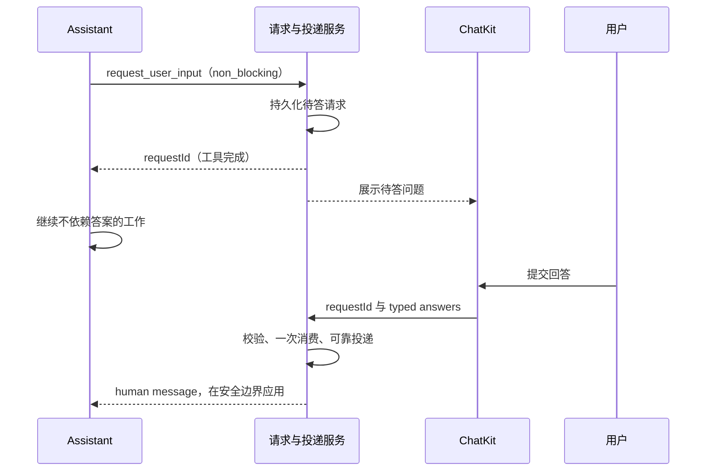

状态：**待实现**。本方案承接 [Issue #1288](https://github.com/xpert-ai/xpert/issues/1288) 的后续需求：Assistant 发出问题后继续处理不依赖答案的工作，用户回答以 human message 引导后续对话。当前仅预留类型契约，未实现请求持久化、投递服务或调度。已实现行为见[中文功能文档](../zh-Hans/guides/runtime-user-input.mdx)与[英文功能文档](../en/guides/runtime-user-input.mdx)。

## 目标与边界

同一个 `request_user_input` 工具通过显式 `mode: non_blocking` 发起问题。字段 `required` 仅约束提交完整性，不意味着必须停下整个任务。原工具立即返回 requestId，后续答案不再补发第二个工具结果，也不使用阻塞式 `Command.resume`。

Agent 应先查已有上下文，只问影响结果的缺失信息，合并同阶段问题。等待期间继续独立工作，说明临时假设；收到答案后修正受影响的结论。未回答不等于接受推荐，更不等于操作授权。依赖答案的行动仍应等待，不能以“非阻塞”为由越过权限或工具确认。

## 请求与答案生命周期

请求需独立持久化，绑定可信 tenant、organization、actor、conversation、发起 Agent、原 execution 和 tool call。客户端不得自报归属或以跨会话 requestId 投递答案；提交时重新验证当前访问权限及原表单定义。

| 对象     | 状态                                   | 含义                                               |
| -------- | -------------------------------------- | -------------------------------------------------- |
| 问题     | `pending`                              | 已创建，等待提交。                                 |
| 问题     | `answered`                             | 已接受一次有效答案，不等于 Agent 已使用答案。      |
| 问题     | `cancelled` / `superseded` / `expired` | 分别表示取消、替代和过期；不可再次按待答请求消费。 |
| 答案投递 | `queued` / `applied` / `failed`        | 分别表示等待应用、已应用和处理失败。               |

一次有效提交只产生一条 human message，携带服务端生成的 `kind: user_input_response`、`requestId`、`schemaVersion` 和保留类型的 `answers` 元数据。问题状态和消息入队需要可靠的一致性保障，避免已标为 answered 却丢失消息；重试不得重复投递或重复执行。修改已提交答案应生成新的修正消息，保留历史。

## 调度与执行控制

- **执行中回答：** 在安全处理边界将答案引导到原 Agent，复用会话执行准入和占用规则，不创建第二个并发主回合。
- **自然完成后回答：** 问题仍可回答，在同会话发起后续回合，保留原问题关联；不恢复旧阻塞检查点。
- **停止后回答：** 不自动唤醒已停止任务。界面明确说明答案是否记录及后续继续方式，继续工作需显式的新操作。
- **迟到答案：** 修正已有假设和受影响结论，不能撤销正在发生或已完成的副作用。
- **多 Agent：** 待答列表按请求身份区分，答案归属原发起 Agent，不以当前可见消息或显示名称推断归属。

请求记录、human message 与安全边界调度之间的具体事务、重试及恢复方案应在实施时结合既有消息和执行控制服务确定，不能只增加一个前端异步回调。

## ChatKit 交互与跨端状态

非阻塞问题使用“提交回答”，与阻塞表单的“提交并继续”区分。问题可收起并从待答列表重开；普通输入框继续可用，不占用或清空普通消息草稿。界面区分“等待回答”“已提交待处理”“已处理”，失败时提供可理解的反馈。

取消单个问题不等同于停止任务；回合自然结束不自动关闭问题。刷新后从服务端恢复待答请求与处理状态，多个客户端收到更新后收敛到同一状态，重复提交只能有一次成功消费。

跨端收敛也应覆盖当前阻塞表单的已知缺口：另一客户端已提交后，原页面不能长期显示仍可操作的旧待答面板。当前重新加载能够恢复正确状态，实时同步尚未通过验收。本 proposal 不承诺未提交表单草稿持久化，该能力需要另行明确存储范围和保留策略。

## 兼容与实施顺序

1. 定义请求存储、提交与查询契约，完成身份绑定、状态转换和幂等校验。
2. 实现可靠 human message 投递及运行中／自然结束／停止三种情况下的调度，复用现有执行准入。
3. 实现待答列表、收起重开、提交状态、刷新恢复与跨端收敛。
4. 完成能力协商与兼容检查后才向模型暴露 `non_blocking`。不支持的宿主明确拒绝，不静默转成阻塞问题。
5. 进行真实 Assistant、并发提交、消息重试和执行控制组合验收，再更新功能文档。

Plan Mode 的实施确认与工具 HITL 保留各自授权语义；不得把澄清答案当作批准行动。普通字段仍沿用已实现的版本化表单校验。

## 验收方法

所有项目均为**待实现后的验收要求**，当前表单不能用于证明非阻塞能力。开始前需真实 Assistant 已启用该能力，任务包含至少两个不依赖回答的工作步骤。若模型过快结束，运行中投递用例应换成长任务复测，不能以结束后回答替代。

测试提示词示例：

> 请制定一份团队内部培训方案。预算和参与人数需要向我提问，使用非阻塞问题收集；发出问题后，先继续完成不依赖这两个答案的目标拆解、课程提纲、筹备清单和风险分析。尚未知道的信息标为待确认，不要自行替我确认，也不要安排任何实际采购或发送通知。收到回答后再调整费用与分组建议。

| 场景               | 用户操作                                         | 通过标准                                                                                                          |
| ------------------ | ------------------------------------------------ | ----------------------------------------------------------------------------------------------------------------- |
| 提问后继续         | 出现问题后先不回答。                             | 问题保持待答，Agent 继续产生有效工作，普通输入框可用；不只是动画继续，也没有因该问题进入 input_wait / interrupt。 |
| 运行中回答         | 执行中提交“预算 5000 元，参与 20 人”。           | 历史恰好增加一条 human message；Agent 在安全处理点使用答案，无第二个并发主执行。                                  |
| 回合结束后回答     | 另一次测试中等 Agent 自然完成后再回答。          | 问题仍可提交，在原会话触发后续回复并关联原问题。                                                                  |
| 不回答／取消问题   | 保持未答，或取消单个问题。                       | 独立工作继续；未知信息保持待确认，不视为接受默认值或授权，不停止整项任务。                                        |
| 停止后迟到回答     | 先停止任务，再尝试回答待答问题。                 | 不自动唤醒已停止任务，界面清楚说明答案处理结果及继续方式。                                                        |
| 刷新与跨端重复提交 | 刷新后，在两个页面提交同一问题。                 | 状态恢复并收敛，请求只消费一次，消息和执行均不重复；阻塞表单也不残留可操作的旧面板。                              |
| 多 Agent 与更正    | 不同 Agent 分别提问，回答后追加更正。            | 归属正确，更正生成新消息，后续结果修正旧假设并保留历史。                                                          |
| 故障与越权         | 在投递中断后重试，或从错误会话／无权限身份提交。 | 失败可恢复且不重复投递；越权请求被拒绝，不改变问题或执行状态。                                                    |

开发侧同时核对持久化证据：提问工具已经完成且返回 requestId；回答前问题为 pending；答案消息 role 为 human 且元数据由服务端生成；投递从 queued 到 applied、一次消费；执行中没有并发主回合。仅凭界面出现一段“用户回答”文字或合成组件预览不能证明该链路通过。
