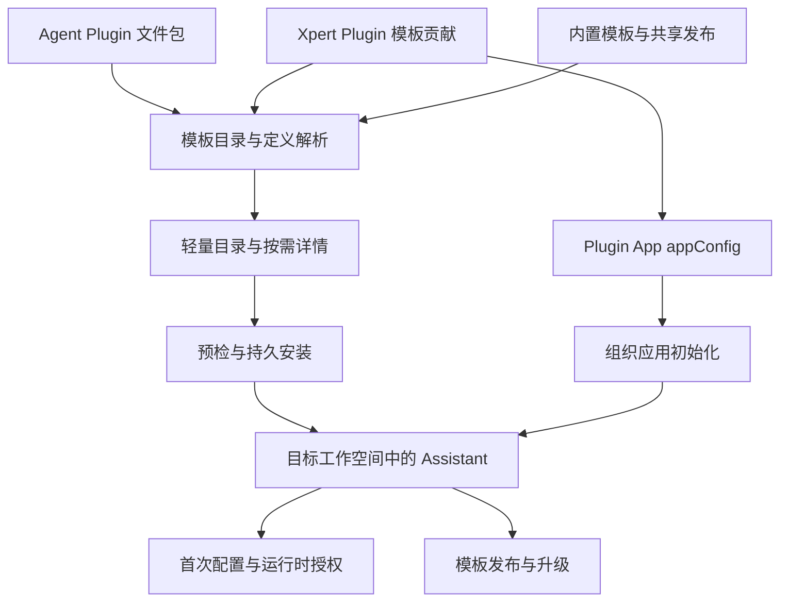

Web 与 Desktop 使用同一服务端模板定义、预检、安装记录和生命周期服务。客户端负责展示和收集配置，服务端决定访问权限、实际来源、安装进度及可执行状态。功能行为见[模板指南](/zh-Hans/guides/assistant-templates)，配置格式见[编写指南](/zh-Hans/guides/assistant-template-authoring)。

## 来源与分层

Agent Plugin 是不加载 NestJS 模块的文件资源包；原生 Xpert Plugin 可以实现服务器能力。Plugin App 是原生插件贡献的应用初始化声明，引用模板及业务资源。Assistant Template 是两种包均可交付的可移植定义，Assistant 则是目标空间中的实例。

`AssistantTemplateDefinition` 基于 `TXpertTeamDraft`，附带顶层 `memories` 和 `template` 元数据。`template.dependencies` 保存来源选择器，manifest v2 保存初始化与额外运行要求。解析器兼容旧定义并检查矛盾声明；详情、预检和安装消费同一归一化结果。

## 目录数据流与性能

Agent Plugin 导入时生成并持久化 `templateCatalog` 摘要；旧包第一次读取时验证并补齐。摘要只包含展示白名单，不返回 DSL、初始文件正文、完整依赖、manifest 或 appConfig。原生模板展示投影按内容摘要和语言缓存，最多 512 项，不缓存用户授权结论。

来源排序在切片前进行：`agent-plugin → plugin → builtin → shared → other`，保持同来源的相对顺序。服务端当前先汇总轻量目录再过滤、切片，不是数据库级分页。`hasApplication` 帮助客户端排除应用关联内容，来源与分类统计基于实际可见的 Assistant 目录。

每页默认 48 条。Desktop 先发出首批，再继续获取；Web 先呈现 24 张卡片并支持继续显示。后续失败保留已收到的内容，组织或语言改变后丢弃旧响应。

头像接口 `catalog-avatar/:id` 返回受认证保护的 JSON `{ url }`，其中可包含图片 data URL。客户端在接近视口时通过授权 HTTP 通道读取；版本摘要参与引用，避免错误复用旧图。它不是公共静态文件接口。单头像查找也不能把不完整的多模板映射写回持久目录。

### 本地性能基线

2026-10-14 同一授权测试环境，原始中文目录 210 条、Assistant 条目 199 条，其中 90 个来自 Agent Plugins：

| 指标                             | 优化前          | 优化后                   |
| -------------------------------- | --------------- | ------------------------ |
| Desktop 完整目录取数中位数，3 次 | 9.056 秒        | 1.147 秒，减少 87.3%     |
| 首批可用数据                     | 等待完整目录    | 48 条，225–230 毫秒      |
| 完整目录 JSON                    | 19,744,736 字节 | 116,466 字节，减少 99.4% |
| 首批 JSON                        | 未单列          | 30,193 字节              |
| API 重启后的首个摘要请求         | 未单列          | 481 毫秒                 |
| 旧包首次补齐摘要                 | 未单列          | 3.49 秒，一次性成本      |

这些是取数、读取响应和数据投影的测量，不是首帧、DOM 绘制、外网延迟或生产 SLA。源数据和优化后证据分别保留；目录数量不是固定产品指标。

## 持久安装状态机

`publish` 控制是否实际发布。状态独立于阶段，为 `running`、`interrupted`、`failed`、`succeeded`。请求含 `idempotencyKey`、`templateId`、`workspaceId`，以及可选基本配置、语言和能力选择。

同一 key 只用于同一安装意图。重试读取服务端持久输入，复用 Assistant、依赖和初始化进度，不接受新的重试请求体配置。新意图必须使用新 key。重启后可以识别中断并恢复；来源变化返回 `SOURCE_CHANGED`，不对新来源盲目继续。

公开回执包含 `assistantId`、`stage`、`attempt`、`retryable`、依赖锁和资源安装记录，不回传存储输入、源文件、凭据或原始运行异常。`pendingAuthInstallationIds` 是安装阶段快照；当前连接可用性以实时 setup 和运行检查为准。

## 依赖、配置与安全边界

原生资源锁记录插件版本、组件摘要及 provider；Agent Plugin 锁额外记录包名、digest、bindingId、bindingVersion。创建 Assistant 前固定来源，详情、安装和执行时重新检查可见范围与启用状态。

认证、租户、组织、目标编辑空间及已发布 Assistant 使用权限分别校验。缺少组织上下文造成的访问失败不能直接判断为账号无权限。原生插件的 system/tenant 安装范围也不能因为业务空间属于组织而改变。

首次引导按用户和 Assistant 保存修订，连接器只引用用户获准使用的连接，不把凭据写入 prompt、偏好或 manifest。模板文件由 Volume 层落实用户/共享范围、路径包含关系和 `create-only`。

工具级操作策略在调用处理器之前决定允许、审批或拒绝，后台执行使用同样规则。首次显式配置才创建个人例行任务；启用是另一操作。服务端不能执行仅本地能力，定时执行的活动与未读状态持久化。事件触发暂不实现。

## API 入口

所有路径以下表所示的 `/api` 前缀调用，仍受实际身份与范围校验；ID 作为路径段时需编码。

| 方法与路径                                                                                                         | 用途                                                                                   |
| ------------------------------------------------------------------------------------------------------------------ | -------------------------------------------------------------------------------------- |
| `GET /api/xpert-template/catalog`                                                                                  | 摘要列表，支持 `offset`、`limit`、`search`、`category`、`pluginName`、`assistantsOnly` |
| `GET /api/xpert-template/catalog-avatar/:id`                                                                       | 授权头像投影                                                                           |
| `GET /api/xpert-template/:id`                                                                                      | 完整模板详情                                                                           |
| `GET /api/xpert-template/:id/overview`                                                                             | 四类能力介绍                                                                           |
| `GET /api/xpert-template/:id/setup`                                                                                | 按目标空间预检模型、能力与依赖                                                         |
| `POST /api/xpert-template-installations`                                                                           | 创建或复用安装操作，HTTP 202                                                           |
| `GET /api/xpert-template-installations`                                                                            | 当前有权访问的安装记录                                                                 |
| `GET /api/xpert-template-installations/:id`                                                                        | 获取安装回执                                                                           |
| `POST /api/xpert-template-installations/:id/retry`                                                                 | 按原持久输入重试，HTTP 202                                                             |
| `GET /api/xpert/:id/template-setup`、`PUT /api/xpert/:id/template-setup`                                           | 读取与保存实例首次配置                                                                 |
| `PUT /api/xpert/:id/template-setup/routines/:key`                                                                  | 配置个人例行任务                                                                       |
| `GET /api/xpert/:id/template-lifecycle/publication`                                                                | 发布前预览                                                                             |
| `POST /api/xpert/:id/template-lifecycle/publication`、`DELETE /api/xpert/:id/template-lifecycle/publication`       | 发布或撤销分享                                                                         |
| `GET /api/xpert/:id/template-lifecycle/upgrade/sources`                                                            | 允许选择的升级/迁移来源                                                                |
| `GET /api/xpert/:id/template-lifecycle/upgrade`、`POST /api/xpert/:id/template-lifecycle/upgrade`                  | 预览与应用升级                                                                         |
| `POST /api/xpert/:id/template-lifecycle/upgrade/resume`、`POST /api/xpert/:id/template-lifecycle/upgrade/rollback` | 恢复操作或之前的配置                                                                   |

ChatKit 通过 `/api/ai/assistants/:assistantId/template-setup` 等对应入口使用已发布 Assistant 的访问规则。兼容接口 `POST /api/xpert-template/:id/install` 仍存在；需要统一可恢复进度的客户端应使用安装操作接口。

## 发布与三方升级

发布服务提取支持范围内的可移植图并移除实例状态；不支持的节点、中间件配置不能被静默丢弃。当前发布保存最新内容，不提供任意历史版本库。撤销只影响后续发现与导入。

升级以来源基线、本地定义、新定义三方比较四组内容：展示、指令、运行配置、模板要求。冲突要求显式决策；预期修订号不匹配返回 409。先持久化草稿，再发布，并保存操作快照供恢复。

跨原生插件与 Agent Plugin 的迁移必须明确选择目标来源。技能协调仅替换来源管理的旧引用，保留用户自行添加的技能。新来源产生新的依赖锁，不能继续套用旧包绑定。

Assistant 身份、对话及业务状态独立于模板版本。已有文件范围、任务定义或技能依赖不兼容时阻止不安全合并；新任务保持暂停。持久化草稿后的中断恢复已覆盖，不把它扩展为任意数据库写入瞬间的崩溃原子性保证。配置回退不回滚外部副作用。

## 代码与部署入口

以下路径相对 `xpert` 仓库：

| 路径                                                                     | 职责                                         |
| ------------------------------------------------------------------------ | -------------------------------------------- |
| `packages/contracts/src/ai/assistant-template*.ts`                       | 定义、依赖、manifest、setup 与 overview 契约 |
| `packages/contracts/src/ai/template-installation.model.ts`               | 安装状态、请求与依赖锁                       |
| `packages/contracts/src/agent-plugin.ts`                                 | Agent Plugin Xpert 扩展与运行绑定            |
| `packages/server-ai/src/xpert-template/`                                 | 目录、详情、能力预检和定义解析               |
| `packages/server-ai/src/plugin-resource/template-installation/`          | 安装编排、来源锁与依赖安装                   |
| `packages/server-ai/src/xpert/template-setup/`                           | 首次配置、连接与例行任务                     |
| `packages/server-ai/src/xpert/template-lifecycle/`                       | 可移植发布、升级、迁移与恢复                 |
| `packages/server-ai/src/xpert/template-workspace-initializer.service.ts` | 初始文件与台账                               |
| `apps/desktop/electron/catalog.cjs`                                      | Desktop 目录和安装衔接                       |

安装相关增量 SQL 位于 `plugin-resource/template-installation/migrations/`；生命周期 SQL 位于 `xpert/template-lifecycle/migrations/`，均相对上述 `packages/server-ai/src/`。由部署流程按目标数据库当前版本执行，外部迁移模式下不能依赖自动 schema sync 补齐。后端、Web 与 Desktop 需采用兼容契约版本。

验证应分别检查身份/范围、资源注册、实际加载、Assistant 发布、业务执行及恢复。真实供应商读写、跨操作系统桌面包和生产负载需要各自证据；本地功能验收与性能基线不替代这些检查。
