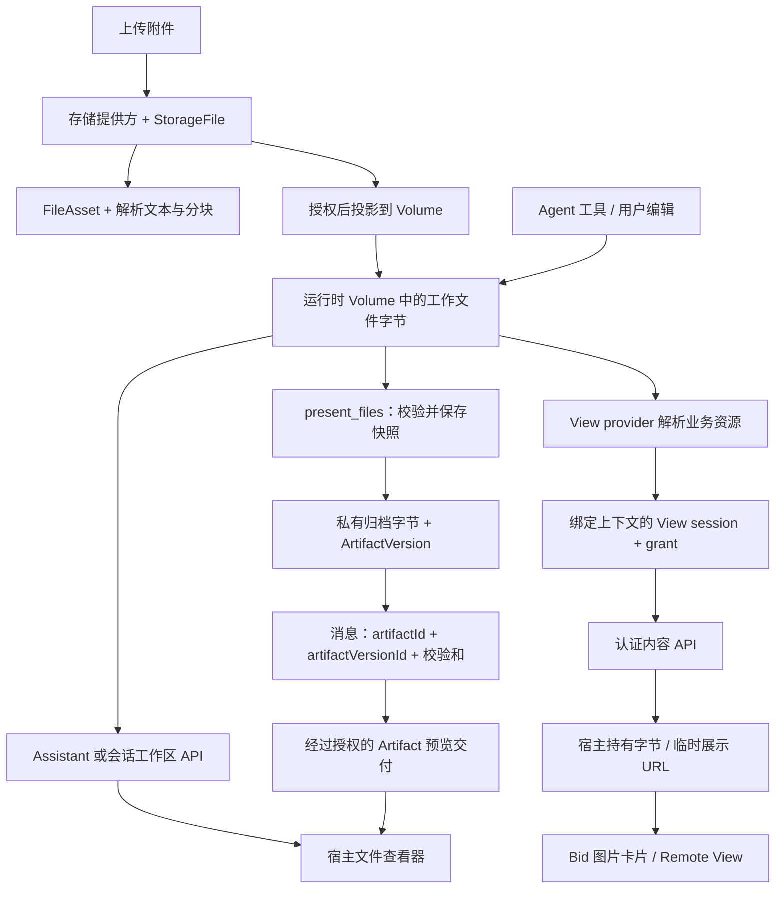
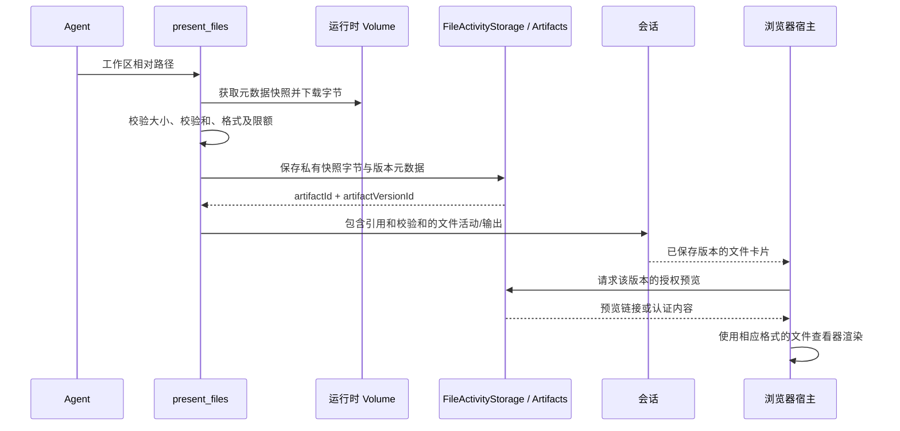
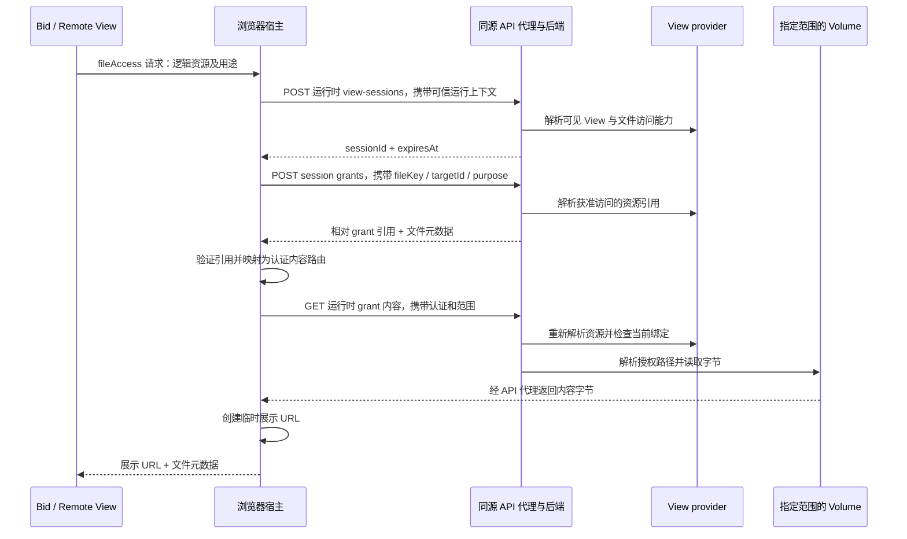

Xpert 通过多种接口访问文件。这些接口使用部分相同的存储基础设施，但权限和版本语义不同：工作区文件浏览器读取当前文件，`present_files` 文件卡片打开已保存的 Artifact 版本，Bid 图片资源卡片则先通过 View provider 解析业务资源，再读取文件字节。

本文介绍这些运行时链路，包括通过前端同源 API 代理读取 View 文件的认证预览方式。附件上传、解析和模型工具输入见 [ChatKit 附件文件生命周期与数据流](./file-lifecycle-data-flow.md)。

## 1. 数据模型与边界

| 概念                           | 保存或表达的内容                                                | 生命周期与访问边界                                       |
| ------------------------------ | --------------------------------------------------------------- | -------------------------------------------------------- |
| `StorageFile` / `FileAsset`    | 原始上传元数据与文件理解资产；原文件字节保存在存储提供方        | 上传与会话附件的授权范围                                 |
| `file_artifact` / `file_chunk` | 解析文本、衍生结构和可检索分块                                  | 文件理解流水线；**不是**下文的交付物版本                 |
| 工作区文件 / Volume            | 指定运行时文件系统范围内的文件字节                              | 可变的工作内容；范围可以属于 Assistant、用户或项目       |
| `PortableWorkspaceFileRef`     | 指向具有范围的工作区文件的可移植引用                            | 用于定位存储；持有引用本身不代表获得权限                 |
| `Artifact` / `ArtifactVersion` | 交付物及版本元数据，包括工作区文件引用、MIME 类型、大小和校验和 | `present_files` 保存私有快照，返回固定版本引用           |
| View 文件 session / grant      | 缓存的授权上下文及已解析资源引用                                | 当前实现中 session 有效期为一小时，grant 随 session 到期 |
| Artifact 预览链接              | 带有访问策略、有效期和版本选择的 `ArtifactLink`                 | 签名预览使用限时令牌，不等于永久公开发布                 |
| 浏览器对象 URL                 | 指向宿主已获取字节的 `blob:` URL                                | 浏览器临时资源；替换或销毁视图时释放                     |

数据库和消息可以保存文件元数据与引用，而不嵌入图片字节。文件系统路径、grant 引用、签名预览链接、浏览器对象 URL 是不同对象，不能混用。

## 2. 文件数据总体流向



两条输出分支可以展示来源于同一工作文件的图片，但不共享同一种预览 URL 协议。存储位于服务端边界内：浏览器通过授权与内容接口获取数据，不直接接收服务器文件系统的绝对路径。

## 3. 直接浏览与编辑工作区文件

工作区文件界面通过 Assistant 或会话工作区 API 列目录、读内容、下载字节，以及执行获准的写操作。文件 capabilities 帮助前端决定展示哪些操作；每次操作仍由服务端独立授权。

- Assistant 运行时请求使用**已发布 Assistant 的运行时文件权限**，与其创作空间 `XpertWorkspace` 的权限分开处理。
- 会话请求校验会话访问权限，以及对应的 Assistant / 项目上下文。
- 项目 Volume 要求项目访问权限与正确绑定；共享 Assistant Volume 与每用户 Volume 不能混用。
- Volume 层解析范围内的相对路径，并执行文件系统边界检查，包括目录穿越和符号链接防护。

文本可以加载为文档模型；二进制预览通过认证下载，再交给相应格式的渲染器，例如为图片生成临时对象 URL。`FileDocumentStore` 在指向相同工作区和路径的标签页之间共享文档状态；编辑草稿和预览 URL 都不是持久化文件存储。保存操作会调用经过授权的写接口。

会话附件列表 `/api/ai/conversations/:conversationId/files` 表示上传、解析后的附件，与 `.../workspace/files` 下的运行时目录树不同。

## 4. `present_files`：先保存版本，再预览

`present_files` 向会话输出一个**私有已保存版本**的引用。该工具本身不创建公开分享链接，也不改写工作文件。



当前工具最多接受 20 个文件，单文件上限 25 MiB，总量上限 64 MiB。持久化前，将下载字节与快照中的大小、SHA-256 对照。存储服务把字节归档到私有用户范围的 Volume，另外保存 `ArtifactVersion` 元数据。重复展示内容未变的文件时，可以复用版本。后续修改工作文件不会改变已保存的快照。

目前有两种内容交付集成：

| 集成方式                   | 数据流                                                                                                           | 授权与版本语义                                                                                                       |
| -------------------------- | ---------------------------------------------------------------------------------------------------------------- | -------------------------------------------------------------------------------------------------------------------- |
| Cloud 宿主中的工具输出预览 | 宿主调用 `POST /api/artifacts/:artifactId/links/signed-preview`，浏览器使用预览令牌访问 `/artifacts/share/:slug` | 创建链接需要认证。宿主指定准确的 `artifactVersionId`，并校验返回版本与校验和；内容接口执行链接策略及有效期检查。     |
| 会话运行时内容接口         | 客户端读取 `GET /api/ai/conversations/:conversationId/artifacts/:artifactId/versions/:artifactVersionId/content` | 校验会话访问权限、Assistant 绑定，以及持久化会话消息中允许访问的版本引用；同时检查 Artifact 范围、状态和内容校验和。 |

Cloud 预览方法默认申请五分钟有效的签名链接；未传 TTL 时，后端默认值为十五分钟。前端代理 `/artifacts/share`，其公开地址通常优先使用前端 URL。因此，`present_files` 图片此前可以通过 4300 显示，而 View 资源卡片仍可能走另一条访问链路。

已保存版本的访问不会退回到原工作路径上的当前文件。链接过期后通过认证请求重新申请，持久身份仍然是保存下来的 Artifact 版本引用。

## 5. Bid 与 Remote View 的资源访问

View 资源卡片使用 `viewKey`、`fileKey`、`targetId` 和 `purpose`（`preview` 或 `download`）描述逻辑资源。Provider 执行业务规则后，将其解析为 `PortableWorkspaceFileRef`。宿主负责认证与内容传输；远程组件接收展示数据，不接收平台凭据。



### Grant 引用与内容请求不同

运行时 grant 响应返回相对引用：

```text
/api/workspace-files/content/<sessionId>/<grantId>/<fileName>
```

宿主验证引用结构和 session 后，通过以下接口读取字节：

```text
GET /api/ai/workspace-files/view-sessions/<sessionId>/grants/<grantId>/content/<fileName>
```

这是**两个不同路由**。直接把第一个路径赋给图片的 `src`，仍然会进入依赖 Cookie 的内容接口，不会自动变成运行时认证读取。Cloud 宿主使用认证 HTTP 客户端从第二个路径获取 Blob，请求成功后再生成展示 URL。ChatKit 的文件访问传输层也会通过配置的运行时 API 解析该 grant 引用。

`viewFileContentRoute` 只接受配置 API 同源下符合预期的引用，要求 session 一致且路径段数量正确；拒绝外部来源、URL 内凭据、查询串、片段以及解码后非法的路径段。宿主不会向 grant URL 随意指定的主机发送认证信息。

Grant 服务仍使用后端公开地址构造标准 URL。**运行时 Controller 只返回 pathname**，使客户端可以使用自己的认证传输地址。管理 API 的 grant 响应保留完整标准 URL。

### 保留的权限校验

每次认证内容读取都会检查：

1. 认证身份及受支持的凭据绑定，包括 client secret 对 Assistant 运行时的限制。
2. Session 所有者、租户与组织范围，以及 session / grant 有效期。
3. Grant 与 session 的绑定、文件名、资源键、目标和用途。
4. 在已保存的运行上下文中重新检查 View 可见性并调用 provider 解析资源；重新验证 Assistant 运行时访问，项目资源继续执行项目成员与绑定校验。
5. 当前解析的引用，其租户、文件路径和 Volume 范围与授权资源一致。
6. 流式返回字节前，在限定范围内解析文件系统路径。

因此，不能利用旧 grant 跟随一个已经指向其他文件或 Volume 的资源键。但普通 View grant **不是不可变的字节快照**：同一授权路径上的可变文件仍可能更新。需要版本语义时，provider 应解析到明确版本的资源；`present_files` 则提供独立的快照保存机制。

### 浏览器生命周期

Cloud Remote View 宿主按上下文修订号管理正在进行的读取与对象 URL。切换 Assistant / 项目 / 会话上下文，或销毁渲染器时，会使待处理结果失效、释放旧对象 URL，并清理文件访问 session。旧上下文响应不能写入新视图。应持久化逻辑资源引用，而不是 `blob:` URL 或预览令牌。

## 6. API 与传输边界

下表中的 API 路径包含默认 `/api` 前缀。`:sid`、`:gid`、`:name` 分别表示 session ID、grant ID 和编码后的文件名。

| 用途                  | 接口                                                                                                  | 访问模型                                                                   |
| --------------------- | ----------------------------------------------------------------------------------------------------- | -------------------------------------------------------------------------- |
| Assistant 工作区文件  | `/api/ai/assistants/:assistantId/workspace/{capabilities,files,file,file/download}`                   | 显式运行时守卫与 Assistant 文件授权；修改接口执行写权限检查                |
| 会话工作区文件        | `/api/ai/conversations/:conversationId/workspace/{files,file,file/download}`                          | Workbench 认证，以及会话和文件范围授权                                     |
| 运行时 View session   | `POST /api/ai/workspace-files/view-sessions`                                                          | 显式运行时守卫；绑定解析后的宿主、View、身份及运行范围                     |
| 运行时 grant          | `POST /api/ai/workspace-files/view-sessions/:sid/grants`                                              | Session 所有者与 View/provider 校验；返回相对引用                          |
| 运行时内容            | `GET / HEAD /api/ai/workspace-files/view-sessions/:sid/grants/:gid/content/:name`                     | 认证读取并重新验证资源                                                     |
| 清理 session          | `DELETE /api/ai/workspace-files/view-sessions/:sid`                                                   | 所有者授权撤销 session，同时清理 session Cookie                            |
| 管理 session 与 grant | `/api/workspace-files/view-sessions` 及 `/:sid/grants`                                                | 管理认证，与运行时 client secret 接口区分                                  |
| 管理下载              | `GET /api/workspace-files/view-sessions/:sid/grants/:gid/content/:name`                               | 认证下载，要求 grant 用途为 `download`                                     |
| Cookie 绑定内容       | `GET / HEAD /api/workspace-files/content/:sid/:gid/:name`                                             | 签名 HttpOnly session Cookie、缓存 grant 绑定、有效期及来源/请求元数据策略 |
| 已保存版本内容        | `GET /api/ai/conversations/:conversationId/artifacts/:artifactId/versions/:artifactVersionId/content` | 会话运行时授权及消息引用的 Artifact 版本                                   |
| 创建签名预览          | `POST /api/artifacts/:artifactId/links/signed-preview`                                                | 经过认证的 Artifact 访问                                                   |
| Artifact 链接交付     | `/artifacts/share/:slug`                                                                              | 链接策略；签名预览还要求有效的预览令牌                                     |

运行时 Controller 上的 `@Public()` 不代表文件可匿名访问：该标记绕过默认管理守卫，显式运行时守卫与领域授权仍会执行。

运行时 View 内容与 Cookie 绑定内容共用流式响应方法，支持 MIME 类型、UTF-8 文件名、`private, no-store`、`nosniff`、`HEAD` 和字节范围（`206` / `416`）。`preview` 使用 inline disposition，`download` 使用 attachment disposition。Blob 预览客户端目前先获取响应体再展示；服务端支持 Range 不代表该客户端采用渐进渲染。会话 Artifact 内容使用另一套响应实现，不能假定它有相同的 Range 行为。

直接 Cookie 路由继续保留。它在读取时依据签名 session Cookie、缓存 grant 和请求来源检查，不执行认证路由中的完整 provider 重新解析。同源修复增加了认证内容交付方式，没有放宽直接访问路由的保护。

## 7. 部署与公开 URL 配置

浏览器来源由协议、主机和端口共同决定。`http://192.0.2.10:4300` 与 `http://192.0.2.10:3333` 属于不同来源。以下地址为文档占位示例，部署时替换为实际可达主机。

API 进程：

```dotenv
API_BASE_URL=http://192.0.2.10:3333
CLIENT_BASE_URL=http://192.0.2.10:4300
```

前端开发进程：

```dotenv
VITE_API_BASE_URL=same-origin
API_BASE_URL=http://127.0.0.1:3333
```

此例中前端进程的 `API_BASE_URL` 用作代理上游，不必与 API 进程的公开 URL 相同。`apps/cloud/proxy.conf.cjs` 同时代理 `/api` 与 `/artifacts/share`。前端采用同源访问时，生产入口也需要提供等效路由。


浏览器访问 4300，代理转发到 3333；这不要求把后端公开 `API_BASE_URL` 改为前端端口。

Artifact 链接按以下顺序选择公开地址：`PUBLIC_BASE_URL`、`ARTIFACTS_PUBLIC_BASE_URL`、配置中的 `CLIENT_BASE_URL`，最后是 API base URL。因此，它的 `/artifacts/share` 路径可以独立使用前端来源，不受工作区文件标准 URL 的来源限制。

## 8. 排查与验收

| 现象                                   | 检查方向                                                                                                                             |
| -------------------------------------- | ------------------------------------------------------------------------------------------------------------------------------------ |
| 其他电脑访问时，grant 返回 `localhost` | 检查后端公开地址或是否仍运行旧版 runtime/controller。`localhost` 指向浏览器所在电脑；除 grant 元数据外，还要看实际内容请求。         |
| 图片直连返回 `401`                     | Cookie 路由检查 session Cookie 是否缺失、无效或过期；运行时路由检查认证是否缺失或无效。先确定路由，再修改配置。                      |
| 改正主机名后图片直连仍返回 `403`       | Cookie 路由的 Origin / Referer / Fetch Metadata 策略仍可能拒绝，尤其在嵌入视图或基于 Blob 的视图中。修正主机名不会自动改变访问方式。 |
| 认证后的工作区/View 请求返回 `403`     | 先检查租户、当前组织、Assistant 运行范围和项目/会话绑定，不能直接断言账号没有权限。                                                  |
| 内容请求返回 `404`                     | Session/grant 缺失或过期、文件名不匹配、View/资源不可见、所有者或范围不匹配，都可能有意表现为未找到。                                |
| Grant 成功但预览失败                   | 继续追踪内容请求的 URL、认证、范围、状态码、MIME 类型与字节。Grant 成功不代表内容已交付或渲染成功。                                  |
| `present_files` 正常，Bid 图片卡片失败 | 分别检查 Artifact 交付与 View grant 交付，两者的路由和授权协议不同。                                                                 |
| Session/grant 请求大量重复             | 检查上下文频繁变化、重试、清理和过期响应。请求总数或 Network 面板累计时间不能定位某一个慢请求。                                      |

本地认证排查使用 `tools/scripts/local-plugin-cli.mjs` 的 `requireAuthentication` 与 `createRequestHeaders`。已知组织时，调用 `createRequestHeaders({ scope: 'organization', orgId }, token, tenantId)`，保留 `organization-id`、`tenant-id` 和 `x-scope-level`。范围未知时，先通过获准的组织/工作区只读接口定位。不能读取浏览器凭据或绕过权限来复现预览。

完整验收应确认：

1. 在另一台电脑上，Bid 卡片取得 grant 后，通过前端的认证运行时内容接口读取字节，不直接向 `localhost` 或 3333 发起图片请求。
2. 图片实际渲染，返回预期 MIME 类型，查看器中的图片尺寸非零。
3. 切换上下文不会显示旧结果，替换或销毁视图后会释放临时资源。
4. 匿名读取、使用他人 session、错误范围、已撤销 session、资源绑定发生变化等场景仍被拒绝。
5. 已保存的 `present_files` 版本仍能正常预览，不会被当前工作文件内容替代。

## 9. 实现索引与相关文档

| 范围                 | 源码                                                                                                                                                                                                                                                                                                                                |
| -------------------- | ----------------------------------------------------------------------------------------------------------------------------------------------------------------------------------------------------------------------------------------------------------------------------------------------------------------------------------- |
| 工作区文件运行时授权 | [Assistant 文件守卫](../../../packages/server-ai/src/ai/assistant-file-access.guard.ts)、[Assistant 工作区 Controller](../../../packages/server-ai/src/ai/assistant-workspace-files.controller.ts)、[会话工作区 Controller](../../../packages/server-ai/src/ai/workbench-files.controller.ts)                                       |
| View 解析与授权      | [View extension service](../../../packages/server/src/view-extension/view-extension.service.ts)、[文件访问 Service](../../../packages/server-ai/src/workspace-file-access/workspace-file-access.service.ts)                                                                                                                         |
| View 内容交付        | [运行时 Controller](../../../packages/server-ai/src/ai/workspace-file-access-runtime.controller.ts)、[Cookie 内容 Controller](../../../packages/server-ai/src/workspace-file-access/workspace-file-content.controller.ts)、[流式响应方法](../../../packages/server-ai/src/workspace-file-access/workspace-file-content.response.ts) |
| Cloud 资源预览       | [路由验证](../../../apps/cloud/src/app/@core/services/view-file-content-route.ts)、[View API 客户端](../../../apps/cloud/src/app/@core/services/view-extension-api.service.ts)、[Remote View 渲染器](../../../apps/cloud/src/app/@shared/view-extension/renderers/remote-component-renderer.component.ts)                           |
| 已保存交付物         | [present_files 实现](../../../packages/server-ai/src/sandbox/middlewares/present-files.ts)、[快照存储](../../../packages/server-ai/src/sandbox/middlewares/file-activity-storage.service.ts)、[Artifacts Service](../../../packages/server-ai/src/artifacts/artifacts.service.ts)                                                   |
| 已保存版本的预览集成 | [Cloud Assistant 宿主](../../../apps/cloud/src/app/features/assistant/assistant-chatkit.runtime.ts)、[会话 Artifact 读取处理器](../../../packages/server-ai/src/chat-conversation/commands/handlers/read-conversation-artifact.handler.ts)                                                                                          |
| 代理配置             | [Cloud 开发代理](../../../apps/cloud/proxy.conf.cjs)                                                                                                                                                                                                                                                                                |

相关文档：[附件生命周期](./file-lifecycle-data-flow.md)、[文件上传架构](../guides/file-upload-architecture.mdx)、[Volume 工作区架构](../guides/volume-workspace-architecture.mdx)、[工作台文件标签页](../../workbench-artifact-tabs.md)、[工具图片存储与模型输入](../../tool-images.md)。
