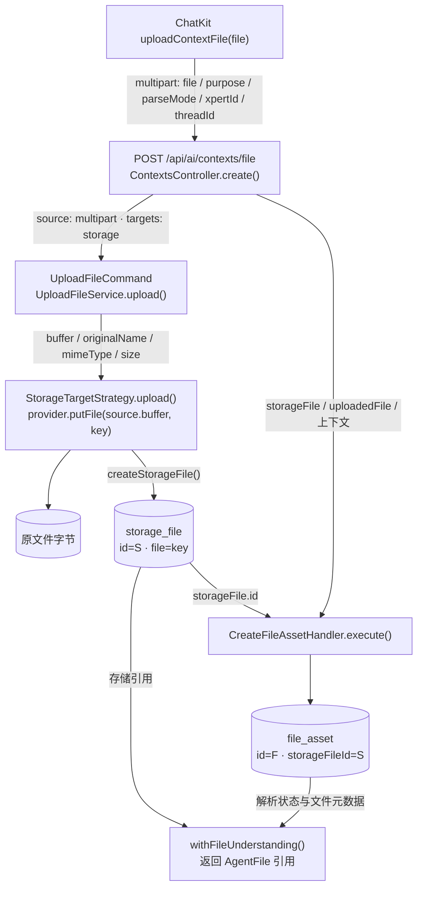
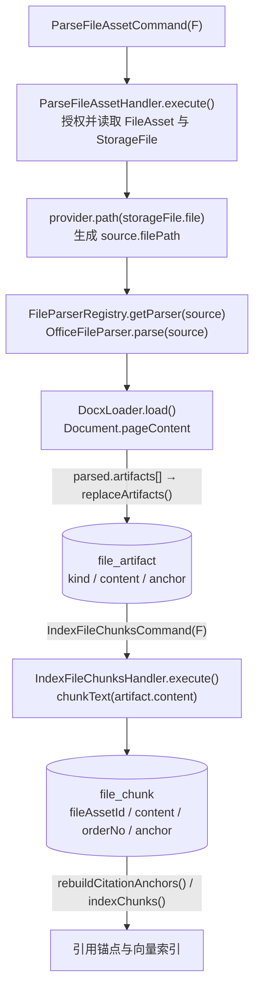
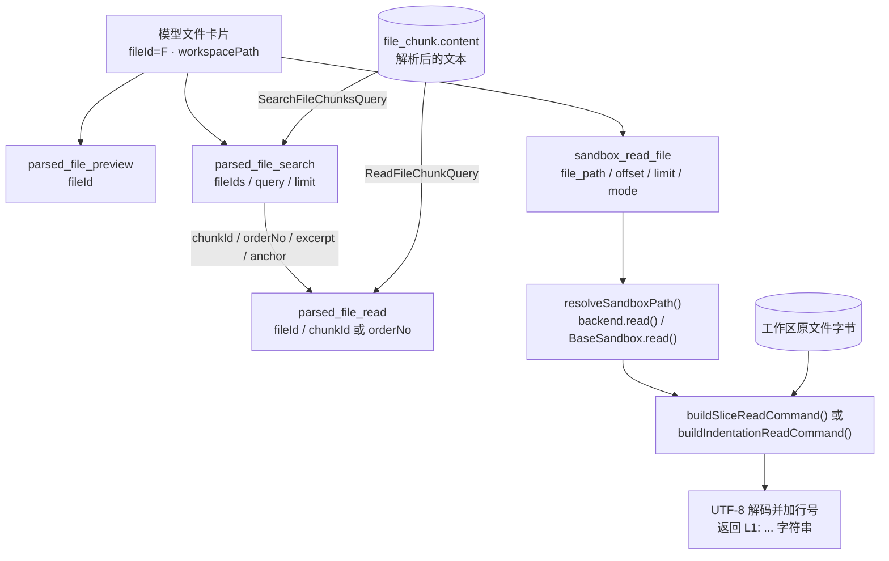
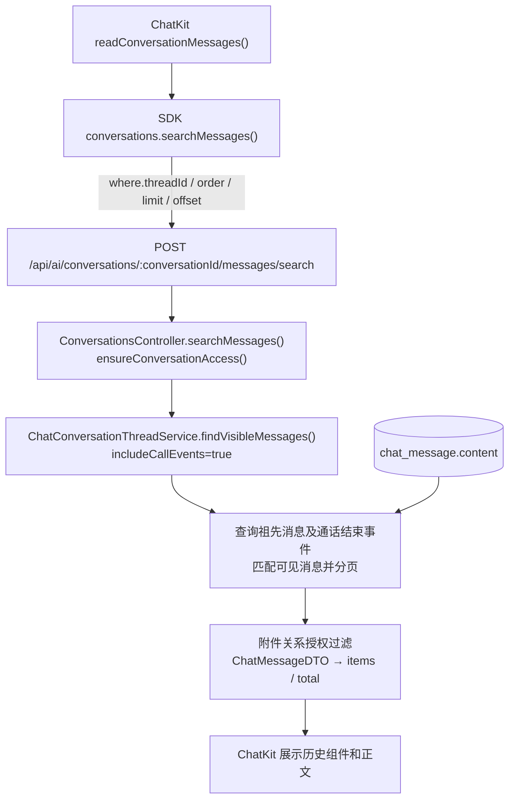

[English](../../en/architecture/file-lifecycle-data-flow.md)

文档类型：架构与实现说明。适用范围：ChatKit 对话附件从上传、文件解析、Agent 工具读取，到消息持久化和历史加载的主路径。实现基线日期：2026-10-11。

同一附件在系统中有三类内容：原始文件字节、解析后的文本，以及某次工具调用返回的输出。原文件由存储 Provider 和运行时 Volume 保存；解析文本由文件理解层保存；工具输出进入对话消息。排查文件相关故障时，需要先确认异常发生在哪一类内容、哪一次转换中。

本文使用 DOCX 附件举例。`S` 表示 `storage_file.id`，`F` 表示 `file_asset.id`，`C` 表示 conversation ID，`T` 表示 thread ID。示例中的身份和路径均为占位符。

## 数据保存位置与字段

| 数据             | 保存位置                                    | 关键字段                                                                                     | 使用者                                   |
| ---------------- | ------------------------------------------- | -------------------------------------------------------------------------------------------- | ---------------------------------------- |
| 原文件字节       | 文件存储 Provider；案例中为 `LOCAL`         | 存储键 `storage_file.file`，由 Provider 解析到实际文件                                       | 文件解析器、下载接口、工作区投影         |
| 原文件元数据     | `storage_file`                              | `id=S`、`file`、`storageProvider`、`originalName`、`mimetype`、`size`                        | 上传层、文件理解层                       |
| 文件理解资产     | `file_asset`                                | `id=F`、`storageFileId=S`、`status`、`parseMode`、`capabilities`、`summary`、`workspacePath` | ChatKit、Agent、文件工具                 |
| 解析产物         | `file_artifact`                             | `fileAssetId=F`、`kind`、`content`、`anchor`、`metadata`                                     | 分块、预览、派生产物读取                 |
| 可检索文本块     | `file_chunk`                                | `fileAssetId=F`、`artifactId`、`orderNo`、`content`、`tokenCount`、`anchor`                  | `parsed_file_search`、`parsed_file_read` |
| 对话与文件的关联 | `conversation_file_link`                    | `conversationId=C`、`threadId=T`、`fileAssetId=F`、`storageFileId=S`                         | 对话文件可见性与授权                     |
| 消息与附件的关联 | `chat_message_file_asset`                   | 消息实体的 `fileAssets` 多对多关系                                                           | 历史消息附件展示、重试输入重建           |
| 原文件工作区副本 | 运行时 Volume                               | `workspacePath`、`metadata.workspace.relativePath` 及 Volume 范围                            | 沙箱文件工具、shell 工具                 |
| 已执行工具的输出 | `chat_message.content`，数据库类型为 `json` | `content[i].data.tool/input/output/status`                                                   | 对话历史展示                             |

`FileAsset` 文件理解实体与上传编排返回的 `IFileAsset` 聚合结果不是同一个数据模型。后者包含 `destinations`；上传控制器从其中取出 `StorageFile`，再创建前者。

## 上传原文件与创建文件资产



| 顺序 | 工具或方法                                                   | 输入与输出                                                                                                                                                                                     |
| ---- | ------------------------------------------------------------ | ---------------------------------------------------------------------------------------------------------------------------------------------------------------------------------------------- |
| 1    | `useChatFiles.uploadContextFile(file)`                       | 构造 `FormData`：`file`、`purpose='chat_attachment'`、`parseMode='auto'`；存在时附带 `xpertId`、`threadId`。通过 SDK `contexts.fetch('/contexts/file', ...)` 上传。                            |
| 2    | `ContextsController.create()`                                | `@UploadedFile()` 接收 `Express.Multer.File`。解析对话与上传范围，再执行 `UploadFileCommand({ source: { kind: 'multipart', file }, targets: [target] })`。                                     |
| 3    | `UploadFileHandler.execute()` → `UploadFileService.upload()` | `resolveSource()` 将 `file.buffer/originalname/mimetype/size` 归一化为 `source.buffer/originalName/mimeType/size`；`normalizeFileMimeType()` 根据字节识别类型。                                |
| 4    | `StorageTargetStrategy.upload()`                             | 生成 `key`，调用 `provider.putFile(source.buffer, key)`，然后 `StorageFileService.createStorageFile()` 保存元数据。                                                                            |
| 5    | `CreateFileAssetHandler.execute()`                           | 接收 `storageFile`、`uploadedFile`、`purpose`、`parseMode` 和上下文；保存 `storageFileId=S`，生成 `F`。以 `storageFileId + tenantId` 查找已有资产；已确定对话时建立 `conversation_file_link`。 |
| 6    | `ContextsController.withFileUnderstanding()`                 | 组合存储记录和文件资产，返回 `AgentFile`。前端获得文件引用、状态和能力信息。                                                                                                                   |

默认上下文上传目标为 `storage`，目录为 `contexts`，文件名前缀为 `files`。存储键通常形如：

```text
contexts/<tenantId>/files-<timestamp>-<random>.docx
```

在 `LOCAL` Provider 中，`LocalProvider.putFile()` 把字节写入 `config.rootPath + key`，`LocalProvider.path(storageFile.file)` 将存储键还原为服务端路径。其他 Provider 的物理位置由各自实现决定。

上传控制器不接受客户端直接指定可信的工作区路径；`workspacePath` 在完成授权和实际文件投影后由服务端生成。租户、组织和用户身份来自请求认证上下文。

来源：[上传控制器](https://github.com/xpert-ai/xpert/blob/main/packages/server-ai/src/ai/context.controller.ts)、[上传编排](https://github.com/xpert-ai/xpert/blob/main/packages/server/src/file/file-upload/upload-file.service.ts)、[存储目标](https://github.com/xpert-ai/xpert/blob/main/packages/server/src/file/file-upload/strategies/storage-target.strategy.ts)、[LOCAL Provider](https://github.com/xpert-ai/xpert/blob/main/packages/server/src/file/file-storage/providers/local.provider.ts)、[创建文件资产](https://github.com/xpert-ai/xpert/blob/main/packages/server-ai/src/file-understanding/commands/handlers/create-file-asset.handler.ts)。

## 解析与建立文本索引

创建资产后，控制器调用 `EnqueueFileParseCommand(F, { runInline })`。`parseMode='none'` 跳过解析；`fast` 同步解析；`deep` 后台解析；`auto` 在文件不超过 2,000,000 字节时同步解析。当前后台分支由 `EnqueueFileParseHandler` 使用 `setImmediate()` 调用解析命令，不是持久化任务队列。



对于普通 DOCX，`OfficeFileParser.parse()` 使用 `DocxLoader` 提取 `pageContent`，产生 `summary` 和 `text` 类型的 artifact。带旧版复合文档签名的 DOCX 会走 `parseLegacyDoc()`，不能仅根据扩展名假设解码方式。

`IndexFileChunksHandler` 对可分块的 artifact 正文切分，保存 `file_chunk.content`，并建立引用锚点和向量索引。解析完成后回写 `file_asset.status`、`summary`、`capabilities`、`metadata.parser`、`metadata.chunkCount` 和 `parsedAt`。状态 `ready` 表示这条解析链完成，不会改变原始 DOCX 字节。

来源：[解析 Handler](https://github.com/xpert-ai/xpert/blob/main/packages/server-ai/src/file-understanding/commands/handlers/parse-file-asset.handler.ts)、[解析调度](https://github.com/xpert-ai/xpert/blob/main/packages/server-ai/src/file-understanding/commands/handlers/enqueue-file-parse.handler.ts)、[Office 解析器](https://github.com/xpert-ai/xpert/blob/main/packages/server-ai/src/file-understanding/parsers/office.parser.ts)、[文本分块](https://github.com/xpert-ai/xpert/blob/main/packages/server-ai/src/file-understanding/commands/handlers/index-file-chunks.handler.ts)。

## 工作区副本与路径传递

`FileWorkspaceProjectionService.projectFileAsset()` 负责把原文件复制到 Agent 可访问的 Volume。解析完成后以及附件关联对话时，都可能触发投影；已有同范围副本时会复用。

```text
projectFileAsset({ fileAssetId: F, storageFileId: S, conversationId: C, ... })
  → FileAssetAccessService.resolve() 授权
  → XpertWorkAreaResolver.resolve() 选择 Volume 与会话目录
  → readStorageFile(storageFile)
  → provider.getFile(storageFile.file) 返回 Buffer
  → writeProjectedVolumeFile(volume, relativePath, buffer)
  → VolumeHandle.writeFile(...) 写入原始字节
  → 保存 file_asset.workspacePath 和 metadata.workspace
```

会话路径示例：

```text
metadata.workspace.relativePath = sessions/<C>/files/<F>/示例招标文件.docx
workspacePath = /workspace/sessions/<C>/files/<F>/示例招标文件.docx
```

`workspacePath` 属于 Agent 看到的运行时路径空间，不是宿主机文件路径。实际目录由 Volume 的 `catalog`、`scopeId`、Provider 和工作区解析器确定；项目文件与 Assistant 文件的范围可能不同。

投影复制的是原文件 `Buffer`，不是 `file_chunk.content`。拥有 `workspace` capability 只说明文件可以按路径访问，不说明文件可以作为 UTF-8 文本读取。

来源：[工作区投影](https://github.com/xpert-ai/xpert/blob/main/packages/server-ai/src/file-understanding/file-workspace-projection.service.ts)、[工作区路径解析](https://github.com/xpert-ai/xpert/blob/main/packages/server-ai/src/file-understanding/domain/workspace-file.ts)。

## 附件引用进入对话与模型输入

上传响应的主要字段如下。示例表示解析和投影完成后的状态；后台解析刚开始时状态可能仍为 `parsing`。

```json
{
  "id": "<F>",
  "fileId": "<F>",
  "storageFileId": "<S>",
  "objectKey": "contexts/<tenantId>/files-<timestamp>-<random>.docx",
  "originalName": "示例招标文件.docx",
  "mimeType": "application/vnd.openxmlformats-officedocument.wordprocessingml.document",
  "status": "ready",
  "parseStatus": "ready",
  "purpose": "chat_attachment",
  "parseMode": "auto",
  "capabilities": ["preview", "read", "search", "workspace"],
  "workspacePath": "/workspace/sessions/<C>/files/<F>/示例招标文件.docx"
}
```

前端 `attachments.toSubmittedFiles()` 保留这些引用字段。发送消息时，`useChatSubmission()` 将它们放入 `inputPayload.files[]`，本地展示消息使用 `newMessage.fileAssets`。

```text
inputPayload.files[]
  → normalizeChatHumanInputFiles()
  → normalizeChatRequestFiles() / normalizeChatRequestFile()
  → toChatFileAssetReferences() 返回 [{ id: F }]
  → humanMessage.fileAssets
  → ChatMessageUpsertCommand
  → chat_message_file_asset 关联表

attachChatFileAssetsToConversation()
  → AttachFileToConversationCommand({ fileAssetId: F, storageFileId: S,
                                     conversationId: C, threadId: T, ... })
  → conversation_file_link
  → projectFileAsset()
```

模型输入通过 `createHumanMessage()` → `resolveAttachmentFile()` 重新解析并授权文件引用。对于已有解析结果的普通文档，`GetFilePreviewQuery(F)` → `buildFileUnderstandingPrompt()` 生成紧凑的文件卡片，包含 `fileId`、`storageFileId`、`status`、`capabilities`、`workspacePath`、`summary`、`availableAnchors` 等信息。完整正文留在文件理解层，由工具按需读取。未命中该分支时仍存在 `LoadFileCommand` 等兼容路径，不能将文件卡片描述为所有格式和状态下唯一的路径。

字段名 `id` 随对象类型变化：上传返回的 `AgentFile.id` 是 `F`；`resolveAttachmentFile()` 命中 `StorageFile` 分支时，内部对象的 `id` 可变成 `S`，同时保留 `fileId=F`、`fileAssetId=F`。跨层定位文件应使用明确的 `fileAssetId/fileId` 和 `storageFileId`。

来源：[聊天文件引用归一化](https://github.com/xpert-ai/xpert/blob/main/packages/server-ai/src/xpert/commands/handlers/chat-file-assets.ts)、[附件关联对话](https://github.com/xpert-ai/xpert/blob/main/packages/server-ai/src/file-understanding/commands/handlers/attach-file-to-conversation.handler.ts)、[模型附件输入](https://github.com/xpert-ai/xpert/blob/main/packages/server-ai/src/shared/agent/message.ts)、[消息附件关系](https://github.com/xpert-ai/xpert/blob/main/packages/server-ai/src/chat-message/chat-message.entity.ts)。

## Agent 读取文件的两条路径



| 工具                  | 模型调用参数                                          | 服务端函数或查询                                                                                                  | 返回值                                                                                    |
| --------------------- | ----------------------------------------------------- | ----------------------------------------------------------------------------------------------------------------- | ----------------------------------------------------------------------------------------- |
| `parsed_file_preview` | `{ fileId: F }`                                       | `requireConversationFile()` → `GetFilePreviewQuery` / `GetFilePreviewHandler.execute()`                           | JSON 字符串：`file`、`artifactCount`、`availableReads`。工具包装层不直接返回正文块。      |
| `parsed_file_search`  | `{ fileIds: [F], query, limit }`；`fileIds` 可省略    | `searchConversationFiles()` → `resolveFileIds()` → 对各文件执行 `SearchFileChunksQuery({ fileId, query, limit })` | JSON 数组：`fileId`、`name`、`workspacePath`、`chunkId`、`orderNo`、`anchor`、`excerpt`。 |
| `parsed_file_read`    | `{ fileId: F, chunkId }` 或 `{ fileId: F, orderNo }`  | `requireConversationFile()` → `ReadFileChunkQuery` / `ReadFileChunkHandler.execute()`                             | JSON 对象：`fileId`、`chunkId`、`orderNo`、`anchor`、`content`。                          |
| `sandbox_read_file`   | `{ file_path, offset?, limit?, mode?, indentation? }` | `SandboxFileMiddleware` → `resolveSandboxPath()` → `backend.read()`                                               | 普通字符串，带 `L1: ...` 行号；数据来自原文件。                                           |

`parsed_file_search` 的公开工具参数是复数 `fileIds`，内部单文件查询参数才是单数 `fileId`。`parsed_file_read` 要求 `chunkId` 与 `orderNo` 恰好提供一个。工具执行前会根据当前对话、项目和文件关联解析可见范围，文件 ID 本身不是授权凭据。

`SearchFileChunksHandler` 获取向量检索和数据库文本匹配结果后合并排序；`ReadFileChunkHandler` 使用 `fileAssetId + chunkId` 或 `fileAssetId + orderNo` 读取块。工具再通过 `compactText()` 限制 `excerpt/content` 的返回长度。

沙箱路径合同要求模型传工作目录下的相对路径，例如 `sessions/<C>/files/<F>/示例招标文件.docx`。当前 `resolveSandboxPath()` 对相对路径调用 `resolve(workingDirectory, file_path)`，已有绝对路径则原样传递；具体访问边界仍由沙箱和 Volume 实现承担。

截至实现基线，`BaseSandbox.read()` 的 slice 和 indentation 模式都执行 `fs.readFileSync(filePath, 'utf-8')`。它们没有复用文件理解层 `decodeTextFileContent()` 的二进制检查。DOCX 等原文件即使解析状态为 `ready`，走这条原文件路径仍可能产生乱码和空字符。

来源：[解析文件工具](https://github.com/xpert-ai/xpert/blob/main/packages/server-ai/src/file-understanding/tools/file-understanding.tools.ts)、[搜索 Handler](https://github.com/xpert-ai/xpert/blob/main/packages/server-ai/src/file-understanding/queries/handlers/search-file-chunks.handler.ts)、[读取 Handler](https://github.com/xpert-ai/xpert/blob/main/packages/server-ai/src/file-understanding/queries/handlers/read-file-chunk.handler.ts)、[沙箱文件工具](https://github.com/xpert-ai/xpert/blob/main/packages/server-ai/src/sandbox/middlewares/sandbox-file.middleware.ts)、[BaseSandbox](https://github.com/xpert-ai/xpert/blob/main/packages/plugin-sdk/src/lib/sandbox/sandbox.ts)、[文本解码校验](https://github.com/xpert-ai/xpert/blob/main/packages/server-ai/src/file-understanding/parsers/text-file.ts)。

## 工具输出进入对话消息

工具返回值可用于后续模型执行，同时也会通过工具事件形成可回放的消息组件。本节描述本次 `sandbox_read_file` 的展示与持久化路径；不同工具的事件封装方式不必完全相同。

```text
BaseSandbox.read() 返回 result 字符串
  → withToolMessage(): output = result
  → dispatchCustomEvent(ON_TOOL_MESSAGE, {
      id, category: 'Tool', tool, input, status: 'success', output, ...
    })
  → xpert-agent/agent.ts 将事件转换成 type='component' 的 MESSAGE
  → component.data 保留 tool / input / output / status
  → sanitizeMessageContentForPersistence()
  → appendMessageContent(aiMessage, component)
  → ChatMessageUpsertHandler.execute()
  → ChatMessageService.save(entity)
  → chat_message.content[i].data.output
```

保存后的结构示意：

```json
[
  {
    "type": "component",
    "data": {
      "tool": "sandbox_read_file",
      "input": {
        "file_path": "sessions/<C>/files/<F>/示例招标文件.docx",
        "limit": 200
      },
      "status": "success",
      "output": "L1: PK\u0003\u0004..."
    }
  }
]
```

这里的 `output` 是一次调用的结果快照，独立于 `file_chunk.content` 和原文件字节。当前 `sanitizeMessageContentForPersistence()` 清理的是 `appInstanceToken` 等展示数据中的临时字段，不会去除工具输出中的 NUL 字符。

`ON_TOOL_MESSAGE` 还有写入 `aiMessage.events` 的处理分支；本次 `category='Tool'` 事件先被转换为组件消息，异常字节实际位于 `content[2].data.output`，该记录的 `events` 为空。

来源：[工具事件封装](https://github.com/xpert-ai/xpert/blob/main/packages/server-ai/src/sandbox/middlewares/tool-message.utils.ts)、[Agent 事件转换](https://github.com/xpert-ai/xpert/blob/main/packages/server-ai/src/xpert-agent/agent.ts)、[聊天流处理](https://github.com/xpert-ai/xpert/blob/main/packages/server-ai/src/xpert/commands/handlers/chat.handler.ts)、[消息保存前处理](https://github.com/xpert-ai/xpert/blob/main/packages/server-ai/src/chat-message/message-step-persistence.ts)、[消息持久化 Handler](https://github.com/xpert-ai/xpert/blob/main/packages/server-ai/src/chat-message/commands/handlers/upsert.handler.ts)。

## 历史对话读取

打开对话时，ChatKit 读取已保存的消息，不会重新执行工具，也不会为回放工具卡片重新读取 DOCX。



控制器先验证 conversation 访问，并确认请求中的 thread 属于该 conversation。附件由 `filterAuthorizedFileRelations()` 过滤，再生成 DTO。

截至实现基线，合并通话结束事件时使用以下 SQL 条件：

```sql
message.content::jsonb -> 0 ->> 'type' = 'call_ended'
```

`content` 列本身是 `json`。为判断首个块的 `type`，上述条件会将整条内容转换成 `jsonb`。因此，即使问题字符位于嵌套的工具输出中，也可能使整次历史消息查询失败。该过滤发生在分页之前，调整前端分页数量不能可靠避开异常记录。

来源：[历史消息控制器](https://github.com/xpert-ai/xpert/blob/main/packages/server-ai/src/ai/conversation.controller.ts)、[线程消息查询](https://github.com/xpert-ai/xpert/blob/main/packages/server-ai/src/chat-conversation/conversation-thread.service.ts)。

## 字段映射速查

| 字段                                  | 所属对象和含义                                       | 不应混用的字段                                   |
| ------------------------------------- | ---------------------------------------------------- | ------------------------------------------------ |
| `id`                                  | 含义由对象决定；`AgentFile.id=F`，`StorageFile.id=S` | 不能把任意对象的 `id` 都当文件资产 ID            |
| `fileId` / `fileAssetId`              | 文件理解层的 `F`；两者在新文件引用中用于明确资产身份 | `storageFileId`                                  |
| `fileIds`                             | `parsed_file_search` 的资产 ID 数组                  | 内部 `SearchFileChunksQuery.input.fileId` 是单值 |
| `storageFileId`                       | 原文件存储记录 `S`                                   | `F`                                              |
| `objectKey` / `storage_file.file`     | 存储 Provider 的键                                   | `workspacePath`、宿主机绝对路径                  |
| `file_asset.fileName`                 | 上传资产中可保存 `storageFile.file` 这一存储键       | 原始展示文件名 `originalName`                    |
| `workspacePath`                       | Agent 路径空间中的文件副本位置                       | 原文解析结果、宿主机路径                         |
| `file_path`                           | `sandbox_read_file` 的路径参数                       | `parsed_file_read.fileId`                        |
| `source.filePath`                     | 解析器实际访问的服务端路径                           | 工具可直接使用的公开路径                         |
| `chunkId` / `orderNo`                 | 文件内的文本块定位信息                               | 原文件字节偏移或沙箱行号                         |
| `file_chunk.content`                  | 解析后的文本块                                       | `chat_message.content`                           |
| `chat_message.content[i].data.output` | 某次工具调用的历史输出                               | 原文件及解析文本的唯一来源                       |

## DOCX 二进制输出导致历史加载失败案例

2026-10-11 的一次排障确认：某 DOCX 使用 `LOCAL` 保存，文件理解状态为 `ready`，解析器为 `office`，存在 `summary`、`text` 产物和可搜索文本块。文档解析链已完成，但原文件读取工具生成了异常的消息输出。

实际调用链为：

1. `parsed_file_preview({ fileId: F })` 成功，返回文件状态和能力。
2. `parsed_file_search` 误传单数 `fileId`，被 strict schema 拒绝；工具接受的是 `fileIds` 数组。
3. 随后正确的搜索调用成功，同时调用了 `sandbox_read_file({ file_path, limit: 200 })`。
4. 沙箱将 DOCX 压缩字节按 UTF-8 读取，输出以 `L1: PK` 开头，包含 1,054 个 NUL 字符。
5. 输出作为 JSON 转义字符保存进一条 AI 消息的 `content[2].data.output`。
6. 再次打开对话时，通话事件查询执行 `content::jsonb`，触发 PostgreSQL `22P05`：`\u0000 cannot be converted to text.`，消息接口返回 HTTP 500。

文件卡片中“有 `workspacePath` 时可使用 `sandbox_read_file` 读取原文件”的提示缺少格式限制，是工具选择的诱因；它不能单独证明模型选择工具时的内部推理。直接导致历史查询失败的是已保存输出中的 NUL 与 SQL JSON 转换的组合。

本次恢复先备份完整异常消息，再在事务中校验账号、对话、组织范围和原始内容，定点替换该工具的不可读输出。其余消息块、工具参数和消息其他列保持一致。对话的 8 条消息保留，原 SQL 恢复执行，三个 API 实例共记录到 5 次成功的消息查询，界面重新加载正常。原文件、工作区副本和解析文本没有修改。

这属于数据恢复，不代表代码缺陷已修复。后续改进需要覆盖沙箱文本读取边界、持久化输出的字符策略，以及避免对任意消息内容做整体 JSON 转换的事件查询设计。回归验证需要真实二进制文件和 PostgreSQL；模拟 QueryBuilder 返回值无法验证这种数据库错误。只移除 `::jsonb` 改用 JSON 字段提取，在该异常数据上仍会报错。

案例不包含生产账号、IP、租户或组织 ID、对话 ID、原始消息正文及备份位置；这些信息应保留在受保护的运行回执中。

## 跨仓库源码入口与相关文档

平台实现基线为 `xpert` 的 `d3352d47b`；ChatKit 和 SDK 的对应源码基线分别为 `ae06dbe`、`71ffc19`。本文记录该日期的行为，后续修改工具合同或存储模型时应同步更新字段表和数据流。

| 仓库           | 源码位置                                                                       | 入口                                   |
| -------------- | ------------------------------------------------------------------------------ | -------------------------------------- |
| `chatkit-js`   | `packages/chatkit-ui/src/components/chat/files/useChatFiles.ts`                | `uploadContextFile()`                  |
| `chatkit-js`   | `packages/chatkit-ui/src/components/chat/attachments.tsx`                      | `toSubmittedFiles()`、解析状态轮询     |
| `chatkit-js`   | `packages/chatkit-ui/src/components/chat/composer/useChatSubmission.ts`        | `inputPayload.files`                   |
| `chatkit-js`   | `packages/chatkit-ui/src/providers/stream/history/useStreamHistoryMessages.ts` | `readConversationMessages()`           |
| `xpert-sdk-js` | `packages/core/src/client.ts`                                                  | `ConversationsClient.searchMessages()` |

相关架构说明：

- [统一文件上传架构](../guides/file-upload-architecture.mdx)
- [文件理解架构](../guides/file-understanding-architecture.mdx)
- [Volume 与工作区架构](../guides/volume-workspace-architecture.mdx)
- [AI Agent 架构与源码地图](/zh-Hans/architecture/ai-agent-architecture)
