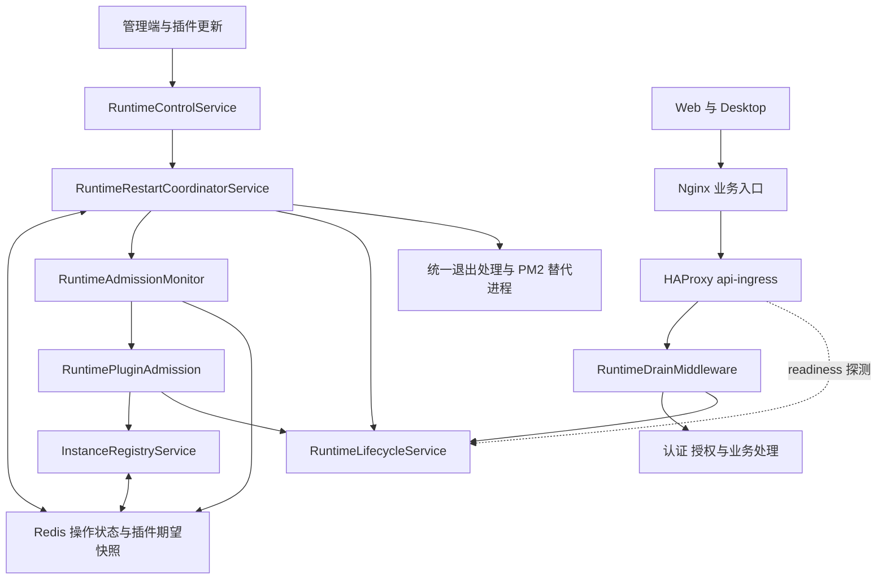
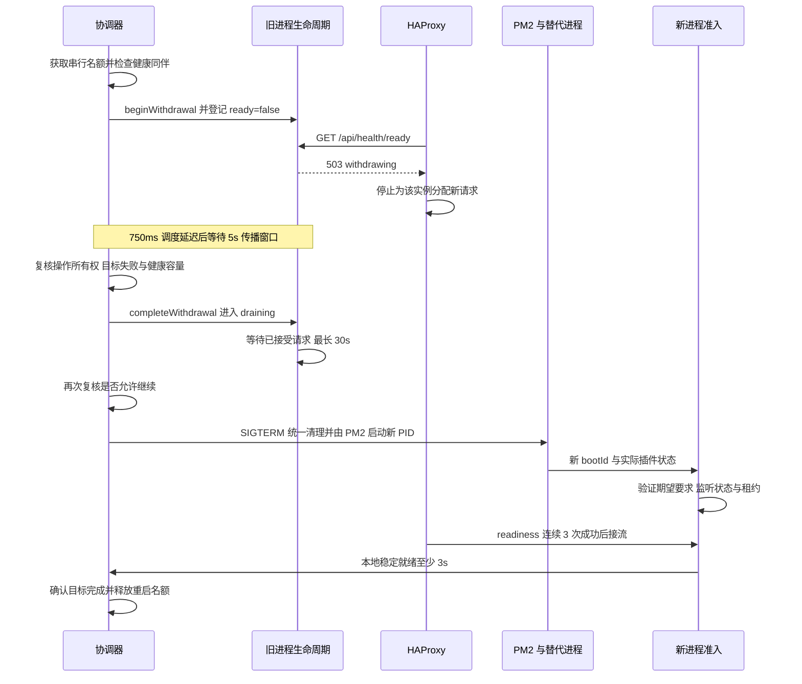

Runtime Control 将插件运行状态收敛、API 副本重启、业务准入、入口摘流和客户端恢复串联起来。目标是在更新期间保留可服务容量，同时让插件不满足要求、验证过期或租约失效的实例停止接收新业务请求。

本文描述包含 #1207 修复的源码与 Compose 方案，并单列尚未实现的入口确认能力。部署只有在全部业务入口接入 readiness 代理后，才能采用本文的摘流传播契约；更新 API 镜像本身不足以完成迁移。进程收到信号后的清理细节见 [API 服务优雅退出](/zh-Hans/guides/graceful-api-shutdown)。

## 整体架构



Redis 保存控制面的期望状态、实例租约和重启操作。业务请求是否放行由本进程准入结果与生命周期共同决定，入口是否选中实例由 HAProxy 的 readiness 探测决定。Redis 中的 `ready=false` 不会直接修改 Nginx 或 HAProxy 的路由。

| 组件                                   | 负责什么                                                           | 边界                                                                                               |
| -------------------------------------- | ------------------------------------------------------------------ | -------------------------------------------------------------------------------------------------- |
| `RuntimeControlService` / Controller   | 重启能力查询、授权、请求确认、状态查询、实例登记管理               | 交互式重启要求 Default tenant 的 SuperAdmin 会话与 `confirmation: "RESTART"`；API Key 不具备该能力 |
| `PluginRuntimeGenerationStore`         | 原子发布插件 generation、累计期望清单和收敛状态                    | 活跃操作保留固定快照，后来发布的变更进入后续操作                                                   |
| `RuntimeRestartCoordinatorService`     | 收集目标副本、串行重启、容量检查、失败终止和后续 generation 交接   | 决定如何推进更新，不是业务准入定时器                                                               |
| `InstanceRegistryService`              | 副本身份、每次启动的 `bootId`、心跳租约、插件状态、ready 有效期    | 登记存在不等于当前允许接流                                                                         |
| `RuntimeAdmissionMonitor`              | 独立定时检查、同一检查共享 Promise、慢检查与事件循环诊断           | 决定何时检查，不决定插件能否准入                                                                   |
| `RuntimePluginAdmission`               | 验证启动、插件要求、持续准入与租约，给出本地准入结果               | 过期后重新验证，不能无条件恢复旧版本                                                               |
| `RuntimeLifecycleService` / Middleware | 管理 withdrawing / draining、追踪请求、返回 readiness 与结构化拒绝 | 传播期仍执行安全准入检查；排空时拒绝所有新业务及恢复请求                                           |
| `api-ingress`                          | 按实例探测、停止分配新流量、重新接流、全不可用时保留有限恢复路径   | 不重放业务请求，不终止已有连接来完成摘流                                                           |
| Desktop                                | 保留错误码与重试时间、安全请求的有界恢复、会话错误横幅清理         | 不自动重放聊天、工具等写请求                                                                       |

## 三组独立状态

### 插件期望状态

插件安装或运行要求变更发布 generation。Redis 原子写入变更、累计期望要求与状态，协调器据此启动收敛。期望清单独立于有保留期限的历史记录，不能因为历史过期就放行不满足当前要求的进程。

收敛状态包括 `in_progress`、`awaiting_restart`、`completed`、`failed`。健康容量不足且没有明确停机授权时，等待状态会在容量恢复后重新评估；失败 generation 不自动无限重试，需要显式发布新的 generation。后续排队变更不会继承上一批的停机授权。

安装完成、进程实际加载、运行要求满足、入口恢复接流与业务验收是不同结果，不能用一个“更新成功”代替全部阶段。

### 重启操作与进程身份

操作先 `collecting` 收集目标，再进入 `rolling`。每个目标依次处于 `pending`、`restarting`、`completed`，异常进入 `failed`。当前并发重启名额为 1；Redis 锁、条件更新和原子操作交接用于避免多个协调器重复推进同一目标。

目标以注册表中的副本身份及 `expectedBootId` 绑定旧进程，替代进程使用新的 `bootId` 确认返回。已满足操作全部运行要求的副本可以直接确认，无须再次重启。HTTP readiness 中的 `instanceId` 是生命周期的进程标识，排障时应同时关联注册表副本身份和启动身份，不能把所有实例标识视为同一个值。

### HTTP 生命周期

| 状态          | `/api/health/ready` | 新普通业务请求       | 含义                                     |
| ------------- | ------------------- | -------------------- | ---------------------------------------- |
| `ready`       | 200                 | 放行                 | 本地准入成立，未退出流量                 |
| `withdrawing` | 503                 | 安全准入仍成立时放行 | 入口传播期间，避免提前拒绝仍到达的请求   |
| `draining`    | 503                 | 拒绝                 | 停止接收新请求，等待已接受的请求完成     |
| `unready`     | 503                 | 拒绝                 | 启动、插件准入、验证期限或租约条件不满足 |

生命周期优先级为 `draining`、安全准入失败产生的 `unready`、`withdrawing`、`ready`。因此 withdrawing 期间丢失租约仍会立即关闭普通业务准入。`status=withdrawing` 与 `admission.reason=ready` 可以同时出现：实例仍安全，但正在退出入口流量。

## 准入检查与 RuntimeAdmissionMonitor

此前准入刷新位于协调器的串行处理循环中。一次较慢的协调操作会阻止下一次刷新，即使进程和插件正常，也可能越过 5 秒验证期限。独立 monitor 让异步协调记账不再占用准入刷新调度。

Monitor 由独立的 Nest provider 管理，随应用 bootstrap 启动，每秒触发一次检查。协调器通过构造器注入 Monitor 和 Admission，不负责创建或停止它们；即使停用重启执行器，准入刷新也必须保留。Monitor 自己读取共享的 rollout 元数据，不回调协调器。协调器需要最新结果时也通过 `monitor.refresh()` 获取结果；已有检查未结束时共享同一 Promise，避免重叠检查和无界积压。一次检查覆盖读取活跃 rollout 快照、读取期望插件要求、判断准入和写入注册表 ready 状态。停止 monitor 后不再调度新检查，已发出的检查不会因此被强制取消。

Monitor 和 API 运行在同一个 Node.js 进程中。它不能隔离事件循环阻塞或 Redis 故障，也不会因为检查缓慢而延长准入期限。

| 条件或期限            | 当前值        | 用途                                       |
| --------------------- | ------------- | ------------------------------------------ |
| Monitor 调度间隔      | 1 秒          | 刷新准入，不受协调器 `processing` 门控限制 |
| 准入验证有效期        | 5 秒          | 超期停止普通业务准入                       |
| 注册表心跳间隔 / 租约 | 15 秒 / 45 秒 | 判定当前进程是否仍持有有效实例租约         |
| 本地稳定就绪窗口      | 3 秒          | 替代进程确认及启动状态提交                 |
| 单副本重启期限        | 300 秒        | 覆盖摘流、排空、退出和替代进程启动         |

`RuntimePluginAdmission` 保留这些安全规则：

- 满足最新期望清单的进程可以准入；端口开始监听和有效租约仍是必要条件。
- 进行中的 rollout 只允许当前操作认可的替代进程按已验证的清单加入。替代进程可能读到后续更新的共享配置，因此也可匹配已原子发布的完整累计清单，包括中间 generation；不拼接各插件版本，也不改写当前操作快照或继承新的停机授权。任意新启动或返回的进程不能借用该例外。
- 未完成或失败的 rollout 可以保留持续健康的旧进程服务。验证或租约中断后，“持续准入”条件消失，不能仅因 monitor 恢复运行就重新接纳旧清单。
- 失败候选的恢复遵循启动状态的显式恢复规则；检查异常不会把失败状态改成健康。已有有效检查可以持续到其期限，超期后关闭准入。
- 刷新时结合生命周期写 ready，不能把 withdrawing 或 draining 的实例重新登记为可接流。

## 摘流到恢复的时序



750ms 是已有的信号路径调度延迟；默认 5 秒是独立的入口传播等待；30 秒是协调器信号前的 HTTP 排空预算。收到信号后还有统一的进程退出期限，预算及队列清理顺序见优雅退出文档，不能将这些时间都计为“启动耗时”。

排空等待超时仍可在复核通过后发送信号，已有长连接不保证无限等待。请求通过响应的 `finish` / `close` 释放计数，重复事件只释放一次。SSE 已建立的响应不能通过代理切换上游续传；流中断和任务恢复沿用业务协议。

操作失去所有权、目标失败或健康同伴不足时停止继续重启，取消只清理匹配 `restartId` 的生命周期状态；重新接流仍需通过安全准入和入口探测。外部停机信号可以直接进入 draining 并覆盖 withdrawal，旧的传播计时器不能重新开放已由外部停机关闭的进程。

**当前完成判据的边界：**协调器依据本地稳定就绪与插件要求确认副本完成，HAProxy 独立依据三次成功探测恢复路由。`IRuntimeRestartStatus.status=completed` 与插件收敛完成只表达运行时结果，已满足要求而无须重启的副本也计入完成数。副本就绪及操作完成日志标记 `completionScope: "runtime"`，摘流日志记录实际 `withdrawalMs`。当前没有将 HAProxy 的接流确认写回协调器，3 秒稳定窗口也不等价于所有入口已经接流。在需要严格入口 ACK 的部署中，仍需完成后续计划中的适配能力。

## 入口部署契约与恢复通道

标准路径为 `客户端 → Nginx → api-ingress:3000 → API 副本`。仓库两份 Compose 配置已把 webapp 的 `API_HOST` 指向 `api-ingress`。外部 Nginx、独立 API 域名、分享链接、ChatKit 与 WebSocket 路由也必须走同一入口，直接指向 `api:3000` 会绕过摘流。

HAProxy 使用 Docker DNS 发现最多 32 个 API 地址，按地址探测 `/api/health/ready`。当前镜像为 `haproxy:3.2.26-alpine`，可通过 `XPERT_INGRESS_IMAGE` 选择兼容镜像。配置采用 1 秒探测间隔、1 秒检查超时、`fall=1`、`rise=3`，初始状态为 fully-down。请求重试次数为 0，避免代理重放已发送的写请求。

`RUNTIME_TRAFFIC_WITHDRAWAL_MS` 控制 API 的传播等待，默认 `5000`，仅接受 `5000` 至 `60000` 的整数毫秒值；空值、非整数或越界值会使应用初始化失败。Compose 已传递该配置，修改后需重建 API 容器。它不修改 HAProxy 的探测参数，也不延长 300 秒单副本重启期限；较长等待会占用该期限内的预算。配置值必须覆盖实际入口的传播时间，当前下限保留标准入口的默认保护。

默认 5 秒 withdrawal 是与上述探测设置配套的有界传播约定，**不是入口摘流 ACK**。探测排队、代理停顿、额外入口或参数变更都可能使该假设不成立。只有全部入口遵循此契约时，才能用它安排 drain；需要强确认的部署应增加专用入口确认协议。

没有 ready 后端时，普通请求收到带 `Retry-After: 5` 和 `Cache-Control: no-store` 的结构化 `503 RUNTIME_NOT_READY`。仅下表恢复路由可回退到 TCP 可连接的副本，API 仍执行原有身份及 tenant / organization 授权；draining 副本仍拒绝请求。

| 方法 | 允许恢复的路径                                                                                                                                          |
| ---- | ------------------------------------------------------------------------------------------------------------------------------------------------------- |
| GET  | `/api/plugin`、`/api/system/runtime/restart-capability`、`/api/system/runtime/restart/:restartId`、`/api/system/runtime/plugin-convergence/:generation` |
| POST | `/api/auth/login`、`/api/plugin`、`/api/plugin/by-names`、`/api/plugin/configuration`、`/api/plugin/refresh`、`/api/system/runtime/restart`             |
| PUT  | `/api/plugin/configuration`                                                                                                                             |

入口 ACL 与 `RuntimeDrainMiddleware.isRecoveryRequest()` 必须一起维护；这不是给全部插件管理接口开放绕过准入的规则。全部进程都不监听时，恢复通道也不可用。

## 诊断与 Desktop 恢复

带认证的 readiness 探针同样跳过租户设置读取，避免诊断依赖 Redis。其他请求的租户设置缓存读写各最多等待 250 ms，缓存失败后从同一租户的数据库设置回退；缓存写入失败不丢弃已读取的设置。未返回的超时操作仍存在时不再提交新缓存操作，并限制最多 32 个并发缓存操作；明确失败后退避 5 秒。此回退不会绕过认证或组织权限检查，也不保证依赖 Redis 的重启写操作在 Redis 故障时可用。

`/api/health/ready` 返回生命周期状态、活动请求数及 `admission`。它是轻量准入快照，和执行数据库、缓存等检查的 `/api/health` 职责不同。全不可用时入口会返回合成 503，逐副本诊断应通过受控内部路径读取 readiness。

| `admission` 字段                              | 解释                                                                       |
| --------------------------------------------- | -------------------------------------------------------------------------- |
| `reason`                                      | 按启动未监听、租约失效、验证过期、插件未准入、ready 的优先顺序给出当前主因 |
| `validationAgeMs` / `validationRemainingMs`   | 最近有效验证距今多久，以及有效期剩余多久；从未验证时 age 为 null           |
| `leaseRemainingMs`                            | 本地实例租约剩余时间                                                       |
| `checkDurationMs` / `checkInFlight`           | 最近完成检查的耗时，或进行中检查已耗时；未检查时 duration 为 null          |
| `lastCheckFailed`                             | 最近检查是否抛出异常，不等价于当前全部准入条件                             |
| `eventLoopDelayMaxMs` / `eventLoopDelayP99Ms` | monitor 最近采样区间的事件循环延迟                                         |

`reason` 的机器值为 `startup-not-listening`、`lease-expired`、`validation-expired`、`plugin-not-admitted`、`ready`。排障先区分主动退出流量与安全准入失败，再关联 `runtime.readiness.changed`、`runtime.admission.check-slow`、`runtime.admission.check-failed`、`runtime.restart.replica-withdrawing` 和 `runtime.restart.replica-signaling`，结合 Redis 延迟、CPU 限流及 GC 证据定位。一次业务请求耗时长不能单独证明事件循环阻塞。

API 中间件拒绝返回 `RUNTIME_DRAINING` 或 `RUNTIME_NOT_READY`、原因及重试时间，并设置 `Connection: close`。入口合成错误只表达没有可接流后端，不包含单个 API 的详细准入原因。Desktop 的恢复链路为 `HTTP → ClientError → IPC HostResult → HostError → ChatPanel`，保留 `errorCode` 与 `retryAfterMs`。

- 仅对明确 runtime 503 的 GET、HEAD，以及精确的 `POST /api/ai/v1/chatkit/sessions` 自动恢复；该会话 POST 的重试依据是请求被运行时层在业务执行前拒绝。
- 最多增加 2 次尝试，重试调度预算为 15 秒，并保留单次请求原有超时；这不是总请求耗时上限。遵守 `Retry-After` 秒数或 HTTP 日期，缺失或非法值默认 5 秒。
- 未知 503、网络异常及聊天、工具写请求不自动重放。认证刷新共享原恢复预算，账户或配置变更使旧请求失效；休眠后超过期限不继续发送。
- 获取会话成功清除该会话此前产生的错误横幅，无需等待新的 iframe-ready；旧会话结果不能清除新会话状态，其他工具错误保留。

## 实施阶段与后续计划

当前执行模式 `rolling-self-signal` 依赖 PM2 或开发 watcher 替换进程；`RuntimeProcessSignaler` 仅表达本进程发信号，不表示部署编排。未来接入 Kubernetes 时，应复用准入、生命周期和诊断，适配发布执行及 Pod 身份关联，并明确唯一的滚动执行者。当前不引入 Kubernetes 客户端、部署模式开关或入口 ACK 的占位实现。

| 阶段             | 当前状态                  | 交付与验收条件                                                                     |
| ---------------- | ------------------------- | ---------------------------------------------------------------------------------- |
| 控制面与准入隔离 | 源码已实现                | generation 快照、串行目标协调、独立 monitor、租约与验证过期保护                    |
| 摘流与恢复       | 源码及标准 Compose 已实现 | withdrawing → draining、HAProxy readiness 路由、取消与替代进程恢复、有限恢复通道   |
| 诊断与 Desktop   | 源码已实现                | 结构化原因与耗时、安全请求恢复、会话横幅正确清理                                   |
| 部署迁移         | 每个环境分别执行          | 同步 installer 配置，核对全部有效入口，使用实际 API、PM2 和插件进行验收            |
| 入口显式确认     | 后续设计，未实现          | withdrawal ACK 后才 drain；接流 ACK 后才释放下一副本；按实际可路由容量判断是否继续 |
| 运维观测         | 已有日志与快照，后续完善  | 汇总阶段耗时、拒绝原因、探测结果与容量，建立告警及可追溯发布记录                   |

显式确认设计应绑定 `restartId`、注册表副本身份、`bootId` 和入口配置版本，支持多入口确认、幂等请求、超时取消和回滚。无法确认摘流时不得继续发信号；无法确认恢复时不得将该实例计入入口可服务容量。具体入口适配器和协议尚未实现，不应把本文时序中的健康检查推断当作该能力。

## 验证与源码导航

在仓库根目录运行：

```sh
corepack pnpm exec jest --config packages/server/jest.config.ts --runInBand packages/server/src/runtime-control packages/server/src/managed-connection/instance-registry.service.spec.ts packages/server/src/tenant/tenant-setting/tenant-settings
node --experimental-strip-types --test apps/desktop/tests/*.test.cjs apps/desktop/tests/audio-capture/*.test.cjs
corepack pnpm exec tsc --noEmit -p apps/desktop/tsconfig.json
node --test docker/runtime-ingress/rollout.test.cjs
```

服务端测试覆盖准入期限、租约、插件收敛、协调阻塞时独立刷新、撤销摘流及外部停机优先级；Desktop 测试覆盖预算、错误传递、上下文失效和横幅恢复。Docker 测试使用真实 Nginx、HAProxy 与三个 Node fixture，运行生产生命周期、中间件和摘流逻辑，验证两轮进程替换、GET / POST、写入不重复、已有 SSE、取消与全不可用恢复。

Fixture 在同一容器内替换 Node 进程，并非完整 Xpert + PM2 部署。生产验收仍须核对有效代理配置、实际插件版本、进程管理器行为、HTTP/2 / keep-alive / WebSocket 路径及长业务操作，分别记录加载、准入、入口恢复与业务结果。

| 源码位置                                                                    | 内容                                                             |
| --------------------------------------------------------------------------- | ---------------------------------------------------------------- |
| `packages/contracts/src/runtime-control.ts`                                 | API 状态与诊断协议                                               |
| `packages/server/src/runtime-control/`                                      | generation、协调器、monitor、admission、生命周期、排空与统一退出 |
| `packages/server/src/managed-connection/instance-registry.service.ts`       | 实例租约与登记                                                   |
| `packages/server/src/health/health.controller.ts`                           | readiness 快照                                                   |
| `docker/runtime-ingress/`                                                   | HAProxy 配置、部署说明与 Docker 回归测试                         |
| `apps/desktop/electron/runtime-recovery.cjs`、`service.cjs`、`dispatch.cjs` | HTTP 恢复与 IPC 错误传递                                         |
| `apps/desktop/src/host.ts`、`ChatPanel.tsx`                                 | HostError 与会话恢复状态                                         |

历史排查及当时提出的 Nginx 配置重载方案保留在 `docs/operations/runtime-draining-ingress-withdrawal-follow-up-2026-10-17.md`。当前实现选择 readiness 感知的 HAProxy 入口；历史建议中的入口 ACK 要求属于上述后续计划。
