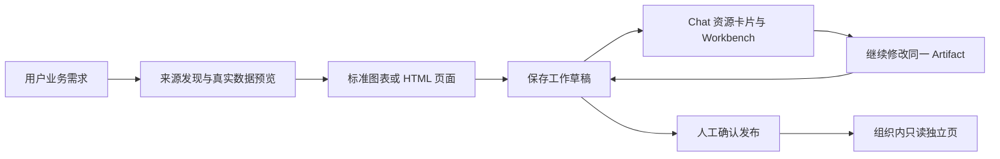

Artifacts Dashboard 是由 Live Dashboard 插件提供的可持续编辑的数据看板。用户在对话中描述业务需求，Agent 查询授权数据，生成标准图表或 HTML/JavaScript 页面，保存为同一个 Artifact 的工作草稿。用户确认后发布正式版本，并可向组织成员分享只读看板。

本文档描述当前实现，作为开发计划和阶段验收记录之外的功能说明。历史验收保留其日期和环境范围；本文不是正式发布或公开包兼容性声明。

## 功能流程

保存的是页面、控件、Binding 及依赖快照，不是查询结果。正式版本固定定义；打开、筛选或刷新时仍查询当前有权访问的数据。因此，固定版本看板不是历史数据快照。

## 分层与模块

| 层              | 当前责任                                                  | 代码入口                                                            |
| --------------- | --------------------------------------------------------- | ------------------------------------------------------------------- |
| contracts       | Binding、Dataset、字段、参数、完整性、新鲜度和来源标识    | `packages/contracts/src/analytics-query.model.ts`                   |
| 平台 Analytics  | 当前用户的数据源授权、Provider 分发、结果校验、期限与限额 | `packages/server/src/data-source/analytics/`                        |
| plugin-sdk      | Provider 注册、标准化与通用 HTML 文档宿主                 | `packages/plugin-sdk/src/lib/data/analytics/`、`artifact-document/` |
| 平台 Artifacts  | 稳定身份、工作草稿、正式版本、分享链接、展示授权          | `packages/server-ai/src/artifacts/`                                 |
| Cloud / ChatKit | 资源卡片、Workbench 导航、独立展示页与受控客户端命令      | `apps/cloud/src/app/artifacts/presentation/`                        |
| 来源插件        | 原生查询格式、发现、参数映射与 Dataset 投影               | `xpert-plugins/community/tools/analytics-*`                         |
| 看板插件        | 页面定义、Agent 工具、预检、控件、分享界面和渲染器适配    | `xpert-plugins/community/apps/live-dashboard`                       |

来源插件不实现页面编辑或图表渲染；平台不解释 SQL、本体 Action 或脚本业务逻辑。看板插件通过同一 Dataset 消费不同来源。

## 已提供的能力

- PostgreSQL、MySQL、Doris、data-xpert 本体、MCP、REST/JSON、Workspace Python/JavaScript，以及 CSV/JSON/XLSX 声明式文件数据来源。
- Data Analytics 标准渲染，以及 Agent 编写的 HTML/CSS/JavaScript 页面。
- 插件打包 ECharts 与 Three.js 核心库，依赖版本和源码随保存内容固定。
- 真实数据预览、筛选探测、HTML 渲染与交互预检、成功保存回执。
- 跨轮修改、草稿自动保存、人工定稿、正式版本历史及并发保护。
- 消息资源卡片在 ChatKit 自己的 Workbench 打开、切换和恢复。
- 正式版本的组织内只读分享、独立页浮层、筛选和刷新。

数据与页面边界见[数据协议与渲染](./data-and-rendering)；编辑、分享和导航见[生命周期与协作](./lifecycle-and-sharing)；环境与当前限制见[配置与能力边界](./configuration-and-limits)。

## 文档职责

本组文档维护当前功能、模块归属和接口行为。SDK 各能力文档继续维护具体 API；插件目录中的技能负责 Agent 操作流程，历史 acceptance 文档记录实际验证范围。开发计划中的已实现内容以本组功能说明为准；尚未实现的建议不作为产品承诺。
