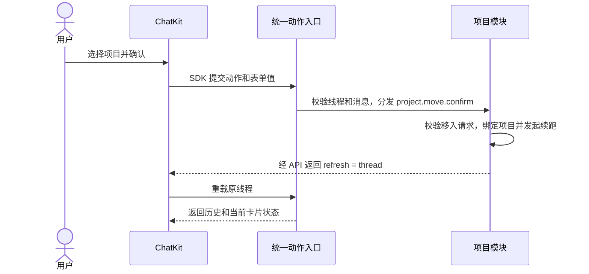

用户在一条助手回复里选择项目，点击“移入并继续”，就能在原对话看到看板继续生成。刷新页面后，同一条回复可以显示待确认的表单，也可以显示“已移入”。这套能力由两部分组成。**消息卡片提供者**（`@MessageWidgetProvider`）决定当前用户在这条消息里能看到什么。**动作提供者**（`@WidgetActionProvider`）按 Widget 类型集中声明一组操作，决定每次点击可以改变什么业务状态。

## 一张卡片如何到达原消息

卡片使用已有的助手消息内容格式 `TMessageContentWidget`。外层是 `type: 'component'`，内层是 `data.type: 'Widget'`。在 `data.widgets[]` 中，每个 A2UI surface 描述一块界面。`surfaceUpdate` 给出控件和数据绑定，`beginRendering` 指定根控件。ChatKit 在消息列表中就地渲染，宿主无需创建挂载点。

| 标识                    | 用途                                                                      |
| ----------------------- | ------------------------------------------------------------------------- |
| `threadId`、`messageId` | 定位卡片所属线程和原始助手回复。                                          |
| `widgetId`              | 标识这条消息上的卡片实例，与内容块的 `id` 一致。可采用稳定的业务记录 ID。 |
| `provider`              | 查找能重建这类卡片的提供者，例如 `project.move`。                         |
| `action.name`           | 查找能处理某个操作的 handler，例如 `project.move.confirm`。               |
| `surfaceId`、控件 `id`  | 供 A2UI 连接控件、布局和数据绑定。它们的作用范围是界面渲染。              |

1. **发卡。** 在助手回复完成前，从当前执行的 registry 取得 `ConversationRuntimeCapability`，调用 `publishWidget(this, { provider, widgetId })`。平台绑定本次执行的当前助手回复。已知同一线程的回复 ID 时可显式传入 `messageId`。线程和身份由宿主绑定。
2. **持久化。** 平台核对提供者身份和会话写入权限，将绑定写入 `chat_message_widget_reference`。同一个提供者重复登记同一绑定是幂等的。动态卡片在此保存的是引用，表单字段、项目列表和可执行动作由提供者按当前业务状态生成。
3. **穿插展示与原位恢复。** 当前回复执行期间发卡，会在该时刻的消息流中插入 Widget 内容块，并保存它在文本块之间的位置。后续文字使用独立内容块，因此同一回复可以包含“文字 → 卡片 → 文字”。实时发卡、消息结束、历史读取和重连快照都按提供者归组调用 `resolve(references)`。返回项必须匹配已登记的 `messageId` 和 `widget.id`。再次发布同一卡片会原位更新；没有已保存位置的引用显示在末尾。刷新只需读取业务状态，无需重跑模型。相同卡片重复推送不会清空当前页面中的表单输入；跨页面刷新保留未提交草稿仍需单独持久化。

受限会话先应用消息可见性规则。提供者只有显式设置 `visibleInRestrictedSessions = true` 才能为这类会话生成动态卡片，且仍须按当前查看者的权限筛选字段和选项。提供者可以省略无权查看的引用。提供者卸载后，若当前作用域已无可用实现，该卡片会隐藏；重新安装后，仍获授权的业务记录可以从原引用恢复。

## 点击“移入并继续”后发生什么

项目选择卡将确认按钮的 `action.name` 设为 `project.move.confirm`，并在**这个按钮所属 surface 的 `serverActions`** 中声明同名动作。按钮的 `action.context` 定义要提交的值。使用已有项目时，`mode` 固定为 `existing`，`target` 取自下拉框绑定的 `/existing`；新建项目时，`mode` 为 `create`，`target` 取自文本框绑定的 `/create`。



ChatKit 对列入 `serverActions` 的名称直接调用 `client.threads.submitWidgetAction`。SDK 分别编码 URL 中的标识，使用当前会话的身份发送请求。请求体直接包含 A2UI 解析出的表单值。下例中的 ID 是路径占位符。

```http
POST /api/ai/threads/{threadId}/messages/{messageId}/widgets/{widgetId}/actions/project.move.confirm
Content-Type: application/json

{"mode":"existing","target":"selected-project-id"}
```

统一入口校验线程参与权限、受限会话的访问范围，以及该助手消息是否属于发起动作的线程。以 `project.move.confirm` 为例，注册表在当前作用域查找 `project.move` 动作提供者，再查找其 `actions` 中显式声明的 `confirm`，将 `{ threadId, messageId, widgetId, fields }` 传给它。动作的来源校验有两种方式。

| Handler 声明                      | 动作依据                                                                                                                |
| --------------------------------- | ----------------------------------------------------------------------------------------------------------------------- |
| 默认或 `widgetSource = 'message'` | 平台核对已签发的引用及提供者当前恢复的 Widget，包括卡片 ID 和 `serverActions`；客户端可编辑的消息内容不能授予动作权限。 |
| `widgetSource = 'receipt'`        | Handler 根据服务端的业务记录（回执）自行核对线程、消息、卡片实例及当前允许的操作。项目移入使用这种方式。                |

两种方式都要求 handler 校验表单值、目标资源权限和业务状态，并处理重复提交。ChatKit 会阻止同一卡片上的并发点击。surface 可以设置 `requiresIdleThread: true`，让界面在当前执行结束后才可操作。客户端的这些限制只控制交互，服务端仍需独立检查状态。

Handler 返回 `{ refresh: 'thread' }` 时，如果用户仍停留在发起操作的卡片上，ChatKit 会重新加载原线程。返回 `{}` 时无需刷新。未列入 `serverActions` 的动作沿原有 A2UI `onAction` 回调分发，宿主可接入本地交互。

### 业务行为由提供者负责

以项目选择为例，项目模块负责选择申请、移入条件、目标权限、确认回执和续跑。它通过消息 provider 发出和恢复卡片，通过动作 provider 处理确认与取消。通用 `request_user_input` 工具继续负责澄清。能力配置、使用流程和当前限制见[将对话移入项目](/zh-Hans/guides/conversation-project-move)。

其他插件的业务卡片也使用同一套消息和动作机制。统一入口不决定项目策略，也不自行开始项目工作。各 provider 校验自己的业务状态，并在需要时返回通用刷新结果。

## 注册与模块边界

两个 Widget 注册器都继承 SDK 通用的 `NamedProviderRegistry`，由它验证实现结构、名称归属，并拒绝同一作用域中的不同实例占用同名标识。`BaseStrategyRegistry` 统一负责发现、生命周期订阅、作用域查找和清理。其他 Provider 类别也可按需使用这层严格约束；现有普通注册器保留原来的命名和替换行为。

平台的 `AIWidgetsModule` 统一承载动作入口与消息解析。SDK 装饰器声明注册类别和名称，加载器据此执行通用预检。插件只需在自己的 Nest 模块注册 provider，无需为每种卡片或动作修改 `AiModule`。插件发卡使用宿主绑定的 `ConversationRuntimeCapability`；平台内部项目服务使用构造注入和内部的类型化 CQRS 接口。

## 插件如何接入

以下示例给 `@example/dashboard` 插件增加一张看板发布审核卡。`DashboardService` 代表插件自己的业务服务。`reviewWidgetsForCurrentViewer` 应逐条校验查看权限并返回 `{ messageId, widget }`。构建发布按钮时，应在按钮的 `action.name` 和所在 surface 的 `serverActions` 中使用相同的 `publishAction`。服务端的 `publishFromWidget` 和 `cancelReviewFromWidget` 分别负责对应动作的表单校验、业务权限和状态变更幂等性。

```ts
import { Module } from '@nestjs/common'
import {
  ConversationRuntimeCapability,
  MessageWidgetProvider,
  WidgetActionProvider,
  type RuntimeCapabilityRegistry,
  type IMessageWidgetProvider,
  type IWidgetActionProvider,
  type MessageWidgetReference,
  type WidgetActionContext
} from '@xpert-ai/plugin-sdk'
import { DashboardService } from './dashboard.service'

const reviewProvider = '@example/dashboard:review'
const publishAction = reviewProvider + '.publish'

@MessageWidgetProvider(reviewProvider)
class DashboardReviewCards implements IMessageWidgetProvider {
  constructor(private dashboards: DashboardService) {}

  issue(capabilities: RuntimeCapabilityRegistry, widgetId: string) {
    return capabilities.require(ConversationRuntimeCapability).publishWidget(this, {
      provider: reviewProvider,
      widgetId
    })
  }

  resolve(refs: readonly MessageWidgetReference[]) {
    return this.dashboards.reviewWidgetsForCurrentViewer(refs)
  }
}

@WidgetActionProvider(reviewProvider)
class DashboardReviewActions implements IWidgetActionProvider {
  constructor(private dashboards: DashboardService) {}

  readonly actions = {
    publish: {
      execute: async (context: WidgetActionContext) => {
        await this.dashboards.publishFromWidget(context)
        return { refresh: 'thread' as const }
      }
    },
    cancel: {
      execute: async (context: WidgetActionContext) => {
        await this.dashboards.cancelReviewFromWidget(context)
        return { refresh: 'thread' as const }
      }
    }
  }
}

@Module({ providers: [DashboardService, DashboardReviewCards, DashboardReviewActions] })
export class DashboardPluginModule {}
```

以下是该提供者为一条审核记录返回的最小 Widget。`review-42` 是记录的稳定标识，“发布”按钮和 `serverActions` 引用同一个插件动作。

```json
{
  "id": "review-42",
  "type": "component",
  "data": {
    "type": "Widget",
    "category": "Dashboard",
    "widgets": [
      {
        "name": "review",
        "serverActions": ["@example/dashboard:review.publish"],
        "messages": [
          {
            "surfaceUpdate": {
              "surfaceId": "review",
              "components": [
                { "id": "caption", "component": { "Text": { "text": { "literalString": "发布" } } } },
                {
                  "id": "publish-button",
                  "component": {
                    "Button": {
                      "child": "caption",
                      "action": { "name": "@example/dashboard:review.publish", "context": [] }
                    }
                  }
                }
              ]
            }
          },
          { "beginRendering": { "surfaceId": "review", "root": "publish-button" } }
        ]
      }
    ]
  }
}
```

将消息提供者和动作提供者注册到插件自己的 Nest 模块即可使用平台统一入口。插件标识使用完整包名作为前缀，内置标识可以使用 `project.move` 这样的名称。在同类注册项、同一作用域中，两个不同实现不能占用同名标识。平台按组织、租户全局、系统全局、平台内置的顺序查找实现，插件加载和卸载会更新注册表。

动作提供者按 Widget 类型注册一次，卡片实例仍通过 `widgetId` 区分。每个 `actions` 成员实现 `IWidgetActionHandler`，本地名称只能包含字母、数字、下划线或连字符；全名为“提供者名称.本地动作名”。注册表只分发显式声明的自有成员，不调用任意类方法或继承属性。插件刷新、卸载影响整组动作。示例卡片仅声明 `publish`；即使 Provider 注册了 `cancel`，也必须在卡片当前的 `serverActions` 中提供该操作才能调用。消息恢复与动作处理保持两个独立契约。

如果需要让正在执行的模型等待用户补充一组字段，再把答案交回同一次执行，可参阅[运行中用户输入](/zh-Hans/guides/runtime-user-input)。
