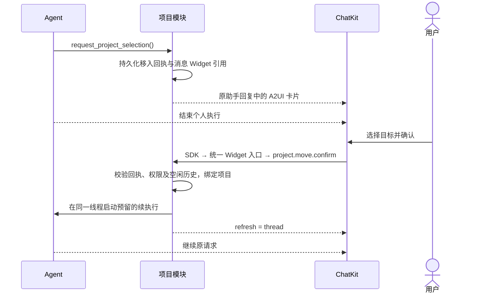

混合助理可以先在无项目的对话中讨论需求，等用户要求执行项目工作时，再提供“选择或创建项目”卡片。确认后，原对话与线程保持打开，历史消息保留，助理在目标项目里继续刚才的请求，用户无需重复发送。

如果助理从第一条请求起就必须使用项目，请使用[会话开始时准备项目](/zh-Hans/guides/conversation-project-bootstrap)。

## 开启能力

在 Assistant 创建、快速创建或能力设置中开启**项目管理**（`project-management`），然后保存并发布。该能力装配 `ProjectMiddleware`，提供无参数的 `request_project_selection()` 工具，用于选择或创建当前对话的目标项目。它暂不增加通用的项目搜索、修改或删除工具。

**项目任务**继续由 `ProjectTasksMiddleware` 负责。项目任务和实时看板也通过能力装配附带 `ProjectMiddleware`。同时启用时，会复用同一 Agent 上相同 provider 的连接，只暴露一个选择工具。取消独立的项目管理选项后，只要其他已开启能力仍需项目选择，该中间件就会保留。已有已发布助理需重新应用能力配置，或更新并发布模板，才能获得这个连接。

混合助理使用 `workspaceScope.mode: project-preferred`，默认从个人聊天开始。ChatKit 渲染消息 Widget，并通过 SDK 提交动作。项目模块根据经过授权的会话范围和迁移资格决定是否发卡，无需客户端声明能力标记。

## 在对话里选择目标

1. 开启个人对话，先讨论需求。例如：“先聊聊按区域比较销售额的口径，暂时不要制作。”仅提及看板、标题或样例，不应触发项目准备。
2. 要求助理开始执行，例如：“按刚才约定的口径制作看板。”Agent 根据当前请求和项目需求决定是否调用 `request_project_selection()`。这是模型的工具决策，不是界面按关键词自动弹卡。
3. 后端在对应助手回复中发送卡片。有创建权限时，通过单选按钮切换已有项目下拉框和新项目名称输入框；否则只提供已有项目。卡片会告知：有权查看目标项目的成员将能阅读本次对话的全部历史消息。
4. 选好目标，点击**移入并继续**。当前执行结束且所有分支空闲后，后端校验移入、绑定项目，并在同一线程里启动新的执行来继续原请求。
5. 卡片显示移入目标，工作台同步项目路由，新回复接在原历史后面。确认前取消会关闭卡片，不创建项目，也不续跑请求。

对话可以先进行任意轮已完成的普通讨论。“两轮执行之间”指个人执行已经结束，项目执行尚未开始。等待阻塞式澄清答案仍属于一次活跃执行，不能视为可移入的时点。

## 支持的会话和项目

当前流程支持创建者将自己的 Web 个人会话移入同一租户、组织下的项目，保留 conversation ID、当前 thread ID 以及所有分支的文字历史。不支持从项目移出，也不支持项目间移动。

检查范围覆盖整段会话及其他分支。支持文字、推理、普通澄清、项目选择，以及受支持的内置技能说明读取或激活摘要。带有附件、文件引用、已拥有的工作区或沙箱资源、目标、其他工具操作，以及待处理或活跃操作的会话不能移入。服务端在发卡时检查一次，确认时再检查已完整持久化的历史。

已有目标必须可访问、处于活跃状态，并允许当前助理执行。新建目标使用助理配置的项目类型，并要求项目创建权限。移入流程只创建直接项目类型。业务实体绑定的应用项目需通过所属业务流程创建，再作为兼容的已有项目选择。启动指南中的应用专属首次创建 provider 属于另一个入口。

### 工具前提与当前移入限制

没有项目时，已启用的中间件和工具仍然加载。工具各自检查前提条件；依赖项目的工具可以在访问项目数据或产生变更前返回 `PROJECT_REQUIRED`。Agent 获得的指引是先请求项目选择，再开始执行这些工作。Plan Mode 会移除项目选择工具并拒绝实际调用；已绑定项目的会话也不再提供该工具。

**失败的工具调用仍可能阻止移入。** 移入资格按持久化历史判断。非白名单工具留下的记录，不会仅因结果为 `PROJECT_REQUIRED` 就获得豁免。当前支持先请求项目卡片，再执行项目工具；不能保证任意“先调用工具、收到缺项目错误、再移入”的路径都可完成。

## 刷新、取消和重试

| 事件                       | 结果                                                                                       |
| -------------------------- | ------------------------------------------------------------------------------------------ |
| 待确认时刷新               | 在原助手消息恢复同一卡片，并按当前用户权限重新提供选项。未提交的表单编辑不跨页面刷新保存。 |
| 移入前取消                 | 持久化取消状态，下次读取历史时省略卡片，不启动续跑。                                       |
| 确认前发送新消息           | 分支头部变化，旧确认失效。                                                                 |
| 重复确认同一目标           | 复用预留的项目和续执行身份，不重复启动已经准入的执行。                                     |
| 项目绑定成功但续跑尚未启动 | 回执可以显示“继续”，重试启动预留的执行，不重复移入。                                       |
| 移入后刷新                 | 从原线程恢复已移入回执及后续回复。                                                         |

项目创建和初始化成功后才会绑定。新建目标使用稳定的预留项目 ID，因此绑定失败后重试可以复用已经准备好的项目。绑定后重试会核对已记录的目标，不能再选择另一个项目。

## 后端与 ChatKit 如何协作

`ProjectMiddleware` 调用注入的 `ProjectSelectionService`。服务将申请绑定到已保存的用户消息、来源助手回复、执行与线程；模型传入的 conversation ID 不能授权移动。服务在同一事务内保存回执与 Widget 引用，再发出卡片。选择请求成功后，中间件返回确认提示并结束当前轮。通用 `request_user_input` 工具仍只负责澄清。

项目的消息 provider 根据当前业务状态恢复卡片，动作 provider 通过[通用 A2UI 服务端动作机制](/zh-Hans/guides/chatkit-message-widgets)处理 `project.move.confirm` 和 `project.move.cancel`。ChatKit 通过 SDK 直接提交。Angular 不生成卡片、不转发业务动作，只在已保存的项目归属改变后同步路由。

确认时锁定会话及其分支，校验回执和目标权限，将会话绑定与回执的绑定状态一同提交。提交后，运行时用回执中稳定的 execution ID 启动新执行。`ConversationContinuation` 携带原用户消息 ID 和服务端确认文本，复用原用户消息，因此历史中不会多出一条重复请求。

项目专属准入校验位于项目模块的 `AssertProjectConversationAdmissionQuery` handler，在调用方的准入事务和线程锁内执行。单次准入避免重复启动续跑。旧个人执行仍可阅读，但移入后不能恢复或重试其检查点。新的执行从开始就使用目标项目环境。

确认和历史刷新对同一目标共享待完成的路由同步。原 ChatKit 实例保持挂载，较早导航被取消也不会清除较新导航的状态。

## 启用与验证

按正常 API 升级流程应用迁移，包括 `core.project.20261119000000-conversation-project-move`，并部署相互兼容的 API、Web 和 ChatKit 版本。需要时重新应用并发布助理能力或模板配置。插件激活本身不会更新已安装助理的图。

用普通请求分别检查已有项目和新建项目：先讨论数轮需求，再提出执行请求；待确认时刷新；确认后检查原会话历史保留，无需手动刷新便能继续；最后核对目标项目中实际保存的产物。还需检查取消、旧卡片失效、重复确认，以及带附件或活跃工作的会话被拒绝。

实现集中在 `packages/server-ai/src/xpert-project` 下：`plugins/project/project.middleware.ts`、`services/project-selection-request.ts`、`services/conversation-project-move.ts`、`services/text-conversation-eligibility.ts` 和 `conversation-project-widget-actions.ts`。通用消息与动作基础设施另见 A2UI 指南。
