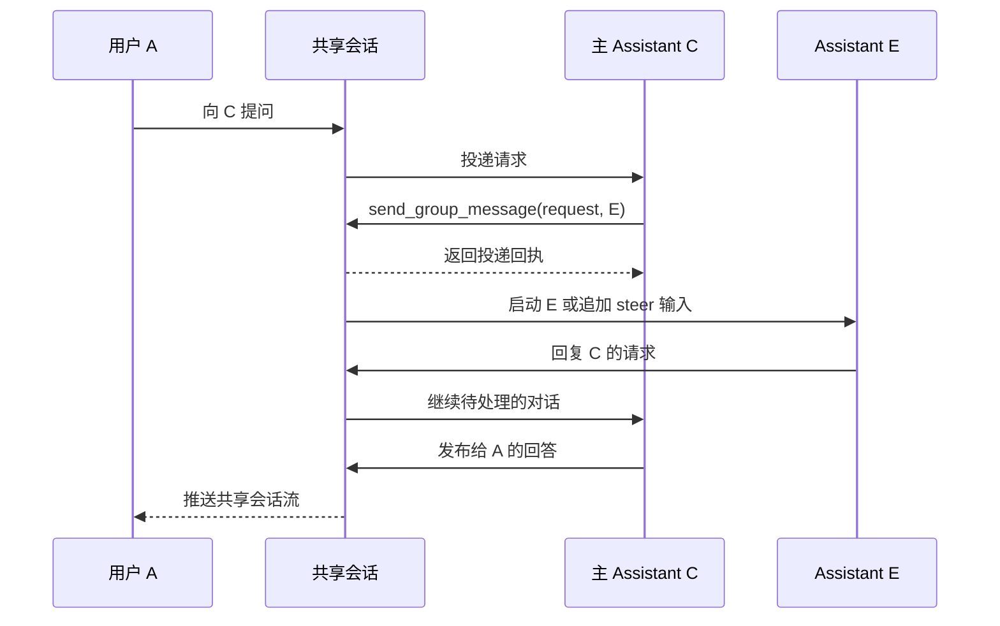
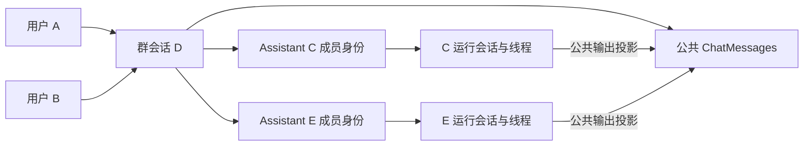

群聊让多位用户和数字专家（API 中称为 Assistant）在同一个共享会话中协作。所有成员看到相同的公共消息历史，每个 Assistant 则保留独立的模型上下文和执行线程。Cloud 与 Desktop 复用现有 ChatKit Chat、Composer、Header 和 Workbench。

本文描述群聊实现。下文的历史验收证据来自 2026 年 10 月 9–10 日，不代表当前版本已经重新完成同样的验证。

## 使用群聊

1. 从宿主应用的会话菜单创建群聊，输入标题并选择主数字专家。当前登录用户成为群主。
2. 打开群成员弹窗，邀请用户或其他数字专家。两类成员分别使用独立页签和可搜索的选择控件，候选列表和头像来自有权读取的用户与 Xpert 资料。
3. 发送没有 @ 提及的消息时，由主数字专家接收。通过输入框的 @ 选择器指定其他成员时，消息发给选中的成员；同一个公共问题可以同时发给多位成员。
4. 另一位已登录成员打开同一群聊后，可以实时查看消息和 Assistant 输出。关闭客户端不会停止已被接纳的 Assistant 执行。
5. 点击带执行链接的消息上的数字专家名称，可以在现有外部 Assistant Workbench 视图中打开执行记录；访问仍受额外的资源权限约束。

群聊和普通 Assistant 共用会话列表，通过 `purpose: 'group'` 区分。群头像由成员头像组合而成，不是侧栏中的独立固定分类。阅读位置、置顶和归档是个人偏好，不改变其他成员的列表。

人类群主管理成员。主 Assistant 是另一个概念，指 `ChatConversation.xpertId` 引用的 Xpert；其他 Assistant 成员各有自己的 Xpert ID 和运行绑定。成员移除操作不能移除群主或主 Assistant。已移除的成员记录保留用于历史归属，重新加入时恢复原成员身份和运行绑定。

所有群消息都向有权访问该群的成员公开，包括只发给某个人的消息。@ 提及用于路由，不是私信边界。受邀成员可以阅读已有公共历史，但加入群聊不会暴露其他人的会话或私有执行状态。

## 消息路由与成员间对话

| 场景                              | 路由与行为                                                                |
| --------------------------------- | ------------------------------------------------------------------------- |
| 用户发送没有 @ 的消息             | 主 Assistant 接收请求                                                     |
| 用户指定某个 Assistant            | 只有该 Assistant 接收，不会隐式加入主 Assistant                           |
| 用户指定另一位用户                | 对方收到公共消息，不启动 Assistant                                        |
| 用户指定多位成员                  | 一条公共消息为每个接收者分别记录回执；各 Assistant 可以独立运行           |
| Assistant 向另一个 Assistant 提问 | `send_group_message` 发布结构化 `request`，目标在自己的运行上下文中接收   |
| Assistant 回复另一个 Assistant    | 关联的 `reply` 完成原接收者的待处理请求，并可继续运行发起请求的 Assistant |
| Assistant 向用户提问              | 问题公开；有效且关联的用户回复可以继续运行提问的 Assistant                |
| Assistant 回复用户                | 回答公开并归属于该 Assistant，不会仅因其他 Assistant 能看见就启动它们     |
| Assistant 发布进度                | `message` 意图只发布信息，不唤醒指定的 Assistant                          |

通信意图与执行输入方式互相独立。内部协议包括 `request`、`reply` 和 `message`，运行中的 Assistant 通过 `steer` 接收输入。人类用户的输入框不提供排队 / steer 切换，也没有单独的广播模式；没有提及成员的消息发给主 Assistant。

### 用户的 @ 提及

公共发送接口接受文本、客户端生成的消息 UUID、可选的提及区间、回复元数据和输入框资源选择，不接受客户端指定作者、通信意图或接收者列表。

每个提及把群成员 ID 绑定到精确的 `@name` 文本区间。偏移量使用 JavaScript UTF-16 索引，起点包含、终点不包含。服务端检查成员是否活跃、显示名称、边界和区间不重叠。没有绑定的 @ 语法会被拒绝，不会按名称推测成员身份。

例如，从群快照选出有权访问的成员后：

```ts
const mention = `@${member.name}`
const input = {
  clientMessageId: crypto.randomUUID(),
  text: `${mention} 请确认交付日期。`,
  mentions: [{ participantId: member.id, start: 0, end: mention.length }]
}
```

将请求体发送到 `POST /api/ai/groups/:groupId/messages`。`member.id` 是群成员身份 ID，不是底层 User Account 或 Xpert ID。重试同一次提交时复用 `clientMessageId`。

`replyToMessageId` 不会覆盖提及路由。只有解析出的唯一接收者是原发送者时，用户回复才被视为协议回复；否则仍然是发给解析出的接收者或主 Assistant 的新请求。被引用的请求和回复成员还必须通过待处理请求校验。

### Assistant 请求与回复

运行时注入的 `send_group_message` 支持以下意图：

- `request`：提供 `text` 和 `recipientIds`，要求活跃成员回应。
- `reply`：提供 `text` 和 `replyToMessageId`，服务端从原请求解析接收者。
- `message`：提供 `text` 和可选的 `recipientIds`，发布进度而不启动其他 Assistant。

工具绑定到当前 Assistant 的群成员身份和执行，其参数不能选择作者或发起用户。生成文本中的普通 `@name` 仅用于显示，不会派发请求。

请求是异步的。工具返回已保存的消息 ID 和投递回执，不等待其他成员。发起请求的 Assistant 可以结束当前轮次，稍后通过有效回复恢复。进度消息不算完成请求，重复回复也不能再次完成同一个待处理接收记录。



因果元数据保留 `rootMessageId`、`rootUserId` 和 `hop`。服务端拒绝向自身发送请求，将因果深度限制为八层，每条链最多 32 条公共消息。回复不会隐式创建反向的新请求。

## 会话与持久化模型

群本身是现有 `ChatConversation`，其 `purpose='group'`，没有独立的 GroupConversation 实体。公共消息仍是普通 `ChatMessage` 记录，附带群通信元数据。

每位 Assistant 成员有独立的 `ChatConversation(purpose='group_assistant_runtime')` 和 `ChatConversationThread`，保存自己的模型历史、检查点和执行。这些会话不会出现在普通会话入口，也不是公共群线程中供用户选择的分支。



三个辅助实体实现共享的持久化接口：

| 实体                                               | 职责                                                                                                             |
| -------------------------------------------------- | ---------------------------------------------------------------------------------------------------------------- |
| `GroupParticipant` / `IGroupParticipant`           | 用户或 Assistant 成员身份、`owner` / `member` 角色、活跃状态、Assistant 运行绑定、上下文与阅读位置、个人列表偏好 |
| `GroupMessageRecipient` / `IGroupMessageRecipient` | 一条公共消息针对一个接收者的投递与消费、执行和输入引用、重试、租约及回复完成情况；它是回执，不是另一套执行队列   |
| `GroupInteraction` / `IGroupInteraction`           | 指定用户的审批或客户端工具交互，以及认领和响应生命周期                                                           |

公共 DTO 不包含技术主体和私有运行绑定。成员 `id` 标识群内身份，`subjectId` 则依据 `kind` 标识 User Account 或 Xpert。显示名称不用于确定身份或权限。

### 顺序与状态版本

- `ChatMessage.sequence` 定义公共消息顺序，更新已有发布内容时保持不变。
- `ChatConversation.lastMessageSequence` 在短事务的群记录锁内分配下一个序号。
- `ChatConversation.revision` 表示公共快照版本，包括没有产生新消息的成员和投递变化。
- 成员的 `contextSequence` 记录模型上下文进度，`readSequence` 记录该用户的阅读位置。
- SSE 事件 ID 是不透明的重放游标，不能与上述值互换。

实现直接使用这些最终字段名。早期草稿中的独立默认 Assistant 字段，以及带前缀的序号 / 版本列名，都不属于当前功能契约。

## Assistant 上下文与执行归属

每个 Assistant 接收自己的系统配置、成员目录、有限范围的公共群背景和当前指定输入。即使其他成员的文本以人类输入形式传给模型，他们仍是独立作者，不会被提升为系统指令，也不会被插入为当前 Assistant 自己的输出或工具结果。

当前投影读取成员上下文位置之后最多 40 条公共消息，排除当前输入、接收 Assistant 自己的消息，以及发给它的消息；这些指定消息保留独立投递回执。每条背景摘要最多 4,000 字符。这是有限范围的上下文投影，不表示自动读取全部历史 token。作为背景看到消息，不会消费其待处理请求。

只有公开回答文本会投影到共享消息和实时流。工具载荷、系统提示词、凭据、检查点和隐藏推理不进入公共群消息流，个人记忆和私有资源上下文也不会在成员间隐式共享。

共享群上下文还要求每个 Assistant 简短输出公开回复、进度和成员间消息，用业务语言说明结果或阻塞，避免内部技术细节，同时保留完整的必要交付物和证据。参见[群内回复方式](/zh-Hans/guides/group-project-tasks#群内回复方式)。

执行审计记录归属于实际触发执行的人类用户：

- 新的人类请求使用其认证 User Account。
- Assistant 间交接和续跑保留因果链中的人类发起者。
- 用户回复在派发该输入时使用实际回复者。
- steer 消息保留自己的发送者，不改写已经运行的执行创建者。

运行会话和线程最初在创建或邀请成员的用户下分配，首次执行时绑定到首位发起用户，之后各次执行记录自己的发起者。Assistant 技术主体用于标识它公开发布的消息，不是由人类发起的执行的创建者。

## 投递、steer 与恢复

群投递复用现有 Handoff 消息队列、派发处理器、运行准入和持久化后续输入机制，没有群专用的 Bull 队列，也不由浏览器负责消费队列。

```text
公共消息与接收回执一起提交
  -> GroupOutboxService / 现有 Handoff outbox 适配器
  -> agent.group_message.v1
  -> agent.chat_dispatch.v1
  -> 已授权的成员运行：send、steer 或明确 resume
  -> 公共输出投影与回执对账
```

短派发和忙碌运行的追加输入使用现有实时队列，长执行使用现有 Handoff 路径。生命周期回调核对完成状态，不把每个文本 token 变为队列任务；token 继续通过现有 Redis 运行流传输。

每个 Assistant 运行上下文独立控制准入。不同 Assistant 可以并行，同一 Assistant 的多个输入沿用现有单写入者边界。空闲目标启动新运行，忙碌目标收到持久化 steer。如果原运行在消费 steer 前自然结束，同一回执可以作为下一次 send 派发。暂停、中断、取消和授权检查仍是明确的控制边界。

每个接收者的状态包括 `pending`、`starting`、`steering`、`consumed`、`blocked`、`canceled` 和 `failed`。`consumed` 表示运行时已消费输入，不代表回答已经出现或所有用户已经阅读。这些状态与线程 / 运行状态、交互状态分别管理。

消息和回执在传输投递前提交。用户提交按群、发送者和客户端消息 ID 去重；Assistant 发布使用宿主生成的执行 / 输出键或工具调用键。有冲突的重试会被拒绝。租约和现有 outbox 扫描重试已提交的工作，不创建重复公共消息。恢复时核对已知执行事实；工作进程丢失且结果不明确时保留阻塞，不盲目重放模型或工具副作用。

`steer` 不保证立即打断模型正在生成的 token。输入消费取决于运行边界，自然结束后的续跑也可能受恢复延迟影响。历史测量结果见下文。

## 授权与 ChatKit 会话

访问群聊要求真实用户认证、正确的租户与组织上下文，以及活跃成员身份。只有群主可以管理成员。调用 Assistant 还需在发起用户的授权范围内检查已发布 Xpert 的访问权限。加入群聊不授予工作空间创作权限、项目访问权限或使用所有 Assistant 的权限。

嵌入式 ChatKit 通过现有会话接口使用 conversation 作用域：

```http
POST /api/ai/v1/chatkit/sessions
Content-Type: application/json

{
  "scope": {
    "kind": "conversation",
    "conversationId": "<group-conversation-uuid>"
  }
}
```

宿主使用现有登录状态和租户 / 组织请求头发送请求，然后通过 ChatKit 的 `api.getClientSecret` 返回 `client_secret`。conversation 作用域不能与会话请求中的 Assistant、项目、委派会话或用户覆盖参数混用。

授权使用 `USER_CONVERSATION` 和 `IApiPrincipal.resourceScope = { kind: 'conversation', conversationId }`，绑定真实用户，以及精确的租户、组织、会话和有效期。现有 Assistant 作用域的密钥不能扩大范围访问群聊。群业务入口和流刷新重新检查实时成员身份与有效期，私有运行和文件访问还有额外检查。

没有独立的群凭据请求头，也没有 `GroupsClient.createSession` 接口；签发和刷新都使用统一 ChatKit 会话机制。最初的群聊宿主集成曾使用已发布的 ChatKit 0.13.0 和 Xpert SDK 0.9.1 验证。新增群项目 API 及其发布顺序参见[群聊项目任务](/zh-Hans/guides/group-project-tasks)。

移除成员时，先撤销受影响的待处理工作和交互，再通过现有控制命令取消相关运行，不删除历史消息。在群里回复“同意”等普通文本，不会批准工具操作。

### 人工审批与客户端工具

运行中断会创建分配给真实 User Account 的 `GroupInteraction`。指定用户必须先用客户端认领 ID 认领，才能获取可操作请求并回应。并发窗口不能各自执行同一个已认领交互。群观察者只能看到状态，订阅或重放流不会认领或执行客户端工具。

运行控制携带精确 `runId`，防止过期的界面操作控制较新的运行。取消投递只影响尚未完成的处理，不能撤销已执行的外部操作。

## 实时更新与 Workbench

每个客户端打开群 SSE 连接，将公共快照与成员现有运行流中的文本增量组合起来。多位用户可以独立观察同一批执行，断开连接只释放读取器，不停止模型执行。

公共事件联合类型包含 `snapshot`、`text` 和 `resync`。快照包含一页已保存消息、成员、投递状态、运行和公共交互摘要。文本增量标识 Assistant 成员、运行及运行输出消息；输出 ID 此时还不是已保存的公共群消息 ID。

客户端按消息身份合并历史，并把流式输出与已保存的发布记录对应起来。分页使用 `before` 序号，返回结果按序号升序排列。`Last-Event-ID` 携带与群和查看者绑定的有限不透明游标，其中包含各运行的独立位置。无效游标触发重新同步，重放缺口需要重新读取快照，不能继续信任累计增量。

点击消息上的 Assistant 名称，打开现有外部 Assistant 执行视图。服务端从公共发布或接收回执解析运行会话、运行和可选的消息定位点，并重新检查 Assistant、工作空间及相关项目权限，仅有群成员身份不够。返回的显示投影用公共问题替换生成的人类上下文块，不暴露检查点或运行配置。

## 共享 ChatKit 界面

群模式扩展现有聊天组件，保留 Header 操作、输入框中的项目 / 文件 / 插件菜单，以及 Chat / Workbench 分栏布局。

- 当前用户的消息显示在右侧，不带头像；其他用户和所有 Assistant 显示在左侧。
- 同一作者的连续消息组成视觉分组，名称出现在开头，头像位于最后一条消息的左下方。相近时间戳合并显示，不在消息间重复。
- @ 提及显示在正文中，不再增加重复的接收者标题。回复关联保留在协议中，不额外渲染原消息引用块。
- Assistant 活动指示显示在消息下方，每个 Assistant 有自己的活动和投递状态。
- 群头像由成员头像组成，头像详情复用现有交互。成员管理使用带页签和搜索选择的弹窗；Cloud 创建弹窗使用 Zard UI，ChatKit 成员弹窗使用 shadcn UI。
- 气泡和头像圆角来自现有 ChatKit 主题半径，宿主与嵌入界面的颜色复用既有主题变量和派生规则，不增加额外颜色 token。

输入框的资源选择必须限定到唯一指定的 Assistant。服务端检查 `composer.participantId` 是否与解析出的接收者一致，并验证项目、文件、资源和能力权限。多目标消息不能混合私有输入框上下文，恢复为一个有效 Assistant 目标后，原菜单重新可用。

宿主导航保留嵌入的 ChatKit 框架，更新会话绑定与凭据。群模式不需要新聊天页或独立输入框；Workbench 没有合适初始视图时使用共享新标签页。

## API 与实现参考

以下路径均相对于 `/api/ai/groups`。HTTP 适配器位于 `AIModule`；`ChatGroupModule` 拥有群策略、成员、消息发布、投递、运行协调和投影。

| 方法与路径                                                            | 用途                                          |
| --------------------------------------------------------------------- | --------------------------------------------- |
| `GET /`                                                               | 列出当前用户的群                              |
| `GET /candidates`                                                     | 创建群前查询有权邀请的候选成员                |
| `POST /`                                                              | 使用 `title` 和主 `assistantId` 创建群        |
| `GET /:groupId`                                                       | 使用可选的 `before`、`limit` 读取快照或历史页 |
| `GET /:groupId/candidates`                                            | 在当前群上下文中查询邀请候选人                |
| `POST /:groupId/members`                                              | 使用 `kind` 和 `subjectId` 邀请成员           |
| `DELETE /:groupId/members/:participantId`                             | 移除符合条件的成员                            |
| `POST /:groupId/messages`                                             | 提交经过提及校验的用户消息                    |
| `PATCH /:groupId/preferences`                                         | 更新查看者的阅读序号、置顶或归档偏好          |
| `GET /:groupId/stream`                                                | 观察群公共 SSE 事件                           |
| `POST /:groupId/members/:participantId/control`                       | 暂停、取消或恢复指定运行                      |
| `POST /:groupId/messages/:messageId/recipients/:participantId/cancel` | 取消一个接收者的待处理投递                    |
| `POST /:groupId/interactions/:interactionId/claim`                    | 认领分配给当前用户的交互                      |
| `POST /:groupId/interactions/:interactionId/respond`                  | 使用成功认领的身份回应                        |
| `GET /:groupId/messages/:messageId/runtime/:participantId`            | 解析有权查看的 Workbench 执行投影             |

输入框适配器位于 `/:groupId/members/:participantId/composer`，Workbench 适配器位于 `/:groupId/workbench`，其中包括带作用域的工作空间文件查看会话。它们复用现有资源服务和授权，不向群凭据开放管理 API。

当前校验限制为：每群最多 32 位活跃成员，消息最多 32,000 个 UTF-16 代码单元，接收者最多 16 位且互不重复，提及区间最多 32 个，历史页最多 100 条消息，默认 50 条。支持 `owner` 和 `member` 角色，不包含早期草稿中的 admin / viewer 角色。

当前功能不提供将私有会话转换为群聊、定向私信、跨组织人类成员、编辑公共消息，或用户自行选择 Assistant 运行分支的能力。普通聊天分支仍是独立功能。

| 范围                        | 源码                                                                                                                                                                                                                                                                                                                                                                                                                                  |
| --------------------------- | ------------------------------------------------------------------------------------------------------------------------------------------------------------------------------------------------------------------------------------------------------------------------------------------------------------------------------------------------------------------------------------------------------------------------------------- |
| 公共协议与持久化接口        | [chat-group.model.ts](https://github.com/xpert-ai/xpert/blob/develop/packages/contracts/src/ai/chat-group.model.ts), [chat-group-entity.model.ts](https://github.com/xpert-ai/xpert/blob/develop/packages/contracts/src/ai/chat-group-entity.model.ts)                                                                                                                                                                                |
| 现有会话与消息扩展          | [conversation.entity.ts](https://github.com/xpert-ai/xpert/blob/develop/packages/server-ai/src/chat-conversation/conversation.entity.ts), [chat-message.entity.ts](https://github.com/xpert-ai/xpert/blob/develop/packages/server-ai/src/chat-message/chat-message.entity.ts)                                                                                                                                                         |
| 群实体与模块                | [group.entity.ts](https://github.com/xpert-ai/xpert/blob/develop/packages/server-ai/src/chat-group/group.entity.ts), [chat-group.module.ts](https://github.com/xpert-ai/xpert/blob/develop/packages/server-ai/src/chat-group/chat-group.module.ts)                                                                                                                                                                                    |
| 访问与成员                  | [group-access.service.ts](https://github.com/xpert-ai/xpert/blob/develop/packages/server-ai/src/chat-group/group-access.service.ts), [group-members.service.ts](https://github.com/xpert-ai/xpert/blob/develop/packages/server-ai/src/chat-group/group-members.service.ts)                                                                                                                                                            |
| 消息与校验                  | [group-messages.service.ts](https://github.com/xpert-ai/xpert/blob/develop/packages/server-ai/src/chat-group/group-messages.service.ts), [group.schema.ts](https://github.com/xpert-ai/xpert/blob/develop/packages/server-ai/src/chat-group/group.schema.ts), [group-mentions.ts](https://github.com/xpert-ai/xpert/blob/develop/packages/server-ai/src/chat-group/group-mentions.ts)                                                 |
| 运行与现有队列适配          | [group-runtime.service.ts](https://github.com/xpert-ai/xpert/blob/develop/packages/server-ai/src/chat-group/group-runtime.service.ts), [group-outbox.service.ts](https://github.com/xpert-ai/xpert/blob/develop/packages/server-ai/src/chat-group/group-outbox.service.ts)                                                                                                                                                            |
| 模型上下文与 Assistant 消息 | [group-context.ts](https://github.com/xpert-ai/xpert/blob/develop/packages/server-ai/src/chat-group/group-context.ts), [group-tools.service.ts](https://github.com/xpert-ai/xpert/blob/develop/packages/server-ai/src/chat-group/group-tools.service.ts)                                                                                                                                                                              |
| 流、交互与执行视图          | [group-stream.service.ts](https://github.com/xpert-ai/xpert/blob/develop/packages/server-ai/src/chat-group/group-stream.service.ts), [group-interactions.service.ts](https://github.com/xpert-ai/xpert/blob/develop/packages/server-ai/src/chat-group/group-interactions.service.ts), [group-runtime-view.service.ts](https://github.com/xpert-ai/xpert/blob/develop/packages/server-ai/src/chat-group/group-runtime-view.service.ts) |
| HTTP 入口                   | [group.controller.ts](https://github.com/xpert-ai/xpert/blob/develop/packages/server-ai/src/ai/groups/group.controller.ts), [group-composer.controller.ts](https://github.com/xpert-ai/xpert/blob/develop/packages/server-ai/src/ai/groups/group-composer.controller.ts), [group-workbench.controller.ts](https://github.com/xpert-ai/xpert/blob/develop/packages/server-ai/src/ai/groups/group-workbench.controller.ts)              |
| 统一会话输入                | [chatkit-session.schema.ts](https://github.com/xpert-ai/xpert/blob/develop/packages/server-ai/src/ai/chatkit-session.schema.ts)                                                                                                                                                                                                                                                                                                       |

Runtime 能力仍由所属的 [Xpert 能力服务](https://github.com/xpert-ai/xpert/blob/develop/packages/server-ai/src/xpert/runtime-capabilities/runtime-capabilities.service.ts)管理，跨领域通过明确依赖和有类型的 CQRS 操作连接，不是第二套群运行服务。

## 验证记录与限制

本节保留 2026 年 10 月 9–10 日的历史证据。整理文档没有重新执行模型调用、多用户浏览器验收或部署测试。

### 两位用户与两个 Assistant

10 月 9 日的本地验收使用已有 group-chat 工作树和数据库服务，API 端口为 3310，ChatKit 为 5310，Desktop 为 4391。两个人类账号 A、B 分别独立认证，两个专用已发布 Assistant C、E 配置 `qwen3.5-plus`、文本回答和群消息工具。验收没有伪造发送者字段，也没有修改已有业务 Assistant。

| 场景                             | 历史结果                                         |
| -------------------------------- | ------------------------------------------------ |
| 用户间提问、关联回复和连续消息   | 通过，A / B 身份正确区分                         |
| A 向 C 提问，同时 B 向 E 提问    | 两个 Assistant 均识别出正确的人类发送者          |
| C 向 E 提问，E 回复，C 为 A 汇总 | 通过真实 `send_group_message` 调用和请求关联完成 |
| C 回答 A 时，B 发送 steer        | 输入最终被消费且归属正确；延迟限制见下文         |
| B 问 C，C 问 A，A 回复，C 回答 B | 通过，A 使用现有输入框回复                       |
| 一个用户问题同时指定 C 和 E      | 两个 Assistant 均回答                            |
| B 连续发送消息                   | 显示为同一作者分组                               |

该轮产生 26 条唯一公共消息，序号连续为 1–26：A 六条、B 七条、C 十条、E 三条。最终检查时全部投递均已消费，没有失败、阻塞、取消或残留的活跃投递。

两个独立认证的 SSE 观察者各收到 22 个快照和 152 个文本增量，最终得到相同公共历史。采样中，从消息创建到首个观察者快照的间隔为 52–993 ms；这是本地观测，不是延迟保证。

实际 Desktop UI 从 A 的视角检查：A 的六条消息右对齐且无头像，其他 20 条左对齐，形成 15 个作者分组，头像位于各组左下方。还检查了组合群头像、成员弹窗和共享输入框。没有打开 B 的完整 Desktop UI；B 的身份、消息和实时更新通过独立登录、API 调用和 SSE 连接验证。

单个 Assistant 目标时文件与插件菜单可见；多个 Assistant 时受单目标上下文限制而禁用；恢复为单目标后重新可用。该轮未执行文件上传或插件业务操作。

### Steer 与审计补充验证

忙碌输入样本中，模型先完成原回答，再在后续运行中消费 B 的 steer。补充回答在 B 的消息创建后 **31.757 秒**出现，观测到的投递路径使用 30 秒重试间隔。这验证了输入接纳、身份保留和最终续跑，不代表能够立即中断生成。

后续审计修正将运行会话和执行归属于真实发起用户，而不是 Assistant 技术账号。记录中的验证包含 12 个测试套件、96 项测试，临时 PostgreSQL 用例覆盖交替人类发起者、Assistant 交接与回复、用户回复、steer、隔离和历史归属修复。一轮真实 C → E → C 交流产生三个已消费执行，均归属于认证用户。历史测试数据修复仅是本地操作，不是部署迁移，也不是受支持的公共修复接口。

受保护的本地回执保存在 `.xpert-local-environment/group-chat/`，包括 `multi-actor-results.json`、`multi-actor-dom-results.json`、`multi-actor-receipt.json`、`multi-actor-environment.json`，截图位于 `design-evidence/`。它们是本地证据，不是提交到代码库的测试样本。本文不包含凭据，以及组织、工作空间、账号、群或消息标识。

环境中还存在与这两个专用 Assistant 无关的默认 skill 初始化失败。群聊验收成功不代表全部插件或 skill 均已就绪。

### 包集成检查

记录中的 ChatKit 0.13.0 宿主升级通过了根目录、API 构建、API 生产、Web 和 Desktop 锁文件的冻结校验，以及 25 项依赖检查、七项 Desktop 群 / 列表测试、Cloud / contracts 类型检查。安装和嵌入 UI 资源也完成验证。较早的审查记录包含 382 项 ChatKit 测试，切换到已发布 SDK 0.9.0 后的另 72 项测试，以及 308 项 Desktop 测试和相关类型 / 构建检查。

这些历史检查对应不同版本，不能合并为最终状态的测试总数。依赖校验和本次文档整理都不代表最终集成后已重跑完整的双用户、双 Assistant 场景。

后续回归应在两个浏览器视角重复交互矩阵，并覆盖并发输入、重连 / 重放、成员移除、运行控制、交互认领竞争、输入框资源和执行视图授权。新的执行证据应与仅基于单测或代码审查的结论分开记录。

## 项目任务协作

Desktop 与 Cloud 共用 ChatKit 群项目入口。群主可以新建或选择有权访问的项目，明确选择参与项目的 Assistant 成员。协调者规划、派发和验收任务；平台记录真实执行并可靠返回结果。原生 Assistant 执行使用带群上下文的 `xpert-task`。设置方法、分批执行、负责人、依赖、领域 ER 图和执行流程参见[群聊项目任务](/zh-Hans/guides/group-project-tasks)。

## 相关功能

- [UserGroup 授权与工作空间运行访问](https://github.com/xpert-ai/xpert/blob/develop/docs/plans/PLAN_xpert_user_groups_access.md)描述已发布 Assistant 的访问用户组，不是聊天成员身份。
- [会话分支](https://github.com/xpert-ai/xpert/blob/develop/docs/conversation-branching.md)描述普通会话分支，不是群成员独立运行。
- [Conversation Map](https://github.com/xpert-ai/xpert/blob/develop/docs/conversation-map.md)描述 Workbench 会话导航。
- [Xpert Tag 提案](https://github.com/xpert-ai/xpert/blob/develop/docs/plans/tag.mdx)涉及外部 IM 渠道，是独立产品提案，本文不表示它已经实现。
