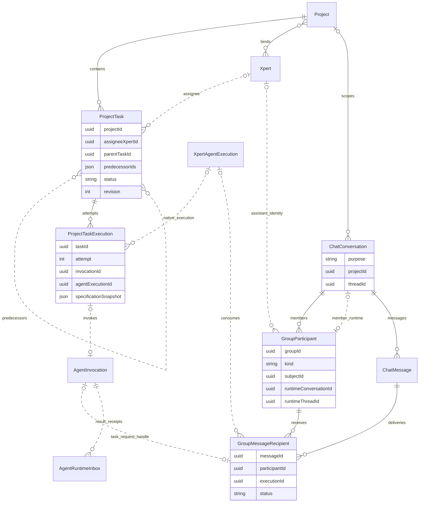
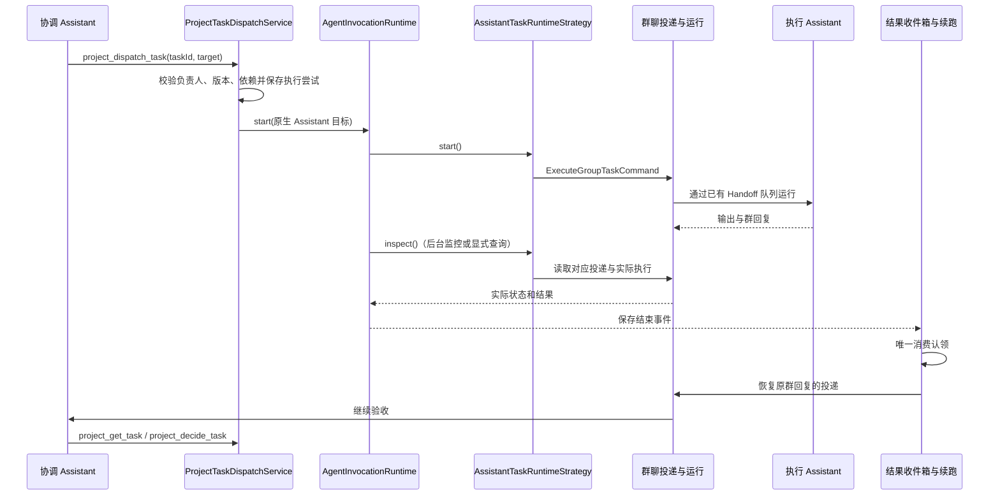

Desktop 和 Cloud 共用 ChatKit 的群聊项目管理入口。用户可以在群里关联一个项目，让协调 Assistant 创建任务、指定负责的 Assistant、设置前置依赖，并分批派发给群成员执行。任务视图保留每次执行和验收记录，群聊保留协作过程。

协调 Assistant 负责业务编排，平台负责可靠执行和结果送达。创建任务、设置依赖或修改计划日期，都不会自动启动执行。

## 开始使用

1. 新建协调 Assistant 时开启 **项目管理**，选择支持工具调用的模型。Desktop 在新建数字专家界面选择能力；Cloud 在 Assistant 创建向导的基本信息步骤选择。能力也可以在支持的 Assistant 设置中调整。
2. 创建群聊，邀请执行工作的 Assistant。执行成员需要具备其工作所需的模型和工具；如果也要读取或修改项目任务，可为其开启项目管理能力。
3. 群主打开输入框下方的**选择项目**菜单，选择已有项目，或通过**新建项目**填写名称。随后确认参与项目的 Assistant；主 Assistant 必须保留在选择中。点击确认后才创建或关联项目，取消确认不会创建项目。
4. 在群里说明目标、交付要求、负责人和先后顺序。协调 Assistant 使用项目任务工具保存计划、派发任务及验收结果。
5. 从 Workbench 的 **Project tasks / 项目任务** 查看任务列表、负责人、依赖、时间线和执行记录。

新建项目和绑定操作由 ChatKit 通过 Xpert SDK 调用统一后端，Desktop 和 Cloud 无需各自处理项目创建事件。

绑定后，同一个项目菜单显示项目名称，并提供**管理参与的 Assistant**。已参与的成员保留关联，可以勾选其他群成员并保存；没有变更时保存按钮禁用。非群主可以查看参与成员，不能修改。群聊标题栏不再提供独立的项目按钮。

### 项目选择和权限

- 群成员身份、项目的人类成员权限、项目绑定的 Assistants 是不同关系。加入群聊不自动获得项目编辑权限。
- 群主负责选择群项目；绑定已有项目还需要该项目的管理权限。实际任务操作始终检查当前业务用户的项目权限。
- 群成员共享 Assistant 运行会话，但每次实际执行仍归属于发起它的人类用户。任务入口通过群领域复查当前成员和项目绑定，不把首次创建该运行会话的人当作永久所有者；个人会话仍要求创建者匹配。
- 只有明确选入该项目的活跃 Assistant 群成员，才能成为本群项目任务的派发目标。负责人必须与选中的执行成员对应。
- 群项目确定后不能从此入口切换到另一个项目，可以继续加入符合条件的 Assistant。已有运行记录的成员会话不能静默切换项目，因此建议在开始对话前完成项目设置。
- 能力开关仅为 Assistant 配置任务工具与指令，不授予项目权限，不创建项目，也不自动配置外部执行环境。

## 群内回复方式

平台通过统一群聊上下文为每位收到消息的 Assistant 注入表达要求，涵盖协调者、执行成员、普通请求、任务派发和结果续跑。Desktop 与 Cloud 共用这一规则，不需要逐个修改 Assistant 的角色提示词，也不改变单聊行为。

- 默认使用用户的语言，控制在 1–3 个简短句子或要点，先说结果、阻塞或下一步，不重复计划或逐条播报操作。
- 群内可见回复、进度更新和发给其他成员的消息都遵守同一要求。
- 使用成员和任务名称说明工作，不向用户展示内部工具名或参数、内部 ID、路由信息、API 路径、运行队列机制、原始错误或调用栈。失败时用业务语言说明影响和下一步。
- 完整交付物和必要证据可以超过默认长度。简短表达不能省略要求、隐瞒阻塞或不确定性，也不能在执行或验收确认前声称成功。

例如，协调者可以回复：

> 已安排分析员调研竞品、数据员核对价格。两项验收通过后，写作员再编写报告。

执行成员可以回复：

> 已核对三款产品的价格，详情见价格表；其中一项报价日期待确认，暂不建议用于最终报告。

这属于模型表达指导，并非字符截断或技术信息过滤器。授权、工具输出隔离、凭据脱敏和执行记录访问控制仍由后端独立负责。

## 一个两批任务的例子

用户在群里对协调 Assistant 说：

> 请安排分析员调研竞品，数据员核对价格；两项都验收完成后，让写作员编写报告。分别保存负责人、依赖和执行记录，结果不符合要求时先返工。

协调 Assistant 保存以下任务：

| 任务         | 负责人 | 前置依赖 | 批次   |
| ------------ | ------ | -------- | ------ |
| T1：调研竞品 | 分析员 | 无       | 第一批 |
| T2：核对价格 | 数据员 | 无       | 第一批 |
| T3：编写报告 | 写作员 | T1、T2   | 第二批 |

接下来的动作是明确的工具调用，而不是创建任务后启动一个自动调度器：

1. 协调 Assistant 调用 `project_dispatch_task` 派发 T1 和 T2。
2. 平台向相应群成员投递请求。不同成员可以并行执行；同一成员的正式任务等待独立运行，不作为另一项任务的追加输入。
3. 执行结束后，平台保存结果，并通过群聊恢复协调 Assistant。成功执行的任务进入 `review`，失败进入 `blocked`；过期的结果不会覆盖已经修改的任务或新的验收决定。
4. 协调 Assistant 调用 `project_get_task` 读取实际结果和证据，再调用 `project_decide_task` 接受或要求返工。接受后任务才成为 `done`。
5. T1、T2 均完成后，协调 Assistant 显式派发 T3。提前派发会被依赖校验拒绝。
6. T3 执行、验收后，协调 Assistant 向用户汇总交付结果。

当前没有独立的 Batch 实体。分批通过任务的 `predecessorIds` 和协调 Assistant 的显式派发表达；`parentTaskId` 表示工作拆分，不替代前置依赖。

重试保留同一个任务，增加一次执行尝试：

```text
T1：调研竞品
├─ E1 → I1 → 分析员第一次执行：失败
└─ E2 → I2 → 分析员第二次执行：成功，等待验收
```

同一次工具调用重放会复用原有派发与执行记录。只有明确的新尝试才生成新的执行记录。

## 领域模型与关系

| 模型                    | 含义                                                                 |
| ----------------------- | -------------------------------------------------------------------- |
| `Project`               | 项目容器、人类成员权限和 Assistant 绑定                              |
| `ProjectTask`           | 要完成的业务工作，包含负责人、要求、依赖和业务状态                   |
| `ProjectTaskExecution`  | 一次执行尝试及执行时的任务要求快照                                   |
| `AgentInvocation`       | 一次统一调用，保存目标、运行状态、结果和恢复信息；可以与项目任务无关 |
| `XpertAgentExecution`   | Assistant 实际运行的记录                                             |
| `ChatConversation`      | 公共群聊或成员自己的运行会话，由 `purpose` 区分                      |
| `GroupParticipant`      | 用户或 Assistant 在某个群中的成员身份                                |
| `GroupMessageRecipient` | 一条群消息针对某个成员的投递、消费记录                               |
| `AgentRuntimeInbox`     | 统一运行结果收件箱，协调等待结果与自动续跑的消费归属                 |

以下为领域 ER 图。虚线是通过 ID 或 JSON 保存的逻辑引用，不保证存在数据库外键。图中仅展示 Assistant 类型的群成员，省略人类成员、任务步骤、产物等字段。



`AgentInvocation` 不会自动创建 `ProjectTask`。本流程先创建业务任务，派发时再保存执行尝试和调用。普通群聊消息也不会因为唤醒了 Assistant 就生成项目任务。

## 执行架构

群成员使用现有原生 Assistant 运行类型 `xpert-task`。群聊是执行的投递渠道和会话上下文，不单独注册 `xpert-group` Runtime，也没有 `GroupTaskRuntimeStrategy`。



### 派发与监控

`project_dispatch_task` 通过 CQRS 调用 `ProjectTaskDispatchService`，先保存执行尝试和不可变派发意图，再调用 Invocation API。群成员目标使用 `configuration.executionContext.type = "group_member"` 明确描述上下文，包含群、成员和项目引用。这些引用由后端从已授权关系解析，不能由消息正文决定。

`AgentInvocationRuntime` 根据 `provider = "xpert-task"` 选择 `AssistantTaskRuntimeStrategy`。后者通过作用域内的 `AssistantTaskExecution` 能力调用群聊领域的 `ExecuteGroupTaskCommand`。群聊领域负责发布请求、定位实际运行和精确取消，现有 Handoff 队列继续负责执行调度。

后台监控以及显式结果查询调用相同的 `inspect()`。只有对应投递所关联的真实执行才能提供结果，群里出现“已完成”字样不会直接完成任务。

### 结果回传与验收

所有正式运行结果先经过现有 Runtime Outbox / Inbox。等待结果和自动续跑争用同一条持久化消费记录，不再通过禁止群任务等待来规避重复消费。

- 成员成功回复通常已经出现在公共群聊中。正式任务的回复先保持可见，实际执行结束、结果记录和消费认领完成后，才恢复其对协调 Assistant 的投递。
- 同一条回复附加后端验证过的运行结果引用，不重复发布整段成功结果。
- 失败或没有回复文本时，平台发布一条可重试、可去重的状态通知。
- 结果续跑使用统一收件箱预留的执行 ID，通过原有群队列进入成员会话；结果收件箱不另行占用该成员线程启动模型。
- 如果当前协调轮次已经通过等待消费了结果，后台不会再为该结果自动唤醒一轮。
- 人工暂停、停止、成员移除和权限撤销仍然阻止不允许的续跑。未知执行结果不能作为重新启动模型或工具副作用的依据。

验收使用最新任务要求、执行尝试和结果版本。运行成功只能进入待验收状态。自动独立审查仍受现有执行器能力限制，不是群成员派发自动附带的能力。

### 会话失败提示

模型服务欠费、限流或其他执行错误会把群消息的对应投递标为 `failed`。Desktop 和 Cloud 的消息下方显示失败原因，并提供“助手处理记录”入口；记录中的 `error` 属于所选执行，不会被后续成功重试覆盖。错误文本去除凭据和调用栈，限制长度后返回前端。

旧版标为 `blocked / execution_not_completed` 的记录，若对应执行已明确失败，读取时同样显示失败原因，无需修改数据库。真正等待人工处理或执行结果不确定的阻塞仍保留 `blocked`。续费后需要重新发送请求，系统不会自动重跑原有失败消息。

## 工具和 SDK 接口

协调 Assistant 的主要工具：

| 工具                         | 用途                                                                               |
| ---------------------------- | ---------------------------------------------------------------------------------- |
| `project_list_task_runtimes` | 查询当前可用后台执行器与本项目的群成员目标                                         |
| `project_update_task_plan`   | 保存父子关系、前置依赖和计划时间，校验版本、跨项目引用和环路                       |
| `project_dispatch_task`      | 显式派发已存在的任务；群成员使用 `target: { type: "group_member", participantId }` |
| `project_get_task`           | 读取任务、尝试历史和已授权结果，不创建执行                                         |
| `project_decide_task`        | 根据实际证据接受或要求返工                                                         |

外部 Runtime 仍使用 `bindingId`，与群成员 `target` 二选一。群成员派发应省略 `bindingId` 和 `delivery`，当前使用普通 Assistant 输出，不支持在该派发入口要求 CLI 文件交付模式；`delivery` 不是一个接受字符串的渠道名称。

ChatKit 的项目设置调用 Xpert SDK：

| SDK 方法                                   | HTTP 路径                             | 作用                                        |
| ------------------------------------------ | ------------------------------------- | ------------------------------------------- |
| `client.groups.project(groupId)`           | `GET /api/ai/groups/:groupId/project` | 读取群项目与选入项目的成员                  |
| `client.groups.setProject(groupId, input)` | `PUT /api/ai/groups/:groupId/project` | 新建或关联项目，并绑定明确选择的 Assistants |

新建请求使用稳定的客户端项目 UUID；网络结果不确定时，UI 重试沿用同一个 UUID。已有项目使用 `mode: "existing"` 和项目 ID。后端锁定群记录并重新校验权限，避免并发窗口绑定不同项目。

`participantIds` 是本次明确选择的 Assistant 成员，必须包含主 Assistant。更新只增加关联，省略已参与的成员不会移除它；响应返回所有仍然活跃且已关联该项目的成员，与后续读取一致。项目创建和 Assistant 绑定复用项目领域的幂等操作；若设置中途失败，保留同一项目 ID 重试可以继续完成，不应更换 ID 再创建一个项目。

项目列表与已有项目名称的读取使用 `client.forGroupComposer(groupId, primaryParticipantId).projects`；群项目查询和保存使用原 `client.groups`。两者保留宿主配置的身份与组织上下文，各自走对应的授权路由。群聊凭据不能直接读取通用项目管理接口；界面读到 403 时应检查请求边界，不能通过更改成员权限绕过。

### 模块职责与依赖边界

| 模块                                                | 负责                                                 | 不负责                        |
| --------------------------------------------------- | ---------------------------------------------------- | ----------------------------- |
| ChatKit `ProjectSelector` / `ProjectManagementMenu` | 通用项目菜单、搜索与菜单操作                         | 群 API、任务派发              |
| ChatKit `useGroupProject`                           | 把群项目状态接入现有菜单，管理确认弹窗和焦点         | 项目权限判定、创建本地任务    |
| ChatKit `useGroupProjectForm` / `GroupProjectForm`  | 前者读取和保存成员，后者展示表单；关闭后忽略迟到响应 | 改动 Desktop / Cloud 宿主逻辑 |
| SDK `GroupsClient`                                  | 类型化请求、路径和取消信号，沿用宿主认证             | 权限规则、菜单状态、执行调度  |
| `GroupProjectService`                               | 群主校验、项目关联、成员运行会话绑定                 | 任务状态和验收                |
| `GroupTaskTargetService`                            | 从已保存的调用方会话解析目标，复查成员和项目授权     | 接受模型指定的群或用户身份    |
| `ProjectTaskDispatchService`                        | 任务要求、负责人、依赖、幂等执行尝试                 | 群消息发布                    |
| `AssistantTaskExecution`                            | 原生 Assistant 传输能力契约                          | 注册另一套群 Runtime 或调度器 |
| 群执行 / 结果 CQRS Handler                          | 请求投递、实际执行读取、精确取消和结果投递           | 决定任务是否验收通过          |
| Runtime Inbox / Continuation                        | 持久化结果消费认领及恢复                             | 越过群队列直接启动成员运行    |

跨领域操作通过有类型的 CQRS 命令连接，处理器在所属模块注册。公共文本提取、凭据脱敏为 `shared` 下的纯函数，群聊不依赖语音业务或 Invocation Activity 数据库服务。HTTP、View 和 Assistant 工具共用 `projectTaskPlanSchema`；工具额外限制一次提交的依赖数量，图的权限、版本和环路检查由 `ProjectTaskGraphService` 统一执行。

SDK 接口必须先发布，正式 ChatKit 依赖再更新到包含它们的版本。开发时可以通过受控的本地 SDK 构建验证，不能把本地联调成功视为正式包已发布。

部署或本地联调时，共享数据库的 API 和后台消费者必须使用兼容版本。仅隔离端口或队列前缀不会隔离数据库中的 Invocation、结果收件箱和群消息投递扫描；旧版本消费者可能抢先读取新任务并将其标记为不可访问。并行测试不同版本时应使用独立数据库，或在获得授权后暂停旧消费者。

## 回归验收

Desktop 和 Cloud 均从当前登录用户的 UI 创建测试群和项目，不使用其他账号创建的只读项目，也不修改角色绕过授权错误。

建议按以下顺序验证：

1. 新建 Assistant 时开启项目管理；创建群、邀请成员、从输入框下方项目菜单新建或选择项目，并确认参与成员。重新打开同一菜单，验证成员管理、取消确认、无变更保存和只读状态。
2. 创建上文 T1、T2、T3，检查负责人和 `T3 → T1、T2` 的依赖已保存。
3. 提前派发 T3 被拒绝；T1、T2 可以派发，不同成员并行，同一成员任务排队。
4. 检查真实执行记录、成功结果和待验收状态；验收完成后再派发 T3。
5. 重试同一次请求不会增加执行；有意返工增加一次尝试，旧记录仍保留。
6. 结果等待与自动续跑不能重复消费；成功回复不重复出现；失败和空结果仍可通知协调者。
7. 刷新或重连后检查任务、负责人、依赖和执行记录；验证暂停、取消、成员移除后的边界。
8. 检查协调者和执行成员的群内回复、进度和失败提示：默认简短、使用业务语言、不披露内部技术细节，且保留必要交付物、证据和阻塞说明。

自动测试使用独立的临时 PostgreSQL 数据库验证投递、幂等和消费竞争，模型与授权依赖在相应测试中使用受控替身。这类测试不能替代 Desktop / Cloud 的真实模型 UI 验收。

## 实现入口

- [项目设置服务](https://github.com/xpert-ai/xpert/blob/develop/packages/server-ai/src/chat-group/group-project/group-project.service.ts)
- [任务派发服务](https://github.com/xpert-ai/xpert/blob/develop/packages/server-ai/src/xpert-project/runtime/project-task-dispatch.service.ts)
- [原生 Assistant 运行适配](https://github.com/xpert-ai/xpert/blob/develop/packages/server-ai/src/agent-invocation/assistant-task-adapter.ts)
- [原生 Assistant 执行能力契约](https://github.com/xpert-ai/xpert/blob/develop/packages/server-ai/src/agent-invocation/assistant-task-execution.ts)
- [任务计划输入定义](https://github.com/xpert-ai/xpert/blob/develop/packages/server-ai/src/xpert-project/project-task-plan.schema.ts)
- [群执行投递处理](https://github.com/xpert-ai/xpert/blob/develop/packages/server-ai/src/chat-group/group-project/group-task-execution.handler.ts)
- [统一结果消费与续跑](https://github.com/xpert-ai/xpert/blob/develop/packages/server-ai/src/handoff/runtime-messaging/runtime-message-continuation.service.ts)
- [群回复恢复与结果关联](https://github.com/xpert-ai/xpert/blob/develop/packages/server-ai/src/chat-group/group-project/group-task-result.handler.ts)

## 相关文档

- [应用项目类型](/zh-Hans/guides/project-application-types)
- [Assistant 能力配置](/zh-Hans/guides/assistant-capabilities)
- [群聊](/zh-Hans/guides/group-chat)
- [项目任务与异步协作](/zh-Hans/guides/project-tasks)
