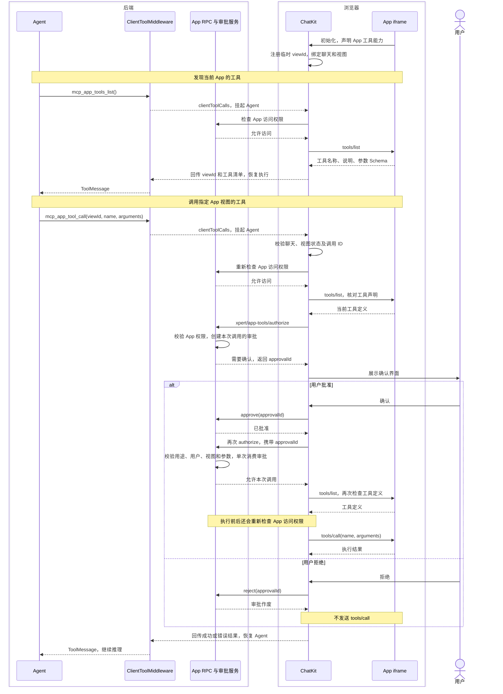

`McpAppToolsMiddleware` 让 Assistant 发现并调用**当前聊天中已打开的 MCP App 视图提供的工具**。工具由 App iframe 中的 JavaScript 实现，可以访问该视图的实时状态，例如选区、未提交的表单或图表配置。这些是能力示例，实际可用工具以 App 的声明为准。

## 两个工具入口

| 工具                 | 作用                                                                                             |
| -------------------- | ------------------------------------------------------------------------------------------------ |
| `mcp_app_tools_list` | 发现当前聊天内仍然有效的 App 视图，返回临时 `viewId` 和各视图声明的工具名称、说明、参数 Schema。 |
| `mcp_app_tool_call`  | 使用发现结果中的 `viewId`、工具 `name` 和 `arguments`，经用户确认后在指定视图执行。              |

例如，某白板 App 声明了“读取选区”和“移动元素”，Assistant 可以先发现工具，再请求操作当前白板。普通 MCP 服务端工具仍走服务端调用路径；仅提供 UI 展示的 App 不会因此自动获得视图工具。

## 为什么复用 ClientToolMiddleware

这两个入口在 Xpert 中属于 **Client Tools**：Agent 在后端发起调用，ChatKit 在浏览器中处理请求，并把结果交回后端。

`ClientToolMiddleware` 已提供“挂起 Agent → 客户端处理 → 回传结果 → 恢复运行”的执行机制，以及工具调用 ID 关联、错误结果和调用过程展示。`McpAppToolsMiddleware` 复用这条执行链，将 App 工具的固定名称、Schema、说明、图标和展示文案封装为一个可选择的中间件。

新增这个中间件的价值在于统一配置和职责边界。技术上，也可以在 `ClientToolMiddleware` 中手动配置同样的两个入口；专用中间件使 Assistant 无需逐个复制协议定义，且配置项不能替换这两个固定工具。

| 层次                    | 职责                                                                                                  |
| ----------------------- | ----------------------------------------------------------------------------------------------------- |
| `McpAppToolsMiddleware` | 向 Agent 暴露固定工具定义，配置调用展示，委托已有客户端工具执行机制。                                 |
| `ClientToolMiddleware`  | 中断并恢复 Agent，将客户端响应转换为 `ToolMessage`。                                                  |
| ChatKit                 | 管理当前聊天的临时视图注册表，定位确切视图，校验工具声明，展示确认界面，通过 `postMessage` 调用 App。 |
| 后端 App RPC 与审批服务 | 校验 App 实例访问权限，为本次调用创建、批准、拒绝及单次消费审批。                                     |
| App iframe              | 声明并执行视图工具，返回结果；工具实现如需后端操作，仍须遵守对应 API 的权限检查。                     |

## 什么时候使用

在 Assistant 编排中添加“当前应用视图工具”（`McpAppToolsMiddleware`）并连接到目标 Agent，适用于 AI 需要操作用户正在使用的交互式 App 的场景。平台注册此中间件不会自动为所有 Assistant 开启它。

运行时需要同时满足：

- ChatKit 支持这两个客户端工具入口，并处于当前聊天中。
- App 已打开，初始化时声明 `appCapabilities.tools`，且实现视图侧的 `tools/list` 和 `tools/call`。
- 当前用户仍有该 App 的访问权限；每次执行视图工具需要用户确认。工具发现本身不创建执行审批。

普通聊天、直接调用 MCP 服务端工具、只展示 App 内容，以及没有前端视图的后台任务，不需要配置这个中间件。当前聊天没有可用视图时，发现结果为空，不会启动一个替代视图。

`viewId` 绑定当前客户端、聊天和视图生命周期。重新挂载后应重新发现工具，不能保存旧 ID、猜测 ID，或把请求转给“最近打开的 App”。变更调用超时后，结果可能尚不确定，应先检查实际状态，再决定是否发起新的操作。

## 前后端调用时序

图中的 `ClientToolMiddleware` 执行由 `McpAppToolsMiddleware` 配置的两个工具。

审批使用 `purpose: 'view-tool'`，绑定用户、App 实例、`viewId`、工具名称和完整参数，不能与原有服务端工具审批混用。App 声明的只读提示不会免除本次视图工具执行的确认。后端授权响应仅允许这次调用；视图是否仍然有效、工具定义是否变化，以及实际向 iframe 发送请求，由 ChatKit 检查和执行。

## 与 WebMCP 的关系

**Client Tools 是 Xpert 的执行路由分类；MCP App 与 WebMCP 则定义网页能力的暴露和调用接口。** 这两层概念应分别理解。

| 类型                    | 工具实现位置                  | 调用方式                                                                   |
| ----------------------- | ----------------------------- | -------------------------------------------------------------------------- |
| MCP 服务端工具          | 后端 MCP Server               | 经 MCP 连接调用服务端工具。                                                |
| 本文的 MCP App 视图工具 | 当前 App iframe 的 JavaScript | ChatKit 通过 JSON-RPC over `postMessage` 发送 `tools/list`、`tools/call`。 |
| WebMCP 工具             | 网页 JavaScript               | 使用浏览器的 `modelContext` API 注册、发现和执行工具。                     |

MCP Apps 的宿主与视图通过 JSON-RPC over `postMessage` 通信，见 [MCP Apps 文档](https://apps.extensions.modelcontextprotocol.io/api/documents/Overview.html#bidirectional-communication)。截至 2026-11-14 核对的 [WebMCP 草案](https://webmachinelearning.github.io/webmcp/#api) 使用 `document.modelContext.registerTool()`、`getTools()` 和 `executeTool()`。当前这批实现没有接入 WebMCP API，已有 App 视图工具不会自动向浏览器的 WebMCP 使用方暴露。

## 实现位置

- Xpert：`packages/server-ai/src/xpert-middleware/mcp-app-tools.middleware.ts` 与 `client-tool.middleware.ts`。
- Xpert：`packages/server-ai/src/mcp-app-runtime/mcp-app-view-tools.ts` 与 `mcp-app-tool-approval.service.ts`；RPC 入口位于 `xpert-toolset/mcp-apps.service.ts`。
- ChatKit：`packages/chatkit-ui/src/components/thread/messages/mcp-app/bridge/app-tools.ts` 与 `useMcpAppTools.ts`；共享工具定义位于 `packages/chatkit/src/mcp-app-tools.ts`。

中间件通用模型与接线方式见[智能体中间件](./agent-middleware)。
