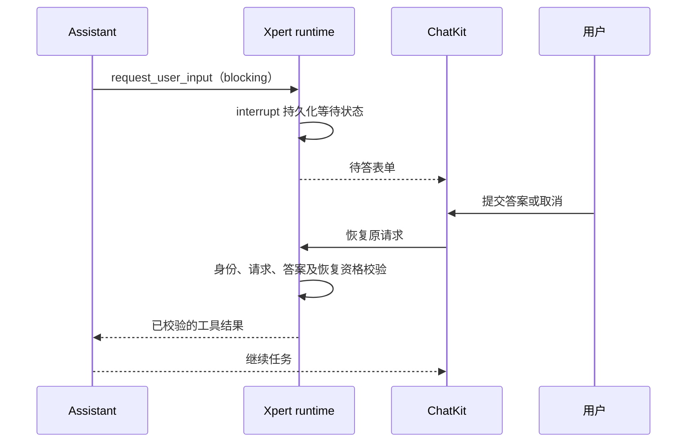

Assistant 可以在普通对话中主动询问缺失信息，以结构化表单收集答案，再继续原任务，无需开启 Plan Mode。本文描述 [Issue #1288](https://github.com/xpert-ai/xpert/issues/1288) 已实现的阻塞式功能。源码实现与本地联调完成不代表共享包已经发布或生产环境已经部署。

非阻塞提问尚未实现，其持久化、human message 投递和调度设计见[后续 proposal](../../proposal/issue-1288-non-blocking-user-input.md)。

## 使用方式

1. 在普通 Assistant 对话中提出任务，例如“安排一次内部培训，先向我收集培训目标、预算和参与部门”。模型先检查已有上下文，只对影响结果的缺失信息发起提问。
2. 提问面板显示在 ChatKit 输入区附近。此时执行等待输入，填写字段不会自动提交。
3. 点击“提交并继续”。客户端检查字段并定位首个错误，服务端再次校验答案；校验通过后恢复原任务。
4. 点击“取消填写”会把明确的取消结果返回模型。模型应说明资料不足或在明确假设下继续，不能把取消当作成功回答或操作授权。
5. 停止整项任务使用独立的停止操作。普通对话在新需求确实需要时可以再次澄清。

回答历史卡保留字段标签和选项标签，区分已提交与已取消。任务摘要以表单标题展示用户输入事项；群聊交互沿用发起 Agent 的回答入口。

刷新页面可以从持久化中断恢复待答请求，但尚未提交的填写草稿不持久化。不要把请求恢复理解为草稿自动保存。

## 字段与校验

| 字段类型      | 答案类型         | 组件与校验                                           |
| ------------- | ---------------- | ---------------------------------------------------- |
| `text`        | string           | Input；必填及最小／最大长度。                        |
| `textarea`    | string           | Textarea；必填及最小／最大长度。                     |
| `number`      | number           | Input；有限数值及最小／最大值，`0` 是有效答案。      |
| `select`      | string           | Select；只能提交已声明的 option value。              |
| `multiselect` | string[]         | Checkbox；选项合法、不可重复，支持最小／最大数量。   |
| `boolean`     | boolean          | Select；明确选择是／否，`false` 不视为空。           |
| `date`        | string           | Input + Popover + Calendar；有效 `YYYY-MM-DD` 日期。 |
| `date_range`  | `{ start, end }` | 两个日期端点；均须有效且开始日不晚于结束日。         |

表单包含 1–12 个字段。字段 ID 在同一表单中必须唯一，以字母开头，只包含字母、数字和下划线，最长 64 个字符；拒绝 `constructor`、`prototype`、`__proto__` 等保留 ID。字段 ID 和选项 value 是稳定的数据标识，不随显示文案改变。

客户端与服务端共用校验逻辑，拒绝未知字段、非法日期、倒置日期范围和未知选项，不把字符串 `"false"`、`"0"` 强制转换成布尔值或数字。可选的空值不作为已填写答案保存。

控件使用仓库的 shadcn/ui 组件，沿用主题颜色、圆角和密度。日期可直接输入，也可使用日历和键盘选择。字段滚动区域为外侧焦点光圈预留 6px 空间，避免父容器裁切；标题和底部操作保持对齐。

## 工具协议

工具名为 `request_user_input`。普通模式使用版本化表单，当前只支持 `schemaVersion: 1`、`mode: blocking`、`purpose: clarification`。

以下是工具参数示例：

```json
{
  "schemaVersion": 1,
  "mode": "blocking",
  "purpose": "clarification",
  "title": "补充培训需求",
  "fields": [
    { "id": "budget", "type": "number", "label": "预算", "min": 0, "required": true },
    { "id": "recording", "type": "boolean", "label": "是否录制", "required": true }
  ]
}
```

服务端将工具调用 ID 用作 `requestId`，以原工具调用中的表单为可信定义。提交结果的 `content` 包含 `type: request_user_input_result`、`schemaVersion`、`requestId`、`purpose`、`status: submitted`、`values`、原始 `form`，并保留兼容字段 `answers: []`。示例中的 `values` 可为 `{ "budget": 0, "recording": false }`。

取消结果使用 `status: cancelled`，不包含 `values`。服务端重新生成 purpose 和原始 form，验证 requestId 与工具调用一致，不信任客户端提供的表单或授权含义。

共享类型保留 `non_blocking` 及未来答案元数据类型，结构识别器也能识别该 mode；这不表示运行时支持。当前工具 JSON Schema 仅暴露 `blocking`，服务端和 ChatKit 拒绝执行非阻塞请求，不静默降级。

## 执行与恢复



普通输入恢复复用现有会话、执行身份、权限及 LangGraph 检查点。`run-create-stream.handler.ts` 先解析并校验目标执行，将输入恢复的唯一接管交给统一 chat admission，避免提前改写 `input_wait` 导致同一次恢复返回 409。重放已消费请求被拒绝，不清理或改写当前执行。

`client-tool.middleware.ts` 在 interrupt 和输入结果解析都返回后才创建服务端工具执行回执，避免挂起时留下在途回执、恢复时被判为重复工具调用。读取历史只恢复内置提问面板，不触发其他客户端工具。

## Plan Mode 与授权边界

- 可见、非结构化输出 Agent 在普通模式自动注入表单工具；隐藏 Agent 和结构化输出路径不注入该工具。
- Plan Mode 保留原 `questions` 协议、计划澄清和 `implement_plan` 实施确认流程。
- 普通表单的 purpose 固定为 `clarification`，即使某字段名为 `implement_plan`，也不能产生实施授权。
- 输入收集与工具 HITL 授权分别处理；表单不收集密码、令牌等凭证。

## 实现位置

ChatKit 路径相对于独立的 `chatkit-js` 仓库，其余路径相对于本仓库。

| 责任             | 关键文件                                                                                                                                          |
| ---------------- | ------------------------------------------------------------------------------------------------------------------------------------------------- |
| 共享协议与校验   | ChatKit `packages/chatkit/src/user-input-form.ts`、`interrupt.ts`。                                                                               |
| 工具及可信结果   | `packages/server-ai/src/shared/agent/user-input.ts`、`runtime-user-input.ts`。                                                                    |
| Agent 注入       | `packages/server-ai/src/xpert-agent/commands/handlers/subgraph.handler.ts`。                                                                      |
| 表单与日期组件   | ChatKit `packages/chatkit-ui/src/components/composer/user-input-form-panel.tsx`、`user-input-date-field.tsx`。                                    |
| 客户端提交及恢复 | ChatKit `packages/chatkit-ui/src/providers/stream/interrupts/useStreamUserInput.ts`、`useStreamInterrupts.ts`。                                   |
| 历史卡           | ChatKit `packages/chatkit-ui/src/components/thread/messages/request-user-input-result-card.tsx`。                                                 |
| 服务端恢复及回执 | `packages/server-ai/src/ai/commands/handlers/run-create-stream.handler.ts`、`packages/server-ai/src/xpert-middleware/client-tool.middleware.ts`。 |

## 验证范围与已知限制

2026-10-30 至 2026-10-31 的本地验证使用 Xpert Node 22.22.2 / Corepack pnpm 10.24.0、ChatKit Node 24.14.1 / Corepack pnpm 10.11.0。

- ChatKit 全量基线为 324 个文件、2327 条通过，另有 1 条已有跳过；后续 shadcn 组件改动针对性运行 7 个文件、49 条测试通过，焦点边框修复后表单组件 4 条测试通过。这些记录并非最后一次样式修改后的全量重跑。
- 服务端初期 46 条测试通过，包含真实 LangGraph + MemorySaver 检查点恢复；联调修复后关联回归共 64 条通过。最后一组依赖注入与隔离测试受既有 TS2589 影响，使用临时 isolatedModules 配置运行通过，未修改仓库测试配置。
- 共享包构建、UI 类型检查及 library/app 构建、完整服务端库与 API 构建通过。
- 真实 Assistant 使用已有 `qwen3.6-plus` 模型，经官方 SDK 验证八类字段、保留 `0`／`false`、提交继续、多轮澄清、取消、重复提交返回 409、Plan Mode 取消及刷新恢复。
- 浏览器组件验证包含提交／取消、必填提示、键盘日期选择、浅色／深色、圆角／直角、三种密度和窄屏；真实会话的跨 iframe 自动点击未完成，SDK 联调不能等同于浏览器端到端自动填写验收。

**跨客户端实时同步仍有限制：** 从另一个客户端提交后，原页面可能残留旧待答面板；重新加载可恢复正确状态。该场景不计入实时同步通过项，后续收敛方案见 proposal。未提交草稿持久化也不属于当前能力。

## 开发验证与发布依赖

前后端必须使用包含新导出的同一组共享协议与 ChatKit UI。旧版本 `@xpert-ai/chatkit-types` 不能直接运行这些服务端源码。本地真实联调使用同级 ChatKit 包链接；Xpert 的依赖版本和 lockfile 尚未更新。

ChatKit changeset 已声明共享包和 UI 包的 minor 变更。发布时先完成配套包发布，再更新 Xpert 依赖及锁文件并验证实际安装版本；本地链接验证不替代正式依赖验收。

在 `chatkit-js` 仓库、上述 Node 版本下运行：

```sh
corepack pnpm --filter @xpert-ai/chatkit-types build
corepack pnpm --filter @xpert-ai/chatkit-ui types
corepack pnpm --filter @xpert-ai/chatkit-ui build
corepack pnpm --filter @xpert-ai/chatkit-ui exec vitest run --maxWorkers=4
```

组件预览使用真实组件和合成数据，不连接后端或模型：

```sh
corepack pnpm --filter @xpert-ai/chatkit-ui exec vite --port 5188 --host 127.0.0.1 --strictPort
```

打开 `/dev/user-input/`。完整业务回归应另外在真实 Assistant 中验证：空提交提示、包含 `0` 与 `false` 的混合表单、提交后继续、第二轮取消、刷新恢复以及 Plan Mode 兼容。
