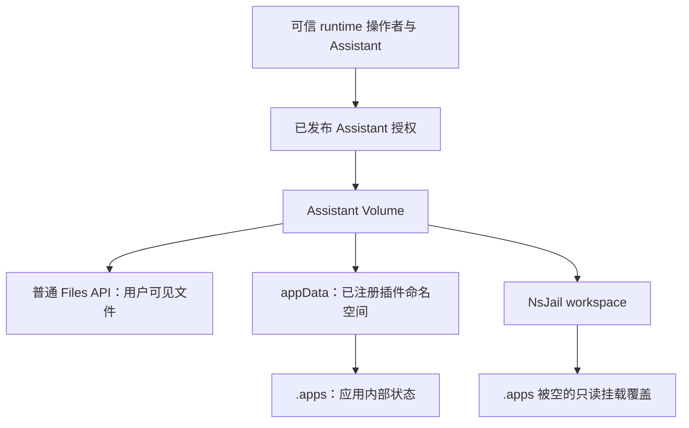

这份文档说明 `xpert` 当前的 Volume / Workspace 双层路径模型，以及 Xpert 运行数据的可选隔离策略。

核心约定有三条：

- `Volume` 永远表示 server 进程可见的文件系统路径。
- 本文路径模型中的 `Workspace` 表示 sandbox 可见的文件系统路径；它不等于数据库中的 `XpertWorkspace` 创作工作区实体。
- Project 是共享数据边界；非 Project 的 Xpert 数据归属由 Xpert 创建时的不可变策略决定。

两者不是同一个概念，但它们之间存在稳定映射关系。

## 文件工作区与创作工作区

`XpertWorkspace`（`xpert_workspace`、`xpert.workspaceId`）组织 Assistant、技能和连接器等创作资源，具有 owner/member 和 `canRead/canRun/canWrite/canManage`。Assistant file workspace 则是运行文件所在的 Volume 及其 sandbox 映射，二者不能共用一套读取权限判断。

非 Project Assistant 的文件卷通过 `resolveXpertDataVolumeScope()` 定位：`shared` 使用 tenant + Assistant，`user` 还包含当前用户。此过程不使用 `xpert.workspaceId`。`VolumeScope` 的 `workspaceId` 仅在它自身对应的 catalog 中具有意义，不应填到 Assistant 文件卷上。

运行态 API 使用 `AssistantFilesService.forRuntime()`；Studio 使用 `forAuthoring()`。两者通过 `ResolveAssistantFileAccessCommand` 校验各自的资源授权后，再访问同一个 Volume 存储实现。通过 UserGroup 获得 Assistant 使用权的用户可以操作它的文件，无需获得创作工作区读取权。

文件策略明确为：共享卷是协作目录，已授权用户可读、上传、修改和删除；用户独立卷允许相同操作，但仅限当前用户根目录。授权和数据归属由服务端决定，客户端不能指定其他用户或卷根。Project 卷继续使用项目授权，Studio 草稿继续使用创作授权。

本次修正保持目录、文件内容、`workspaceDataScope` 以及 Assistant 文件 API 路径不变。会话运行目录使用 `/api/ai/conversations/:id/workspace/*`；`/api/ai/conversations/:id/files` 专用于已解析的附件 FileAsset 列表，二者不得注册同名路由。SDK Workbench 客户端须同步使用 `/workspace` 路径；旧的单文件路由保留兼容。完整规则与凭证/文件链接有效期边界见 [权限指南](./permission#56-assistant-文件工作区授权)。

## 为什么要拆开

同一份底层数据，在不同运行位置看到的路径并不一样：

- server 直接跑在开发机上时，server 看到的是本机路径。
- server 跑在 Docker API 容器里时，server 看到的是 API 容器内路径。
- sandbox 跑在本机 shell 或另一个容器里时，sandbox 看到的是它自己的工作目录。

如果继续把这些路径都叫 `workspacePath`，调用方很容易把：

- server 路径
- Docker bind source
- sandbox 工作目录

混在一起传递。

新架构的目标就是把这三层拆开，并通过显式映射重新连起来。

## 核心对象

### `VolumeScope`

`packages/server-ai/src/shared/volume/volume.ts` 中的 `VolumeScope` 只表达逻辑卷定位，不表达 sandbox/provider 细节。

主要字段：

- `tenantId`
- `catalog`
- `projectId`
- `userId`
- `xpertId`
- `knowledgeId`
- `workspaceId`
- `environmentId`
- `rootId`
- `isolateByUser`

### `VolumeClient`

`VolumeClient` 负责 server 侧路径解析。

主接口：

- `resolve(scope): VolumeHandle`
- `resolveRoot(tenantId): { serverRoot, hostRoot }`

它不负责 sandbox 生命周期，也不直接推导容器工作目录。

### `VolumeHandle`

`VolumeHandle` 是一个已经解析好的 server-side volume。

关键字段：

- `scope`
- `serverRoot`
- `hostRoot`
- `publicBaseUrl`

关键方法：

- `ensureRoot()`
- `path(relative?)`
- `publicUrl(relative?)`
- `readFile()`
- `putFile()`
- `deleteFile()`
- `list()`

语义上：

- `serverRoot` 是 server 当前运行环境能直接访问的路径
- `hostRoot` 是 Docker bind mount 需要使用的宿主机路径
- `publicBaseUrl` 是浏览器或前端消费的 URL 前缀

### `WorkspacePathMapper`

`WorkspacePathMapper` 负责把 Volume 映射为 Workspace。

主接口：

- `mapVolumeToWorkspace(volume, options?)`
- `mapWorkspaceToVolume(binding, workspacePath)`

`WorkspaceBinding` 描述一次明确映射：

- `volumeRoot`
- `workspaceRoot`
- `workspacePath`
- `bindSource`
- `containerMountPath`

## 运行时实现

### `DevVolumeClient`

`DevVolumeClient` 表示 server 直接运行在本机文件系统上。

此时：

- `serverRoot === hostRoot`

根路径规则：

- `dev`、server 直接运行在本机且未配置 `SANDBOX_VOLUME` 时，默认使用 `~/data/${tenantId}`
- 其他情况下优先使用 `${SANDBOX_VOLUME}/${tenantId}`
- 如果没有 `SANDBOX_VOLUME`，则回退到 `~/data/${tenantId}`
- 只有显式设置 `SANDBOX_VOLUME_LAYOUT=legacy-flat` 时，未配置卷的 `dev` 才兼容旧的 `~/data` 扁平根

### `DockerVolumeClient`

`DockerVolumeClient` 表示 server 运行在 API Docker 容器内。

此时：

- `serverRoot` 使用 API 容器视角，例如 `/sandbox/${tenantId}`
- `hostRoot` 使用宿主机视角，例如 `${SANDBOX_VOLUME}/${tenantId}`

### `LocalShellWorkspacePathMapper`

本地 shell sandbox 直接工作在 server 可见路径上。

因此：

- `workspaceRoot === volume.serverRoot`
- `workspacePath === volume.serverRoot` 或其子路径

### `DockerWorkspacePathMapper`

Docker sandbox 会把一个精确的 Volume 根挂到容器内 `/workspace`。

因此：

- `bindSource === volume.hostRoot`
- `containerMountPath === '/workspace'`
- `workspaceRoot === '/workspace'`
- `workspacePath` 是把 server 侧子路径映射到 `/workspace/...` 之后的结果

## Runtime Workspace 文件能力

插件、Agent middleware 和异步队列不要直接用 Node `fs` 读取 sandbox 里的 `/workspace/...` 路径。`/workspace` 是 sandbox 视角的工作区挂载点，不一定存在于 API 进程或宿主服务器的同一路径上。

平台通过 runtime capability 提供统一的 workspace 文件入口：

```ts
const workspaceFiles = context.runtime.capabilities.require(WorkspaceFilesRuntimeCapability)
const file = await workspaceFiles.readRuntimeBuffer('/workspace/report.docx')
```

`platform.workspace.files` 支持三类 runtime locator：

- sandbox 绝对路径：`/workspace/report.docx`
- workspace 相对路径：`report.docx` 或 `./report.docx`
- 平台返回的 portable reference：`{ source: 'platform.workspace.files', filePath, workspacePath, catalog, scopeId, ... }`

解析规则：

- `/workspace/foo.docx` 或当前 `workspaceRoot/foo.docx` 会归一化为 Volume 相对路径 `foo.docx`。
- `foo.docx`、`./foo.docx` 按当前 Agent runtime workspace 的相对路径处理。
- portable reference 携带 catalog/scope，但不能覆盖当前 runtime 绑定的所有者或绕过授权。
- 默认 scope 由当前 Agent runtime 提供：存在 `projectId` 时使用 `catalog: 'projects'`；否则按 Xpert 持久化的 `workspaceDataScope` 使用 `catalog: 'xperts'` 或 `catalog: 'user-xperts'`。插件调用方不自行选择 Xpert catalog。

安全规则：

- 拒绝空路径、空字节、`..`、workspace 根目录本身，以及逃逸当前 workspace root 的绝对路径。
- 不在业务插件里硬编码 `/workspace -> /sandbox` 或本机路径映射。
- 不把 `/workspace/...`、`/sandbox/...`、宿主绝对路径持久化为业务文件引用。

读取接口会返回文件 bytes 和平台生成的 `WorkspacePortableFileReference`。需要延迟发送、重试或异步处理时，只持久化 portable reference 以及 `size`、`sha256` 等校验信息，不要把 base64 或 buffer 写入队列 payload。

写入新文件时使用 `writeRuntimeBuffer()`：

```ts
const written = await workspaceFiles.writeRuntimeBuffer({
  path: 'exports/report.docx',
  originalName: 'report.docx',
  mimeType: 'application/vnd.openxmlformats-officedocument.wordprocessingml.document',
  buffer
})

await outboundQueue.enqueue({
  fileRef: written.reference,
  size: written.size ?? buffer.length
})
```

这样插件只处理业务文件引用，路径归一化、scope 推断、Volume 读写和租户隔离都由平台统一负责。

## Assistant 应用数据

`WorkspaceFilesRuntimeCapability.appData()` 将插件内部状态保存在所属 Assistant 的文件工作区中，与普通文件共用 `platform.workspace.files` 能力入口。原有独立的 `AssistantWorkspaceStorageCapability` / `AssistantWorkspaceStorageApi` 已移除。SDK 必须提供 `appData()`，运行中的宿主也必须实现它；只更新插件依赖不会升级宿主能力。

### 选择文件入口

| 数据                                 | API                                                           | 在已授权 Assistant Volume 中的位置              |
| ------------------------------------ | ------------------------------------------------------------- | ----------------------------------------------- |
| 用户可见的导出文件与文档             | `readRuntimeBuffer()`、`writeRuntimeBuffer()`、`deleteFile()` | 普通路径，例如 `meetings/<meeting-id>/notes.md` |
| 内部清单、录音分片、检查点和同步回执 | `appData({ pluginName })`                                     | `.apps/<artifactNamespace>/...`                 |
| 协作文档状态                         | 平台 Collaboration 能力                                       | 平台管理的文档存储；Markdown 可以是其投影       |



### 绑定操作者、Assistant 和命名空间

从宿主提供的 scoped runtime 获取 API：

```ts
import { WorkspaceFilesRuntimeCapability } from '@xpert-ai/plugin-sdk'

const workspaceFiles = context.runtime.capabilities.require(WorkspaceFilesRuntimeCapability)
const state = workspaceFiles.appData({
  pluginName: '@example/plugin-notes',
  requireUserIsolation: true
})
```

`pluginName` 是插件自身的注册身份，由可信插件代码提供。宿主按当前组织、租户或系统安装范围查找已加载插件，并从其元数据解析 `artifactNamespace`。调用方不能指定物理目录或覆盖命名空间。注册命名空间只允许小写字母、数字和下划线（`^[a-z0-9_]+$`）。插件运行时元数据必须从自己的 `package.json` 读取 `version`、`xpert.plugin.level` 和 `xpert.plugin.artifactNamespace`。

每次操作都会重新校验已认证租户、组织、当前用户和确切的已发布 Assistant。UserGroup 授权可以独立于创作工作区成员身份生效，不能用创作工作区的 `canRun` 代替已发布 Assistant ACL。等待锁结束后也会重新鉴权。身份缺失、操作者改变、访问被撤销或插件元数据不可用时，应用数据访问失败。

数据范围由已发布 Assistant 决定：

| `workspaceDataScope` | Catalog                          | 租户 Volume 根下的标准路径                                            |
| -------------------- | -------------------------------- | --------------------------------------------------------------------- |
| `shared`             | `xperts`，`isolateByUser: false` | `xpert/<assistantId>/.apps/<artifactNamespace>/`                      |
| `user`               | `user-xperts`                    | `user/<currentUserId>/xpert/<assistantId>/.apps/<artifactNamespace>/` |

组织参与授权，不额外进入路径；用户是当前已认证调用者，不是 Assistant 创建者。`requireUserIsolation: true` 会拒绝共享 Assistant。`appData()` 当前要求 Assistant 绑定，拒绝 Project 绑定和其他 catalog，也不会回退到机器本地目录。

存储句柄会固定首次解析出的 Volume 和命名空间。二者变化后，必须重新验证业务范围，再创建新句柄。普通文件的私有绑定同样拒绝跟随策略变化进入共享目录，防止将私有投影复制到共享存储。`workspaceDataScope` 在创建 Assistant 时选择；这些防漂移检查不意味着支持原地切换策略或自动迁移数据。后台任务应恢复可信操作者与组织上下文，再取得 scoped API，不要序列化句柄或绝对路径。参见 [Managed Queue](./managed-queue)。

原生插件仍是可信服务端代码。此 API 约束按平台协议访问数据的插件，不是针对可直接访问宿主文件系统的恶意原生代码的隔离沙箱。

### 存储操作与并发更新

| 方法                                  | 行为                                           |
| ------------------------------------- | ---------------------------------------------- |
| `read(path)`                          | 返回某一完整文件版本的 `Buffer`                |
| `write(path, stringOrBytes)`          | 创建父目录并原子替换单个文件                   |
| `mkdir(path)`                         | 在应用命名空间内创建目录                       |
| `list(path)`                          | 返回直接子项名称，排除内部锁与临时项           |
| `remove(path)`                        | 删除文件或子树；不能删除命名空间根             |
| `withLock(key, callback, { waitMs })` | 将同一 Volume、命名空间和 key 的协作写入串行化 |

路径和锁 key 必须是规范的相对路径。拒绝绝对路径、反斜杠、NUL、`.` / `..` 段、重复或末尾的 `/`，以及 `.locks` 段及其大小写变体。只有 `mkdir('')` 和 `list('')` 接受命名空间根。应用相对路径中不要再加 `.apps/<artifactNamespace>` 前缀。

读取、校验与写入必须位于同一把锁内。下面的示例可以跨 API 实例初始化并更新经过 schema 校验的计数器：

```ts
import { z } from 'zod/v3'

const Counter = z.object({ revision: z.number().int().nonnegative() }).strict()

await state.withLock(
  'records/example',
  async () => {
    let bytes: Buffer | undefined
    try {
      bytes = await state.read('records/example/counter.json')
    } catch (error) {
      if (!error || typeof error !== 'object' || !('code' in error) || error.code !== 'ENOENT') {
        throw error
      }
    }
    const current = bytes ? Counter.parse(JSON.parse(bytes.toString('utf8'))) : { revision: 0 }
    await state.write('records/example/counter.json', JSON.stringify({ revision: current.revision + 1 }))
  },
  { waitMs: 10_000 }
)
```

宿主先写临时文件并刷盘，再用 rename 替换目标，最后刷写父目录。读者读取某一完整文件版本。这不是多文件事务，原子替换本身也不能串行化“读—改—写”。插件仍需负责 revision 校验、幂等、删除标记和恢复清单；同一业务资源的所有写入方必须使用同一个锁 key。

锁位于 `.apps/<artifactNamespace>/.locks/`，不放在可删除的业务文件夹里。当前实现每 10 秒尝试心跳，过期阈值为 120 秒；只有文件系统心跳成功才延长本地租约。变更前校验锁归属和有效期，旧回调不会释放接管者的锁。失锁后，该回调中后续的 app-data 和普通 Volume 写入、删除都会被拒绝。

`waitMs` 控制获取锁的重试时间，不是回调执行超时：默认 10 秒，最大 180 秒，`0` 表示不重试。必须在回调内 await 全部工作，脱离回调的异步任务不能继续使用已释放的租约。模型调用或网络请求等外部副作用不会被文件系统锁回滚。

### `.apps` 保护

普通文件列表、读取、编辑、上传、下载、目录归档和文件理解输入会拒绝或隐藏受管理状态。检查覆盖原始路径、真实路径别名、硬链接文件，以及 mounted-workspace 根目录别名。普通递归删除会检查后代，因此不能通过删除公开父目录来抹除其中受保护的 `.apps`。保留名称不区分大小写，也包括 `.workspace-write-*.tmp`。

NsJail Runner 协议 **3** 声明 `appDataProtection: true`。每次执行、终端和服务都会用空的只读挂载覆盖 `/workspace/.apps`，首次应用写入之前也如此。文件 RPC 和工作目录选择拒绝 `.apps`，宿主 app-data API 则在该挂载命名空间之外访问真实存储。

API 会拒绝旧 Runner 或缺少此能力的 Runner。升级时先更新 Runner，再更新 API，并重启现存 runtime。Local Shell 是可信开发执行模式，不提供这一操作系统级隔离；隐藏目录本身不是访问控制边界。

### 在平台统一配置持久存储

Meetings 没有固定的 `/var/lib/xpert/data/plugins/meetings` 目录，也没有独立 `dataDirectory`。存储根由平台 Volume 配置决定：

| 运行方式                 | 根路径与配置                                                       |
| ------------------------ | ------------------------------------------------------------------ |
| API 直接运行在开发宿主机 | `SANDBOX_VOLUME/<tenantId>`；未配置时为 `~/data/<tenantId>`        |
| API 容器                 | `/sandbox/<tenantId>`；部署将持久存储挂载到 `/sandbox`             |
| Docker 宿主机路径解析    | 配置了 `SANDBOX_VOLUME` 时，以其作为宿主机根，必须与实际挂载源一致 |
| NsJail Runner            | 其 workspace 挂载必须与 API/worker 挂载指向同一份底层数据          |

在平台环境配置中设置 `SANDBOX_VOLUME`，并在部署配置中设置 API/worker/Runner 的实际挂载；设置环境变量不会创建共享存储。当前仓库的 `docker-compose.yml` 和 `.deploy/nsjail-runner/docker-compose.nsjail.yml` 将 `./docker/volumes/api/sandbox/` 绑定到 `/sandbox/`，只修改 `SANDBOX_VOLUME` 不会重写这两个显式挂载。

多实例时，所有访问这些文件的 API/worker 必须挂载**同一个持久文件系统**。不同机器上同名的本地目录既不共享数据，也不共享锁。文件系统必须支持目录原子创建、rename，以及一致的元数据和心跳可见性；对象存储桶或对象存储 FUSE 挂载不属于此后端。此功能应使用标准租户/作用域分层布局，不使用仅供开发兼容的 `legacy-flat`。具体路径解析见下方根路径矩阵。

### Meetings 示例与排查

Meetings 要求按用户隔离的 Assistant。录音分片、capture 绑定、清单、检查点和同步回执使用 `.apps/meetings/records/` 与 `.apps/meetings/captures/`；用户可见 Markdown 和导出文件位于同一用户/Assistant Volume 的 `meetings/<creation-date-title-meeting-uuid>/`，不放在 `sessions/` 中。文档初始化后由平台 Collaboration 存储 CRDT 状态，Markdown 与清单中的文档检查点是投影。本次重构不迁移旧插件目录的数据。

| 现象                                | 检查项                                                                           |
| ----------------------------------- | -------------------------------------------------------------------------------- |
| `appData` 不可用                    | 宿主与 SDK 兼容性；不要加入本地文件系统回退                                      |
| `assistant_user_workspace_required` | 应用要求 `workspaceDataScope: user`，共享 Assistant 不能保存此应用的私有数据     |
| `403`                               | 操作者、组织和确切已发布 Assistant 的授权；普通 Files 还需检查是否触及受管理路径 |
| 解析插件命名空间时 `404`            | 插件是否在当前安装范围已加载，注册元数据是否有效                                 |
| `EINVAL`                            | 相对路径非法，或句柄对应的 Volume/命名空间发生变化                               |
| `ELOCKED`                           | 同一资源被其他执行者持锁，按业务策略重试                                         |
| `ELOCKLOST`                         | 停止旧操作，重新获取锁并读取后再计算；检查文件系统延迟、进程停顿和共享挂载一致性 |
| 不同实例读到不同状态                | 比较实际挂载、租户、当前用户、Assistant 和命名空间，不能只比较路径字符串         |

实现由 `packages/server-ai/src` 下的 `workspace-storage.spec.ts`、`workspace-managed-path.spec.ts`、`assistant-files.integration.spec.ts` 和 mounted-workspace 上传测试覆盖。Runner 回归位于 `.deploy/nsjail-runner/test_runner.py`，`verify_app_data.py` 在一次性容器中验证真实 Linux 挂载/RPC 隔离。这些检查覆盖进程并发、原子读取、锁接管、权限撤销、作用域漂移和受保护路径别名；部署验收还需确认实际共享文件系统与挂载配置。

## 根路径矩阵

根路径计算集中在 `packages/server-ai/src/shared/volume/volume-layout.ts`。

### API 容器根

`getApiContainerSandboxVolumeRootPath(tenantId)`：

| 场景                                                    | 返回值                          |
| ------------------------------------------------------- | ------------------------------- |
| `dev`、server 不在 Docker 且未配置 `SANDBOX_VOLUME`     | `~/data/${tenantId}`            |
| `dev`、未配置卷且 `SANDBOX_VOLUME_LAYOUT=legacy-flat`   | `~/data`                        |
| `dev` 且 server 不在 Docker 中，已配置 `SANDBOX_VOLUME` | `${SANDBOX_VOLUME}/${tenantId}` |
| `dev` 且 server 在 Docker 中                            | `/sandbox/${tenantId}`          |
| 非 `dev`                                                | `/sandbox/${tenantId}`          |

### 宿主机根

`getDockerHostSandboxVolumeRootPath(tenantId)`：

| 场景                                 | 返回值                          |
| ------------------------------------ | ------------------------------- |
| `dev`、server 不在 Docker 且未配置卷 | `~/data/${tenantId}`            |
| 显式启用 `legacy-flat`               | `~/data`                        |
| 已配置 `SANDBOX_VOLUME`              | `${SANDBOX_VOLUME}/${tenantId}` |
| 其他未配置 `SANDBOX_VOLUME` 的场景   | 回退到 API 容器根               |

### 默认分层与旧扁平布局兼容

server 直接运行在本机且未配置 `SANDBOX_VOLUME` 时，现在默认使用分层布局：

```text
~/data/<tenantId>/project/<projectId>/...
~/data/<tenantId>/xpert/<xpertId>/...
```

因此不同 Project、不同共享 Xpert 不会再把整个 `~/data` 当作自己的 Volume 根，Project 资产索引和会话附件投影也只会遍历或写入选中的逻辑子树。

只有同时满足下面条件时，才启用旧扁平模式：

- `environment.envName === 'dev'`
- 未配置 `SANDBOX_VOLUME`
- 显式设置 `SANDBOX_VOLUME_LAYOUT=legacy-flat`

兼容模式下：

- `serverRoot` 和 `hostRoot` 都会直接落到 `~/data`
- 旧的共享逻辑 catalog 继续共用这一个根目录；`user-xperts` 始终保留 `user/<userId>/xpert/<xpertId>` 叶子，历史 `xperts + isolateByUser: true` 保留 `xpert/<xpertId>/user/<userId>` 叶子，`runtime-jobs` 也保留独立任务子树
- public URL 会经过 `normalizeSandboxPublicVolumeSubpath()` 做兼容归一化

`user-xperts` 的 public URL 不参与旧前缀归一化，避免私有 URL 被改写成匿名共享路径。

切换布局不会移动、复制或删除任何现有文件。需要继续读取历史扁平数据时，应显式启用 `legacy-flat`；需要迁移到默认分层布局时，由开发者确认目标 tenant/catalog/id 后人工处理。历史 `xperts + isolateByUser: true` 仍使用真实的 `xpert/<xpertId>/user/<userId>` 叶子和鉴权 URL。生产多租户的符号链接边界依赖 Linux 的 `/proc/self/fd` 目录句柄锚定；macOS 原生运行仅作为单用户本地开发模式，不作为多用户安全部署形态。

这也是开发环境里 “磁盘根路径” 和 “逻辑 URL 子路径” 看起来不完全对齐的主要原因。

## 逻辑 Volume 子路径

`getVolumeSubpath()` 定义了逻辑子路径：

| `catalog`                         | 子路径                             |
| --------------------------------- | ---------------------------------- |
| `environment`                     | `/environment/${environmentId}`    |
| `knowledges`                      | `/knowledges/${knowledgeId}`       |
| `projects`                        | `/project/${projectId}`            |
| `skills`                          | `/skills/${rootId}`                |
| `users`                           | `/user/${userId}`                  |
| `workspaces`                      | `/workspaces/${workspaceId}`       |
| `xperts` 共享                     | `/xpert/${xpertId}`                |
| `user-xperts` 按用户隔离          | `/user/${userId}/xpert/${xpertId}` |
| `xperts + isolateByUser: true` 旧 | `/xpert/${xpertId}/user/${userId}` |

基于这个子路径，可以得到：

- Volume 路径：`volume.serverRoot`
- Public URL：`getVolumePublicBaseUrl(scope)`

示例：

| 逻辑对象             | server 侧路径                                          | public URL                                            |
| -------------------- | ------------------------------------------------------ | ----------------------------------------------------- |
| 项目                 | `/sandbox/${tenantId}/project/${projectId}`            | `/api/sandbox/volume/project/${projectId}`            |
| 用户                 | `/sandbox/${tenantId}/user/${userId}`                  | `/api/sandbox/volume/user/${userId}`                  |
| Xpert 共享卷         | `/sandbox/${tenantId}/xpert/${xpertId}`                | `/api/sandbox/volume/xpert/${xpertId}`                |
| Xpert 用户隔离卷     | `/sandbox/${tenantId}/user/${userId}/xpert/${xpertId}` | `/api/sandbox/volume/user/${userId}/xpert/${xpertId}` |
| Xpert 历史用户隔离卷 | `/sandbox/${tenantId}/xpert/${xpertId}/user/${userId}` | 保留历史 portable reference 读取兼容                  |
| Workspace            | `/sandbox/${tenantId}/workspaces/${workspaceId}`       | `/api/sandbox/volume/workspaces/${workspaceId}`       |

`user-xperts` 的 HTTP 路由要求登录，并校验当前租户和当前用户。历史 `xperts + isolateByUser: true` 使用独立的兼容鉴权路由执行相同校验。匿名通用 Volume 路由会拒绝 `user/<userId>/xpert/<xpertId>` 和 `xpert/<xpertId>/user/<userId>`，也会在解析真实文件路径后再次拒绝指向这两类目录的符号链接，不能通过回退路由绕过鉴权。

因此，`/user/<userId>/xpert/<xpertId>` 与 `/xpert/<xpertId>/user/<userId>` 是保留的私有命名空间。共享 `users` 或 `xperts` Volume 即使能创建同形目录，其 HTTP 文件访问也按私有目录处理；不要把共享数据放在这两个保留子树中。除此之外，共享 `xperts` URL 的历史行为不在本次改造中收紧。

## Xpert 工作区目录规则

Xpert 运行时工作目录由 `XpertWorkAreaResolver` 统一解析，入口在 `packages/server-ai/src/shared/volume/work-area.ts`。

设计原则：

- Project Volume 是项目成员的共享数据边界；同一 Project 中的多个 Xpert 挂载同一个项目根。
- Project 中每个 Xpert 的默认 cwd 是项目 Volume 根；Agent 子目录不是独立的安全边界。
- 非 Project Xpert 根据创建时的 `workspaceDataScope` 选择共享根或按用户隔离根。
- `workspaceDataScope` 默认是 `shared`，创建后不可修改；复制 Xpert 时可以在创建新记录前重新选择。
- `shared` 是显式共享成果目录。Project 中多个 Xpert 都能访问项目根及 `shared/`。
- Xpert 长期 FileMemory 与所选运行数据根保持一致。
- Agent invoke、terminal、sandbox upload、conversation workspace files、managed sandbox service 都应该使用同一套 resolver 结果，避免 Agent cwd 和终端 cwd 不一致。
- 用户组、组织和 Workspace 只参与授权，不进入运行数据路径。

> 取代说明：旧方案曾规定所有非 Project Xpert 都共享 `/xpert/<xpertId>`。该方案已被 `workspaceDataScope` 取代；`shared` 仍保持旧行为，`user` 使用新的 `user-xperts` catalog。历史 `/xpert/<xpertId>/user/<userId>` 仅用于旧 portable reference 读取兼容，新代码不再创建这种引用。

### 创建与兼容规则

- Xpert 表新增非空 `workspaceDataScope` 字段，数据库默认值为 `shared`；旧记录和旧客户端保持共享模式。
- 空白创建、模板创建、DSL 导入、模板安装、ClawXpert 创建和复制在创建前都可以选择策略。
- Project 创建不再自动安装“项目助手”；加入 Project 的 Xpert 运行时始终使用 Project Volume，因此其非 Project 数据策略在该场景下被忽略。
- 策略不写入 DSL。导入或同步模板时，portable 内容不能覆盖本地 Xpert 的数据归属。
- 本次不移动、复制或删除任何 `/xpert/<xpertId>` 文件。已有 Xpert 如需改策略，应复制为新 Xpert，再按需人工迁移文件。

标准目录树如下：

```text
/sandbox/<tenantId>/
  project/<projectId>/
    project.md
    skills/
    shared/
    sessions/<conversationId>/
    .xpert/memory/xperts/<xpertId>/

  xpert/<xpertId>/
    shared/
    .xpert/memory/

  user/<userId>/xpert/<xpertId>/
    shared/
    .xpert/memory/

  environment/<environmentId>/
```

### 项目对话

当 `projectId` 存在时，resolver 使用项目 Volume：

```ts
{
  tenantId,
  catalog: 'projects',
  projectId,
  userId
}
```

相对路径规则：

| 用途                        | Volume 内相对路径                |
| --------------------------- | -------------------------------- |
| 默认 cwd                    | Volume 根                        |
| 项目显式共享子目录          | `shared`                         |
| Xpert 在项目下的 FileMemory | `.xpert/memory/xperts/<xpertId>` |
| 单次会话临时区              | `sessions/<conversationId>`      |
| 项目内部状态                | `.xpert`                         |

本地 shell sandbox 中，`workspace_path` 会是 server 可见路径，例如：

```text
/sandbox/<tenantId>/project/<projectId>
```

Docker sandbox 中，同一目录会映射为：

```text
/workspace
```

Volume 的挂载根和默认 cwd 都是整个 `/project/<projectId>`。多个 Xpert 共用项目文件，并通过 `.xpert/memory/xperts/<xpertId>` 区分记忆。`workspaceDataScope` 在 Project 场景下被忽略。

### Project、Workspace 与成员边界

Project 只属于一个 Organization，不再绑定 Workspace。来自同一 Organization、不同 Workspace 的 Xpert 可以加入同一个 Project；跨 Organization 或跨 Tenant 的 Xpert 和真人用户不能加入。

- Project Owner、Manager、Editor、Member 决定项目内容和配置权限。
- Project 成员关系不会授予 Workspace 成员资格，也不会授予 Xpert 运行权限。
- Project 中的 Xpert 全部是平级的“项目专家”，没有默认 Project Assistant；发起会话时必须明确选择一个已加入 Project 且当前用户有权运行的 Xpert。
- 在普通 Xpert ChatKit 中，只能选择“当前用户是有效成员、当前 Xpert 已加入、当前用户仍有运行权限”的 Project。选择 Project 不会自动把 Xpert 加入 Project。
- Conversation 的 `projectId` 在首次发送后不可修改；Project 页面发起的会话从创建开始固定 Project。

Project 的内容真源直接位于 Project Volume：

```text
/project/<projectId>/
  project.md
  skills/
    <skill>/SKILL.md
  shared/
  .xpert/memory/xperts/<xpertId>/
```

`project.md` 是服务端在运行开始时加载的 Project 指令，客户端不能覆盖；Project 技能只从 `skills/**/SKILL.md` 发现。Editor 及以上可以通过 Project Content 接口修改这两类内容，Agent 运行时只读。旧 Project 首次读取时可以从旧的 `settings.instruction` 初始化 `project.md`，初始化完成后不再双写。

Connector 不写入 Project Volume。它是独立的作用域绑定：

- Project Connector 只在选择该 Project 时可用；无 Project 时只加载 Xpert 实际所属 Workspace 的 Connector。
- `personal` 模式下，Binding 只表示允许成员连接自己的账号，每个成员使用自己的凭据；个人账号本身属于用户，退出 Project 时仅删除该 Binding 的 Grant。
- `shared` 模式下，Project 成员共同使用 Manager 配置的一份团队凭据，但审计仍记录每次调用的真人操作者。
- 同一作用域、同一 Provider 只能存在一个有效 Binding，`personal` 与 `shared` 不能共存；授权模式创建后不可修改。
- 会话只保存选中的 Binding ID，运行时由服务端重新校验成员、Xpert、授权模式与 Grant，再投影凭据；Agent 不接触原始密钥。

### 非项目 Xpert 对话

当没有 `projectId` 且有 `xpertId` 时，resolver 读取 Xpert 持久化的 `workspaceDataScope`：

| 策略     | Volume scope                                           | 数据根                           |
| -------- | ------------------------------------------------------ | -------------------------------- |
| `shared` | `catalog: 'xperts'`, `xpertId`, `isolateByUser: false` | `/xpert/<xpertId>`               |
| `user`   | `catalog: 'user-xperts'`, `userId`, `xpertId`          | `/user/<userId>/xpert/<xpertId>` |

相对路径规则：

| 用途                  | Volume 内相对路径 |
| --------------------- | ----------------- |
| 默认 cwd              | Volume 根         |
| Xpert 显式共享子目录  | `shared`          |
| Xpert 长期 FileMemory | `.xpert/memory`   |

`shared` 模式下，所有有权运行该 Xpert 的用户读写同一份文件和 FileMemory。`user` 模式下，每个用户命中各自的完整 Xpert 根，sandbox 只挂载最末级 `/user/<userId>/xpert/<xpertId>`，不会暴露该用户的其他 Xpert 目录。

策略只在创建 Xpert、复制为新 Xpert 或安装模板创建新 Xpert 时选择，默认 `shared`。创建完成后，普通更新、DSL 覆盖和模板同步都不能改变它；发布生成历史版本时会保留原策略。策略不进入可移植 DSL。

### Docker 容器运行示例

假设：

- `tenantId = tenant-1`
- `userId = user-A`
- `xpertId = xpert-X`
- 非项目对话
- sandbox provider 是 Docker

`shared` 模式下，API 服务容器看到的 server-side Volume 目录是：

```text
/sandbox/tenant-1/xpert/xpert-X/
  shared/
  .xpert/memory/
```

各目录含义：

| 目录                                            | 用途                                    |
| ----------------------------------------------- | --------------------------------------- |
| `/sandbox/tenant-1/xpert/xpert-X`               | Xpert X 的默认工作目录                  |
| `/sandbox/tenant-1/xpert/xpert-X/shared`        | Xpert X 的显式共享子目录                |
| `/sandbox/tenant-1/xpert/xpert-X/.xpert/memory` | Xpert X 的长期 FileMemory，所有用户共享 |

同一个 Volume 在 sandbox Docker 容器里会挂载为 `/workspace`，因此 Agent、terminal 和 sandbox tools 看到的是：

```text
/workspace
/workspace/shared
/workspace/.xpert/memory
```

对应关系：

| API 服务容器路径                                | Sandbox Docker 路径        | 说明                                                   |
| ----------------------------------------------- | -------------------------- | ------------------------------------------------------ |
| `/sandbox/tenant-1/xpert/xpert-X`               | `/workspace`               | 默认 cwd，普通文件生成、文件上传和终端命令默认写入这里 |
| `/sandbox/tenant-1/xpert/xpert-X/shared`        | `/workspace/shared`        | 显式共享子目录                                         |
| `/sandbox/tenant-1/xpert/xpert-X/.xpert/memory` | `/workspace/.xpert/memory` | `memory_write`、Dream、memory 文件 API 的长期记忆目录  |

如果 user B 也与同一个 `shared` 模式 Xpert X 对话，则仍命中同一个 Xpert 工作区和 FileMemory。若 Xpert X 是 `user` 模式，user A 和 user B 分别命中：

```text
/sandbox/tenant-1/user/user-A/xpert/xpert-X
/sandbox/tenant-1/user/user-B/xpert/xpert-X
```

两个根都会各自挂载为对应 sandbox 的 `/workspace`，FileMemory 分别位于各自根下的 `.xpert/memory`。

如果这次对话属于项目 `project-1`，默认目录会切换到项目 Volume：

```text
/sandbox/tenant-1/project/project-1
/workspace
```

项目共享、Assistant 记忆和 session 目录分别是：

```text
/sandbox/tenant-1/project/project-1/shared
/sandbox/tenant-1/project/project-1/.xpert/memory/xperts/xpert-X
/sandbox/tenant-1/project/project-1/sessions/<conversationId>
```

在 Docker sandbox 中对应为：

```text
/workspace/shared
/workspace/.xpert/memory/xperts/xpert-X
/workspace/sessions/<conversationId>
```

### Conversation workspace 文件接口

ClawXpert 文件面板以及相关预览 / 编辑流程使用 conversation 文件接口：

```text
GET    /api/chat-conversation/:conversationId/files
GET    /api/chat-conversation/:conversationId/file
POST   /api/chat-conversation/:conversationId/file
POST   /api/chat-conversation/:conversationId/file/upload
DELETE /api/chat-conversation/:conversationId/file
```

这些接口通过 conversation 加载 Xpert 和持久化策略，再解析当前工作区根目录：

| Conversation 上下文               | Volume scope                                           | 子树范围  |
| --------------------------------- | ------------------------------------------------------ | --------- |
| 存在 `projectId`                  | `catalog: 'projects'`, `projectId`                     | Volume 根 |
| 无 Project，Xpert 为 `shared`     | `catalog: 'xperts'`, `xpertId`, `isolateByUser: false` | Volume 根 |
| 无 Project，Xpert 为 `user`       | `catalog: 'user-xperts'`, `userId`, `xpertId`          | Volume 根 |
| 没有 `projectId` 且没有 `xpertId` | 不允许访问 workspace files                             | N/A       |

`conversationId` 仍用于会话定位和权限上下文。Project 对话浏览整个项目 Volume；非 Project 对话浏览解析后的共享或用户私有 Xpert Volume。

### Workspace 文件相对路径解析

插件、managed connection 和 runtime capability 写入 workspace 文件时，应把文件记录为“相对路径 + catalog/scope”，而不是记录当前进程或 sandbox 里的绝对路径。

标准输入形态：

```ts
{
  tenantId,
  userId,
  catalog: 'projects' | 'users' | 'knowledges' | 'skills' | 'xperts' | 'user-xperts',
  scopeId,
  filePath: 'files/wechat/<integrationId>/<messageId>/<fileName>'
}
```

公共解析函数位于：

```text
packages/server-ai/src/file-understanding/domain/workspace-file.ts
```

它们负责把 `catalog` / `scopeId` 统一映射为 `VolumeScope`：

| catalog       | scope 字段                 | Volume scope 输出                                       |
| ------------- | -------------------------- | ------------------------------------------------------- |
| `projects`    | `projectId` 或 `scopeId`   | `{ catalog: 'projects', projectId, userId }`            |
| `xperts`      | `xpertId` 或 `scopeId`     | `{ catalog: 'xperts', xpertId, userId, isolateByUser }` |
| `user-xperts` | `xpertId` 或 `scopeId`     | `{ catalog: 'user-xperts', xpertId, userId }`           |
| `users`       | `scopeId` 或 `userId`      | `{ catalog: 'users', userId }`                          |
| `knowledges`  | `knowledgeId` 或 `scopeId` | `{ catalog: 'knowledges', knowledgeId, userId }`        |
| `skills`      | `rootId` 或 `scopeId`      | `{ catalog: 'skills', rootId, userId }`                 |

Portable reference 必须持久化实际 catalog。这样异步任务和延迟读取会继续命中创建引用时的目录；历史 `xperts + isolateByUser: true` 引用仍按旧布局读取，但不再由新运行时创建。

读取文件时，调用方只应把相对路径交给 `VolumeHandle.path(relativePath)`：

```ts
const { volumeScope } = resolveWorkspaceVolumeScope(input, { tenantId, userId })
const absolutePath = volumeClient.resolve(volumeScope).path(input.filePath)
```

不要把 `files/wechat/...` 直接交给 Node `fs.open()`；那会按 API 进程 `cwd` 解析，在生产环境中容易出现文件存在于 workspace 面板但后端报 `ENOENT` 的情况。也不要把 `/workspace/...`、`/sandbox/...` 或本机 runtime 目录持久化为业务路径；这些路径属于具体 runtime / sandbox 映射，跨部署不可移植。

### 环境 sandbox

`sandboxEnvironmentId` 只决定使用哪个 sandbox 运行环境，不改变业务数据的归属边界。当会话同时属于 Project 时，数据根仍然是 Project：

```ts
{
  tenantId,
  catalog: 'projects',
  projectId,
  userId
}
```

此时 sandbox 仍可按 `sandboxEnvironmentId` 获取或复用运行实例，但挂载 `/project/<projectId>`，默认 cwd 为项目 Volume 根。只有不属于 Project 的会话才使用 `environment/<environmentId>` 作为数据根。

### Xpert FileMemory

Xpert FileMemory 跟随解析出的数据范围；Project 中再按 Assistant 区分记忆子目录：

| 场景            | server 侧完整路径                                                        |
| --------------- | ------------------------------------------------------------------------ |
| 非 Project 共享 | `/sandbox/<tenantId>/xpert/<xpertId>/.xpert/memory`                      |
| 非 Project 用户 | `/sandbox/<tenantId>/user/<userId>/xpert/<xpertId>/.xpert/memory`        |
| Project         | `/sandbox/<tenantId>/project/<projectId>/.xpert/memory/xperts/<xpertId>` |

注意：

- 非 Project 场景使用 `.xpert/memory`；Project 记忆保留按 Assistant 区分的子树。
- frontmatter 中仍保留 `scopeId=<xpertId>`，用于表达记忆属于哪个 Xpert。
- FileMemory 与会话文件、terminal 和 sandbox 使用同一个 resolver 结果，不单独选择 catalog。
- 在同一个已解析 Volume 根内，首次访问时会从旧路径 `.xpert/memory/xperts/<xpertId>` 做非破坏性 lazy migration：只复制新目录缺失的文件，冲突时保留新文件，并在 `.dream/migrations/` 写 migration report；不会跨 `/xpert`、`/user` 或 `/project` 根自动搬运数据。

## Knowledge 工作区目录规则

知识库和知识流水线使用独立的 `KnowledgeWorkAreaResolver`。它与 Xpert 工作区共享 Volume / Workspace 映射机制，但不并入 Xpert 对话默认 cwd。

设计原则：

- 知识库是 tenant 内的共享数据资产，目录粒度是 `knowledgebaseId`。
- 多个用户、多个 Xpert、多个 pipeline 可以读写同一个知识库 Volume。
- 用户私有对话目录和 Xpert FileMemory 不存放知识库源文件。
- pipeline 的临时文件优先按单次 task 隔离，避免多个导入任务共用同一个 `tmp`。

标准目录树如下：

```text
/sandbox/<tenantId>/
  knowledges/<knowledgebaseId>/
    files/
    users/<userId>/staging/
    documents/<documentId>/
    pipeline/runs/<taskId>/
    tmp/
    .knowledge/
```

相对路径规则：

| 用途                         | Volume 内相对路径            |
| ---------------------------- | ---------------------------- |
| 知识库正式源文件             | `files`                      |
| 用户导入暂存区               | `users/<userId>/staging`     |
| 单文档派生资产               | `documents/<documentId>`     |
| 单次 pipeline run 工作区     | `pipeline/runs/<taskId>`     |
| 单次 pipeline run 临时目录   | `pipeline/runs/<taskId>/tmp` |
| 兼容旧逻辑的临时目录         | `tmp`                        |
| 知识库内部状态、锁、迁移报告 | `.knowledge`                 |

### 知识库上传

新的知识库文件上传入口会继续使用 `catalog: 'knowledges'` 与 `knowledgeId` 定位 Volume，但文件会写入 `files/` 子目录。

示例：

```text
/sandbox/<tenantId>/knowledges/<knowledgebaseId>/files/<folder>/manual-<unix>-<random>.pdf
```

返回给前端和文档记录的 `filePath` 是相对 knowledge Volume 的路径，例如：

```text
files/<folder>/manual-<unix>-<random>.pdf
```

读取时仍然通过 `volume.path(doc.filePath)` 解析，因此历史上没有 `files/` 前缀的旧文档路径仍可继续读取。

### 知识流水线

知识流水线 processor / transformer 会使用同一个 knowledge Volume：

```ts
{
  tenantId,
  catalog: 'knowledges',
  knowledgeId,
  userId
}
```

当存在 `taskId` 时，默认 run 工作区是：

```text
/sandbox/<tenantId>/knowledges/<knowledgebaseId>/pipeline/runs/<taskId>
```

transformer 临时目录是：

```text
/sandbox/<tenantId>/knowledges/<knowledgebaseId>/pipeline/runs/<taskId>/tmp
```

没有 `taskId` 但有 `documentId` 的普通文档处理，会使用：

```text
/sandbox/<tenantId>/knowledges/<knowledgebaseId>/documents/<documentId>/tmp
```

没有 task/document 上下文的预览场景仍回退到：

```text
/sandbox/<tenantId>/knowledges/<knowledgebaseId>/tmp
```

Docker sandbox 中，如果未来把知识库 pipeline 映射到容器执行，同一 Volume 会挂载为 `/workspace`：

```text
/workspace/files
/workspace/pipeline/runs/<taskId>
/workspace/pipeline/runs/<taskId>/tmp
/workspace/.knowledge
```

### Runtime `sys` 字段

Agent 运行时会把 resolver 结果写入 `sys`：

| 字段                     | 含义                                                |
| ------------------------ | --------------------------------------------------- |
| `volume`                 | server 侧 Volume 根路径                             |
| `workspace_path`         | sandbox 侧默认 cwd                                  |
| `workspace_url`          | 默认 cwd 对应的 public URL                          |
| `workspace_root`         | sandbox 侧挂载根                                    |
| `shared_workspace_path`  | 共享工作区路径                                      |
| `agent_workspace_path`   | 项目内 Xpert agent 工作区路径，仅项目场景有值       |
| `session_workspace_path` | 单次会话临时区路径，仅项目且有 conversation 时有值  |
| `memory_workspace_path`  | Xpert 长期记忆路径；Project 场景位于对应 agent 目录 |

`workspace_path` / `workspace_url` / `volume` 是兼容字段，不能删除。新代码如果需要共享目录、agent 目录、session 目录或 memory 目录，应优先读取新的明确字段。

## 还有几类额外路径

### Workspace 路径

`packages/server-ai/src/xpert-workspace/types.ts`：

- workspace 根目录：`${volumeRoot}/workspaces/${workspaceId}`

`packages/server-ai/src/skill-repository/types.ts`：

- workspace skills 根目录：`${workspaceRoot}/skills`

### 组织共享技能路径

同样在 `packages/server-ai/src/skill-repository/types.ts`：

- 组织级共享技能根：`${volumeRoot}/organizations/${organizationId}/skills/public`
- 全局共享技能根：`${volumeRoot}/skills/public`

## 从工作区 Resolver 映射到 Workspace

普通 Volume 场景仍然可以手动两步处理：

1. 先解析 Volume
2. 再映射 Workspace

但 Xpert 对话、项目对话、terminal、sandbox upload、managed service、Agent invoke 等运行态入口应优先使用 `XpertWorkAreaResolver`。

推荐写法：

```ts
const workArea = await this.workAreaResolver.resolve({
  tenantId,
  userId,
  provider,
  xpertId,
  projectId,
  conversationId,
  environmentId,
  workspaceDataScope: xpert.workspaceDataScope
})
```

结果含义：

- `workArea.volumePath` 供 server 识别 Volume 根
- `workArea.workspaceBinding` 供 sandbox provider 挂载
- `workArea.workingDirectory` 供 sandbox 作为工作目录使用
- `workArea.sharedPath` / `agentPath` / `sessionPath` / `memoryPath` 供业务显式使用

## 调用链里的字段语义

新架构下，几个常见字段的语义应该固定下来：

- `sys.volume`: server 侧 Volume 路径
- `sys.workspace_path`: sandbox 侧 Workspace 路径
- `sandbox.workingDirectory`: sandbox 侧 Workspace 路径
- `workspaceBinding`: Volume 和 Workspace 的显式映射

不要再把 `/sandbox/...` 的 server 路径直接塞到 Docker sandbox 的 `workingDirectory` 里。

## Skills middleware fallback sandbox

Skills middleware 正常情况下会从 `request.runtime.configurable.sandbox` 读取当前运行态 sandbox。如果工具调用需要 backend，但运行态 sandbox 缺失，fallback sandbox 也必须遵循同一套 workspace 归属规则：

| 上下文                        | Fallback Volume scope                                  |
| ----------------------------- | ------------------------------------------------------ |
| 存在 `projectId`              | `catalog: 'projects'`, `projectId`                     |
| 无 Project，Xpert 为 `shared` | `catalog: 'xperts'`, `xpertId`, `isolateByUser: false` |
| 无 Project，Xpert 为 `user`   | `catalog: 'user-xperts'`, `userId`, `xpertId`          |
| 两者都不存在                  | `catalog: 'users'`, `userId`                           |

这样可以避免 skill 文件读取或 skill shell 执行时脱离当前 Xpert 的持久化数据策略。

## 文件上传语义

和新架构直接相关的是三种目标：

### `volume`

- 目标路径是 server 侧 Volume
- 返回 public URL

### `sandbox:mounted_workspace`

- `workspacePath` 现在表示 server 可见的挂载路径
- 本质上是直接写入已经挂载到 server 的 Volume

### `sandbox:backend_upload`

- `workspaceId` / backend `workspace_id` 表示 sandbox 侧工作目录
- 实际文件写入发生在 sandbox backend 内

这三类路径不要混用。

## `VolumeSubtreeClient`

旧的 `WorkspaceVolumeClient` 现在重定责为 `VolumeSubtreeClient`，定义在 `packages/server-ai/src/shared/volume/volume-subtree.ts`。

它的职责不是“代表一个 Workspace”，而是：

- 在一个 `VolumeHandle` 下面浏览某个子树
- 读写受限目录中的文本文件
- 生成相对于该子树的文件 URL

适合用在：

- conversation workspace 文件接口，此时 project / Xpert 的 Volume 根就是受控子树
- xpert memory 文件目录
- 项目或 workspace 下的受控子目录

## 依赖注入入口

新架构默认通过 `packages/server-ai/src/shared/volume/volume.module.ts` 注入：

- `VOLUME_CLIENT`
- `WorkspacePathMapperFactory`
- `XpertWorkAreaResolver`
- `KnowledgeWorkAreaResolver`

推荐写法：

```ts
@Inject(VOLUME_CLIENT)
private readonly volumeClient: VolumeClient
```

Xpert 运行态入口推荐直接注入 resolver：

```ts
constructor(
  private readonly workAreaResolver: XpertWorkAreaResolver
) {}
```

知识库和知识流水线入口推荐直接注入：

```ts
constructor(
  private readonly knowledgeWorkAreaResolver: KnowledgeWorkAreaResolver
) {}
```

而不是继续在业务代码里手动拼接 `project/users/agents/sessions/.xpert/memory` 或 `knowledges/files/tmp`。

## 推荐实践

- 先确定你需要的是 Volume 还是 Workspace。
- 需要 server 读写时用 `VolumeHandle`。
- 需要 sandbox 执行路径时先通过 `WorkspacePathMapper` 映射。
- 需要 Xpert / project / environment 运行目录时用 `XpertWorkAreaResolver`。
- 需要知识库上传、知识流水线或文档派生资产目录时用 `KnowledgeWorkAreaResolver`。
- 需要浏览受控子目录时用 `VolumeSubtreeClient`。
- 保留旧 static helper 只做兼容，不要把它们当作新的主入口。
