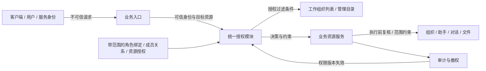
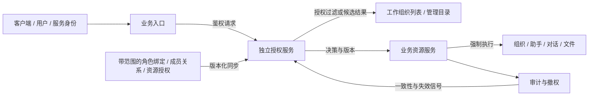

**状态：待评审设计提案。** 本文描述建议的目标架构，不代表当前版本已经实现或生产权限已经调整。

## 设计结论

建议采用方案 2：带作用范围的角色授权、明确的资源协作关系、少量强制条件，以及统一的应用内授权模块。租户代表客户，组织代表该客户内的部门或业务单元；这是本提案采用的目标业务语义。角色模板可以共享，授予某人角色时必须绑定范围。

本文是待评审设计，不是已实施方案。我们不通过现有 ALL*ORG*\* 枚举推导正确产品规则，也不把“当前账号看到了全目录”当成跨部门业务数据已被访问的证明。

## 方案概要

我们比较三个真实选择：方案 1「分层角色与入口补强」、方案 2「统一范围授权模块」、方案 3「独立授权服务」。方案 1 适合快速收紧已知入口；方案 2 在同一产品内统一规则和执行契约；方案 3 适合多个独立服务需要共享授权事实与一致性协议的阶段。

我推荐以方案 2 为目标，并保留方案 1 的临时收紧措施。它解决的是角色与范围混在一起的结构问题，同时避免立即引入授权网络服务。我们应先稳定产品授权语义，再根据跨服务规模和实际性能决定是否走向方案 3。

## 背景与设计输入

本提案以产品的目标业务语义为依据，不从现有角色名称或权限枚举推导应有授权。组织目录现象只是识别范围歧义的背景；以下设计不能被当作已经发布的安全保证。

| 编号 | 设计输入                 | 对设计的约束                                                                                               |
| ---- | ------------------------ | ---------------------------------------------------------------------------------------------------------- |
| E1   | 产品权限架构重设计       | 必须明确动作、角色、授权范围和业务资源边界，而不只是更名权限。                                             |
| E2   | 单组织成员获得全租户目录 | 既有场景中，一个账号仅加入一个组织，但共享管理员角色可以扩大目录范围；成员关系与客户治理职责需要分开表达。 |
| E3   | Xpert 业务资源与代理执行 | 需要区分助手编排、运行、会话、文件、项目、插件控制面和委托执行。                                           |
| E4   | 组织代表客户内部部门     | 租户对应客户，组织对应客户内部的部门或业务单元；不同客户需要隔离。                                         |

E2 描述一个已观察到的目录行为，不证明该账号能够访问所有其他组织的业务数据。我们据此识别成员身份、管理范围和数据访问混淆的风险；其他接口仍须独立验证。

设计原则参考 [NIST ABAC 定义](https://csrc.nist.gov/pubs/sp/800/162/upd2/final) 对主体、对象、操作和环境属性的区分，以及 [OWASP 授权指南](https://cheatsheetseries.owasp.org/cheatsheets/Authorization_Cheat_Sheet.html) 的默认拒绝、逐请求验证和最小权限。这些原则不替代产品对客户内部岗位职责的定义。

## 现有问题与失效模式

先前观察中，一个租户范围的角色标志扩大了账号看到的组织目录。对于真正的客户管理员，这可能符合业务需求；对于一个部门的管理员，范围就过大。因此我们需要修正身份与授权表达，而不能简单规定“任何管理员都只能看自己的部门”或“任何管理员都能看全部部门”。

另外，看到部门名称、进入部门工作台、管理部门成员、使用一个已发布助手、读取别人的对话是不同操作。将这些操作折叠成查看或编辑两个标志，会让目录接口的规则被误用到其他业务入口。

## 目标规则与授权模型

我们首先确定以下可验证规则：

- 客户之间隔离。组织、用户组、工作区、项目和资源授权都必须归属于明确客户；客户端提交的范围只表示目标选择，不构成授权。
- 角色授予带范围。A 部门管理员身份不能与 B 部门读者身份拼接，获得 B 部门编辑权；必须有一条完整授权路径同时匹配主体、动作、资源和范围。
- 角色绑定可作用于租户、部门、工作区、项目或单个资源。父子关系只表达归属；是否继承由具体动作的策略明确规定。
- 默认拒绝。系统硬约束与明确禁止优先于允许；资源归属、主体状态和有效期不能被共享关系绕过。
- 部门目录可见、工作台可进入、业务资源可访问分别计算。列表、搜索、计数、详情、导出和实时推送使用相同规则。
- 管理容器不自动获得私密内容；普通权限管理员不能通过给自己加角色绕过这条规则。
- 人工委托、助手工具调用、后台任务、服务账号和用户请求遵循同一客户边界和资源授权语义。
- 撤权具有明确、可测的生效上限；敏感写入不能仅凭过期缓存继续执行。

### 业务层级与身份

建议使用：平台 → 租户（客户）→ 组织（部门或业务单元）→ 工作区、项目 → 业务资源。工作区与项目是不同容器，不要求所有资源组成一棵单继承树。每个资源有唯一的归属客户与必要的归属部门，其他关系负责协作授权。

平台运营人员属于平台管理身份；客户账号通过 TenantMembership 加入客户，同一账号可分别加入多个客户。部门成员关系与 RoleBinding 分开记录：加入部门不等于成为管理员；角色可以通过部门内用户组授予，也可以对具体人员授予。

子部门不自动继承父部门的全部权限。确需分管整个部门树时，授予明确的组织子树范围，并逐类规定继承动作。已有子部门和未来新建子部门是否包含，应在授权界面明确展示。

### 动作与范围分别表达

Permission 只定义可执行动作；RoleDefinition 把动作组织为岗位模板；RoleBinding 把角色授予某个主体并绑定范围、期限与必要条件。

| 例子          | 角色及动作     | 授予范围   | 结果                                                     |
| ------------- | -------------- | ---------- | -------------------------------------------------------- |
| 甲负责采购部  | 部门管理员     | 采购部     | 管理采购部资料、成员及允许转授的角色                     |
| 甲参与工程部  | 部门成员       | 工程部     | 进入工程部，按资源分享使用助手和项目                     |
| 甲担任评审人  | 项目审阅者     | 某投标项目 | 读取该项目允许审阅的资料，不取得整个部门的管理权         |
| 乙负责客户 IT | 客户治理管理员 | 当前客户   | 管理该客户的部门体系、账号与治理策略，不自动读取个人对话 |

我们应弃用含义宽泛的 ALL_ORG_VIEW 和 ALL_ORG_EDIT 作为新授权模型的基础。建议拆分为 organization.read、organization.update、organization.members.manage、organization.roles.assign、organization.enter，以及客户范围的 organization.create、organization.directory.read。最后两个动作分别作用于客户这个父容器与其组织目录；它们不自动授予其他组织操作。

需要“管理客户全部部门”时，给客户治理角色显式配置必要组织动作，并以该客户的所有部门作为覆盖范围。无需把“所有”写进每一个动作名称。一个动作是否允许租户范围绑定，必须由权限定义声明，不能任意扩大。

“有权查看的组织”是策略计算出来的集合，不应成为没有定义的授权依据。普通工作台按 organization.enter 返回部门；企业通讯录可以按客户政策显示部门名称，但受限部门可以隐藏，且目录读取不授予进入、成员管理或业务内容读取。

### 岗位角色与数据权限

| 角色模板                   | 管理范围                         | 默认业务内容权限                               |
| -------------------------- | -------------------------------- | ---------------------------------------------- |
| 平台运营管理员             | 部署、客户生命周期、运行状态     | 不默认读取客户内容；有界支持访问另行授予       |
| 客户所有者                 | 本客户治理、管理员授予、组织架构 | 不因身份自动读取个人私密对话                   |
| 客户治理管理员             | 本客户组织、成员、策略等明确能力 | 需数据职责或资源授权才能读取业务内容           |
| 部门管理员                 | 明确部门及明确授予的子部门       | 管理部门设置和成员；私密内容不自动开放         |
| 工作区管理员 / 设计者      | 指定编排工作区                   | 按职责设计、发布助手，不自动读取所有使用者对话 |
| 项目负责人 / 成员 / 审阅者 | 指定项目                         | 按项目角色和内容可见性访问项目资料             |
| 助手使用者                 | 指定助手或受众集合               | 运行已发布助手；不自动编辑助手或读取他人对话   |
| 数据审计员                 | 有界数据类别与范围、必要有效期   | 读取获明确批准的审计内容；独立留痕             |

客户内可以跨部门协作：工程部成员可被加入采购部的某个投标项目，获得该项目权限；无需加入采购部管理员角色。跨部门用户组也可以被授权到明确项目，但组成员和资源必须在同一客户边界内。跨客户共享如果未来需要，使用显式访客/共享协议，不能放宽所有客户边界检查。

部门管理员的 roles.assign 必须附带“可转授角色集合”和最大范围；不能给自己授予客户管理员、平台身份或受控审计能力。客户治理角色与业务数据审计角色的兼任应显式配置并留痕。若产品承诺管理员无法自助获取个人内容，就必须同时限制修改这类保护规则和自助授予审计权限；只隐藏读取按钮无法实现此承诺。

组织删除、客户所有权转移、最后一位所有者移除、批量数据导出应单独定义高风险动作。它们不由模糊的 edit 权限自动推导。

### Xpert 资源策略

助手至少区分 discover、run、configure、publish、share。被加入助手使用群体的人可以运行已发布助手，无需成为编排工作区成员。设计者修改或发布助手，也不会自动获得所有使用者的对话记录。

会话区分个人、显式共享、项目共享、部门共享等声明的可见性；共享范围由可信服务保存，不能由客户端临时覆盖。个人会话默认仅本人及明确参与者可读；关联某项目不应在未声明项目共享时自动改变可见性。

文件区分用户运行空间、助手共享空间、项目空间及编排素材。每类空间分别定义 read、write、delete、share；助手 run 角色是否同时获得共享空间读写，应由产品角色模板显式声明，而不是文件入口自行推测。附件、搜索、知识检索、记忆检索、导出和下载链接都遵守资源权限；后台检索不得先跨范围取回再仅在界面隐藏。

插件安装属于平台或客户控制面，插件启用、业务授权和连接器使用分别处理。安装一个系统插件不能给插件作者或调用者读取客户所有数据的权利。凭据的 use 与 secret.read 分开，普通业务运行应由平台代理使用凭据而不是返还明文。

人工发起的代理调用，其可执行范围由当前执行人的授权、委托凭证上限、助手/应用允许的能力和工具策略共同约束。每次读取目标资源或产生副作用时都重新授权，子代理不得获得更大范围。后台自动化若需脱离用户在线会话运行，应使用事先授权、独立审计的服务身份；不能在用户离职后悄悄退化为系统管理员继续运行。

### 数据与决策契约

逻辑模型包括 Principal、TenantMembership、OrganizationMembership、GroupMembership、RoleDefinition、RoleBinding、ResourceRelation/Grant、Delegation 和 AuditEvent。RoleDefinition 是可复用模板，不在 user.roleId 上存放用户唯一且全局的业务身份。

统一决策以 principal、action、resource、context 为输入。服务端从可信登录和资源归属解析客户/部门；客户端所选部门只作为约束校验。决策满足：主体有效、资源边界有效、至少一条完整允许路径成立、无匹配禁止规则、执行所需条件满足。产品套餐与配额检查是额外门槛，不产生数据权限。

需要同时提供 authorize（单对象）、authorizeMany（批量）、授权列表过滤和 explain（受控的授权来源说明）。拒绝理由可以记录在服务端审计中，普通调用者不应因此获知隐藏资源是否存在。不能通过先分页后过滤来实现授权列表，也不能让 count、聚合、搜索建议、文件下载或 WebSocket 订阅绕过范围。

写操作中的资源迁移、授权变更、成员移除应在一致的事务/版本条件下检查，防止检查后资源被换部门。批量操作须检查每个对象，并定义全成功或部分失败契约。

## 约束与非目标

我们先满足“客户—内部部门”模型，不讨论把每个部门机械拆成独立租户。若存量数据把不同客户放进同一个技术租户，后续必须单独清理客户归属；仅修复角色名不能补齐真正的客户隔离。

本提案不意味着数据库迁移、线上角色重命名或共享 ADMIN 权限变更已经实施，也不预设所有客户都必须采用同一审批流程。支持访问、审计职责和高风险转授权的条件是设计建议，具体体验需要产品决策。

我们没有真实负载的延迟、内存或撤权预算。下文所有性能判断是架构推断，不是测量结果。应用权限也不等价于能抵御具有数据库或宿主机最高权限的运维人员；若需此级别隔离，应另行设计密钥和基础设施职责分离。

## 改造前的授权边界

下图概括上述目录行为与业务资源各自检查的边界，不表示全部资源接口都已审计。

同一角色标志同时影响目录覆盖范围，容易让产品使用者把“管理员”理解成一个普适身份。我们要让“角色动作”和“覆盖范围”在数据模型和界面中都可见。

## 备选方案

### 方案 1：分层角色与入口补强

我们保留分散在各业务入口的鉴权方式，拆开客户管理员和部门管理员，在组织目录、切换、详情、成员管理等已知入口加显式检查。这个方案最适合发布窗口短、必须先止住目录范围扩张的情形；对调用协议和运行拓扑的影响最小。

它的限制是每个入口仍需要自行理解范围与继承，新加的搜索、导出和插件入口仍可能出现不同解释。单次请求可以不新增网络跳转，内存通常只增加少量成员/角色数据，但反复查询成员关系也可能使列表出现 N+1 查询；这些判断都需要压测。

我们可以按入口逐步发布，保留可审查的账号映射和审计记录。回退只能回到仍受范围限制的兼容路径，不能恢复旧的全组织兜底。它足以解决已知目录问题，却不能作为长期覆盖代理执行、项目协作和所有资源类型的统一保证。

| 变化     | 改造前           | 改造后                      | 安全影响                   | 成本               |
| -------- | ---------------- | --------------------------- | -------------------------- | ------------------ |
| 目录检查 | 通用全组织标志   | 明确客户/部门角色与成员检查 | 限制目录范围扩大           | 多入口改造         |
| 控制归属 | 业务入口各自判断 | 仍各自判断但补齐检查        | 已知入口可收紧，后续易分叉 | 持续审查与回归测试 |

### 方案 2：统一范围授权模块

这个方案保留现有服务部署，在产品内部建立统一授权模型与模块。每个业务服务仍拥有资源和业务约束，但必须通过同一个角色、范围、关系和条件契约决策。我们把“判断能不能做”集中，把“在实际资源读写位置执行限制”保留在业务服务，避免只检查网关而让后台任务绕开。

角色模板可由平台提供，客户自定义角色只能组合被允许的动作及范围。授权模型版本化；新插件注册新的资源类型和动作时，需要声明支持的授予范围、继承规则、敏感级别和可转授性。未知动作默认拒绝。策略变更需要验证和可追踪发布，不能由一个任意 JSON 权限对象随请求注入。

我认为这个方案的主要收益是减少控制漂移，同时可以用关系表和受限策略表达覆盖目前的组织、项目和助手模型。查询入口由授权模块生成受控查询条件或批量决策，而不是每行独立远程调用。代价是需要建立统一资源目录、授权数据表、权限缓存和业务入口适配；一个错误的共同策略也可能扩大影响，因此必须具备版本、影子判定和负向契约测试。

运行上先采用进程内模块，不新增鉴权网络服务。关系查询与索引、批量结果及缓存仍会消耗资源，我们需要对大量部门、深层组关系和大项目列表测量 p95/p99 延迟、查询数、缓存命中、内存及撤权传播。缓存键必须包含客户、主体、动作、资源和相关成员/策略版本，不能只按角色名称缓存。

撤权通过共享版本或失效事件传播到全部 API 实例，定义可测的最大生效时间。敏感操作读取足够新的权威状态；无法确认时拒绝敏感操作。长任务在重要读取和副作用前重验，实时订阅收到撤权后关闭。权限服务内部故障不能自动切换到旧的更宽授权。

迁移时双读/影子比较、单写新授权数据，避免两个系统都能独立授予新权限。我们可按资源类型启用新执行器；若回退，回到先前安全策略版本或关闭未适配的敏感入口，而不是退回裸角色检查。

| 变化       | 改造前             | 改造后                           | 安全影响                     | 成本               |
| ---------- | ------------------ | -------------------------------- | ---------------------------- | ------------------ |
| 授权表达   | 账号角色与权限位   | 主体＋角色＋范围＋关系＋条件     | 减少跨部门拼接和隐式扩权     | 角色绑定与关系迁移 |
| 目录与数据 | 容易共用全组织标志 | 目录、进入、资源动作分别决策     | 目录权限不会自动转成内容权限 | 列表与详情契约改造 |
| 执行位置   | 入口和服务自行解释 | 统一决策，资源边界强制执行       | 覆盖后台与插件入口           | 业务服务适配       |
| 撤权       | 无统一设计保证     | 权限版本、失效传播、重要动作重验 | 明确陈旧授权窗口             | 缓存协议与观测     |

我们仍需逐个接入执行点。存在统一 authorize 函数，并不能证明所有导出、下载、检索和后台任务都调用了它；这也是逐类验收不可省略的原因。

### 方案 3：独立授权服务

在保持方案 2 产品语义的基础上，我们把策略和关系决策放到独立授权服务。它适合多个独立部署、不同语言团队需要统一决策的阶段，也可以为批量授权、集中解释和跨服务策略升级建立独立所有权。

这个方案的安全收益来自共同模型与强制执行契约，而非多一个网络服务本身。调用方仍需提供可信资源属性并执行返回的约束，关系同步错误仍可能错误授权。我们必须设计写入后的可见性、撤权一致性令牌、候选列表过滤和服务故障时的拒绝策略，否则集中服务会引入新的陈旧权限窗口。

每次远程判断可能增加网络和序列化成本，批量接口与有界缓存可以减轻开销，但会增加一致性复杂度。服务及索引副本会增加内存和运维负担；服务故障还可能影响所有依赖它的业务。具体产品或引擎尚未做基准，本提案不据此指定某一产品。

它可在方案 2 之后通过相同决策契约影子接入。回退时切到同版本的本地策略实现，前提是其授权事实足够新；无法满足时，应暂停受影响操作。若未来独立服务规模显著增长，这种独立发布与治理能力可能值得额外成本；目前我们缺少必须立即引入它的证据。

| 变化     | 改造前       | 改造后               | 安全影响                   | 成本                 |
| -------- | ------------ | -------------------- | -------------------------- | -------------------- |
| 决策归属 | 各业务入口   | 独立统一授权服务     | 多服务共享策略语义         | 新可用性依赖         |
| 授权事实 | 业务关系散落 | 版本化关系同步与索引 | 可集中审计，需处理一致性   | 同步、撤权协议、运维 |
| 执行点   | 每个业务服务 | 仍在每个业务服务     | 不能以网关检查替代资源检查 | 客户端适配及失败处理 |

## 方案对比

下面是预期方向，没有任何一项被当作测量值。评审应关注成本的来源，而不是给三个方案打一个缺乏依据的总分。

| 维度           | 方案 1：入口补强               | 方案 2：统一模块                   | 方案 3：独立服务               | 验证方式                                          |
| -------------- | ------------------------------ | ---------------------------------- | ------------------------------ | ------------------------------------------------- |
| 安全与剩余风险 | 已知入口改善，规则分叉仍在     | 语义集中，遗漏执行点仍需治理       | 多服务集中，关系同步是新风险   | 同一正负用例跨入口执行                            |
| 性能与延迟     | 无新网络跳转，可能重复查询     | 关系查询与批量过滤；可进程内决策   | 网络调用与序列化，需批量与缓存 | 对比同一列表/详情/代理负载的 p95/p99 和 DB 查询数 |
| 内存与资源     | 少量局部缓存，重复结构         | 共享策略、关系索引与有界缓存       | 额外服务、索引副本和客户端缓存 | 记录 RSS、索引大小及高基数主体缓存规模            |
| 可用性与隔离   | 故障分散，行为不一致           | 策略错误影响更广，需版本和渐进发布 | 新中心服务故障可扩大影响       | 注入超时、断连、陈旧版本及实例切换                |
| 运维与可解释性 | 入口日志分散                   | 决策原因、版本、来源统一           | 另需服务监控与同步观测         | 验证每次拒绝/敏感允许可追溯                       |
| 兼容与迁移     | 快，但容易成为永久补丁         | 需角色绑定映射与逐入口适配         | 还需服务协议和授权事实迁移     | 影子差异及旧客户端契约测试                        |
| 开发一致性     | 依赖开发者记住规则             | 类型化契约和领域策略使遗漏更易发现 | 跨语言需维护客户端和模型契约   | 新资源接入测试、未知动作拒绝                      |
| 回退           | 可按入口回退，但不能恢复宽授权 | 回退安全策略版本或限制功能         | 回退同版本本地引擎，否则暂停   | 演练新拒绝不因回退变成允许                        |

方案 2 的安全、可解释性方向为改善，置信度中等，依据是设计机制推断；性能和内存方向尚未确定。方案 3 的额外网络与运行进程成本可预期，但金额、耗时和吞吐不可从架构图得出。方案 1 的迁移成本预计最低，但长期维护成本未必最低。

## 推荐方案

我推荐方案 2，并把租户定义为客户、组织定义为客户内部部门写入产品契约。我们可以先通过既有服务和数据库建立统一授权模块，不必同时更换数据库或引入独立策略服务。

客户治理管理员应能够按明确授权查看或管理本客户全部部门；一个部门的管理员则仅管理自己的绑定范围。客户部门通讯录可以有独立的可见性策略。个人会话与敏感业务数据不能因目录或组织管理权限自动开放。

仅有几条局部入口、发布极紧张时，方案 1 是合理过渡；多语言独立服务与集中政策治理成为主要成本后，再评估方案 3。这里的决定应跟随产品与运维约束，而不是某个权限库的功能列表。

## 需求覆盖与剩余风险

| 证据                      | 方案 1             | 方案 2                         | 方案 3                     | 迁移期措施                                   |
| ------------------------- | ------------------ | ------------------------------ | -------------------------- | -------------------------------------------- |
| E1 — 架构重设计需求       | 缓解，缺乏统一表达 | 解决所述建模目标               | 解决所述建模目标           | 先冻结产品语义和权限词汇                     |
| E2 — 单成员获得全租户目录 | 已知目录路径可解决 | 用范围和目录动作解决结构原因   | 同方案 2，增加集中决策     | 个别账号分类复核，不能批量升格或误改共享角色 |
| E3 — 资源与代理执行需求   | 部分缓解，易分散   | 以统一契约覆盖，逐入口验收     | 以共享服务覆盖，逐入口验收 | 保留现有有效资源检查，禁止兼容兜底扩权       |
| E4 — 客户内部部门语义     | 可以表达基本分层   | 可表达跨部门协作与明确治理权限 | 同方案 2                   | 核实存量客户和部门归属                       |

“解决”描述目标设计覆盖，不表示已经实施。入口遗漏、授权事实错误、客户错误映射、DBA 权限、第三方系统自身权限、模型生成不可信工具参数等风险仍需各自控制。

## 迁移与发布

先复核存量账号究竟承担客户治理还是部门管理职责。旧 ADMIN 不能统一映射为客户管理员，也不能未经核对一概降为普通成员；共享角色可能有多个使用者，应逐账号建立新范围绑定。原 ALL*ORG*\* 不应直接复制成宽范围新授权；来源不明的授权待核实期间采用可解释的受限状态。

随后启用新角色定义与绑定，先影子判定已知业务请求，比较允许和拒绝差异。影子阶段不执行新增权限。已确认的组织目录问题在过渡期间仍需收紧，不能以等待新体系为由放任。

灰度从组织目录、进入与成员管理开始，再覆盖助手使用/编排、项目/会话/文件、检索/导出，最后覆盖服务身份、插件与长任务。每个阶段同时检查列表、详情、写入和异步入口；关闭对应旧授权分支，避免新旧并集产生额外权限。

撤权要同步清理缓存、会话授权版本、资源链接和后台委托。签名下载链接需定义不可撤销窗口，敏感内容优先使用在线授权代理或短有效期。回滚不恢复已确认过宽的授权，必要时暂时停止对应管理动作。

## 验证计划

产品验收至少包括：同一人 A 部门管理员/B 部门读者；客户管理员查看全部本客户部门但不默认读取个人对话；跨客户猜测资源标识；项目定点跨部门共享；助手受众用户无编排工作区成员资格也可正常运行；设计者不能自动读取他人会话；部门管理员不能自升格或自授审计身份。

入口验收覆盖组织目录、选择器、详情、统计、搜索、聚合、下载、导出、WebSocket、任务执行、插件和子代理。资源父容器变化与授权变更应并发测试，确认检查后资源移动不产生跨范围写入。权限被撤销后，对多 API 实例、缓存、长连接与排队任务验证实际生效时间。

性能使用同一数据集和授权分布，对比改造前基线与候选：冷/热缓存，少量/大量部门，单对象/批量对象，深层用户组，常规/敏感写入。记录 p50/p95/p99、DB 查询次数、CPU、RSS、索引大小及撤权传播。上线前由团队约定可接受预算；禁止未经测量承诺“无开销”或预设提升百分比。

新模型的业务授权正负用例必须全部符合产品矩阵；无法判定、失效主体、未注册动作和失效委托必须拒绝。灰度中发现原允许、新拒绝时区分真实回归和应纠正的过宽权限，不能一律为兼容恢复允许。

## 实施工作范围

这里列出设计落实范围，不表示已经选定并开始实施：明确租户/组织/资源语义与角色矩阵；定义权限动作、支持范围和转授规则；建立授权事实与统一决策契约；适配目录与各业务执行点；实现委托、撤权和解释；逐账号迁移并完成跨入口验收。正式实施计划应在选择方案后结合当时源码版本细化。

## 待决策事项

已确认组织代表同一客户内部的部门或业务单元。仍需产品决定：客户内部门目录是否默认公开；哪些资料属于个人私密、项目共享或企业受托管理；客户治理和数据审计是否允许同人兼任及其条件；存量 Default Tenant 是否实际包含不相关客户；撤权与授权延迟的验收预算。本文按“工作台只显示可进入部门，目录另行授权，个人会话默认私密”给出可执行默认值。
