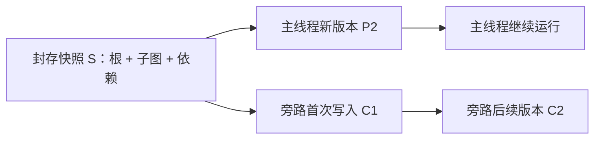

**状态：待实施设计提案。** 本文记录共享 checkpoint 的目标架构。当前旁路实现仍将最近封存回复的 checkpoint 依赖闭包复制到子线程；本提案不表示引用存储已经实现、迁移或部署。

## 目标与当前行为

目标是在主线程持续运行时，以最近一次完整封存的回复创建旁路，避免为每个旁路线程重复复制历史 checkpoint 内容。建议采用共享封存快照与子线程独立写入新版本的模型。

现有 `POST /api/ai/threads/:thread_id/copy` 的 `mode: 'latest-sealed-reply'` 已表达正确的业务边界：创建新的 thread，共享所选消息的祖先路径，保留主线程运行状态，并通过 `requestId` 重试去重。`parentThreadId` 表达来源关系，不会让 LangGraph 自动继承父线程状态。

目前 `SideChatForkService` 选择并校验消息封存点，随后调用 `copyBranchCheckpoints()` 复制根 checkpoint、子图和祖先依赖，重绑定平台身份。新线程不继承 pending writes、排队输入、运行控制、审批或正在执行的 Goal。前端入口和 API 可以保持这一语义，底层存储再从复制演进为共享引用。

第一阶段限于同一 conversation 内的旁路线程。跨 conversation 的独立分叉、父线程单独删除但保留子线程、消息或 channel 级增量存储，以及工作目录快照均不包含在本阶段。

## 现有存储约束

| 位置                                                          | 当前行为                                                              | 改造要求                                                  |
| ------------------------------------------------------------- | --------------------------------------------------------------------- | --------------------------------------------------------- |
| `copilot-checkpoint/checkpoint-saver.ts`                      | 按 thread、namespace、checkpoint ID 查找；整体序列化内容并 upsert     | 区分逻辑地址与不可变内容版本，统一解析继承状态            |
| `copilot-checkpoint/copilot-checkpoint.service.ts`            | 管理 API 另有读取与 upsert 路径                                       | 与 Saver 使用同一版本及引用规则                           |
| `chat-conversation/message-checkpoint.service.ts`             | 根图完成时扫描本线程物理行，固定子图边界，最终回复落库后封存          | 捕获本地与继承的有效 namespace 边界                       |
| `chat-conversation/conversation-branch/branch-checkpoints.ts` | 遍历 `parent_id` 和 `metadata.parents`，复制内容并重绑定身份          | 提取可复用的依赖解析与状态投影；保留旧复制路径            |
| `ai/commands/handlers/thread-delete.handler.ts`               | 按线程删除 checkpoint；主线程删除整个会话，有子分支的非主线程禁止删除 | 释放所有权及引用后再判断物理内容是否可回收                |
| `copilot-checkpoint/retention.service.ts`                     | 保护消息封存锚点、同 namespace 祖先、运行控制和输入锚点               | 纳入跨线程引用和跨 namespace 依赖，处理建立引用与清理并发 |

以上路径均相对 `packages/server-ai/src/`。历史编辑、暂停恢复和执行状态查询也存在直接读取 checkpoint 的路径，必须一起审计，不能只改 `getTuple()`。

现有“封存”是业务边界：消息内容与路径校验值能证明回复对应的历史，但不是 checkpoint 字节不可修改的数据库保证。Saver 和管理 API 都允许 upsert；运行时也存在子图保存语义。因此不应直接把所有 upsert 改成拒绝更新，而应先分离可更新的逻辑映射与不可变内容版本。

## 建议的数据模型

以下名称描述职责，不是已经落库的表结构。所有记录均携带可信租户、组织及必要的 conversation 范围。

| 概念                       | 保存内容                                                                                  | 生命周期                                               |
| -------------------------- | ----------------------------------------------------------------------------------------- | ------------------------------------------------------ |
| `CheckpointObject`         | 唯一内容版本 ID、序列化格式及版本、状态与 metadata 字节、完整性校验值                     | 发布后不可修改；无保留引用且到期才可删除               |
| `ThreadCheckpointEntry`    | 线程逻辑地址 `(threadId, namespace, checkpointId)` 到内容版本的映射，以及可查询的依赖关系 | 线程独立维护；同一逻辑地址的后续保存不能改写旧内容版本 |
| `SealedCheckpointSnapshot` | graph revision、根和各 namespace 的固定边界、所需内容版本及依赖闭包                       | 完成校验后原子发布，不再修改成员                       |
| `ThreadSnapshotReference`  | 子线程对快照的引用、分叉消息及创建请求身份                                                | 与子线程创建同事务登记；删除线程时释放                 |

快照成员引用具体内容版本，而不是会随父线程推进的逻辑地址。依赖关系需要能被数据库查询和约束，不能只藏在序列化 metadata 或 thread JSON 内。关联使用外键保护被引用内容；跨范围引用必须拒绝。

`parentThreadId` 保留业务来源信息，不作为内容生命周期的唯一所有者。内容校验值用于完整性和可选的范围内去重，不构成授权凭证，不要求跨租户内容去重。

图中两条路径共享 S，后续新版本分别属于各自线程。新 checkpoint 仍可包含完整状态；本提案不承诺 channel 或消息字节级增量保存。

## 创建、读取和首次写入

### 创建与幂等

1. 沿源线程 head 的祖先路径选择最近一次封存回复，校验消息、路径和 graph revision；不读取正在生成的回复作为边界。
2. 固定根及所有 namespace 的内容版本和依赖。首次将旧数据转换为不可变版本时只转换一次；后续分叉复用同一快照。
3. 在受控事务内重验边界和权限范围，登记子线程、快照引用及幂等结果。与删除、清理使用一致的锁顺序；不得出现子线程已提交但快照未被保护的窗口。
4. 网络结果未知时使用相同 `requestId` 返回原子线程，不再次登记引用或改变选定快照。重复请求不得重复增加引用计数。

持久化请求结果应具有唯一约束，作用域延续现有源线程、conversation 和请求身份规则。同一标识改变分叉模式必须冲突。若支持线程删除后的延迟重试，需要保存有期限的删除结果记录，避免旧请求重新创建已删除的线程；期限应随重试窗口明确配置。

### 统一读取

解析器首先确定请求的逻辑 namespace 和 checkpoint 地址，再读取本地映射或快照中明确允许的继承版本。无 checkpoint ID 时，每个 namespace 读取本地当前状态或其固定继承边界；不能回退到父线程最新状态。显式读取历史 checkpoint 也只能命中该线程允许的历史依赖。

向 LangGraph 返回的 `config`、`parentConfig` 和相关引用必须使用子线程逻辑身份。当前 Saver 会返回物理行的 `thread_id`，直接复用父行将使运行配置携带父线程身份，需要在解析层消除这种歧义。

对独立反序列化的状态执行已有平台身份投影：重绑定 `sys.thread_id`，按现有策略清除 session 路径和 pending follow-ups，保留模型消息、tool-call/result 配对和不透明业务值。不能原地修改共享缓存对象，也不能把父线程 pending writes 带入子线程。不可迁移的知识任务等限制继续生效。

封存捕获必须合并子线程的本地 namespace 与继承边界。历史编辑、执行详情、状态查询、再次分叉和暂停恢复使用统一解析能力；暂停产生的私有写入仍按本线程读取。已有 `list()` 未提供完整历史枚举，不能假定它已覆盖上述需求。

### 首次写入及再次分叉

`put()` 为子线程保存新的内容版本和逻辑映射，`putWrites()` 始终写入子线程自己的空间。即使 pending writes 先于新 checkpoint 落库，或首次运行失败并重试，也不能写到父线程或重复恢复父线程任务。

首次写入不是全线程“脱离父快照”的原子切换：根 namespace 可能已经有本地版本，某些子图仍依赖继承状态。历史编辑和后续分叉也可能需要旧依赖，因此不能在首次写入后自动释放引用。要释放这些依赖，需另行定义可验证的历史截断或快照压缩规则。

从旁路再次分叉时，将有效依赖解析到实际内容版本，避免形成无限递归的父线程读取链。共享相同内容版本，但保持每个线程独立的身份投影和授权范围。

## 隔离边界

- 主线程继续写入不会改变已发布快照；子线程只看见选定封存边界及自己的后续状态。
- thread head、执行租约、`runControl`、取消、暂停恢复、审批、Goal 和输入队列继续独立。建立引用不触发暂停、取消、重放工具或发送新消息。
- 引用不是权限。入口继续检查 conversation contribute 权限和 Assistant 范围，内部解析验证租户、组织、conversation 与允许的快照成员；不得接受客户端指定任意物理内容版本。
- 工作文件、文件资产、长期记忆和 sandbox 保持各自现有的共享及授权模型。checkpoint 共享不会复制、回滚或隔离外部副作用。
- graph revision、消息内容及路径验证继续生效；新增内容完整性校验不能代替这些业务校验。

## 删除与回收

| 操作                                   | 建议规则                                                                    |
| -------------------------------------- | --------------------------------------------------------------------------- |
| 删除旁路线程                           | 清理私有运行状态，释放线程和消息所持引用；共享内容有其他保留引用时继续存在  |
| 删除有子分支的非主线程                 | 第一阶段保留现有禁止规则；单独开放需要同时处理消息树与执行关联              |
| 删除主线程或整个 conversation          | 保持现有删除整个线程族的语义，统一释放引用后回收无引用内容                  |
| 单独删除父线程但保留子线程             | 属于后续产品能力；需保留共享消息历史、快照及展示依赖，不能只留下 checkpoint |
| 删除一个 checkpoint 或通过底层命令删除 | 使用同一引用检查；不得绕过引用保护直接按 `thread_id` 批量删除内容           |

删除事务应与运行认领、分叉和清理协调，避免删除中的线程继续产生新引用或写入。实体级 cascade、管理 API、命令和后台入口均需审计；仅修改公开删除接口不够。

现有 retention 的候选筛选发生在删除事务之前。引用模式必须在删除事务内重新判断可回收性，并通过明确锁协议或外键限制，保证“新引用提交”和“内容删除”至多一个成功；清理任务之间的 advisory lock 不能代替这一保护。

保留根包括既有消息输入/输出锚点、有效运行恢复状态，以及新增的线程快照引用。沿显式关系保护根、子图及所有必要依赖。内容同时满足无保留引用和保留期限才可回收；pending writes 按所属线程和运行恢复需求单独清理，不能与共享内容混用所有权。

引用表及依赖可达性是事实来源，引用计数可以作为优化但不能是唯一依据。发布快照失败留下的未引用对象通过可控宽限期回收。需要观测无引用对象、被引用阻止清理的字节数、最老引用年龄、解析失败和清理重试；不记录消息正文、密钥或 checkpoint 内容。

## 改造范围与收益

| 范围                                      | 工作量判断         |
| ----------------------------------------- | ------------------ |
| 数据模型、迁移、不可变版本发布、引用约束  | 大                 |
| Saver 与管理 API 统一读取、身份投影、写入 | 大                 |
| 封存捕获、历史编辑、子图恢复和再次分叉    | 中到大             |
| 删除、retention、并发引用与恢复           | 大                 |
| 旁路创建和持久化幂等结果                  | 中                 |
| SDK、前端入口及 API 语义                  | 小，可保留当前契约 |

整体是后端存储层的中等偏大重构。主要收益是避免每次分叉重复序列化和写入整个 checkpoint 依赖闭包。首次构建快照仍需解析、校验依赖；只有复用已发布快照后，创建旁路才可能接近固定数量的元数据写入，不能将整个流程一概称为 O(1)。

后续 checkpoint 仍可能整体保存完整历史，因此本方案不消除运行中每一步快照的内容重复。共享引用也可能延长历史内容保留时间；应比较实际保留字节和创建耗时，不能只比较线程数量。

## 迁移与发布顺序

1. 增加内容版本、快照及引用关系，支持旧物理行与新版本读取；旧线程和已复制分支继续可用。
2. 在关闭新引用分叉开关时部署统一解析器、不可变发布、删除和 retention 保护，并验证所有实例及后台任务已升级。
3. 将封存点按需转换为快照，保留旧校验；原子发布后才能作为共享引用目标。无需一次性复制或改写全部历史。
4. 以同 conversation 的旁路为首个启用范围，保留 API mode、requestId、错误契约和前端行为，观察创建延迟与存储变化。
5. 稳定后再评估独立 conversation 分叉、旧数据压缩、父线程独立删除和更细粒度去重。

关闭新分叉开关只能阻止新增引用，不能让已有引用线程恢复成旧存储。回滚至不支持引用的服务前，必须将仍存活的引用线程物化，并校验其子图和历史依赖；否则保留兼容读取与清理能力。旧服务或清理任务不能与已启用引用的数据无保护地混跑。

## 验收要求

- 使用真实 LangGraph 验证主线程运行时分叉：继承 H1/A1，不包含正在执行的 H2，父子独立继续且不重放旧工具。
- 覆盖多 namespace、嵌套子图、本地与继承状态混合、历史编辑、再次分叉及图版本变化。
- 验证父逻辑地址被再次写入时已发布快照字节不变；未知结果重试不重复创建内容、线程或引用。
- 使用隔离 PostgreSQL schema 验证创建引用与清理、删除与分叉、首次写入与删除并发；验证事务失败无悬空引用，外键与唯一约束实际生效。
- 验证子线程删除、整个 conversation 删除、历史消息软删除、引用释放及到期回收；无首次写入的长期旁路仍能恢复。
- 验证租户、组织和 conversation 越界拒绝，执行详情和暂停恢复不泄露父线程新状态或 pending writes。
- 对比长对话及多个旁路的复制字节、创建延迟、查询次数和清理耗时，记录相同数据规模下的结果。

本提案未运行引用存储的性能或 PostgreSQL 并发实验。此前复制方案的测试结果不能替代这些验收，也不能作为共享方案已部署的证据。
