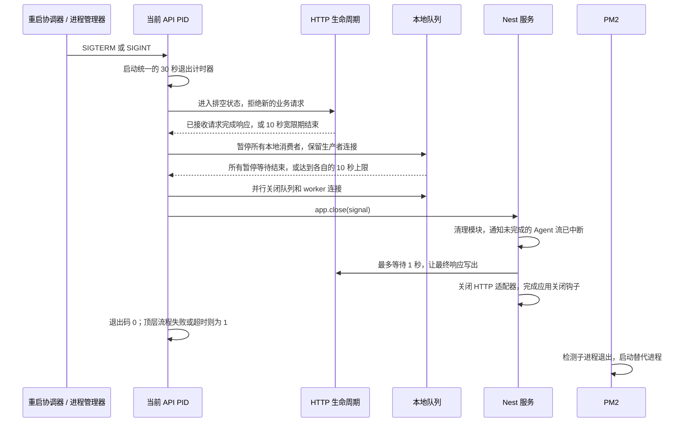

# 优雅退出当前 API 服务进程

Xpert 可以主动退出当前 Node.js API 进程，由进程管理器启动替代进程。这项能力用于应用插件运行时变更和执行协调式 API 重启，同时为已接收的请求、后台任务和资源清理提供有时间上限的完成机会。

仓库中的 Docker Compose API 服务通过 `pm2-runtime main.js` 启动。API 主动重启时，会向自己的 PID 发送信号，执行关闭流程并退出；随后由 PM2 启动新的 Node 进程。Docker 的容器重启策略作用于容器层面，API 子进程的替换由 PM2 负责。

## 功能范围与职责

| 组件                                             | 职责                                                                                         |
| ------------------------------------------------ | -------------------------------------------------------------------------------------------- |
| `RuntimeRestartCoordinatorService`               | 协调各副本的重启和插件状态收敛，排空选中的副本，再请求发送 `SIGTERM`。                       |
| `enableRuntimeShutdown`                          | 确保信号只触发一次关闭流程，启动进程退出计时器，执行准备阶段和 Nest 清理，最终退出当前 PID。 |
| `prepareApiShutdown` / `RuntimeLifecycleService` | 拒绝新的业务请求，在操作队列前等待已接收的 HTTP 请求完成响应。                               |
| `RuntimeQueueShutdownService`                    | 发现本地消费者，等待所有消费者完成排空等待，再关闭其队列或 worker 连接。                     |
| Nest 生命周期钩子 / `runShutdownStep`            | 释放各服务持有的资源，为等待设置时间上限并记录清理过程。                                     |
| PM2                                              | 检测子进程退出，并按照配置的重启策略启动替代进程。                                           |

HTTP API 和专用 worker 的启动入口都会注册 `enableRuntimeShutdown`。专用 worker 没有 HTTP 监听服务，因此其准备阶段直接从队列的统一排空等待开始。

本功能不保证所有业务任务都能在退出前完成，也不提供持久化 SSE 重放、任务恰好执行一次的保证，或替代进程启动时插件加载失败的自动修复能力。

## 触发退出

滚动重启协调器调用注入的 `RUNTIME_PROCESS_SIGNALER`，其生产实现使用 `process.kill(process.pid, signal)`。协调器请求发送 `SIGTERM`。统一的退出处理器也处理 Nest 支持的其他退出信号，包括 PM2 通常用于受控停机的 `SIGINT`。

业务集成应使用已有的运行时控制能力，避免另行注册信号监听器或直接调用 `process.exit()`：

- 交互式重启通过 `POST /api/system/runtime/restart` 发起，请求中包含 `confirmation: "RESTART"`。它要求 Default 租户中的交互式 SuperAdmin 会话，协调的是所有活跃 API 副本，而不是提供一个公开的单 PID 终止接口。
- 插件运行时变更通过 `RuntimeControlService.recordPluginRuntimeChange()` 或 `recordPluginRuntimeRequirements()` 进入已有的状态收敛协调流程。
- 常规停机时，外部进程管理器可以向 API 进程发送受支持的退出信号。

上述启动入口使用 `enableRuntimeShutdown` 替代 Nest 的 `app.enableShutdownHooks()`。两者同时注册会产生相互竞争的关闭路径。直接调用 `app.close()` 不会启动进程退出计时器；生产环境的退出流程必须经过统一处理器。

## 退出时序



上图描述的是 PM2 仍在运行时的主动重启路径。主动停止 PM2 或容器时，不保证会在同一个容器中启动替代进程。如果任意阶段达到进程退出期限，Xpert 会直接向 stderr 写入最终诊断信息，并以退出码 `1` 结束进程。

### 1. 等待已接收的 HTTP 请求完成

`RuntimeDrainMiddleware` 跟踪已接收的请求，直到响应触发 `finish` 或 `close`。同一响应可能同时触发这两个事件，因此释放请求计数的回调必须幂等。健康检查路由不受此请求准入限制；进入排空状态后，`/api/health/ready` 返回 `503`，并包含 `status: "draining"`。

到达中间件的新业务请求会收到 `503`、`errorCode: "RUNTIME_DRAINING"`、`Retry-After: 5` 和 `Connection: close`。已接收的请求最多有 10 秒完成响应。在此期间，队列的生产者**和消费者**都保持可用：请求可能先查询数据库再提交任务，也可能需要等待任务结果才能响应。

即使协调器此前已经执行过滚动重启的排空等待，也不能跳过这一步。如果此前的等待超时，退出信号到达时仍可能存在活跃 HTTP 请求。长连接 SSE 响应也计入活跃请求，可能用完这段宽限期。

### 2. 所有本地消费者结束排空等待后，再关闭队列

发现机制识别由 Nest 提供的 Bull 队列和 BullMQ `WorkerHost` 实例，并按对象身份去除 provider 别名带来的重复项。Bull 使用 `pause(true)` 执行本地暂停；BullMQ 暂停本地 worker。其他副本仍可继续消费任务。

所有暂停操作并行执行。在每个暂停等待都完成、失败或超时之前，不会关闭任何已发现的队列。这个统一等待点保护了当前空闲的队列：另一个队列正在运行的任务，可能仍需要向它写入回调或后续任务。

越过统一等待点后，并行执行关闭操作，每个关闭等待最多 3 秒。`close(true)` 避免再次无限等待正在运行的任务。对于 BullMQ，此阶段关闭的是已发现的 worker；单独持有的生产者由其所属模块的生命周期管理。

暂停消费不会清空 Redis 中积压的待执行任务，这些任务可以留给其他消费者或替代进程处理。等待超时不会取消任意任务中的 JavaScript 执行；如果任务依赖另一个已在本地暂停的消费者，也可能耗尽宽限期。任务处理器仍需具备合适的幂等、重试和业务取消机制。参见[托管队列](/zh-hans/guides/managed-queue)。

### 3. 执行 Nest 清理并写出中断通知

准备阶段完成后，`app.close(signal)` 按 Nest 生命周期执行模块销毁、`beforeApplicationShutdown`、适配器关闭和应用关闭钩子。

模块销毁期间，`AgentChatRealtimeService` 向未完成的流发送终止性的中断事件，结束其 Observable，并关闭专用 Redis 订阅连接。随后，`RuntimeLifecycleService.beforeApplicationShutdown()` 最多等待 1 秒，让被跟踪的响应触发 `finish`。这一步很关键：Nest 会异步序列化并写出最后一条 SSE 消息，仅结束 Observable 并不代表响应数据已经写出。

HTTP 启动入口设置了 `forceCloseConnections: true`，因此在最终写出宽限期结束后，残留 socket 不会无限阻塞适配器关闭。如果客户端、网络或进程退出期限阻止了最后一次写入，中断通知只能尽力送达。

其他有等待上限的清理包括实例心跳与注销、专用 Pub/Sub 订阅连接、插件销毁钩子、旧版 MCP 会话、沙箱运行时注销，以及显式创建的 PostgreSQL 连接池。每个命名操作都会记录开始和结果日志。没有单独包裹的 Nest 或第三方清理操作，仍受进程级总退出期限约束。

### 4. 退出旧 PID

第一个信号建立关闭 Promise 并启动退出计时器。后续信号复用同一个关闭操作，不会重新执行清理，也不会延长时间预算。

- **退出码 `0`：** 准备阶段和 Nest 关闭流程成功返回。某些资源清理失败或超时可能已记录日志并被容忍，因此不能据此认定所有任务或资源都已完成处理。
- **退出码 `1`：** 准备阶段失败、Nest 关闭失败，或达到进程退出期限。如果准备阶段失败，不会在其尚未安全结束时继续启动 Nest 销毁流程。

处理器在清理后显式退出进程，避免残留句柄让旧 PID 一直存活。替代进程是否就绪、插件状态是否收敛，由重启协调器另行检查。出现新 PID 本身不能证明所需插件已经加载。

## 时间预算

| 等待项                   | 当前预算  | 所属逻辑与含义                                                             |
| ------------------------ | --------- | -------------------------------------------------------------------------- |
| 整个进程退出流程         | 30,000 ms | `RUNTIME_SHUTDOWN_TIMEOUT_MS`，从接收到第一个信号开始计时。                |
| HTTP 准备阶段            | 10,000 ms | `HTTP_SHUTDOWN_DRAIN_TIMEOUT_MS`，在暂停队列之前等待。                     |
| 队列排空                 | 10,000 ms | `drainShutdownQueues` 的默认值，所有消费者并行等待。                       |
| 单个资源关闭             | 3,000 ms  | `SHUTDOWN_STEP_TIMEOUT_MS`，包括队列关闭和已包裹的资源清理钩子。           |
| 最终 HTTP/SSE 响应写出   | 1,000 ms  | `RuntimeLifecycleService.beforeApplicationShutdown`，属于 Nest 关闭阶段。  |
| 协调器提前执行的副本排空 | 30,000 ms | `DEFAULT_DRAIN_TIMEOUT_MS`，发生在向自身发送信号之前，不计入进程退出预算。 |

这些数值是当前代码默认值，不是环境变量配置。`enableRuntimeShutdown` 接受 `timeoutMs` 选项，供其他启动入口或测试使用；常规 API 和 worker 启动入口使用默认值。修改某个阶段的预算时，需要同时检查总预算和外部进程管理器的超时配置。

进程级计时器贯穿所有阶段，不会在进入 Nest 关闭或执行每个插件时重新计时。顺序执行的资源等待可能耗尽剩余时间，因此后续钩子不一定能得到执行。除非资源自身提供取消机制，否则 Promise 超时后，其对应操作仍会继续执行。

## Agent 流中断协议

共享协议定义位于 `packages/contracts/src/runtime-control.ts`：

```text
event: runtime-interrupted
data: {"code":"RUNTIME_RESTARTING","message":"The service is restarting and the live reply was interrupted. The task may still be running. Refresh the conversation to check its result."}

```

消息文本会根据创建流时保存的请求语言进行本地化。消费端应根据事件名和 `code` 判断行为，不应依赖消息文本。

服务端在发出该事件**之前**，先将流标记为已结束。客户端可能在处理事件时立即取消订阅；此时的清理不能发出业务取消命令，因为任务可能仍在其他进程中继续执行。普通客户端断开连接时的取消逻辑保持不变。

Web 客户端的 `fetchEventSource` 包装层校验该事件后，抛出 `RuntimeStreamInterruptedError` 并中止传输。已有的聊天错误处理会展示中断信息，避免在收到 EOF 时把未完成的回复标记为成功。它不会自动重连或重放原始 POST，以免再次提交任务。刷新会话用于查看已持久化的结果，并不保证自动恢复流订阅。

部署时，后端协议与对应的 Web 传输处理逻辑需要一同更新。自定义 SSE 消费端也需要实现相同的终止事件处理。

## Debug 日志与排障

### 开启和收集日志

在 **API 容器环境**中设置 `LOG_LEVEL=debug`，例如通过 Compose 覆盖配置：

```yaml
services:
  api:
    environment:
      LOG_LEVEL: debug
```

仓库中的 API Compose 服务也通过 `env_file` 读取 `.env`。只要没有被显式的 `environment` 配置覆盖，在 `.env` 中设置 `LOG_LEVEL=debug` 同样有效。通过正常容器部署流程使环境配置生效；仅编辑环境文件不会改变已经运行的 Node 进程。Nest 和 Pino 都读取此配置，`LOG_LEVEL=verbose` 也包含 debug 日志。排障结束后，如果不再需要额外输出，可以恢复通常使用的日志级别。

在部署所用的目录和 Compose 项目中，同时收集 stdout 与 stderr；根据实际部署调整服务名 `api` 和 Compose 文件参数：

```bash
docker compose logs --since 15m --timestamps api
docker compose logs --since 15m --timestamps api | rg 'runtime\.(restart|shutdown)\.'
```

正常生产日志使用 Pino JSON 格式。这些事件会序列化到 `msg` 字符串中，不一定是 Pino 日志的顶层字段。最终退出超时诊断会绕过常规日志传输，直接同步写入 stderr，格式为独立的一行 JSON。检索时需要兼顾这两种形式。进程即将退出时，常规缓冲日志只能尽力送达。

结合容器或主机名、时间戳和 `pid` 关联日志，不同容器中的 PID 数值可能重复。协调器审计事件还会按需包含 `restartId`、副本标识和启动标识。`instance-unregister-started` 将退出中的 PID 与注册信息中的 `instanceId`、`bootId` 关联起来。退出诊断记录阶段元数据和计数，不记录请求正文、聊天内容或凭据。

### 预期日志事件

下表中的事件名均带有 `runtime.shutdown.` 前缀。仅运行 worker 时，准备阶段不会出现 HTTP 事件；在 Nest 生命周期的同一阶段内，各服务钩子的日志可能交错出现。

| 事件                                                 | 级别            | 含义                                                                            |
| ---------------------------------------------------- | --------------- | ------------------------------------------------------------------------------- |
| `handlers-installed`                                 | DEBUG           | 当前 PID 已注册退出处理器，包含支持的信号、进程退出超时值以及是否存在准备阶段。 |
| `started`                                            | INFO            | 信号已到达处理器，并启动全局计时器。                                            |
| `signal-ignored`                                     | DEBUG           | 重复信号复用了已经启动的退出流程。                                              |
| `drain-entered`, `drain-cancelled`                   | DEBUG           | 本地请求准入状态发生变化；也可能在收到退出信号之前，由协调器触发。              |
| `http-drain-started`, `http-drain-finished`          | DEBUG           | HTTP 准备阶段的请求数、宽限期、等待结果和耗时。                                 |
| `idle-wait-started`, `idle-wait-finished`            | DEBUG           | 一次具体的请求排空等待，包括提前执行的滚动重启排空；包含活跃请求数和等待结果。  |
| `http-drain-timeout`                                 | WARN            | HTTP 准备阶段宽限期结束时，仍有已接收的请求尚未完成响应。                       |
| `queues-discovered`                                  | DEBUG           | 通过 Nest 发现的 Bull 队列数和 BullMQ worker 数。                               |
| `queue-drain-started`, `queue-drain-finished`        | DEBUG           | 队列名称、宽限期、耗时以及每个暂停操作的结果；结束事件表示已到达统一等待点。    |
| `queues-closed`                                      | DEBUG           | 所有关闭等待已结束；需检查各项是否失败或超时，不能据此保证所有连接均已关闭。    |
| `queues-already-closing`                             | DEBUG           | 调用方复用了已有的队列关闭操作。                                                |
| `nest-close-started`                                 | DEBUG           | 准备阶段结束，开始 Nest 关闭；包含剩余的进程退出预算。                          |
| `agent-streams-interrupting`, `agent-streams-closed` | DEBUG           | 被跟踪的流和订阅连接数量，以及中断清理等待的完成情况。                          |
| `agent-stream-rejected`                              | DEBUG           | 较晚到达的流订阅在启动新任务之前就被中断。                                      |
| `response-flush-started`, `response-flush-finished`  | DEBUG           | 最终响应写出的宽限期、剩余请求数以及是否排空。                                  |
| `instance-unregister-started`                        | DEBUG           | 实例注册标识，以及是否仍有进行中的心跳写入。                                    |
| `redis-close-started`                                | DEBUG           | 指定订阅连接采用本地 `disconnect`，还是回退到 `quit`。                          |
| `step-started`                                       | INFO            | 某个命名资源的等待开始，并设置其独立超时值。                                    |
| `step-finished`                                      | INFO / WARN     | `completed` 使用 INFO；`failed` 或 `timed_out` 使用 WARN，并记录耗时。          |
| `step-error`                                         | WARN            | 清理操作的错误信息；`afterTimeout` 用于区分是否在等待超时后才失败。             |
| `step-settled-after-timeout`                         | DEBUG           | 操作在其等待超时之后才返回，包含实际结果和耗时。                                |
| `prepare-aborted`                                    | DEBUG           | 准备阶段未完成，跳过 Nest 清理，以退出码 `1` 结束进程。                         |
| `finished`                                           | INFO            | Nest 关闭等待已结束，包含即将使用的退出码和总耗时。                             |
| `deadline-exceeded`                                  | 直接写入 stderr | 强制退出诊断，包含 PID、信号、耗时、超时值和仍在等待的步骤。                    |

命名步骤包括 `runtime.prepare-close`、`nest.application-close`、`queue.<name>.drain`、`queue.<name>.close`、`plugin.<class>.destroy`、`instance-registry.heartbeat`、`instance-registry.unregister` 和 `database.pool.end`。嵌套步骤与并行步骤可能同时出现在日志中。

资源清理辅助函数也用于普通流或会话的清理。单独出现 `step-*` 或 `redis-close-started` 事件，并不代表整个进程正在退出；需要查找同一 PID 的 `started` 事件。

### 定位最后执行到的阶段

| 观察到的现象                                                                 | 排查方向                                                                                                                                                  |
| ---------------------------------------------------------------------------- | --------------------------------------------------------------------------------------------------------------------------------------------------------- |
| 协调器记录了 `runtime.restart.replica-signaling`，但没有退出流程的 `started` | 确认信号目标 PID 正确、已部署的启动入口注册了处理器，以及收集的日志覆盖该副本。检查事件循环阻塞或外部终止是否导致信号未被处理。                           |
| 出现 `http-drain-started`，但尚无对应结束事件                                | 检查 `activeRequests` 和已消耗的宽限时间。持续的 SSE 流可能使此阶段一直等待到超时。                                                                       |
| 出现 `queue-drain-started`，但尚无对应结束事件                               | 查找尚未结束的 `queue.<name>.drain` 步骤，检查活跃任务，以及它们是否依赖其他已暂停的消费者。                                                              |
| 出现 `nest-close-started`，但没有 `finished`                                 | 检查各资源步骤的开始和结果日志。插件、Redis 关闭、实例注册操作、MCP 会话或数据库连接池可能正在消耗剩余预算。                                              |
| `response-flush-finished` 中的 `drained: false`                              | 某些响应没有在最终宽限期内完成，适配器关闭时会终止其 socket；这些客户端可能收不到中断通知。                                                               |
| `deadline-exceeded` 中只有 `nest.application-close`                          | 阻塞点可能位于尚未单独记录的 Nest 或第三方钩子。为对应清理操作添加命名且有时间上限的步骤，以缩小范围。                                                    |
| 某步骤已超时，但不在 `pendingSteps` 中                                       | 这是预期行为：该列表记录当前仍在等待的步骤，而不是所有仍在执行的操作或未关闭句柄。查找该步骤之前的警告及之后可能出现的结束事件。                          |
| 旧 PID 已退出，但替代进程没有就绪                                            | 检查 PM2 状态、重启策略、启动错误和插件状态收敛情况。此时问题已经超出旧 PID 的退出流程。                                                                  |
| 日志停止，且没有退出超时诊断                                                 | 检查 PM2/Docker 强制终止、OOM 事件、stderr 是否丢失，以及事件循环是否阻塞。JavaScript 计时器无法抢占同步 CPU 计算、阻塞的原生调用，也无法处理 `SIGKILL`。 |

## PM2 与 Docker 集成

主动重启要求 PM2 保持运行，并允许子进程自动重启，包括以正常退出码 `0` 结束的情况。本地开发应使用项目的文件监听器或进程管理器；单独运行 `node main.js` 时，进程退出后不会自行启动。

应用内部的退出计时器覆盖向自身发送信号的路径。PM2 的 `kill_timeout` 控制由 PM2 发起的停止或重启；使用这条路径时，需要为应用清理预留足够时间。参见 [PM2 优雅退出文档](https://pm2.keymetrics.io/docs/usage/signals-clean-restart/)。

Docker 可以在 `stop_grace_period` 到期后独立强制终止正在停止的容器。容器宽限期应大于进程管理器允许的关闭时间，并保留运维余量。参见 [Compose 停止宽限期](https://docs.docker.com/reference/compose-file/services/#stop_grace_period)。

### 部署前必须配置外部停止宽限期

要让普通部署停止或重启也保留完整的清理窗口，必须显式配置 PM2 和 Compose 的停止宽限期，并验证实际生效的值。对于当前实现，使用以下部署配置：

| 层级           | 配置                          | 时间  |
| -------------- | ----------------------------- | ----- |
| API 进程       | `RUNTIME_SHUTDOWN_TIMEOUT_MS` | 30 秒 |
| PM2            | `kill_timeout: 35000`         | 35 秒 |
| Docker Compose | `stop_grace_period: 45s`      | 45 秒 |

保持 `应用退出期限 < PM2 停止超时 < 容器停止宽限期`。修改应用退出期限时，需要同步调整外部时间预算。仓库中的 Compose API 命令目前使用 `pm2-runtime main.js`，没有显式设置上述两项外部宽限期；本功能不会自动应用这些部署配置。

2026-10-11 的本地 Docker Compose + PM2 7.0.4 验收中，执行 `pm2 restart main` 时，PM2 确实在等待 1600ms 后发送了 `SIGKILL`。这会截断应用清理，也可能使 `finished` 或 `deadline-exceeded` 日志来不及输出。该现象与 [PM2 文档描述的默认停止行为](https://pm2.keymetrics.io/docs/usage/docker-pm2-nodejs/#enabling-graceful-shutdown)一致。应用的 30 秒退出计时器无法阻止外部提前强杀。

同次验收中，插件变更触发的自身 `SIGTERM` 路径已通过，包括异步清理永久等待时的 30 秒兜底退出。这个结果不能替代对 `pm2 restart` 和容器停止路径的验收。

### 配置示例

在仓库根目录下创建 `.deploy/api/ecosystem.config.json`，为每个 API 容器保留一个 Node 进程：

```json
{
  "apps": [
    {
      "name": "main",
      "cwd": "/srv/xpert",
      "script": "main.js",
      "exec_mode": "fork",
      "instances": 1,
      "autorestart": true,
      "watch": false,
      "stop_exit_codes": [],
      "kill_timeout": 35000
    }
  ]
}
```

在仓库根目录的 Compose 配置中，将以下设置合并到现有 `api` 服务，保留已有环境变量和卷挂载：

```yaml
services:
  api:
    command: ['pm2-runtime', '/srv/xpert/ecosystem.config.json']
    stop_grace_period: 45s
    volumes:
      - ./.deploy/api/ecosystem.config.json:/srv/xpert/ecosystem.config.json:ro
```

配置文件必须先创建，再挂载进容器；也可以通过镜像构建复制到相同容器路径。按照部署流程重新创建 API 容器，使 Compose 命令、挂载和停止宽限期生效。仅修改文档或重启旧 PM2 进程，不等于应用了这些配置。

### 验证配置生效

1. 检查运行中 PM2 应用的 `kill_timeout` 为 `35000`、`autorestart` 为 `true`，且正常退出码 `0` 未列入 `stop_exit_codes`；检查容器的 `Config.StopTimeout` 为 `45` 秒。
2. 在隔离环境中分别验收插件安装触发的自身退出、`pm2 restart main` 和 Compose 容器停止。使用耗时超过 1.6 秒但仍在应用预算内的清理操作，确认旧 PID 退出前没有被 PM2 提前 `SIGKILL`；另行注入异步挂起，确认应用约 30 秒的退出兜底能执行。
3. 对重启路径确认新 PID、就绪检查、插件加载状态和实际版本；容器停止路径应正常停止，不要求自动恢复。记录日志与实际配置，不能仅凭容器运行或安装接口成功判断验收通过。

## 扩展与接入约束

1. 只在启动入口注册一次退出处理，并保持顺序：HTTP 宽限等待、所有消费者统一排空等待、关闭队列、Nest 清理。其他队列仍在排空时，不能提前关闭空闲队列。
2. 将资源所有权保留在明确注入的具体服务中。可能阻塞的清理操作使用 `@xpert-ai/server-core` 导出的 `runShutdownStep`，并使用稳定的资源或操作名称，不包含秘密信息或请求负载。
3. 先停止接收新工作，再等待进行中的工作：清除定时器，暂停领取任务。实例注销必须保留启动标识比较，防止旧进程的清理误删替代进程的注册信息。
4. 将超时视为等待结束，不要当作操作已经取消。如果后续清理依赖操作真正完成，应使用资源明确提供的取消机制，或将依赖保留到进程退出。
5. `closeRedisSubscriber` 仅用于专用 Pub/Sub 客户端。其他排空操作仍需要共享生产者或 Redis 命令客户端时，不能提前断开它们。
6. 在 Nest 发现机制之外创建的 worker，需要显式接入生命周期。如果它们会写入已发现的队列，必须将其排空纳入同一个生产者关闭前的统一等待点；仅使用 `onModuleDestroy` 钩子，对这种依赖关系来说已经太晚。
7. 新增流式接口时，保留明确的流中断语义和最终响应写出等待。不要为了恢复中断订阅而自动重放会修改状态的请求。

例如，持有网络客户端的服务可以为其释放钩子设置等待上限：

```ts
import { Injectable, OnModuleDestroy } from '@nestjs/common'
import { runShutdownStep } from '@xpert-ai/server-core'
import { ConnectorClient } from './connector-client'

@Injectable()
export class ConnectorService implements OnModuleDestroy {
  constructor(private readonly client: ConnectorClient) {}

  async onModuleDestroy(): Promise<void> {
    await runShutdownStep('connector.client.close', () => this.client.close())
  }
}
```

这个包装提供超时和诊断能力，服务自身仍需定义安全的客户端关闭行为并停止其生产者。插件开发者应在 `onPluginDestroy` 中释放插件持有的资源，宿主会为每个这样的钩子设置等待上限。插件销毁钩子在统一的进程退出期限内顺序执行。

## 源码位置与验证

| 功能                           | 仓库源码                                                                                                                             |
| ------------------------------ | ------------------------------------------------------------------------------------------------------------------------------------ |
| 进程退出期限与退出操作         | `packages/server/src/runtime-control/runtime-shutdown.ts`                                                                            |
| HTTP 准备阶段与最终响应写出    | `packages/server/src/runtime-control/runtime-shutdown-preparation.ts`、`runtime-lifecycle.service.ts`、`runtime-drain.middleware.ts` |
| 队列统一排空等待               | `packages/server/src/runtime-control/runtime-queue-shutdown.service.ts`                                                              |
| 资源等待期限与超时后的结束处理 | `packages/server/src/runtime-control/shutdown-step.ts`                                                                               |
| HTTP 与 worker 启动入口        | `apps/api/src/bootstrap/index.ts`、`apps/api/src/bootstrap-worker.ts`                                                                |
| Agent 流中断                   | `packages/server-ai/src/handoff/agent-chat-realtime.service.ts`、`packages/contracts/src/runtime-control.ts`                         |
| Web 流处理                     | `apps/cloud/src/app/@core/services/fetch-event-source.ts`                                                                            |
| 日志级别配置                   | `packages/server/src/logger/pino-logger.ts`                                                                                          |

针对性测试覆盖排空期间的跨队列写入、HTTP 请求稍后提交任务、真实 Node 进程向自身发送信号、清理卡住时的退出期限、通过 HTTP 送达 SSE 中断事件、前端错误处理，以及超时后才结束的清理操作。真实进程测试使用 Nest 和 HTTP，并用隔离的队列及 Redis 替身代替外部服务，因此不依赖生产基础设施，也不能证明生产环境的 Redis 或 PM2 配置正确。

在仓库根目录执行：

```bash
corepack pnpm exec jest --config packages/server/jest.config.ts --runInBand --runTestsByPath \
  packages/server/src/runtime-control/runtime-shutdown.spec.ts \
  packages/server/src/runtime-control/runtime-shutdown-preparation.spec.ts \
  packages/server/src/runtime-control/runtime-queue-shutdown.service.spec.ts \
  packages/server/src/runtime-control/runtime-lifecycle.service.spec.ts \
  packages/server/src/runtime-control/shutdown-step.spec.ts

corepack pnpm exec jest --config packages/server-ai/jest.config.ts --runInBand --runTestsByPath \
  packages/server-ai/src/handoff/agent-chat-realtime.service.spec.ts

corepack pnpm exec jest --config apps/cloud/jest.config.ts --runInBand --runTestsByPath \
  apps/cloud/src/app/@core/services/fetch-event-source.spec.ts

corepack pnpm exec tsc --project apps/api/tsconfig.app.json --noEmit --incremental false
```

部署验收还需观察旧 PID 退出、PM2 启动替代 PID、就绪状态恢复，以及所需插件的实际加载状态。应分别验证主动重启和部署中的常规外部停机路径，因为它们受到的进程管理器超时约束不同。
